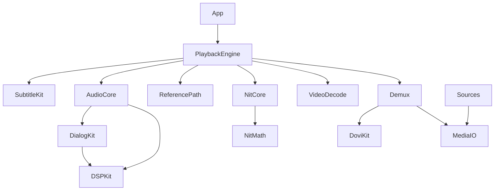

# 02 — Çözüm ve Teknik Mimari

> **Aşama:** 2 / 3 · **Ajan:** `cozum-ajani` · **Tarih:** 25 Ekim 2026 · **Durum:** kullanıcı onayı bekliyor
>
> **Girdiler (bağlayıcı):**
> - `docs/00-brief.md`
> - `docs/01-konsept.md` rev. 5: MVP 10 özellik; M10 boost dahil. Rev. 5 ile sahne bazlı `L_ref` MVP'de ve M2'nin parçası (§3.5.1).
> - `docs/01b-ek-fikirler.md`: N1 Temiz Nit MVP'de ve M2'nin parçası; N2 Ses Çekirdeği v1.1'in ilk işi
> - `docs/03-tasarim.md` (onaylı) ve `docs/01-konsept.md` rev. 6. Uyum turu: oynatma hızı (§4.10), elle altyazı gecikmesi (§4.11), S0'ın tasarımla hizalanması (§10.1) ve tasarım geri bildirimlerine yanıtlar (§14, G-01–G-20).
>
> **İşaretler:**
> - **[doğrulandı]**: Apple dokümantasyonu, WWDC oturumu, iOS 27 sürüm notu ya da kaynak koduyla teyit edildi.
> - **[doğrulanmalı]**: İkincil kaynak, forum raporu ya da çıkarım. Spike ile teyit edilecek.
> - **[ölçülmeli]**: Yalnızca cihazda ölçülerek bilinebilecek bir değer.
>
> **Bağlayıcı kurallar:**
> - M2 Nit Çekirdeği 1 numaralı özelliktir.
> - **Uygulama parlaklığı hiçbir koşulda kendiliğinden düşürmez.** Yalnızca sistemin verdiği headroom değişimine uyar.
> - OCR, çeviri ve otomatik altyazı senkronu kapsam dışıdır.
> - Derleme Mac olmadan, GitHub Actions macOS runner'ında yapılır. Hesap ücretli Developer hesabıdır. Hedef: iOS 27.0.1, iPhone 11 Pro.

---

## 0. Yönetici özeti

### 0.1 Ana mimari kararlar

1. **Tek özel oynatma motoru.** Yerel, SMB, Jellyfin ve Plex dosyalarının hepsi aynı motordan geçer:
   - Demux: FFmpeg `libavformat` (LGPL, dinamik bağlı). ISO ve BDMV için `libbluray` + `libudfread`.
   - Çözme: Donanımda VideoToolbox. Yazılımda FFmpeg ve dav1d.
   - AVPlayer yalnızca sunucunun HLS akışları için kullanılır.
2. **Aynı motorda iki görüntü yolu:**
   - **Nit:** Kendi Metal çekirdeğimiz → `CAMetalLayer` (RGBA16Float, extended linear Display P3, EDR, `edrMetadata = nil`).
   - **Referans:** Sıkıştırılmış örnekler → `AVSampleBufferDisplayLayer`. Sistemin HDR10, HLG ve Dolby Vision işleyişi kullanılır.
3. **Nit eğrisi headroom'a (`H`) normalize edilmiş, kapalı formda bir fonksiyon:**
   - SDR'da beyaz = `H`.
   - HDR'da "Maksimum" modunda beyaz = 0,95 `H`, "Dengeli" modunda 0,75 `H`.
   - Vurgular log uzayında üstel bir omuzla sıkıştırılır. Çıkış hiçbir zaman `H`'yi aşmaz, yani kırpma olmaz.
   - **HDR'da referans beyaz (`L_ref`) sabit 203 nit değil, sahne bazında tespit edilir (rev. 5, MVP).** Kaynak DV'de L1, HDR10'da kendi histogramımızın P90 değeridir. Değer film çapasından en fazla ±0,5 stop sapabilir ve 80–300 nit arasında kalır (§3.5.1).
4. **Headroom takibi ve Tepe Kilidi:**
   - Headroom düşünce anında, yükselince 150 ms'de takip edilir.
   - **Tepe Kilidi**, sistem parlaklığını (`UIScreen.brightness`) **yalnızca yükseltir**: headroom dirseğine kadar. Headroom çökerse SDR tepesine kadar.
5. **Kare zamanlaması:**
   - Çekirdek ekran hızında değil, **kaynak kare hızında** çalışır.
   - Kareler `present(at:)` ile hedef vsync'e oturtulur.
   - 3:2 kadans, ses saatine kilitli bir video saatiyle seçilir.
6. **Temiz Nit (N1)** aynı komut tamponunda 0. ve 6. adım olarak çalışır. Toplam GPU bütçesi **≤ 4,5 ms / kaynak karesi**.
7. **Dolby Vision:**
   - RPU'yu `libdovi` (MIT) ayrıştırır ve P7'yi P8.1'e çevirir.
   - P5 reshaping ve IPT→RGB matematiği Metal'de kendi kodumuzla yazılır. Referans olarak ETSI GS CCM 001 ve libplacebo kullanılır; libplacebo'dan kod kopyalanmaz.
8. **Ses zinciri:** `AVSampleBufferAudioRenderer` + `AVSampleBufferRenderSynchronizer`. PCM zinciri iki evrelidir:
   - **Önden evre:** M9 diyalog ve gece modu.
   - **Geç evre:** N2 yuvası → rota profili → M10 boost → **true-peak limiter**.
   - DSP çekirdeği gerçek zamanlı thread'de güvenle çalışır ve parametreleri kilitsiz takas eder.
9. **M9:**
   - Stereoda AUSoundIsolation'ın ayırdığı ses orijinale geri karıştırılır.
   - Müzikli sahnelerde Sound Analysis'e göre otomatik olarak gevşer.
   - Çok kanallıda merkez kanal yükseltilir.
   - Yedekler: DSP ile merkez çıkarma ve DeepFilterNet3.
10. **M10 boost:**
    - Üst sınır kesin olarak +6 dB. Kazanç, zincirin sonundaki true-peak limiter'dan önce uygulanır.
    - Yüksek kayıtlı içerikte bir "boost yöneticisi" pompalamayı önler.
    - Native Atmos'ta boost açılırsa ses otomatik olarak PCM'e çözülür. DAC'ta "bit-perfect değil" göstergesi yanar.
    - Boost değeri rota başına hatırlanır.
11. **Rev. 6 eklemeleri:**
    - **Oynatma hızı 0,5×–2× (M1):** Synchronizer hızı ve renderer'ın perde koruyan `timeDomain` algoritmasıyla yapılır. İçeriğe bağlı süzgeçler medya zamanında çalışır. Native Atmos 1× dışında PCM'e çözülür (§4.10).
    - **Elle altyazı gecikmesi (M6):** Ofset medya zamanında uygulanır. Adım 50 ms, aralık ±10 s. Dosya ve parça bazında hatırlanır (§4.11).
12. **Derleme ve ölçüm:**
    - Proje XcodeGen ve SPM modülleriyle üretilir.
    - Native bağımlılıklar ayrı bir iş akışında XCFramework olarak derlenir ve sürüm varlığı olarak önbelleğe alınır.
    - İmzalı ad hoc IPA, OTA (`itms-services`) ya da Sideloadly ile yüklenir.
    - Mac olmadığı için Instruments da yok. Ölçümler **uygulama içi telemetriyle** yapılır.

### 0.2 En büyük üç risk

| # | Risk | Neden | İlk ölçüm |
|---|---|---|---|
| R1 | **Nit vaadinin film boyunca sürdürülmesi** | iOS headroom'u sistem politikasıyla veriyor. Kaydırıcıya bağlı **8×** üst sınırı var (WWDC21 **[doğrulandı]**). Forum raporlarına göre **20–40 dk** kesintisiz HDR'den sonra headroom 1'e iniyor; Photos ve AVPlayer'da da görülüyor **[doğrulanmalı]**. Isı, ABL ve Düşük Güç Modu ek sınırlar. | S0: AS-26, AS-27, AS-28 |
| R2 | **Özel hatta Dolby Vision** | DV tetiklenmesi (AS-1) ve P5 renk doğruluğu (AS-30) belgelenmemiş davranışlara dayanıyor. | S2 |
| R3 | **AUSoundIsolation'ın oynatma zincirinde kullanımı** | Tek ikincil kaynağa göre 16 kHz'de ve 58 ms gecikmeyle çalışıyor (Mac'te ölçüm) **[doğrulanmalı]**. iOS 27'de arka planda ANE erişimi entitlement istiyor **[doğrulandı]**; AUSoundIsolation'ın ANE kullanıp kullanmadığı bilinmiyor. | S4: AS-12 |

Diğer önemli riskler: native Atmos (AS-9), Mac olmadan hata ayıklama ve profil çıkarma, CI dakika maliyeti, lisans ve patentler (bölüm 12).

### 0.3 İlk spike: S0 Nit Çekirdeği

Uygulama aşamasında ilk kodlanacak şey budur. Kapsamı ve başarı ölçütleri §10.1'de.

- **Kapsam:** Tasarımdaki Nit Laboratuvarı (E-61): tek ekran, yerel SDR ve HDR10 dosyaları, headroom göstergesi, Nit/Referans geçişi, eşitlik ve tonalite testleri.
- **Bağımlılık:** Native bağımlılık yok. AVAssetReader + VideoToolbox + Metal kullanılır; FFmpeg ve libdovi gerekmez (K-31).
- **Yanında:** CI ve imza iskeleti, AS-33 (EDR çıkış zincirinde bant ve titreşim testi) ve 2 saatlik headroom kaydı.
- **Hemen ardından S0b (AS-38):** Sahne bazlı `L_ref` aynı prototip üzerine eklenir (§10.2).

### 0.4 MVP'ye önerilen netleştirmeler

Bunlar kapsam değişikliği değil; kök kısıtlardan çıkan netleştirmelerdir.

| Konu | Öneri | Gerekçe |
|---|---|---|
| M7: Jellyfin ve Plex keşfi | Jellyfin elle adres girilerek eklenir. Plex sunucuları plex.tv hesabından listelenir. SMB, Bonjour (`_smb._tcp`) ile bulunur. | Jellyfin'in UDP yayın keşfi ve Plex GDM, `com.apple.developer.networking.multicast` ister. Bu entitlement Apple onayına bağlı **[doğrulanmalı]**. |
| M1/M8: PiP | PiP'te varsayılan yol Referans'tır, yani sistemin HDR işleyişi. Nit-PiP deneysel. | PiP için `AVSampleBufferDisplayLayer` gerekir. Uygulama arka plandayken GPU kullanılamaz (§3.12). Bu bir sistem kısıtı, uygulamanın tercihi değil; arayüzde açıkça söylenir. |
| M1: AirPlay video | Özel hatta AirPlay video yok. Görüntü yalnızca ekran yansıtma ve dış ekran sahnesiyle gider. Ses AirPlay 2 ile gider. | `AVSampleBufferDisplayLayer` AirPlay video akışı yapmaz **[doğrulanmalı]**. |
| M10: Native Atmos | Boost > %100 seçilince ses PCM'e çözülür: 5.1/7.1 yatak kalır, nesneler kaybolur. | Sıkıştırılmış akışa DSP uygulanamaz. `volume` özelliği 0–1 aralığında tanımlı (§5.5). |

---

## 1. Sistem mimarisi

```
                ┌──────────── Kaynaklar (M7) ────────────┐
 Files/yerel ── │ security-scoped URL · libsmb2 (SMB2/3)  │ ── özel AVIOContext (aralıklı okuma, önden okuma)
 Jellyfin/Plex ─│ URLSession Range istekleri (direct play)│
                └───────────────────┬─────────────────────┘
                                    ▼
          Demux (libavformat · libbluray/libudfread) ──► paket kuyruğu + "GOP tutucu"
                 │ video                    │ ses                         │ altyazı
                 ▼                          ▼                             ▼
   DoviKit (RPU ayrıştır/çevir)     Ses çözme (AudioToolbox:        PGS/ASS/SRT (FFmpeg, libass)
   VideoToolbox / FFmpeg / dav1d    AAC, AC-3, E-AC-3 · FFmpeg:              │
          │            │            TrueHD, DTS-HD, FLAC…)                   │
   (Nit) CVPixelBuffer │ (Referans) sıkıştırılmış örnek                       │
          ▼            ▼                    ▼                                 │
   NitCore (Metal) ──► CAMetalLayer   PCM DSP zinciri (2 evre) ──┐           │
   (Temiz Nit, eğri,   (EDR)          ya da sıkıştırılmış Atmos  │           │
    altyazı bindirme)                                            ▼           │
          AVSampleBufferDisplayLayer ◄──── AVSampleBufferRenderSynchronizer ─┘ (ana saat = ses)
                     ▲                           ▲
                     └── PiP (AVPictureInPictureController) · AVSampleBufferAudioRenderer → sistem (uzamsal ses / AirPlay 2 / DAC)
```

- **Kontrol düzlemi:** `PlaybackEngine` actor'ü, SwiftUI arayüzü, Now Playing `MediaSession` ve kalite yöneticisi.
- **Veri düzlemi:** Adanmış thread'ler. Demux, render, ses evreleri ve gerçek zamanlı ses ayrı thread'lerde çalışır (bkz. §9.2).

---

## 2. Özellik bazlı çözüm tablosu

| # | Problem | Kök kısıt | Seçilen çözüm ve API'ler | Yedek plan | Risk |
|---|---|---|---|---|---|
| **M1** Evrensel oynatma | MKV, M2TS, ISO ve BDMV açılmalı. VC-1, MPEG-2 ve AV1 çözülmeli. 4K remux takılmadan oynamalı. | iOS'ta MediaExtension yok **[doğrulandı]**. AVFoundation MKV açmıyor. A13'te AV1, VC-1 ve MPEG-2 için donanım çözücü yok. | `libavformat` + özel `AVIOContext` · `libbluray`/`libudfread` (ana başlık, seamless branching) · `VTDecompressionSession` (H.264, HEVC Main/Main10) · FFmpeg (VC-1, MPEG-2, MPEG-4 ASP, VP9) · dav1d (AV1 ≤ 1080p) · `AVSampleBufferRenderSynchronizer` saati · Metal deinterlace · 3:2 kadans (§3.8) · **hız 0,5×–2×**: `setRate` + `timeDomain` perde koruma (§4.10, rev. 6) | VT bir HEVC akışını reddederse (4:2:2, 12-bit) FFmpeg `hevc` yazılım çözücüsüne geçilir (≤ 1080p). 4K AV1'de "desteklenmiyor" kartı ve nedeni gösterilir. | Orta (AS-3, AS-7, AS-8) |
| **M2** Nit Çekirdeği + N1 | SDR ve HDR'da beyaz ≈ 1200 nit olmalı; bant olmamalı. | Headroom'u sistem verir: kaydırıcı, 8× sınırı, ısı, Düşük Güç Modu, ABL. Panelin nit değeri public API ile okunamaz. Arka planda GPU yok. Mac yok, dolayısıyla Instruments yok. | §3'ün tamamı: CAMetalLayer EDR, `currentEDRHeadroom`, kapalı form eğri, sahne bazlı `L_ref` (DV L1 / HDR10 histogramı, rev. 5), Tepe Kilidi, `present(at:)`, Temiz Nit | Headroom çökerse Tepe Kilidi SDR tepesini korur. GPU bütçesi aşılırsa yalnızca hesap kalitesi düşer, parlaklık asla. | **Yüksek** (R1) |
| **M3** HDR ve DV | HDR10, HLG ve DV P5/P8 doğru renkte oynamalı. P7, P8.1'e çevrilmeli. | Apple, özel hatta DV tetiklemeyi belgelemiyor. VT, P7 FEL'i çözmüyor. Dolby'nin DM algoritması kapalı. | **Referans:** `dvcC`'li `CMVideoFormatDescription` + `AVSampleBufferDisplayLayer`. P7'de EL atılır, RPU `libdovi` mode 2 ile çevrilir. **Nit:** BL, VT'de düz HEVC olarak çözülür; RPU'dan çıkan reshaping ve matrisler shader'a verilir (§3.7). | Referans'ta DV tetiklenmezse HDR10 olarak oynar ve rozet "DV → HDR10" ile nedenini gösterir. Nit yolunda renk reshaping sayesinde zaten doğrudur. | **Yüksek** (AS-1, AS-2, AS-30) |
| **M4** Sinema sesi | Atmos çalmalı. TrueHD ve DTS-HD uzamsal sese aktarılmalı. Gece modu ve BT gecikme telafisi olmalı. | TrueHD ve DTS için nesne çözücü yok. E-AC-3 JOC'yi yalnızca Apple render eder. | E-AC-3 JOC sıkıştırılmış olarak `AVSampleBufferAudioRenderer`'a gider (`allowedAudioSpatializationFormats` **[doğrulandı]**). TrueHD ve DTS → FFmpeg → 7.1 PCM (açık kanal tanımlı `AudioChannelLayout`). Gece modu önden evrede DRC. | JOC Atmos olarak tetiklenmezse Apple `AudioConverter` ile 5.1/7.1 PCM'e çözülür. | Orta–yüksek (AS-9, AS-10) |
| **M5** Audiophile müzik | Bit-perfect, örnekleme hızı geçişi, gapless çalma ve loudness. | iOS mikseri her zaman yolda. Örnekleme hızı oturum düzeyinde. DAC ses seviyesi denetimi belirsiz. | `AVAudioSession.setPreferredSampleRate` (dosya hızı) · renderer'a dosyanın PCM'i, DSP bypass · R128 vDSP ile · gapless için sürekli PTS · sinyal yolu görünümü | Hız değiştirilemezse en yüksek kalitede `AVAudioConverter` kullanılır ve "bit-perfect değil" göstergesi yanar. | Orta (AS-11) |
| **M6** Gömülü altyazı | PGS, ASS ve SRT ekran çözünürlüğünde ve doğru zamanlamayla görünmeli. | AVFoundation MKV altyazılarını işlemez. ASS için Core Text yetmez. | FFmpeg `pgssub`/`dvdsub`/`ass`/`subrip` + `libass` (ISC) çıkış çözünürlüğünde · Nit'te Metal geçişinde bindirme, Referans'ta üstte SDR katmanı · `MACaptionAppearance` stili · **elle gecikme** ±10 s, medya zamanında (§4.11, rev. 6) | libass sorun çıkarırsa SRT için Core Text kullanılır. | Düşük |
| **M7** Kaynaklar | Files, SMB, Jellyfin ve Plex. | Multicast entitlement'ı Apple onayına bağlı. Files'ın SMB üzerinden aralıklı okuma performansı belirsiz. | `libsmb2` (LGPL) + `NWBrowser` `_smb._tcp` · Jellyfin REST (direct play) · Plex (plex.tv kaynak listesi + token) · URLSession aralık istekleri | Files sağlayıcısının security-scoped URL'i kullanılır. | Orta (AS-3, AS-23) |
| **M8** Sıfır ayar | İlk açılışta doğru davranış. | iOS 27 SDK'sında sahne yaşam döngüsü ve launch screen zorunlu **[doğrulandı]**. Now Playing, MediaPlayer API'leriyle karıştırılmamalı **[doğrulandı]**. | Kural motoru (parça seçimi) · CloudKit/KVS · `isIdleTimerDisabled` · Now Playing `MediaSession` · `thermalState` tabanlı kalite yöneticisi (yalnızca hesap maliyetini düşürür) | — | Düşük (AS-22) |
| **M9** AI diyalog | Fısıltı sahnelerinde diyalog anlaşılmalı. | AUSoundIsolation oynatma için tasarlanmamış olabilir. Arka planda ANE kısıtı var. | §5.4 | DSP merkez çıkarma ve DeepFilterNet3 | Orta–yüksek (AS-12) |
| **M10** Boost | En fazla +6 dB, kırpma olmadan. | Sıkıştırılmış Atmos'a DSP uygulanamaz. Bit-perfect ile çelişir. iOS kulaklık güvenliği devrede. | §5.5 | — | Düşük–orta (AS-37) |

---

## 3. M2 Nit Çekirdeği: mühendislik tasarımı

### 3.1 Sözleşme

**Değer uzayı.** EDR'de `1.0`, o anki SDR beyazıdır. Panelin o anki tepe değeri `H = UIScreen.currentEDRHeadroom` ile verilir. Apple bunu "ekranın en parlak beyazının SDR beyazına oranı" olarak tanımlıyor ve bu oranın tüm içeriği sınırladığını belirtiyor **[doğrulandı]**. Çekirdek nit değerini bilmek zorunda değildir: "beyaz = `H`" demek, "beyaz = panelin o anki tepesi" demektir.

**Kurallar:**

| Kural | İçerik |
|---|---|
| **P-1: Parlaklık düşürülmez** | Uygulama `UIScreen.brightness`'ı asla azaltmaz. Çıkış eğrisi yalnızca sistemin verdiği `H` değişimine uyar. Isı ya da GPU baskısında yalnızca hesap maliyeti düşer. |
| **P-2: Kırpma yok** | Hiçbir pikselde çıkış değeri o anki `H`'yi aşmaz. Bu sayede kompozitör kırpması olmaz. |
| **P-3: Referans bir dokunuş uzakta** | Referans modu her zaman tek dokunuşla açılır (§3.11). |
| **P-4: Arayüz SDR'da kalır** | Arayüz `1.0` değerinde çizilir. Altyazının varsayılanı `1.0`'dır; kullanıcı `1.0…H` arasında ayarlayabilir. |
| **P-5: Şeffaflık** | Sistemin aldığı her headroom kaybı HUD'da nedeniyle gösterilir. Nedenler: kaydırıcı sınırı, ısı, Düşük Güç Modu, sistemin uzun süreli HDR politikası. |

### 3.2 Hat: mantıksal adımlar ve fiziksel yürütme sırası

Konseptteki adım numaraları (1–5) korunur. N1, 0. ve 6. adımları ekler. Fiziksel sırada iki fark var:

- Ölçekleme (5) başa alınır ve **sinyal alanında**, çıkış çözünürlüğünde yapılır.
- DV için 1a eklenir.

```
VTDecompressionSession ─► CVPixelBuffer (IOSurface, Metal uyumlu; 'x420' 10-bit / '420v' 8-bit)
  (yazılım çözücüler aynı biçimde CVPixelBufferPool'dan)
        │ CVMetalTextureCache (kopyasız): Y = r16Unorm | r8Unorm · CbCr = rg16Unorm | rg8Unorm
        ▼
┌─ Geçiş A · compute · yalnızca 8-bit kaynakta ya da 10-bit'te bant dedektörü tetiklenince ─┐
│ 0  TEMİZ NİT (N1): 0a bant haritası (1/4 çöz., 32×32 karo, zamansal histerezis)          │
│                    0b algı eşiği LUT[kod, H] · 0c eşiğe bağlı dekuantalama (2–3 iterasyon)│
│    Çıkış: r16Float Y′ ve rg16Float CbCr, kesirli kod değerleri, kaynak çözünürlüğünde    │
└────────────────────────────────────────────────────────────────────────────────────────────┘
        ▼
┌─ Geçiş B · render (fragment), drawable'a doğrudan yazar · çıkış pikseli başına ────────────┐
│ 5* ÖLÇEKLEME     sinyal alanında: luma bicubic (ölçek < 1'de genişletilmiş çekirdek),      │
│                  krom konumu düzeltilmiş bilineer                                          │
│ 1  Y′CbCr → R′G′B′   aralık açma + matris (709 / 2020 NCL / 601)                           │
│ 1a (yalnız DV)       RPU reshaping (polinom/MMR) → doğrusal olmayan matris → LMS′          │
│ 2  EOTF          SDR BT.1886 · PQ · HLG (+OOTF) · DV: PQ EOTF + LMS→BT.2020                │
│                  → doğrusal ışık, beyaz-göreli (x = L / L_ref)                             │
│ 3  GAMUT         709 / 2020 / 601 → Display P3 (doğrusal 3×3) + luma-korumalı gamut sıkma │
│ 4  NİT EĞRİSİ    m = max(R,G,B); y = H_eff · f(m); RGB · (y / m)                           │
│ +  ALTYAZI       doğrusal EDR uzayında, ön-çarpımlı alfa, parlaklık s_sub ∈ [1, H]         │
│ 6  TİTREŞİM (N1) zamanla değişen mavi gürültü, ~1 LSB (AS-33'e bağlı; gereksizse kapalı)   │
└────────────────────────────────────────────────────────────────────────────────────────────┘
        ▼  commandBuffer.present(drawable, atTime: hedef vsync)
CAMetalLayer: rgba16Float · extendedLinearDisplayP3 · wantsExtendedDynamicRangeContent = true
              edrMetadata = nil · preferredDynamicRange = .high (iOS 26+) · framebufferOnly = true
```

**Neden ölçekleme başta ve sinyal alanında?**
- **Maliyet:** 4K kaynakta piksel başına renk işi kaynakta yapılsaydı 8,3 Mpx gerekirdi. Çıkışta yapılınca 2000×1125 için 2,25 Mpx, 2,39:1 içerikte 2436×1019 için 2,48 Mpx yeter. Bu yaklaşık 3,5 kat daha az ALU demek. Ayrıca 4K'da ara RGBA16F dokusu (66 MB/kare yazma) gerekmez.
- **Kalite:** 458 ppi'de, yaklaşık 0,52× küçültmede doğrusal ışıkta ölçekleme ile sinyal alanında ölçekleme arasındaki fark yalnızca çok ince yüksek kontrastlı desenlerde görülür. mpv ve libplacebo da varsayılan olarak sinyal alanında ölçekler.
- **Seçenek:** "Doğrusal ışıkta küçültme" uzman seçeneği olarak v1.1'e bırakılır.

**Neden Temiz Nit (0) ölçeklemeden önce?** Bant basamakları kaynağın kod değerlerinde tanımlıdır. Ölçekleme onları yumuşatıp dedektörü yanıltır. 01b §2.3 de böyle tanımlıyor.

### 3.3 Girdi ve normalizasyon

**Piksel biçimleri:**
- 8-bit: `kCVPixelFormatType_420YpCbCr8BiPlanarVideoRange` (`420v`).
- 10-bit: `kCVPixelFormatType_420YpCbCr10BiPlanarVideoRange` (`x420`). Örnekler 16-bit kelimenin üst 10 bitindedir (CoreVideo başlık tanımı).
- Tam aralık: `420f` / `xf20`.
- VT oturumu bu biçimleri `kCVPixelBufferMetalCompatibilityKey` ve IOSurface ile ister.

**Normalizasyon.** `v`, dokudan okunan normalize değerdir. `n` bit derinliğidir.

```
8-bit video aralığı :  Y′ = (255·v − 16)/219          C = (255·v − 128)/224
10-bit video aralığı:  kod = v·65535/64 (MSB hizalı)
                       Y′ = (kod − 64)/876            C = (kod − 512)/896
Tam aralık          :  Y′ = kod/(2^n − 1)             C = (kod − 2^(n−1))/(2^n − 1)
DV                  :  aralık bayrağı container'dan değil RPU'dan (vdr_dm_data) okunur.
```

**Krom konumu.** Konum CVPixelBuffer'ın `kCVImageBufferChromaLocationTopFieldKey` eki ya da HEVC/H.264 VUI'deki `chroma_sample_loc_type` alanından okunur.
- **Tip 0 ("sol", H.264/HEVC 4:2:0 varsayılanı):** Krom örnekleme koordinatına yatayda +0,25 krom tekseli (= +0,5 luma pikseli) eklenir.
- **Tip 2 ("sol-üst", bazı UHD kaynaklar):** Yatayda ve dikeyde +0,25 krom tekseli eklenir.

Yanlış konum, renk kenarlarında yarım piksel kaymaya yol açar.

### 3.4 Adım adım matematik ve hassasiyet

**1. Y′CbCr → R′G′B′ (NCL):**

| Matris | R′ | G′ | B′ |
|---|---|---|---|
| BT.709 (Kr 0,2126, Kb 0,0722) | Y′ + 1,5748 Cr | Y′ − 0,1873 Cb − 0,4681 Cr | Y′ + 1,8556 Cb |
| BT.2020 NCL (Kr 0,2627, Kb 0,0593) | Y′ + 1,4746 Cr | Y′ − 0,1646 Cb − 0,5714 Cr | Y′ + 1,8814 Cb |
| BT.601 (Kr 0,299, Kb 0,114) | Y′ + 1,4020 Cr | Y′ − 0,3441 Cb − 0,7141 Cr | Y′ + 1,7720 Cb |

BT.2020 CL çok nadirdir; desteklenmez ve teşhis kartında "desteklenmiyor → Referans" olarak gösterilir.

**1a. DV reshaping (P5 zorunlu; P8.1 ve P7→8.1'de de uygulanır).** Model libplacebo'nun `pl_shader_dovi_reshape` mantığıdır (kaynak kod incelendi **[doğrulandı]**). Uygulama ETSI GS CCM 001'e göre kendi kodumuzla yazılır.

```
s   = clamp(Y′CbCr_norm, pivot_lo, pivot_hi)            // her bileşen kendi pivot aralığına
her bileşen c için: i = s_c'nin düştüğü pivot parçası (≤ 8 parça)
  yöntem 0 (polinom): r_c = a0 + a1·s_c + a2·s_c²
  yöntem 1 (MMR)    : r_c = k + Σ_{o=1..order≤3} w_o · t^o,
                      t = [s0, s1, s2, s0·s1, s0·s2, s1·s2, s0·s1·s2]  (7 terim, o. kuvvet)
LMS′ = M_ycc→rgb(RPU) · (r − offset(RPU))                 // doğrusal olmayan matris
LMS  = PQ_EOTF(LMS′)                                       // bileşen başına
RGB2020 = M_LMS→2020(HPE, sabit) · M_rgb→lms(RPU) · LMS    // tek 3×3'e birleştirilir
```

Sabit HPE ters matrisi libplacebo'daki değerlerdir: `[[3.0644,−2.1660,0.1016],[−0.6561,1.7855,−0.1294],[0.0174,−0.0473,1.0300]]`. RPU'dan gelen matrisle CPU'da çarpılıp shader'a tek matris olarak verilir.

**2. EOTF → doğrusal, beyaz-göreli `x`:**

```
SDR  : x = max(E′,0)^γ                      γ = 2,4 (BT.1886, Lb = 0; OLED siyahı 0)
PQ   : L = 10000 · ( max(E′^(1/m2) − c1, 0) / (c2 − c3·E′^(1/m2)) )^(1/m1)   [nit]
       m1 = 0,1593017578 · m2 = 78,84375 · c1 = 0,8359375 · c2 = 18,8515625 · c3 = 18,6875
       x = L / L_ref,  L_ref = sahne bazlı tespit (§3.5.1; 80–300 nit); sabit kipte 203 nit (BT.2408)
HLG  : E = E′²/3 (E′ ≤ ½);  E = (exp((E′ − c)/a) + b)/12 (E′ > ½)
       a = 0,17883277 · b = 0,28466892 · c = 0,55991073
       OOTF (Lw = 1000, γ = 1,2): L = 1000 · Y_s^0,2 · E   ·   x = L / L_ref  (sabit kipte 203; HLG %75 ≈ 203 nit)
DV   : 1a'nın çıktısı L (nit) → x = L / L_ref
```

- **SDR'da γ seçimi:** Varsayılan 2,4'tür. S0'da "tonalite eşleme testi" yapılır: Referans yolundaki SDR gri rampası ile Nit yolunda `H = 1`'e zorlanmış rampa yan yana gösterilir. iOS'un BT.709 videoyu ≈1,96 ya da 2,2 ile gösterdiği anlaşılırsa varsayılan ona çekilir **[doğrulanmalı]**. İlke: Nit, Referans'tan yalnızca **parlaklıkta** farklı olmalı, tonalitede değil.
- **Referans beyaz:** Apple da meta verisi olmayan HDR içerik için varsayılan `contentHeadroom`'u **4,926** (= 1000/203) kabul ediyor **[doğrulandı]**. Bu, 203 nitlik referans beyazla tutarlı.

**3. Gamut (doğrusal, D65 → Display P3):**

```
BT.2020 → P3: [ 1.3435783 −0.2821797 −0.0613986 ]   BT.709 → P3: [ 0.8224621 0.1775380 0 ]
              [−0.0652975  1.0757879 −0.0104905 ]                 [ 0.0331942 0.9668058 0 ]
              [ 0.0028218 −0.0195985  1.0167767 ]                 [ 0.0170826 0.0723974 0.9105199 ]
601-525 (SMPTE C) → P3: [[0.7759,0.2127,0.0114],[0.0484,0.9354,0.0162],[0.0159,0.0668,0.9173]]
601-625 (EBU)     → P3: [[0.8587,0.1413,0],[0.0347,0.9653,0],[0.0178,0.0824,0.8998]]
```

- **Gamut dışı (negatif) bileşen:** Varsa luma korunarak doygunluk azaltılır: `Y = (0,2290, 0,6917, 0,0793)·rgb`, `t = Y/(Y − min)`, `rgb = Y + t·(rgb − Y)`.
- **Gerekçe:** Konseptteki "doygunluk şişirmesi yok" kuralı. Negatif değerleri kompozitöre bırakmak ton kaymasına yol açar.

**4. Nit eğrisi:** §3.5'te.

**6. Titreşim:**
- Panelin kuantalayıcısı yaklaşık "`H`'ye göre gamma 2,2 alanında b bit" olarak modellenir:
  `e = (y/H)^(1/2.2)`, `e += (n − 0,5)/(2^b − 1)`, `y = H·e^2.2`.
- `n`, 64×64 mavi gürültü dokusundan, her karede farklı bir kaydırmayla okunur. `b` = 10 (varsayılan) ya da 8.
- AS-33 "gerekli değil" derse bu adım kapatılır.
- RGBA16F'nin kendisi bant kaynağı değildir: göreli adımı 2⁻¹¹ (%0,05), panelin 10-bit kuantalamasından daha incedir.

**Hassasiyet:**
- Tüm shader matematiği `float` (32-bit) ile yapılır, çıkış `half4`'tür. PQ için `half` yetersizdir (karanlık bölgede).
- Nit kütüphanesi `MTLCompileOptions.mathMode = .safe` ve `mathFloatingPointFunctions = .precise` ile derlenir. Bu API iOS 18'den beri var **[doğrulandı]**. Hızlı matematikle fark S0'da ölçülür.
- **Doğruluk hedefi:** CPU referansına (`NitMath`, float64) göre her piksel ≤ 0,25 LSB (10-bit PQ eşdeğeri). Golden-image testleri §9.3'te.

### 3.5 Parlaklık eğrileri: SDR, "Maksimum" ve "Dengeli"

**Tasarım hedefleri:**
- Gölgeler ve orta tonlar saf kazançla parlar, böylece kontrast oranı korunur.
- Referans beyaz hedefe oturur.
- Vurgular **stop (log) uzayında** sıkıştırılır.
- Çıkış hiçbir zaman `H`'yi aşmaz.
- Eğrinin biçimi `H`'den bağımsızdır: `H` değişince yalnızca ölçek değişir. Bu, headroom uyumunu (§3.6) basitleştirir.

**Kapalı form.** `x` beyaz-göreli doğrusal değerdir (beyaz = 1). İki parametre var: `w` beyaz hedefi, `κ` dirsek başlangıcı. İkisi de `H`'nin kesridir ve `w > κ`.

```
D   = log2(1/κ)                         omuzun yüksekliği (stop)
u_k = D · ln( log2(1/w) / D )           dirsek girişi, log2(x) cinsinden (< 0)
x_k = 2^(u_k)        g = κ / x_k        doğrusal bölgenin kazancı (H biriminde)

f(x) = g · x                                     x ≤ x_k
f(x) = 2^( −D · exp( −(log2 x − u_k) / D ) )      x > x_k
y    = H_eff · f(x)        RGB_out = RGB · y / m   (m = maxRGB, beyaz-göreli)
```

**Özellikler:**
- `f(1) = w`, yani beyaz tam hedefte.
- `x_k`'de değer ve türev sürekli (C¹); log-log eğimi 1'den 0'a yumuşakça iner.
- `f < 1`, monoton artan ve `x → ∞` iken 1'e yaklaşır. Bu yüzden **P-2 matematiksel olarak garanti**.
- Shader maliyeti: piksel başına bir `log2`, bir `exp` ve bir `exp2`.

**Modlar:**

| Mod | Parametre | Beyaz (x = 1, yani `L_ref`) | Dirsek | Doğrusal kazanç |
|---|---|---|---|---|
| **SDR** | `f(x) = x` (x ≤ 1); süper beyaz 1'e kırpılır | **`H`** (panel tepesi) | — | `H` |
| **HDR Maksimum** (varsayılan) | w = 0,95 · κ = 0,80 | **0,95 H** (1200 nitlik tepede ≈ 1140 nit) | x_k = 0,720 (≈ 146 nit) | 1,111 H |
| **HDR Dengeli** | w = 0,75 · κ = 0,50 | **0,75 H** (≈ 900 nit) | x_k = 0,544 (≈ 110 nit) | 0,920 H |

**Örnek değerler.** Tablo `f(x)` ile, 1200 nitlik tepe ve `L_ref = 203` varsayımıyla hesaplandı. Sütunlar kaynak nit değerleridir. Sahne bazlı `L_ref`'te (§3.5.1) sütunlar `L_ref / 203` oranında kayar; örneğin `L_ref = 120` iken 120 nitlik kaynak 1140 nite çıkar.

| Kaynak (nit) | 1 | 10 | 50 | 100 | 150 | **203** | 300 | 406 | 600 | 1000 | 4000 |
|---|---|---|---|---|---|---|---|---|---|---|---|
| **Maksimum** | 7 | 66 | 328 | 657 | 983 | **1140** | 1189 | 1197 | 1200 | 1200 | 1200 |
| **Dengeli** | 5 | 54 | 272 | 544 | 769 | **900** | 1019 | 1079 | 1130 | 1166 | 1195 |

- **Maksimum:** Konseptin tanımına uyar. Beyaz pratikte tepededir: 1140 nit, `H`'ye göre 0,07 stop fark. Bedeli şu: 2× beyazın üstündeki vurgular beyazla birleşir. HDR "patlaması" azalır; konsept bunu kabul ediyor.
- **Dengeli:** Vurgular her stop'ta ayrışır (203 → 1000 nit arası 900 → 1166 nit). Görüntü daha "HDR" görünür.
- **Neden doğrusal alanda üstel omuz değil?** İlk denemede doğrusal alanda bir üstel omuz kullanıldı. Dengeli modunda 600 nitin üstündeki her şeyi tepeye yığdı. Log uzayındaki omuz stop'ları korur (karar K-03).
- **SDR'da omuz yok:** SDR'ın tepesi zaten beyazdır. Süper beyazlar (Y′ > 1, limited range'de 941–1019 kodları) 1'e kırpılır.

**Uzman parametreleri:**
- Referans beyaz: Sahne bazlı (varsayılan) / Sabit 203 nit / Elle 100–300 nit (§3.5.1; tasarım C-13)
- Maksimum için `w` (0,90–0,98)
- SDR `γ` (2,2 / 2,4 / Apple ile eşleşen)

**Sahne bazlı `L_ref` MVP'ye alındı (rev. 5); tam dinamik ton eşleme v1.1'de.** Sabit `L_ref = 203` ile, diffuse beyazı 100–150 nite koyan HDR10 filmlerde Maksimum modunda beyaz ≈ 640–980 nitte kalıyordu. MVP'de yalnızca `L_ref` sahneye göre tespit edilir (§3.5.1). Eğrinin biçimini (κ, `w`) sahneye göre değiştiren tam dinamik ton eşleme v1.1'de kalır (V3, AS-4).

#### 3.5.1 Sahne bazlı `L_ref` (MVP, rev. 5)

**Amaç.** `L_ref`, o sahnenin diffuse beyazının tahminidir. Böylece her filmde beyaz `x ≈ 1` olur ve `f(1) = w` sayesinde hedefe oturur (Maksimum'da 0,95 `H`). SDR'da `L_ref` yoktur, çünkü SDR beyazı kod değeri olarak 1,0'dır. Bu bölüm yalnızca HDR10, HLG ve DV için geçerlidir.

**Çıkış formülü:**

```
L_ref = clamp( A · clamp( Ŵ / A , 2^−δ , 2^+δ ) , L_min , L_max )        [nit]
   Ŵ     : zamansal süzgeçten geçmiş sahne beyazı tahmini (aşağıda)
   A     : film çapası, yani filmin tipik diffuse beyazı
   δ     = 0,5 stop (uzman: 0–1) · L_min = 80 nit · L_max = 300 nit
x = L / L_ref                       (kanal başına, beyaz-göreli; §3.4 adım 2)
```

**Kaynaklar ve öncelik sırası:**

| Öncelik | İçerik | Sahne beyazı tahmini `W_s` | Not |
|---|---|---|---|
| 0 | Uzman kipi "Sabit 203" ya da "Elle" | `L_ref` = 203 ya da kullanıcı değeri (100–300) | Sahne bazlı tespit devre dışı |
| 1 | **DV** (P5, P8.x, P7→8.1), L1 geçerliyse | `W_s = min(k · PQ⁻¹(avg_pq), PQ⁻¹(max_pq))`. **L2/L8 trim** varsa pozlama düzeltmesi uygulanır: `W_s ← W_s / e`. | L1 çekim başına sabittir ve mastering aracı tarafından tüm çekim üzerinden hesaplanır. Bu yüzden çekim içinde pompalama yapısal olarak imkânsızdır ve GPU maliyeti yoktur. `k` başlangıçta 4'tür (algısal ortalamanın ≈ 2 stop üstü). AS-38'de aynı DV içerikteki histogram P90 değerine göre kalibre edilir. |
| 2 | **HDR10, HLG** ve L1'i geçersiz DV | Kendi histogramımız: `W_s = P90` (aşağıda) | **HDR10+** dinamik meta verisi v1.1'e kadar okunmaz; o zamana kadar histogram kullanılır. |
| — | MaxFALL / MaxCLL | **Yalnızca başlangıç:** `A₀ = clamp(MaxFALL, 100, 203)`; MaxFALL yoksa 203. Ayrıca `W_s ≤ MaxCLL` (tavan). | MaxFALL en parlak karenin ortalamasıdır ve bir karenin ortalaması diffuse beyazı nadiren aşar. Bu yüzden MaxFALL < 203 olan filmlerde beyazın da 203'ün altında olması beklenir **[doğrulanmalı]**. |

**L1 geçerliliği.** Bazı dönüştürülmüş RPU'larda L1 sabit ya da varsayılan değerlidir. İlk 2 dakikada L1 hiç değişmiyorsa ya da `max_pq` 4095 ise L1 "geçersiz" sayılır ve histograma geçilir.

**L2/L8 trim kullanımı:**
- Panel tepesine en yakın hedef seçilir (≈ 1000 nit; L2'de `target_max_pq`, L8'de `target_display_index`).
- Trim'in slope, offset ve power değerleri ham kodlarından nötre göre çözülür. Diffuse beyaz adayına PQ uzayında uygulanır:
  `e = PQ⁻¹(T(PQ(W_s))) / W_s`, `T(p) = (p·s + o)^pw`.
- `e`, [2^−0,5, 2^+0,5] aralığına kırpılır.
- Anlamı: kolorist parlak bir hedef ekran için beyazı açtıysa `L_ref` düşer ve beyaz açılır.
- Alanların ölçeklenmesi ve semantiği **[doğrulanmalı: ETSI GS CCM 001 / libdovi alan adları]**.
- Dolby'nin DM algoritmasının kendisi yine kullanılmaz (§3.7). Trim'ler yalnızca bu pozlama düzeltmesi için okunur.

**Histogram (HDR10, HLG ve DV yedeği):**
- **Örnekleme:** Ekrandaki video dikdörtgeninin her boyutta 1/4'ü. 16:9'da ≈ 500×281, yani ≈ 140 bin örnek. Bantlar (letterbox) dışarıda kalır.
- **Nicelik:** Piksel başına `maxRGB`, PQ uzayında.
  - HDR10'da `R′G′B′` zaten PQ kodludur. PQ monoton olduğu için `max(R′,G′,B′) = PQ(maxRGB)`; EOTF hesaplamak gerekmez.
  - HLG'de §3.4'teki HLG yoluyla nite çevrilir, sonra PQ'ya kodlanır.
  - DV yedeğinde reshaping ve LMS→RGB adımlarından sonra aynı şey yapılır.
- **Girdi:** Kaynak kod değerleri. Temiz Nit çıktısı değil, ondan bağımsız. Altyazılar kaynakta olmadığı için histograma girmez.
- **Kutular:** PQ [0, 1] aralığında 256 kutu. 100 nit civarında bir kutu ≈ 0,05 stop'tur. Kutu içinde doğrusal enterpolasyon yapılır.
- **Metal uygulaması:** Compute çekirdeği her threadgroup için yerel bir histogram tutar (threadgroup belleğinde atomik toplama), sonra global tampona birleştirir. Tampon `storageModeShared`'dır; CPU onu bir sonraki karede okur ve beklemez. Bir karelik gecikme önemsizdir.
- **Yüzdelik: P90, yalnızca ≥ 1 nit olan pikseller üzerinden.**
  - **Neden yüksek bir yüzdelik?** Diffuse beyaz yüzeyler (gömlek, duvar, bulut) normal pozlanmış bir sahnenin en parlak onda birlik diliminde bulunur.
  - **Neden P99 ya da tepe değil?** Vurgular ve ışık kaynakları tipik olarak karenin %5'inden azını kaplar. P99 ve tepe bunları ölçer; tepe tespiti diffuse beyazı değil vurguyu bulur.
  - **Neden ortalama değil (Reinhard "anahtarı")?** Ortalama sahnenin kompozisyonuna bağlıdır. Karanlık bir gece sahnesini "pozu düşük" sanıp aydınlatır ve sanatsal niyeti bozar.
  - **Neden ≥ 1 nit eşiği?** Siyah ve neredeyse siyah alanlar (gece gökyüzü, gölgeler) yüzdeliği aşağı çekmesin.
  - **Bilinen zayıflık:** Gökyüzü ya da kar ağırlıklı sahnelerde P90 diffuse beyazın üstüne çıkar. Bunu film çapası sınırı (±0,5 stop) ve sahne içi yükselme sınırı (+0,2 stop) bastırır.

**Film çapası `A`:**
- Filmin şu ana kadarki sahnelerindeki `W_s` değerlerinin süre ağırlıklı medyanıdır (log2 uzayında).
- Başlangıç değeri: başlık önbelleğinde varsa o değer, yoksa `A₀`.
- Değişim hızı ≤ 0,1 stop/dk. İlk 5–10 dakikada oturur.
- Her 5 dakikada ve film bitince başlık bazında kütüphaneye kaydedilir. İkinci izlemede çapa baştan doğrudur.
- **Görevi:** Sahne tahmininin sapmasını sınırlamak. Kasıtlı olarak karanlık bir sahne çapanın en fazla 0,5 stop üstüne yükseltilir. Yani gece sahnesi gündüz sahnesi kadar parlak olmaz; sanatsal niyet korunur.

**Sahne kesimi tespiti:**
- **DV:** L1 değişimi ya da RPU'daki `scene_refresh_flag`. Hesap gerekmez.
- **HDR10 ve HLG:** Ardışık karelerin 64 kutulu kaba histogramları arasında kümülatif fark hesaplanır (EMD, PQ biriminde): `d = Σ abs(CDF_t − CDF_{t−1}) / 64`.
  - Kesim koşulu: `d > 0,08` **ve** `d > 4 ×` (son 2 s'deki `d` medyanı). İkinci koşul eşiği içeriğe uyarlar.
  - Kare bir IDR karesiyse eşik %30 düşürülür, çünkü kodlayıcılar kesimlere genellikle anahtar kare koyar.
  - İki kesim arasında en az 0,5 s olmalıdır.
  - Kararmalar ve geçişler (fade, dissolve) yavaş olduğu için kesim sayılmaz; onları sahne içi süzgeç izler.
  - Eşikler AS-38'de ayarlanır **[ölçülmeli]**.
- **Sarma (seek)** her zaman kesim sayılır.
- Kesim olayı **paylaşılan bir sinyaldir.** Temiz Nit'in bant haritası da aynı karede sıfırlanır.

**Zamansal yumuşatma (log2 uzayında):**

| Aşama | Kural | Etki |
|---|---|---|
| Kare ön süzgeci | Son 9 karenin `W_f` medyanı (24 fps'te ≈ 0,375 s) | Namlu alevi, şimşek gibi tek karelik flaşlar silinir |
| **Kesimde (hızlı)** | Yeni sahnenin ilk 3 karesinin medyanı hedef olur. Geçiş τ = 0,25 s. | Değişimi kesimin kendisi maskeler |
| **Sahne içinde, `L_ref` düşerken** (görüntü parlar) | τ = 4 s, hız ≤ 0,25 stop/s | Yavaş ve fark edilmez |
| **Sahne içinde, `L_ref` yükselirken** (görüntü kararır) | τ = 8 s, hız ≤ 0,1 stop/s | Pompalamaya karşı ana koruma |
| Sahne içi sapma sınırı | Sahne başındaki değere göre en fazla **+0,2 stop** yükselme ve −0,5 stop düşme | Parlak obje gelse bile beyaz en fazla ≈ %13 düşer, o da saniyeler içinde |
| Ölü bant | 0,1 stop'tan küçük değişimler yok sayılır | Titreşim olmaz |
| Film çapası | `A · 2^±δ` aralığına kırpılır, δ = 0,5 stop | Sanatsal niyet korunur |
| Mutlak sınır | 80 ≤ `L_ref` ≤ 300 nit | Aşırı uçlar engellenir |

**Pompalama önleme, özetle.** Kadraja parlak bir obje (far, patlama, beyaz çarşaf) girdiğinde:
1. Obje karenin %10'undan azını kaplıyorsa P90 hiç değişmez.
2. Daha büyükse `L_ref`'in yükselmesi sahne başına +0,2 stop ile sınırlıdır ve 8 s'lik zaman sabitiyle yavaş gelir.
3. Tek karelik flaşları medyan süzgeci siler.
4. DV'de L1 çekim boyunca sabit olduğundan çekim içinde pompalama olamaz.

**Eğriyle etkileşim:**
- `L_ref` yalnızca girdiyi ölçekler: `x = L / L_ref`. Eğrinin parametreleri (`w`, `κ`, `D`, `u_k`, `g`) `L_ref`'ten bağımsızdır. Kapalı form ve `f(1) = w` aynen geçerlidir; sahnenin diffuse beyazı her zaman `w · H`'ye oturur.
- `f < 1` her `x` için geçerlidir. Bu yüzden **P-2 (çıkış ≤ `H_cur`) `L_ref` ne olursa olsun korunur.**
- Çıkış `y = H_eff · f(L / L_ref)`. `H` çıkışı, `L_ref` girdiyi ölçekler. İkisi çarpımsal olarak ayrıdır; çapraz terim yoktur.
- Uygulamada `1/L_ref` her karede bir uniform olarak verilir. LUT yeniden üretilmez. Shader'a maliyeti piksel başına bir çarpmadır.
- Orta tonların etkin kazancı `g · H / L_ref`'tir. Örnek: diffuse beyazı 120 nit olan bir film Maksimum modunda, 1200 nitlik tepede, beyazını ≈ 1140 nitte gösterir. Sabit 203 ile ≈ 750 nitte kalırdı.

**Temiz Nit ve headroom filtresiyle etkileşim: üç filtre, üç değişken.**

| Filtre | Sahibi olduğu değişken | Girdisi | Zaman ölçeği |
|---|---|---|---|
| Headroom (§3.6) | `H_eff` (çıkış ölçeği) | Sistem (`currentEDRHeadroom`) | Düşüşte 0, yükselişte 150 ms |
| Sahne beyazı (bu bölüm) | `L_ref` (girdi ölçeği) | **Kaynak** histogramı ya da L1 | Kesimde 0,25 s; sahne içinde 4–8 s |
| Temiz Nit (N1) | Bant haritası (karo başına açık/kapalı) | Kaynak kod değerleri | Karo başına ≈ 0,5 s histerezis |

Kurallar:
1. Her filtre tek bir değişkenin sahibidir. Hiçbiri diğerinin çıktısını girdi olarak kullanmaz.
2. `L_ref` çıkıştan değil **kaynaktan** hesaplanır. Bu yüzden `H` ile bir geri besleme döngüsü kurulamaz. AS-27'deki APL riski `L_ref`'e taşınmaz.
3. Temiz Nit'in görünürlük eşiği nihai nit değerine bağlıdır (LUT[kod, H]). 10-bit HDR'da bu değer artık `H_eff · f(L / L_ref)`'tir ve her pikselde o anki uniform'lardan hesaplanır. Ayrı bir süzgeç eklenmez. 8-bit SDR'da `L_ref` yoktur, dolayısıyla etkileşim de yoktur.
4. Sahne kesimi tek bir yerde tespit edilir ve iki tüketiciye (`L_ref` ve N1 bant haritası) aynı karede iletilir.

**GPU bütçesi.** Histogram 1/4 çözünürlükte ≈ 0,1–0,3 ms sürer **[ölçülmeli]**. Kesim metriği ve süzgeç CPU'da çalışır; maliyetleri ihmal edilebilir. **Toplam M2 tavanı ≤ 4,5 ms olarak korunur** (§3.10). 4K HDR10'da en kötü durum ≈ 3,6 ms'dir. SDR'da histogram çalışmaz.

**Uzman katmanı ve teşhis:**
- **Referans beyaz:** Sahne bazlı (varsayılan) / Sabit 203 nit / Elle (100–300 nit). Elle aralığı, otomatik kipin güvenlik sınırından (80–300) dardır; elle seçimde aşırı uçlara gerek yoktur.
- **Sahne sapma sınırı δ:** 0–1 stop (varsayılan 0,5).
- **Teşhis kartında anlık değer:** "Sahne beyazı: 128 nit → ≈ 1140 nit (0,95 H) · kaynak: HDR10 histogram (P90) · çapa: 135 nit".
  - Sağdaki "≈ Y nit" tahmininin formülü, headroom durumlarına göre gösterim kuralları ve olay akışı §14 G-01'de. Y'yi motor hesaplar (`SceneWhite.displayEstimateNits`); arayüz hesaplamaz.
  - Panelin nit değeri public API'den okunamadığı için Y her zaman "≈" ile yazılır. Tahmin edilemeyen durumlarda gösterilmez.
- **Telemetri (CSV):** `W_f`, `Ŵ`, `A`, `L_ref`, `e` (DV trim), kesim olayları ve kaynak türü.

**Başarı ölçütü (AS-38, §10.2):**
- Diffuse beyazı 100–150 nite koyulmuş 5 HDR10 filmde Maksimum modunda tipik beyaz **≥ 0,9 H** olmalı. Ölçüm: gündüz ve diyalog sahnelerinin ≥ %90'ında, sahnenin P90 pikselinin çıkış değeri.
- Parlak obje içeren sahnelerde **görünür pompalama olmamalı.**

### 3.6 Headroom: okuma, yumuşak uyum, Tepe Kilidi

**Okuma:**
- iOS'ta headroom değişimi için bir bildirim yoktur; değer her çizimde yeniden sorgulanmalıdır (WWDC22 "Explore EDR on iOS" **[doğrulandı]**).
- `UIScreen` UIKit nesnesi olduğundan değer ana thread'de okunur. Ana thread'deki 30 Hz'lik hafif bir `CADisplayLink`, `view.window.windowScene.screen` üzerinden şunları okur: `currentEDRHeadroom`, `potentialEDRHeadroom` ve `brightness`.
- Okunan değerler zaman damgasıyla bir `Atomic` yapıya yazılır. Render thread'i bunları kilitsiz okur.
- `potentialEDRHeadroom`, EDR içerik gösterilmiyorken de okunabilir **[doğrulandı]**.

**Filtre.** Render thread'i her çizimde şunu yapar:

```
H_cur, H_pot ← atomik okuma
if H_cur < H_s            : H_s = H_cur                          // DÜŞÜŞ: anında
else                      : ℓ_s += (1 − e^(−Δt/τ_up)) · (log2 H_cur − ℓ_s),  H_s = 2^ℓ_s
                            τ_up = 150 ms; |Δ| < %1 ise yok sayılır (ölü bant)
H_eff = min(H_s, H_cur)                                          // P-2 garantisi
if |H_eff − H_çizilen| / H_çizilen ≥ %1 : kare değişmemiş olsa da yeniden çiz
```

**Neden "düşüşte anında, yükselişte kısa"?** Amaç, **mutlak parlaklığı sabit tutmak**. Kullanıcı kaydırıcıyı yükseltince SDR beyazı artar, `H` düşer. Biz `H`'yi geç takip edersek orta tonlar bir an parlar (flaş) ve vurgular kırpılır. Anında takipte nit değeri sabit kalır. Sistemin kendi geçişleri (ısıl kısma, oynatma başındaki rampa) zaten yumuşaktır; ek yavaşlatma yalnızca geçici kusur üretir. Kısa yükseliş sabiti, okumadaki titreşimi ve tek karelik sıçramaları bastırır.

**Geri besleme riski.** Sistem `H`'yi içeriğin ortalama parlaklığına (APL) göre değiştiriyor olabilir; ABL bu şekilde uygulanıyor olabilir. Bu durumda "parlak sahne → H düşer → çıkış düşer → H yükselir" döngüsü salınım yapabilir. AS-27 bunu ölçer. Bağımlılık görülürse `τ_up` 1 s'ye çıkarılır ve %3'lük histerezis eklenir **[ölçülmeli]**.

**Tepe Kilidi.** Bu, `UIScreen.brightness` değerinin **yalnızca yükseltilmesidir**. Nit modunda varsayılan olarak açıktır; uzman katmanından kapatılabilir.
- **Gerekçe 1:** WWDC21'e göre XDR ekranlı iPhone'lar en fazla **8×** headroom verir ve headroom kaydırıcıya bağlıdır **[doğrulandı]**.
- **Gerekçe 2:** Bir iPhone 13 Pro raporunda kaydırıcı %0–60 arasındayken `H = 8` (sabit), %60–100 arasında 8'den 2,2'ye iniyor. Ayrıca düşük parlaklıkta tepe parlaklığın da sınırlandığı belirtiliyor **[doğrulanmalı]**.
- **Sonuç:** Kaydırıcı bu "dirseğin" altındaysa tepe = 8 × SDR beyazıdır ve 1200 nite ulaşılamaz. Örneğin 50 nitlik SDR beyazıyla tepe 400 nit olur.

```
Nit modu açıkken, oynatma sürerken (her 300 ms):
  if H_cur ≥ 0,97 · H_pot  (en az 3 s boyunca)  → "kaydırıcı sınırlı" durumu
      brightness += 0,03 (≈ 300 ms'de bir küçük adım; görünür sıçrama olmaz)
      dur: H_cur < 0,97·H_pot (artık panel tepesi sınırlıyor) ya da brightness = 1,0
      dirsek değeri b_k kaydedilir (bir sonraki oynatmada doğrudan b_k'ye çıkılır)
  Hiçbir koşulda brightness azaltılmaz.
  Otomatik parlaklık b'yi tekrar dirseğin altına çekerse en fazla 30 sn'de bir yeniden yükseltilir.
Oynatıcıdan çıkış (kullanıcı eylemi): brightness, kullanıcının giriş değerine geri döner
  (kullanıcı arada değiştirmediyse). Apple'a göre değer zaten kilitte sıfırlanır [doğrulandı].
```

**Headroom çöküşü.** Forum raporlarına göre 20–40 dakika kesintisiz HDR'den sonra headroom kademeli olarak 1'e iniyor; Photos ve AVPlayer'da da aynı şey görülüyor (iOS 18.5 ve öncesi; iOS 27'de durumu **[doğrulanmalı]**).
- **Tetik:** Nit modunda `H_cur < 1,1` değeri 5 saniyeden uzun sürerse ve neden Düşük Güç Modu değilse.
- **Yanıt:** Tepe Kilidi `brightness`'ı 1,0'a çıkarır. Böylece beyaz, en azından **SDR tepesinde** kalır (iPhone 11 Pro'da kullanıcı kaydırıcısıyla ≈ 600–800 nit **[ölçülmeli]**).
- **HUD mesajı:** "Sistem HDR'yi kıstı (uzun süreli HDR politikası). Beyaz SDR tepesinde."
- **Sınır:** Sistem korumasını aşmaya çalışan bir hile yapılmaz; örneğin EDR'yi kapatıp açarak "bütçe sıfırlama" denenmez. Bu bir OLED koruması olabilir.

**Düşük Güç Modu.** Bir uygulama listesi ve kullanıcı raporlarına göre bu modda HDR kapanıyor **[doğrulanmalı]**.
- `ProcessInfo.isLowPowerModeEnabled` ve `NSProcessInfoPowerStateDidChange` izlenir.
- Mod açıkken Tepe Kilidi SDR tepesini hedefler.
- HUD mesajı: "Düşük Güç Modu HDR'yi kapatıyor."
- Uygulama Düşük Güç Modu'nu değiştiremez.

### 3.7 Dolby Vision: P5, P8.1 ve P7

| Profil | Nit yolu | Referans yolu |
|---|---|---|
| **P8.1** (HDR10 uyumlu BL) | BL, VT'de düz HEVC Main10 olarak çözülür (format description yalnızca `hvcC`). RPU reshaping + matris uygulanır (çoğu zaman özdeşe yakındır). | `dvh1`/`hvc1` + `dvcC` ile `AVSampleBufferDisplayLayer` (AS-1) |
| **P8.4** (HLG BL) | HLG yolu + RPU | Aynı |
| **P5** (IPTPQc2, BL tek başına izlenemez) | **Reshaping zorunlu** (1a). Hata olursa Referans'a düşülür ve kart nedenini gösterir; yeşil/mor görüntü asla gösterilmez. | `dvcC` (profil 5). Sistem çözer. |
| **P7 MEL** | EL NAL'ları (tip 63) atılır. RPU `libdovi` mode 2 ile çevrilir; MEL'de eşleme korunur. | NAL 63 atılır, NAL 62 çevrilmiş RPU ile değiştirilir, `dvcC` profil 8 / compat 1 ile yazılır (AS-2) |
| **P7 FEL** | Aynı. Mode 2, FEL için eşlemeyi kaldırır; EL'nin katkısı kaybolur (konseptte kabul edildi). | Aynı. Kart: "FEL → P8.1, EL katkısı yok". |

**RPU akışı (demux thread'inde, çözmeden önce):**

```
paket → uzunluk önekli NAL taraması → NAL 62 (UNSPEC62) → dovi_parse_unspec62_nalu()
  Referans·P7 : dovi_convert_rpu_with_mode(rpu, 2) → dovi_write_unspec62_nalu() → NAL değiştir; NAL 63 at
  Nit         : dovi_rpu_get_data_mapping() + dovi_rpu_get_vdr_dm_data()
                → DoviFrameParams { pivotlar, polinom/MMR katsayıları, M_ycc→rgb + offset,
                                    M_rgb→lms, aralık, L1 (min/avg/max PQ) }
                → PTS ile etiketlenir → render'da 8 girişlik uniform halkasından okunur
```

- **Fonksiyon adları:** `libdovi` C API'si incelendi. Fonksiyonlar ve mode 2 tanımı **[doğrulandı]** (`capi.rs`, README: "mode 2 – profile 8.1 compatible; removes mapping for P7 FEL"; "mode 5 – 8.1, preserving mapping").
- **Maliyet:** Kare başına mikrosaniye mertebesinde **[ölçülmeli, AS-2: < 2 ms hedefi]**.
- **MKV'de DV sinyali:** `BlockAdditionMapping` (`dvcC`/`dvvC`). FFmpeg bunu `AV_PKT_DATA_DOVI_CONF` olarak verir; `dvcC` bundan yeniden kurulur. Çift izli P7'de (BL ve EL ayrı izlerde) EL izi okunmaz.
- **Nit'te DV DM:** Dolby'nin DM algoritması kullanılmaz; yerini Nit eğrisi alır. AS-30'un "parlaklık farkı hariç renk eşleşmesi" tanımı tam olarak budur. **L1 (min/avg/max) ve L2/L8 trim'leri MVP'de yalnızca sahne bazlı `L_ref` için okunur** (§3.5.1, rev. 5). Trim'ler görüntüye doğrudan uygulanmaz.
- **P5'te reshaping ölçeklemeden sonra yapılır (yaklaşık).** Reshaping doğrusal değildir; ölçeklemeden sonra uygulanması kaynak çözünürlüğündeki sonuçtan küçük farklar doğurabilir. AS-30'da CPU referansında iki sıra karşılaştırılır. Fark ΔE_ITP ≥ 1 çıkarsa 4K P5 için ayrı bir reshaping geçişi eklenir (+0,5–1 ms **[ölçülmeli]**).

**Lisans:**
- `libdovi` / `dovi_tool`: MIT **[doğrulandı: LICENSE]**. Rust'ta yazılı; `cargo-c` ile iOS statik kütüphanesi olarak derlenir.
- libplacebo: LGPL-2.1+ **[doğrulandı: README]**. **Bağlanmaz.**
  - Metal arka ucu yoktur (Vulkan, OpenGL ve D3D11 var). MoltenVK üzerinden kullanmak ağırdır.
  - Shader kodu kopyalanmaz: kopyalanırsa o dosya LGPL'nin türev eseri olur. Matematik ETSI GS CCM 001'den kendi kodumuzla yazılır; libplacebo yalnızca doğrulama referansıdır (CI'da `ffmpeg -vf libplacebo` çıktısıyla karşılaştırma, §9.3).
- "Dolby Vision" adı yalnızca teşhis amacıyla, tanımlayıcı olarak kullanılır. Logo kullanılmaz. Ticari dağıtım yoktur.

### 3.8 Kare zamanlama: CADisplayLink ve 3:2 kadans

**Saat:**
- Ana saat `AVSampleBufferRenderSynchronizer`'dır; ses renderer'ına bağlıdır, yani ses ana saattir.
- Nit yolunda video, synchronizer'a bağlı bir renderer değildir. Render thread'i şu dönüşümle medya zamanını hesaplar: `t_media = CMSyncConvertTime(hedef_vsync_host, from: HostTimeClock, to: synchronizer.timebase)`.

**Render thread'i:**
- Adanmış bir `Thread` + RunLoop üzerinde çalışır (QoS `.userInteractive`).
- `CADisplayLink` 60 Hz'de çalışır. Panel 60 Hz sabit olduğu için `preferredFrameRateRange` önemsizdir.
- Her geri çağrıda:
  1. `targetTimestamp` hedef vsync'in host zamanıdır.
  2. `t_v = PLL(t_media)`. Video saati ses saatine düşük bant genişlikli (≈ 0,1 Hz) bir PLL ile kilitlenir. Böylece ses saatindeki mikro titreşim, kare seçimini oynatmaz.
  3. Seçilen kare: `PTS ≤ t_v + ½·T_vsync` koşulunu sağlayan en büyük PTS. Karar sınırına ±2 ms içinde düşen kararlarda önceki kalıp sürdürülür (histerezis).
  4. Kare değiştiyse, ya da `H_eff`, altyazı veya titreşim fazı değiştiyse kodlanır ve `commandBuffer.present(drawable, atTime: targetTimestamp)` çağrılır (`MTLDrawable.present(at:)` **[doğrulandı]**).
  5. Değişiklik yoksa hiçbir şey yapılmaz. Katman son içeriği gösterir. Böylece **çekirdek kaynak kare hızında çalışır**: 24 fps içerikte saniyede 24 çizim, 60 değil.
- `addPresentedHandler` ile alınan `presentedTime` **[doğrulandı]** kayda yazılır. Bu, kadans ve jitter ölçümünün kaynağıdır.

**Kadans aritmetiği:**

| Kaynak | vsync/kare (60,000 Hz panel) | Kalıp | Not |
|---|---|---|---|
| 23,976 | 2,5025 | 3,2,3,2… | 3:2 ortalaması 2,5. **Her 1000 vsync'te (16,7 s) bir kare fazladan tekrar edilir.** Panel 59,94 Hz ise hiç fazla tekrar olmaz. Panel hızı `CADisplayLink.duration` ve `presentedTime` farklarından ölçülür **[ölçülmeli]**. |
| 24,000 | 2,5 | 3,2 kusursuz | — |
| 25 | 2,4 | 3,2,3,2,2 | Doğal judder; 60 Hz panelde çözümü yok. |
| 29,97 / 59,94 | 2,002 / 1,001 | 2 / 1 | ~16,7 s'de bir tekrar |

**"Kesin kadans" uzman seçeneği (varsayılan kapalı):** 23,976 içerik 24/23,976 = 1,001 hızla oynatılır, ses yeniden örneklenir (`audioTimePitchAlgorithm`). Kusursuz 3:2 elde edilir, ama ses perdesi 1,7 cent kayar ve bit-perfect bozulur.

### 3.9 Çıkış katmanı ve kompozisyon

- **`CAMetalLayer` ayarları:**
  - `pixelFormat = .rgba16Float`, `colorspace = extendedLinearDisplayP3`, `wantsExtendedDynamicRangeContent = true` (iOS 16+ **[doğrulandı]**)
  - `edrMetadata = nil`: sistem ton eşleme yapmaz; değerler doğrudan gider, aşanlar kırpılabilir **[doğrulandı]**. P-2 kırpmayı zaten önler.
  - `preferredDynamicRange = .high` (`CALayer.DynamicRange`, iOS 26 **[doğrulandı]**)
  - `framebufferOnly = true`, `isOpaque = true`, `maximumDrawableCount = 3`, `presentsWithTransaction = false`
  - `contentsScale = 3` (2436×1125 drawable)
- **`contentsHeadroom` (iOS 26):** Varsayılan bırakılır. S0'da "0 (varsayılan)" ile "`H_pot`" karşılaştırılır. Sistemin panel parlaklığını içeriğin bildirdiği headroom'a göre ayırıyor olma olasılığı var **[doğrulanmalı]**.
- **Bantlar (letterbox/pillarbox):** Ekranın video dışında kalan kısımları `(0,0,0,1)` ile temizlenir. OLED pikselleri kapalı kalır (P1).
- **Drawable tam ekrandır, video dikdörtgeni değil (K-33).** Gerekçeler:
  - Altyazı banda taşınabilsin (§4.7).
  - Doldur kipi (kıstırma) ve A/B bölmesi drawable'ı değiştirmeden çalışsın.
  - Dikeyde videonun üste kayması yalnızca katman konum dönüşümüyle yapılabilsin (G-18).
  - Bedel küçüktür: 16:9 içerikte drawable yazımı ≈ 22 MB yerine ≈ 18 MB olurdu.
- **Döndürme (yatay ↔ dikey, G-18):** Drawable boyutu değişir (2436×1125 ↔ 1125×2436). Siyah kareyi önlemek için:
  1. Döndürme animasyonu sürerken eski içerik `contentsGravity = .resizeAspect` ile ölçeklenir; yeni çizim yapılmaz.
  2. Animasyon bitince tek bir `CATransaction` içinde `presentsWithTransaction = true` yapılır, yeni `drawableSize` ayarlanır, son çözülmüş kare yeniden çizilip sunulur, ardından `presentsWithTransaction = false` yapılır. Bunun için render, son çözülmüş `CVPixelBuffer`'ı tutar.
  - Geçici yeniden ayırma ≈ 66 MB **[ölçülmeli, Sprint 2]**.
- **Ayıklama uniform'ları (A/B ve bant haritası, G-17):** `abSplit` (< 0 kapalı; 0…1, video dikdörtgeni içinde ayraç x konumu; solu ham Nit, sağı Temiz Nit), `bandMapAlpha` (0 kapalı, varsayılan 0,4) ve `bandMapColor` (doğrusal P3 `(1, 0, 1)`, SDR seviyesinde).
  - Karışım `out = mix(out, bandMapColor, bandMapAlpha · mask)`. P-2 korunur.
  - Ayraç çizgisini shader değil, arayüz katmanı (`ABSplitOverlay`) çizer.
  - Ham yarı orijinal dokudan, Temiz Nit yarısı Geçiş A'nın çıktısından örnekler. Ek maliyet yok denecek kadar azdır.
- **Altyazı:** Video ile aynı geçişte, doğrusal EDR uzayında bindirilir. Beyaz = `s_sub` (varsayılan 1,0; ayarlanabilir 1,0…H). Ayrı bir CALayer kullanılmaz; böylece kompozitörde ek katman maliyeti olmaz.
- **Arayüz:** UIKit/SwiftUI katmanları üstte, SDR'da kalır. Birkaç saniye sonra gizlenir (P2).

### 3.10 GPU bütçesi ve güç

| Senaryo | Geçiş A (N1) | Geçiş B (1–5 + altyazı + 6) | Toplam hedef | Not |
|---|---|---|---|---|
| 4K HEVC 10-bit HDR → 2000×1125 | Dedektör ≈ 0,2–0,3 ms + **`L_ref` histogramı ≈ 0,1–0,3 ms** | ≈ 1,5–2,5 ms (bant genişliği sınırlı: ≈ 25 MB okuma + 18 MB yazma) | Geçiş B **≤ 3,0 ms** (AS-29); toplam ≤ 3,6 ms | **[ölçülmeli]** (AS-38) |
| 4K DV P5 | Dedektör (L1 varsa histogram yok) | + reshaping ≈ 0,3–0,8 ms | ≤ 3,5 ms (L1 geçersizse histogramla ≤ 3,8 ms) | AS-30 |
| 1080p 8-bit SDR (Blu-ray) → 2000×1125 | **≤ 1,5 ms** (AS-32) | ≤ 1,0 ms | ≤ 2,6 ms | — |
| **Tavan (her durumda)** | | | **≤ 4,5 ms / kaynak karesi** | 01b bütçesi |

- **Doluluk:** 4,5 ms × 24 = 108 ms/s, yani GPU'nun ≈ %11'i. 60p kaynakta ≈ %27.
- **Bellek:**
  - Drawable'lar: 3 × 2436×1125×8 B = 66 MB
  - Çözülmüş kare havuzu: 4K `x420` için 24,9 MB × 6 = 149 MB; 1080p `420v` için 3,1 MB × 8
  - Temiz Nit ara dokuları (1080p): ≈ 12,4 MB
- **Isıl kademe:** Yalnızca hesap kalitesi düşürülür, parlaklık asla.
  1. Bicubic → bilineer
  2. Temiz Nit 3 → 2 iterasyon; harita 2 karede bir güncellenir
  3. 10-bit dedektörü kapatılır
- **Güç:** Ekranın 1200 nitteki tüketimi (watt mertebesi) GPU'nun payını küçük bırakır. AS-28 Nit ile Referans arasındaki pil farkını ölçer.

### 3.11 Referans modu ve geçiş

**Referans yolu.** Demux'tan gelen **sıkıştırılmış** örnekler `AVSampleBufferDisplayLayer`'a verilir. Katman synchronizer'a bağlıdır ve zamanlamayı kendisi yapar.
- DV'nin sistemce tetiklenmesi için RPU'nun sisteme ulaşması gerekir. Bu yüzden Referans'ta biz çözmeyiz.
- Sistemin çözemediği codec'lerde (AV1 yazılım, VC-1, MPEG-2) bizim çözdüğümüz `CVPixelBuffer`'lar, renk ekleriyle birlikte katmana verilir.
- iOS 27'de `AVSampleBufferVideoRenderer.Receiver` async API'si (`enqueue`, `flush`, `renderingEventsAfterFinishedEnqueuing`) var **[doğrulandı]**. Receiver'ın renderer'dan nasıl elde edildiği **[doğrulanmalı]**. İlk sürümde `sampleBufferRenderer.enqueue` (iOS 17) kullanılır, Receiver S2'de denenir.

**"GOP tutucu".** Demux, son 2 GOP'un sıkıştırılmış paketlerini bellekte tutar (4K remux'ta ≈ 25 MB). Mod geçişinde disk yeniden okunmaz.

**Nit → Referans:**
1. Son Nit karesi ekranda kalır (dondurma).
2. GOP tutucudaki son IDR'den itibaren örnekler katmana verilir. `t0`'dan önceki örneklere `kCMSampleAttachmentKey_DoNotDisplay` eklenir.
3. Katman hazır olunca (`hasSufficientMediaDataForReliablePlaybackStart` **[doğrulandı]**) CAMetalLayer'ın opaklığı 150 ms'de 0'a iner.
4. VT oturumu ve kare havuzu serbest bırakılır.

**Referans → Nit:** Yukarıdakinin tersi. VT, IDR'den `t0`'a kadar çözer; çıkan kareler gösterilmez. İlk Nit karesi hazır olunca katman 150 ms'de görünür. Ardından Referans katmanı boşaltılır.

**Hedefler (S0, K6):** Geçiş ≤ 500 ms. Siyah kare olmaz. Ses hiç kesilmez; synchronizer etkilenmez.

**Otomatik Referans'a geçiş tetikleri.** Hepsinde neden HUD'da gösterilir:
- PiP (§3.12)
- Dış ekran
- DV P5'te RPU hatası
- BT.2020 CL ya da bilinmeyen renk sistemi

### 3.12 PiP, AirPlay, dış ekran, ekran kaydı ve arka plan

| Senaryo | Davranış | Gerekçe / durum |
|---|---|---|
| **Arka plan (PiP yok)** | Görüntü yolu durur (Metal ve VT). Ses sürer (`UIBackgroundModes: audio`). Ön plana dönünce son IDR'den yeniden çözülür. | Arka planda Metal komutu gönderilemez. Bu yaygın bilinen bir davranış; Apple belgesinde açık bir ifade bulamadım **[doğrulanmalı]**. Metal ile PiP'in birlikte kullanılamadığı üçüncü parti SDK belgelerinde de geçiyor. |
| **PiP** | `AVPictureInPictureController.ContentSource(sampleBufferDisplayLayer:playbackDelegate:)` (iOS 15). Kaynak, Referans katmanıdır. PiP içinde görüntü sistem yolundadır: HDR10/DV sistemin işleyişiyle, SDR ise SDR beyazında gösterilir. Kart: "PiP'te Nit kullanılamıyor (sistem kısıtı)". | PiP genelde uygulama arka plandayken açıktır. O sırada GPU'muz yok. Bu bir P-1 ihlali değildir; sistem kısıtıdır ve kullanıcıya açıkça söylenir. |
| **Otomatik PiP (eve kaydırma)** | Açıksa, Referans katmanı Nit modunda da çözülmüş `CVPixelBuffer`'larla **gölge olarak beslenir** (kopyasız). Katman CAMetalLayer'ın arkasında, opak katmanın altında kalır. | Bunun maliyeti (kompozitör, güç, HDR modunun tetiklenip tetiklenmediği) AS-31'de ölçülür. Maliyetliyse otomatik PiP Nit modunda kapatılır; elle PiP 0,3 s önden doldurmayla başlar. Bilinen hata: ilk PiP denemesi `PGPegasusErrorDomain −1003` ile başarısız olabiliyor (forum) **[doğrulanmalı]**. |
| **PiP + yazılım çözücü** (AV1, VC-1, MPEG-2; G-16) | **Desteklenir.** Arka planda CPU çalışmaya devam eder (ses arka plan modu + etkin PiP). Kareler IOSurface havuzuna kopyalanıp Referans katmanına verilir. Taramalı içerikte GPU yerine CPU deinterlace kullanılır (FFmpeg `bwdif`; lisansı **[doğrulanmalı]**). PiP düğmesi bu içerikte etkindir. | AV1 1080p PiP'te ≈ 2 çekirdek tüketir **[ölçülmeli, AS-31]**. Isı `.serious` olursa PiP sürer, HUD-05 gösterilir. |
| **Nit-PiP (deneysel, v1.1)** | Seçenek A: SDR kare, HLG etiketiyle sistemin genişletmesine bırakılır. Seçenek B: CPU'da (vImage) düşük çözünürlüklü PQ kodlama. | İkisi de belirsiz. MVP'ye bağlanmaz (AS-31b). |
| **AirPlay ses** | `AVSampleBufferAudioRenderer` + `routeSharingPolicy = .longFormVideo`; AirPlay 2 tamponlu çalma. | AirPlay 2 sample buffer API'leri **[doğrulanmalı: WWDC17 "Introducing AirPlay 2"]** |
| **AirPlay video / ekran yansıtma** | Özel hatta AirPlay video yok. Yansıtmada iPhone ekranındaki Nit sürer. Dış ekran sahnesi varsa video orada **Referans** katmanıyla gösterilir (`UISceneAccessory.externalNonInteractive`, `registerSceneAccessory`, iOS 27). iPhone'da kontroller kalır. | iOS 27 SDK'sında `windowExternalDisplayNonInteractive` sahneleri artık otomatik verilmiyor; `UISceneAccessory` gerekiyor **[doğrulandı: sürüm notu]**. Nit panele özgü bir özellik; dış ekranın kendi headroom'u var. |
| **Lightning Digital AV (HDMI)** | Dış ekranla aynı. | — |
| **Ekran kaydı / yansıtma algılama** | `UITraitCollection.sceneCaptureState` izlenir (`UIScreen.isCaptured` iOS 27'de deprecated **[doğrulandı]**). Ekrandaki Nit **değiştirilmez**. Bilgi çipi: "Kayıtta görüntü kırpılabilir; Referans'a geçmek için dokun." | Kaydın EDR içeriği nasıl yakaladığı bilinmiyor **[doğrulanmalı, AS-31]**. Kayıt kullanıcı eylemidir; parlaklık kendiliğinden düşürülmez. |
| **Denetim Merkezi, bildirim, arama** | Nit sürer. Sistem `H`'yi düşürürse anında uyum sağlanır. | §3.6 |

### 3.13 Fiziksel sınırlar

Bunlar uygulamanın aşamayacağı sınırlardır; HUD'da ve teşhis kartında açıkça yazılır.

| Sınır | Etki | Uygulamanın yaptığı |
|---|---|---|
| **ABL** (OLED otomatik parlaklık sınırlama) | Ekranın büyük kısmı parlakken tepe değeri sürdürülemez. Küçük alanda ~1200 nit beklenir; tam beyaz ekranda ~800 nit ya da altı **[ölçülmeli, AS-27]**. | Hiçbir şey; panelin içinde olur. `H` bunu yansıtıyorsa uyum sağlanır. |
| **Kaydırıcıya bağlı 8× sınırı** | Düşük kaydırıcıda tepe = 8 × SDR beyazı. | Tepe Kilidi (yalnızca yükseltme) |
| **Uzun süreli HDR politikası** | Forum: 20–40 dk sonra `H` → 1 | Tepe Kilidi ile SDR tepesi; HUD |
| **Isıl kısma** | `H` düşer. `.serious` ve `.critical` durumlarında sistem ekranı karartabilir. | Uyum + hesap maliyetinin kısılması (§3.10) |
| **Düşük Güç Modu** | EDR kapanabilir **[doğrulanmalı]** | SDR tepesi; HUD |
| **Otomatik parlaklık / True Tone** | SDR beyazı değişir; `H` ters yönde değişir | Mutlak nit sabit tutulur (§3.6) |
| **Pil ve OLED aşınması** | Tüketim ve aşınma artar | Kullanıcının bilinçli tercihi; pil tahmini v1.1 (P6) |

### 3.14 Ölçüm protokolü: AS-26–AS-31, AS-33 ve AS-38

**Araç kutusu.** Işıkölçer olmayabilir ve Mac yok, bu yüzden Instruments da yok. Ölçümler şu araçlarla yapılır.

1. **Telemetri kaydı (CSV, 1 Hz ve olay bazlı).** Alanlar: `t`, `H_cur`, `H_pot`, `H_s`, `H_eff`, `brightness`, `thermalState`, `isLowPowerMode`, `sceneCaptureState`, çıkış APL'i (GPU'da kare ortalaması, EDR biriminde), çıkış maksimumu, GPU süresi (`MTLCommandBuffer.gpuStartTime/gpuEndTime`), düşen kare sayısı, `presentedTime` farkı, pil yüzdesi ve `phys_footprint`. "Laboratuvar" ekranından paylaşım menüsüyle dışa aktarılır.
2. **Uygulama içi eşitlik testi.** Ekran ikiye bölünür:
   - **Sol yarı:** Referans katmanında PQ 1000 nit beyaz yama (MDL 1000 nit, MaxCLL 1000; ayrıca 4000 ve 10000 nit varyantları). Sistem bunu panel tepesine eşlemelidir **[doğrulanmalı]**.
   - **Sağ yarı:** Nit katmanında SDR beyazı × `H`.
   - Headroom tüm ekran için ortak olduğundan karşılaştırma adildir. Kullanıcı kör olarak "hangisi parlak?" sorusuna yanıt verir; konum her denemede rastgele değiştirilir.
3. **Apple HDR test videosuyla karşılaştırma.** Apple'ın HDR10/DV örnek akışları ya da iPhone'la çekilmiş bir HDR video Photos ve TV uygulamasında oynatılır. Hızlı uygulama değişimiyle aynı sahnedeki tepe beyaz, Nit modundaki SDR beyazıyla karşılaştırılır.
4. **Telefonla göreli ölçüm (ışıkölçer yoksa):**
   - **Android telefonun ışık sensörü** (ör. bir "lux meter" uygulaması). Sensör ekrana dayanır. Büyük Lambertian kaynakta temas halinde E ≈ π·L olduğundan değer **yalnızca göreli** kullanılır: 1200 nit ≈ 3770 lx mertebesi. iPhone'da ortam ışığı sensörüne public API yoktur.
   - **İkinci bir telefonun kamerası:** Manuel pozlama (sabit ISO ve enstantane, mümkünse RAW/DNG), sabit mesafe. Yamaların doğrusal piksel ortalamaları oranlanır. Doğruluk ±%5–10.
   - Kalibre bir ölçer (ör. i1Display Pro + Windows'ta HCFR) varsa mutlak nit ölçülür.
5. **Kör A/B:** Konum rastgele, en az 5 deneme.

| # | Protokol | Başarı ölçütü |
|---|---|---|
| **AS-26** (headroom ve tepe) | (a) Kaydırıcı %10/25/50/75/100'de `H_pot` ve `H_cur` tablosu çıkarılır; Nit SDR beyazı açık ve kapalı durumda. (b) Eşitlik testi. (c) Tepe Kilidi dirsek araması: b_k değeri ve aramanın süresi. (d) SDR tonalite eşleme testi (γ seçimi, §3.4). (e) `contentsHeadroom` 0 ile `H_pot` karşılaştırması. | Çıkış beyazı her karede `H_s` ile eşleşir (±%0,5, kayıttan). Eşitlik testinde 5 denemenin ≥ 4'ünde "fark yok" ya da göreli ölçüm farkı ≤ %10. Tepe Kilidi açıkken kaydırıcı %10'dayken bile beyaz tepeye ulaşır. |
| **AS-27** (ABL) | SDR ve PQ'da %1/10/25/50/100 beyaz pencereler, Nit modunda. Merkezde göreli ölçüm. `H_cur`'un APL'e bağlı olup olmadığına bakılır. | Göreli tablo çıkar. Tipik film karelerinde (%10–25 parlak alan) tepe ≥ %85 korunur **[ölçülmeli]**. `H` APL'e bağlıysa §3.6'daki geri besleme ayarları açılır. |
| **AS-28** (2 saat) | Aynı SDR film döngüde oynatılır: (1) Nit + Tepe Kilidi, (2) Nit, Tepe Kilidi kapalı, (3) Referans. Ayrıca kontrol olarak Photos'ta HDR video döngüsü (sistem politikasını ayırt etmek için). | Dakika dakika `H`, ısı ve pil kaydı. Headroom düşüşünde görünür sıçrama 0 (kayıtta `H_eff` sürekli, kör izleme). Pil farkı raporlanır. Headroom çöküşü varsa beyaz ≥ SDR tepesi. |
| **AS-29** (maliyet) | GPU süresi p50/p95/p99. Isıl durum değişince tekrar edilir. | 4K 10-bit için p95 ≤ 3,0 ms. N1 dahil toplamda p95 ≤ 4,5 ms. 10 dk'da 0 kare kaybı. |
| **AS-30** (DV renk) | (1) **Çevrimdışı (CI):** P5 ve P8.1 test karelerinde NitMath CPU referansı ile `ffmpeg -vf libplacebo` çıktısı karşılaştırılır; ΔE_ITP (BT.2124) hesaplanır. (2) **Cihazda:** Referans ile Nit "renk eşleme" ayıklama eğrisi (`x·203/100`, `H`'ye kırpılmış) yan yana; renk çubukları ve cilt tonları. | Çevrimdışı ortalama ΔE_ITP < 1, p99 < 3. Cihazda yeşil/mor kayma görülmez (kör). |
| **AS-31** (senaryolar) | §3.12'deki tablonun her satırı için bir kontrol listesi: PiP elle/otomatik, AirPlay ses, yansıtma, dış ekran, kayıt başlat/bitir, Denetim Merkezi, gelen arama, kilit, Düşük Güç Modu, ısı. Gölge beslemenin güç maliyeti de ölçülür. | Her senaryoda tanımlı davranış, siyah kare yok, ses kesilmez. Gölge besleme ek pil tüketimi ≤ %2/saat; aşarsa otomatik PiP Nit modunda kapatılır. |
| **AS-33** (çıkış zinciri bandı) | Shader'da sentetik ince rampa üretilir: `[0,18H; 0,22H]` aralığında 2048 adım, ayrıca karanlık rampa `[0; 0,02H]`. Titreşim açık ve kapalı. Ekrandan makro fotoğraf çekilir ve görsel karar verilir. Kompozitörün titreşim uygulayıp uygulamadığına bakılır. | Karar kaydı: "6. adım gerekli mi?", "b = 8 mi 10 mu?". |
| **AS-38** (sahne bazlı `L_ref`) | (1) **Çevrimdışı (Linux CI):** 5 HDR10 filmden saniyede 1 kare çıkarılır. Her sahnenin diffuse beyazı elle işaretlenir (beyaz yüzey seçimi); bu "gerçek değer" setidir. `NitMath` tahmincisi (P90 + süzgeç + çapa) aynı karelerde koşturulur. (2) **Cihazda:** Telemetride `L_ref` ve sahne P90'ının çıkış değeri. 10 "parlak obje" klibinde (far, patlama, pencereye dönen kamera, beyaz çarşaf) kör izleme. (3) Kesim tespiti için 20 klip; kesimler elle işaretlenir. (4) DV: Aynı filmlerde L1 tabanlı ve histogram tabanlı `W_s` karşılaştırılır; `k` kalibre edilir. | Tahmin ile gerçek değer arasındaki medyan hata ≤ 0,3 stop. Maksimum modunda gündüz/diyalog sahnelerinin ≥ %90'ında tipik beyaz ≥ 0,9 `H`. Parlak obje kliplerinde sahne içi `L_ref` yükselmesi ≤ 0,2 stop ve kör izlemede ≥ 9/10 "pompalama yok". Gece sahnelerinde `L_ref ≥ A · 2^−0,5` (niyet korunur). Kesimlerin ≥ %95'i yakalanır; 10 dk'da ≤ 1 yanlış kesim; geçişler (fade) kesim sayılmaz. Histogram ≤ 0,3 ms, toplam M2 p95 ≤ 4,5 ms. Aynı film tekrar oynatılınca `L_ref` izi ±0,05 stop içinde kalır. |

---

## 4. Video hattı (M1, M3, M6)

### 4.1 Konteyner ve demux

- **libavformat** (LGPL): `matroska`, `mov/mp4`, `mpegts` (M2TS) ve ses dosyası demuxer'ları.
  - G/Ç, **özel `AVIOContext`** üzerinden yapılır: okuma ve sarma geri çağrıları kaynak katmanına bağlanır (yerel dosya tanıtıcısı, libsmb2, HTTP Range).
  - Önden okuma tamponu yerelde 8 MB, ağda 32–64 MB'tır. Ayrı bir G/Ç thread'i doldurur.
  - MKV'den kullanılan bilgiler: `Cues` (sarma), ekler (fontlar → libass), `BlockAdditionMapping` (DV), `Colour` (MaxCLL, MaxFALL, mastering meta verisi), bölümler.
- **ISO ve BDMV:** `libudfread` (LGPL-2.1) ISO içindeki UDF 2.50'yi okur ve özel blok girişini destekler; böylece SMB üzerinden de çalışır. `libbluray` (LGPL-2.1) şunları yapar:
  - Özel dosya sistemi geri çağrılarıyla açılır.
  - `bd_get_titles(TITLES_RELEVANT)` ve ana başlık seçimi.
  - MPLS ve CLPI ayrıştırma, seamless branching ve açılara göre klip geçişleri (`bd_read`).
  - Çıkan M2TS akışı yine `AVIOContext` ile libavformat'a verilir.
  - **BD-J kapalıdır** (Java yok). **libaacs ve libbdplus eklenmez**: yalnızca şifresi çözülmüş, kullanıcının kendi rip'leri desteklenir.
  - API ayrıntıları (iOS'ta özel fs ile açma) **[doğrulanmalı, AS-8]**.
- **AVFoundation'ın rolü:** S0'da FFmpeg'e bağımlı olmamak için MP4 dosyaları `AVAssetReader` ile okunur. Üretimde de MP4/MOV dosyaları libavformat'tan geçer; tek motor ilkesi (K-01).

### 4.2 Donanımda mı, yazılımda mı çözülür?

| Codec / profil | Yol | Not |
|---|---|---|
| H.264 High (8-bit 4:2:0, ≤ L5.2) | **VT donanım** | — |
| H.264 Hi10P / 4:2:2 | FFmpeg yazılım (≤ 1080p) | Anime fansub'larda görülür |
| HEVC Main / Main10 4:2:0 (DV BL dahil) | **VT donanım** (`RequireHardwareAcceleratedVideoDecoder`) | 4K60 Main10 A13'te mümkün **[ölçülmeli]** |
| HEVC 4:2:2 / 4:4:4 / 12-bit | FFmpeg yazılım (≤ 1080p) | Nadir |
| AV1 8/10-bit | **dav1d** (BSD-2), ≤ 1080p; 4K reddedilir | AS-7: ≥ 30 fps |
| VP9 | FFmpeg `vp9` yazılım (≤ 1080p) | iOS'ta public VT VP9 yolu **[doğrulanmalı]** |
| VC-1 (BD), MPEG-2 (DVD/BD), MPEG-4 ASP | FFmpeg yazılım | 1080p VC-1, A13'te gerçek zamanlı **[ölçülmeli]** |

**VT ayrıntıları:**
- Asenkron çözme kullanılır. Çıktılar **PTS'ye göre yeniden sıralanır**; tampon derinliği `sps_max_num_reorder_pics` kadardır.
- Arka plandan dönüşte `kVTInvalidSessionErr` gelirse oturum yeniden kurulur.
- Yazılım çözücülerin çıktısı IOSurface destekli `CVPixelBufferPool`'a kopyalanır (düzlem başına `memcpy`). Böylece aynı Metal hattı kullanılır.

### 4.3 Dolby Vision profilleri

§3.7'deki tablo geçerlidir. Teşhis kartı (S2) şunları gösterir:
- Profil ve BL uyumluluk kimliği
- EL/RPU varlığı
- Uygulanan dönüşüm (ör. "P7 FEL → P8.1, EL katkısı yok")
- Referans'ta DV'nin tetiklenip tetiklenmediği (AS-1)

### 4.4 HDR10+ ve HLG

- **HDR10+ (v1.1):**
  - SEI T.35 yükü demux thread'inde çıkarılır. FFmpeg'in public `libavutil` ayrıştırıcısıyla (`av_dynamic_hdr_plus_from_t35`) çözülür **[doğrulanmalı: API adı/sürüm]**.
  - Nit'te Dengeli modu sahnenin tepe değerine göre κ'yı uyarlar.
  - iPhone 11 Pro'nun HDR10+'ı native olarak işleyip işlemediği **[doğrulanmalı]**. İşlemiyorsa Referans'ta HDR10 olarak oynar ve rozet bunu söyler.
- **HLG:** Nit'te §3.4'teki HLG yolu kullanılır. Referans'ta sistem HLG'si kullanılır.

### 4.5 EDR, `CAEDRMetadata` ve `wantsExtendedDynamicRangeContent`

- **Nit:** `wantsExtendedDynamicRangeContent = true`, `edrMetadata = nil`. Ton eşlemeyi biz yaparız (K-02).
- **`CAEDRMetadata.hdr10(minLuminance:maxLuminance:opticalOutputScale:)` / `.hlg`** (iOS 16 **[doğrulandı]**) MVP'de üretim yolunda kullanılmaz. Yalnızca Laboratuvar'daki "Sistem ton eşlemesi" ayıklama kipinde kullanılır: AS-30'da bizim doğrusal çıkışımızı Apple'ın ton eşleyicisiyle karşılaştırmak için (`CAEDRMetadata.isAvailable` kontrolüyle). Apple bu yolun "önemli miktarda bellek ve GPU" istediğini yazıyor **[doğrulandı]**.

### 4.6 Ton eşleme

| Yol | Ton eşleme |
|---|---|
| Nit (MVP) | §3.5'teki kapalı form eğriler (SDR, Maksimum, Dengeli) |
| Referans | Sistem: HDR10 statik, DV DM, HLG |
| Nit MVP (rev. 5) | **Sahne bazlı `L_ref`:** DV L1 ya da HDR10 histogramı, sahne kesimi tespiti, film çapası (§3.5.1, AS-38) |
| Nit v1.1 (V3) | **Tam dinamik ton eşleme:** κ ve `w`'nin sahneye göre uyarlanması, HDR10+ eğrisi, isteğe bağlı yerel kontrast. AS-4: ≤ 4 ms ve pil etkisi ≤ %10. |

### 4.7 Altyazı (M6)

- **PGS:**
  - FFmpeg `pgssub` çözücüsü paletli bit eşlemler üretir. Bunlar RGBA'ya çevrilir (palet BT.709 Y′CbCr) ve Metal dokusuna yazılır.
  - Ekran çözünürlüğüne bicubic ile ölçeklenir. Konum, PGS kompozisyon koordinatları (1920×1080) videonun ekrandaki dikdörtgenine eşlenerek bulunur.
  - **Boyut ölçeği (uzman, %80–150, varsayılan %100; G-08):** Her kompozisyon nesnesi kendi alt-orta noktası etrafında ölçeklenir ve ekranın güvenli alanına kırpılır. İki nesne çakışırsa dikeyde yığılır.
  - Uzman seçeneği: siyah banda taşıma (P1). Alt üçte birdeki kompozisyon nesneleri alt banda kaydırılır.
- **VobSub (DVD bit eşlem altyazı; rev. 6 uyum turunda eklendi, G-07):** FFmpeg `dvdsub` (LGPL) 4 renkli paletli bit eşlem üretir. Palet, MKV `CodecPrivate`'taki idx metninden okunur. Sonrası PGS ile aynı yoldur: ölçek, banda taşıma ve parlaklık. Böylece H-10 ("desteklenmiyor") VobSub için kullanılmaz; DVB teletext gibi başka biçimler için kalır.
- **ASS/SSA:**
  - `libass` (ISC; FreeType, HarfBuzz ve FriBidi ile) **çıkış çözünürlüğünde** render eder. Yani çizim ekran piksellerinde yapılır; bu, konseptteki "458 ppi" vaadidir.
  - MKV ekindeki fontlar belleğe yüklenir. Glif atlası önbelleğe alınır; olay değişmezse yeniden çizilmez.
- **SRT:** Varsayılan ASS stiline çevrilip libass ile çizilir. Stil, sistemin `MACaptionAppearance` profilinden okunur: boyut, renk, kenar ve arka plan.
- **SRT ve ASS'te siyah banda taşıma (G-06):**
  - `ass_set_frame_size` ekran boyutuna, `ass_set_storage_size` video boyutuna ve `ass_set_margins` bant boylarına ayarlanır. Ardından `ass_set_use_margins(1)` çağrılır.
  - libass bu durumda **konumlandırılmamış** (regular) olayları banda yerleştirir. `\pos` ve `\move` ile konumlanmış tabelalar video alanında kalır **[doğrulandı: libass `ass.h`]**.
  - 2,39:1 içerikte yatay ekranın alt bandı ≈ 53 px'tir; tek satır sığar. Taşan satırlar videonun alt kenarına doğru uzar.
- **Parlaklık (G-05):** `s_sub = H_eff^t`, `t ∈ [0, 1]`, varsayılan `t = 0` (SDR beyazı). `s_sub` her karede uniform olarak verilir.
  - `s_sub ≤ H_eff ≤ H_cur` olduğundan P-2 korunur.
  - Headroom değişince altyazı videoyla orantılı kalır.
  - Referans'ta altyazı katmanı **SDR**'dır (`wantsExtendedDynamicRangeContent = false`) ve kaydırıcı devre dışıdır. Teknik olarak EDR olabilirdi, ama "disk neyse o" ilkesi ve video katmanının sistem HDR sunumunu etkileyebilecek ikinci bir EDR katmanından kaçınmak için SDR seçildi.
- **Otomatik parça seçimi (S1) ve erişilebilirlik tercihleri (G-09):**
  - `MACaptionAppearanceGetDisplayType(.user)`:
    - `.alwaysOn`: altyazı her zaman açık (dil tercihine göre)
    - `.automatic`: ses dili sistem dilinden farklıysa açık
    - `.forcedOnly`: yalnızca zorunlu (forced) altyazı
  - `MACaptionAppearanceCopyPreferredCaptioningMediaCharacteristics(.user)` SDH tercihini içeriyorsa (`public.accessibility.describes-music-and-sound`), aynı dildeki `AV_DISPOSITION_HEARING_IMPAIRED` bayraklı ya da adında "SDH" geçen parça öne alınır.
  - `MAAudibleMediaCopyPreferredCharacteristics()` sesli betimleme tercihini içeriyorsa (`public.accessibility.describes-video`), `VISUAL_IMPAIRED` veya `DESCRIPTIONS` bayraklı ses parçası öne alınır. Bu kural, kayıpsız ses önceliğinin de önüne geçer.
  - Yorum parçaları (`COMMENT`) atlanır. `FORCED` parça otomatik açılır.
  - API'ler **[doğrulandı: MediaAccessibility]**. Bayraklar MKV'nin `FlagHearingImpaired`, `FlagVisualImpaired` ve `FlagCommentary` alanlarından gelir.
- **Zamanlama:** Altyazılar aynı medya saatine göre seçilir. Elle gecikme ofseti uygulanır (§4.11). Nit'te render geçişinde bindirilir; Referans'ta üstteki SDR `CAMetalLayer`'da çizilir.
- **Bütçe:** Olay değiştiğinde ≤ 2 ms CPU (libass); bindirme 0,1 ms GPU **[ölçülmeli]**.

### 4.8 Deinterlace ve telecine

- **Deinterlace:** Taramalı içerik (DVD 480i/576i, 1080i, VC-1/H.264 taramalı) Metal'de bwdif/yadif mantığıyla alan hızında açılır: 59,94i → 59,94p. Bu adım Temiz Nit'ten önce, kod değerleri alanında yapılır.
- **Yumuşak telecine (DVD bayrakları):** FFmpeg'in `repeat_pict` bilgisi kullanılır ve içerik 23,976p olarak işlenir.
- **Sert telecine:** Ters telecine (IVTC) v1.1'e bırakılır.

### 4.9 Judder

§3.8'e bakın.

### 4.10 Oynatma hızı 0,5×–2× (M1, rev. 6)

**Mekanizma:**
- **Hız:** `AVSampleBufferRenderSynchronizer.setRate(_:time:)` ile değişir **[doğrulandı]**. Synchronizer'a bağlı bütün renderer'lar (ses ve Referans videosu) aynı hızı izler. Nit yolu medya zamanını synchronizer'ın timebase'inden okuduğu için (§3.8) ek bir şey gerekmez.
- **Perde koruma:** `AVSampleBufferAudioRenderer.audioTimePitchAlgorithm` kullanılır. Değerler: `timeDomain`, `spectral`, `varispeed` **[doğrulandı]**.
  - Film ve dizide **`.timeDomain`** seçilir. Apple bunu konuşma için uygun ve daha ucuz olarak tanımlıyor; filmlerde diyalog belirleyicidir.
  - Müzikte MVP'de hız yoktur. Eklenirse `.spectral` kullanılır.
  - Uzman seçeneği `.varispeed`: perde değişir, artefakt en azdır.
  - Algoritma oynatma başlamadan ayarlanır. Oynatma sırasında değiştirmek flush gerektirebilir **[doğrulanmalı]**.
- **iOS 27 Receiver API'siyle ilişkisi:** `audioTimePitchAlgorithm` renderer'ın deprecated olmayan bir özelliğidir. `Receiver` yalnızca besleme ve flush'ı üstlenir **[doğrulandı: belge konu listesi]**. Hız synchronizer'da tutulduğu için Receiver ile çakışmaz.
- **Aralık:** 0,5–2,0. Motor bu aralığı kod düzeyinde sınırlar. Kademeleri arayüz belirler; öneri: 0,5 / 0,75 / 1 / 1,25 / 1,5 / 1,75 / 2.
- **Değişim anı:** Oynatma noktasında, `setRate(r, time: synchronizer.currentTime())` ile.
- **Now Playing:** `MediaCommand.changePlaybackRate(supported:)` (iOS 27) **[doğrulandı]**.
- **Kalıcılık:** Her yeni dosya 1× ile başlar. Uzman katmanında "Hızı hatırla" seçeneği dosya bazında hatırlar.

**Native Atmos.** Renderer'ın sıkıştırılmış E-AC-3 JOC'u 1× dışında perdeyi koruyarak Atmos olarak render edip etmediği bilinmiyor **[doğrulanmalı, AS-39]**.
- **Varsayılan tasarım:** 1× dışında ses PCM'e (5.1/7.1 yatak) çözülür. Olay `atmosDecodedToPCM(reason: .playbackRate)` yayımlanır.
- 1×'e dönülünce 2 s sonra native Atmos'a geri geçilir.
- AS-39 native yolun hızla doğru çalıştığını gösterirse (Atmos göstergesi yanar, perde korunur) PCM'e çözme kaldırılır.

**Etkileşimler:**

| Bileşen | 1× dışında davranış |
|---|---|
| Bit-perfect | Bozulur. Sinyal yolu: "Bit-perfect değil · hız 1,5×". Müzikte MVP'de hız yok. |
| M9 diyalog | Önden evre medya zamanında çalıştığı için algoritma etkilenmez. Ama gerçek zamandaki yük hızla çarpılır: 2×'te AUSoundIsolation bütçesi ≤ %40 P çekirdeği. Aşılırsa F1'e geçilir (200 ms çapraz geçiş). Sound Analysis için de aynısı geçerli. |
| M10 boost ve limiter | Medya zamanında çalışır ve renderer'ın zaman-perde dönüşümünden **önce** gelir. `timeDomain`'in birleştirme noktaları küçük tepe aşımı üretebilir. AS-39'da ölçülür; gerekirse 1× dışında tavan −1,5 dBTP'ye çekilir. |
| Parametre değişim gecikmesi | Geç evrenin ufku medya zamanındadır (150–250 ms). Gerçek zamanda bunun 1/r katı: 2×'te ≈ 100 ms, 0,5×'te ≈ 400 ms. |
| Önden evre tamponu | 1 s medya = 2×'te 0,5 s gerçek zaman. Üretici bu durumda iki kat hızlı çalışır. |
| A/V senkronu | Synchronizer sağlar, değişmez. BT gecikme telafisi (§5.7) gerçek zamanda tanımlı olduğu için hızdan etkilenmez. |
| "Kesin kadans" | 1× dışında kapalıdır; kendisi zaten 1,001 hız hilesi kullanır. |
| İçeriğe bağlı süzgeçler | `L_ref`, N1 histerezisi, M9 gevşetmesi ve boost yöneticisi **medya zamanında** tanımlıdır; içerik açısından davranış aynı kalır. Sisteme bağlı headroom süzgeci (§3.6) gerçek zamanda çalışır. |

**Video kare zamanlaması.** Seçim kuralı (§3.8) hızdan bağımsızdır: medya zamanı synchronizer'dan okunur ve her vsync'te `PTS ≤ t_v + ½·T_vsync` koşulunu sağlayan en büyük PTS'li kare seçilir.

| Hız (23,976 içerik) | Sunum hızı | vsync/kare (60 Hz) | Kalıp |
|---|---|---|---|
| 0,5× | 11,99 fps | 5,005 | 5 (≈ 16,7 s'de bir 6) |
| 0,75× | 17,98 fps | 3,337 | 3, 3, 4 |
| 1,25× | 29,97 fps | 2,002 | 2 |
| 1,5× | 35,96 fps | 1,668 | 2, 2, 1 |
| 1,75× | 41,96 fps | 1,430 | 1 ve 2 karışık |
| 2× | 47,95 fps | 1,251 | 1, 1, 1, 2 |

- **24p'de 2×'te kare düşmez** (47,95 < 60).
- **60p içerik 2×'te** 120 fps eder; her ikinci kare bilerek atlanır. 4K'da çözücü yükü için **referans olmayan kareler** (HEVC "sub-layer non-reference" NAL tipleri) çözülmeden atlanabilir **[ölçülmeli]**.
- **24p 4K 2×** = 48 fps HEVC çözme demektir; A13'ün donanım çözücüsünün sınırı içinde olması beklenir **[ölçülmeli]**.
- **Yazılım çözücüler** (AV1, VC-1, MPEG-2): 2×'te CPU yükü iki katına çıkar. Yetmezse sunum kareleri atlanır ve Bilgi panelinde "hız için kare atlanıyor" yazar. Ses kesilmez.

**Nit ve Temiz Nit bütçesi.** Kare başına bütçe değişmez (≤ 4,5 ms). Saniyedeki iş, sunulan kare sayısıyla ölçeklenir:
- 24p'de 2× → 48 çizim/s → GPU'nun ≈ %22'si.
- En kötü durum 60 Hz tavanıdır (≈ %27), 1×'teki 60p ile aynı.
- Isıl kademe (§3.10) aynı kalır.

**Altyazı zamanlaması.** Altyazı medya zamanına göre seçildiği için hızla kendiliğinden ölçeklenir. ASS animasyonları (`\move`, `\t`, karaoke) da medya zamanındadır. Elle gecikme de medya zamanında uygulanır (§4.11).

**Referans ve PiP:**
- Referans katmanı synchronizer'a bağlı olduğu için hızı izler. DV içerik 2×'te sistem çözücüsünde 4K48 demektir **[ölçülmeli]**.
- PiP'te hız `AVPictureInPictureSampleBufferPlaybackDelegate` üzerinden aynı motor komutuna bağlanır.

### 4.11 Elle altyazı gecikmesi (M6, rev. 6)

**Tanım:**
- Gecikme `d` ms cinsindendir. Pozitif `d` altyazıyı geç gösterir.
- Altyazı saati: `t_sub = t_media − d`. Olaylar `t_sub`'a göre seçilir.

**Ofset medya zamanında mı, gerçek zamanda mı? Medya zamanında.**
- Gerekçe: Dosyadaki kayma medya zaman çizelgesinde oluşur (farklı kurgu, farklı başlangıç noktası).
- Örnek: 500 ms'lik bir medya kayması 2×'te 250 ms gerçek zamana denk gelir ve diyalogla hizalı kalır.
- Ofset gerçek zamanda tanımlansaydı hız her değiştiğinde hizalama bozulurdu.

**Biçim bazında davranış:**
- **ASS ve SRT (libass):** `ass_render_frame(renderer, track, now: t_sub)` çağrılır; animasyon ve karaoke de ofsetle kayar. Metin olayları demux'tan PTS sırasıyla gelir ve libass track'ine eklenir.
- **PGS ve VobSub:** Çözülen ekran kümeleri (display set) PTS'leriyle bir kuyrukta tutulur. `PTS ≤ t_sub` koşulunu sağlayan son küme gösterilir. Epoch ve acquisition point mantığı değişmez.
- **Görüntüye yakılmış altyazı:** Ayarlanamaz. Seçili altyazı parçası yoksa arayüz gecikme satırını gizler.

**Negatif gecikme ve demux önden okuma:**
- Demux'un paket kuyruğu ≈ 2–3 s öndedir. Bu süreden küçük negatif gecikmelerde altyazı olayları zaten eldedir.
- Daha büyük negatif değerlerde (altyazı erken), **yalnızca altyazı akışı için** ikinci bir libavformat bağlamı `abs(d) + 2 s` önden okur. Diğer akışlar `AVDISCARD_ALL` ile atlanır: G/Ç yine akar, ama veri saklanmaz.
- Yerel dosyada maliyet önemsizdir. SMB'de 10 s × 80 Mb/s ≈ 100 MB ek okuma demektir. Bağlantı bit hızının en az 2 katıysa sorun olmaz; değilse ek okuma düşük öncelikle ve gecikme sınırına kadar yapılır **[ölçülmeli]**.

**Adım ve sınırlar:**
- Adım **50 ms** (dokunuş başına). Basılı tutunca 0,5 s sonra 250 ms'lik adımlara geçilir.
- Aralık **−10 s … +10 s**. "Sıfırla" seçeneği vardır.
- Kare süresi (41,7 ms) adım olarak seçilmedi; altyazı zamanları ms çözünürlüklüdür.
- Değişiklik bir sonraki çizimde (≤ 1 kare) görünür. Nit'te altyazı bindirmesi yeniden çizimi tetikler.

**Dosya bazında kalıcılık:**
- Değer `(dosya kimliği, altyazı parçası kimliği)` anahtarıyla kütüphanede (SwiftData) saklanır.
- Dosya kimliği: kaynak + yol + boyut + değiştirme zamanı. Taşınan dosyaları eşlemek için içerik özeti de tutulur (ilk ve son 1 MB'ın SHA-256'sı).
- Parça değiştirilince o parçanın kayıtlı değeri yüklenir; kayıt yoksa 0 kullanılır.
- Yeni bir dosya her zaman 0 ile başlar (sıfır ayar).

**Motor arayüzü:** Komut `setSubtitleDelay(Duration)`, olay `subtitleDelayChanged(trackID:delay:)` (§14 G-04). Kalıcılığın sahibi ve şeması: §14 G-24.

**Kapsam:** Otomatik senkron hâlâ kapsam dışıdır (kullanıcı kararı). Test: AS-39(c).

---

## 5. Ses hattı (M4, M5, M9, M10; N2'ye hazır)

### 5.1 Çözme matrisi

| Format | Çözücü | Not |
|---|---|---|
| E-AC-3 JOC (Atmos) | **Sıkıştırılmış olarak renderer'a** (native Atmos, AS-9) | DSP gerekirse (M9 ya da M10) AudioToolbox ile 5.1/7.1 PCM'e çözülür. JOC'den kaç kanal çıktığı **[doğrulanmalı]**. |
| AC-3, E-AC-3 | AudioToolbox (Apple lisanslı) | Dialnorm uygulanır (hedef −31 dBFS). Bu yüzden Dolby filmleri "sessiz" gelir; M10 tam burada işe yarar. |
| TrueHD (Atmos dahil) | FFmpeg `truehd` → 7.1 PCM (yatak) | Nesneler yok (konseptte elendi). AS-10: < %15 P çekirdeği. |
| DTS, DTS-HD MA (XLL), DTS:X | FFmpeg `dca` → 7.1 PCM | XLL kayıpsız; X nesneleri yok |
| LPCM (BD), WAV, AIFF | FFmpeg `pcm_*` / doğrudan | — |
| FLAC | FFmpeg | Bit-perfect yolda tamsayı PCM olarak verilir |
| ALAC, AAC, MP3 | AudioToolbox | — |
| Opus, Vorbis | FFmpeg | — |
| DSD (DSF/DFF) | v2 | — |

**Kanal düzeni.** FFmpeg kanal sırası, `AudioChannelLayout` içinde **açık kanal tanımlarıyla** (`kAudioChannelLayoutTag_UseChannelDescriptions`) Core Audio'ya eşlenir. Etiket tabanlı eşlemede yan/arka (Ls/Rs ve Rls/Rrs) karışıklığı yaygın bir hatadır.

### 5.2 Çıkış mimarisi: iki evreli PCM zinciri

```
Çözücü (float32, kanal başına ayrı düzlem)
  │
  ├─ ÖNDEN EVRE  · thread "audio.stage1" · QoS userInitiated · oynatma noktasından ≈ 1 s önde
  │    G0  içerik kazancı (müzik: ReplayGain / R128; film: dialnorm sonrası, ek kazanç yok)
  │    M9  diyalog netleştirme (AUSoundIsolation / F2 / F1) + Sound Analysis müzik gevşetmesi
  │    M4  gece modu (DRC, 10 ms ön bakış)
  │    yan zincir: K-ağırlıklı kısa süreli loudness (3 s) → boost yöneticisine gider
  │  → önden evre halkası (son ≈ 2 s saklanır; geç evre yeniden işlemede buradan okur)
  │
  ├─ GEÇ EVRE  · thread "audio.stage2" · QoS userInteractive · ufuk 150–250 ms · RT-güvenli çekirdek
  │    [N2 yuvası: Ses Çekirdeği, v1.1. MVP'de geçiş.]
  │    A1  rota profili: kanal düzeni/downmix · hoparlörde boost için HPF · BT tavanı
  │    M10 boost kazancı (0 … +6 dB) → boost yöneticisi → yumuşak dirsekli kompresör
  │    LIM true-peak limiter (−1,0 dBTP · 2 ms ön bakış)  |  limiter KAPALI: deterministik sert kırpma
  │    ölçüm: GR, kırpma sayacı, TP aşımı → PTS'li kilitsiz halka
  │
  └─► AVSampleBufferAudioRenderer.Receiver.enqueue (iOS 27) ─► iOS (uzamsal ses / AirPlay 2 / USB DAC / BT)

Sıkıştırılmış Atmos yolu : E-AC-3 JOC ─────────────────────────► Receiver   (DSP yok)
Bit-perfect yolu         : dosyanın tamsayı PCM'i ──────────────► Receiver   (DSP yok, limiter yok)
```

**Neden `AVSampleBufferAudioRenderer`?** `AVAudioEngine`'e kıyasla avantajları:
- Video ile tek synchronizer saati paylaşılır.
- Sıkıştırılmış E-AC-3 JOC native Atmos olarak gider.
- AirPlay 2 tamponlu çalma desteklenir.
- Çok kanallı PCM sistem uzamsallaştırmasına gider (`allowedAudioSpatializationFormats` **[doğrulandı]**).

Bedeli, DSP'nin renderer'dan önce, "önden" çalışmasıdır. Bu bedel şöyle çözülür:

**Anında parametre değişimi.** Diyalog, boost ya da limiter değiştiğinde değişiklik oynatma noktasına ≈ 50–80 ms içinde ulaşır:
1. `t_s = şimdi + pay` (yerelde 40–60 ms **[ölçülmeli]**).
2. iOS 27'deki `Receiver.flush(fromSourceTime:)` çağrılır **[doğrulandı]**. Bu yöntem, oynatmayı kesmeden gelecekteki örnekleri değiştirmek için tasarlanmış. Eski `flush(fromSourceTime:completionHandler:)`, `enqueue` ve `requestMediaDataWhenReady` iOS 27'de deprecated **[doğrulandı]**; yeni async `Receiver` API'si kullanılır.
3. Geç evrenin `t_s` anındaki durum kontrol noktası geri yüklenir. Kontrol noktası her 10,67 ms'lik blokta alınır: limiter zarfı, ön bakış hattı, filtre geçmişleri.
4. Önden evre halkasından `t_s`'den itibaren yeniden işlenir. Eski ve yeni parametreler arasında **20 ms'lik çapraz geçiş** yapılır. Durum sürekli olduğu için tıklama olmaz.
5. Flush `false` dönerse (zaman çok yakınsa) `t_s + 50 ms` ile tekrar denenir. Yine olmazsa değişiklik ufuk sonunda aynı çapraz geçişle uygulanır (≤ 250 ms).

Kaydırıcı sürüklenirken yeniden işleme en fazla 10 Hz'de yapılır; aradaki değerler blok başına rampalanır.

**AirPlay'de** ufku sistem belirler (saniyeler mertebesinde). Parametre değişimleri gecikmeli duyulur ve arayüz bunu belirtir.

**Gerçek zamanlı güvenli çekirdek (N2 için de):**
- `DSPKit` (C99 + ince Swift sarmalayıcı), `process(blok ≤ 1024)` içinde **bellek ayırmaz, kilit almaz ve G/Ç yapmaz**.
- Parametreler değişmez `ParamSet` nesneleridir:
  - Kontrol thread'i yeni seti kurar ve **atomik işaretçi takasıyla** yayınlar.
  - DSP thread'i seti blok başında alır.
  - Eski setler bir dönem (epoch) sayacıyla kontrol thread'inde serbest bırakılır. Gerçek zamanlı thread'de `free` çağrılmaz.
- Kazançlar 10 ms içinde örnek örnek rampalanır. Biquad değişimi, eski ve yeni filtre çıktılarının 10 ms'lik çapraz geçişiyle yapılır; bu kararlı bir yöntemdir.
- Aynı çekirdek ileride bir `AVAudioSourceNode` ya da AUv3 render bloğunda, yani gerçek zamanlı thread'de de çalışabilir. Bu, 01b'nin "kilitsiz katsayı takası" şartını karşılar.

### 5.3 Kanal düzeni, uzamsal ses ve binaural

- **AirPods ve Beats:** Çok kanallı PCM ve native Atmos sistemin uzamsallaştırıcısına gider. Head tracking kullanıcının Denetim Merkezi ayarına bağlıdır; entitlement gerekmez.
  - `allowedAudioSpatializationFormats` varsayılanı `.multichannel` bırakılır **[doğrulandı]**. Böylece stereo stereo kalır (sadakat).
  - Uzman seçeneği: `.monoStereoAndMultichannel`.
- **Dahili hoparlör:** Çok kanallı PCM verilir; sanallaştırmayı sistem yapar **[doğrulanmalı]**.
- **Stereo USB DAC ve Apple dışı BT:** A1 ITU-R BS.775 downmix'i uygular: merkez ve surround −3 dB. LFE varsayılan olarak dışarıda kalır; uzman seçeneğiyle +0 dB eklenir. Kırpmaya karşı güvenli normalizasyon yapılır.
- **PHASE / AUSpatialMixer ile özel binaural:** MVP'de yok. `head-pose` entitlement'ının alınabilirliği belirsiz (AS-25).
- **iOS 26 Cinematic "Audio Mix" API'si** (konuşma ve ambiyans ayrımı) yalnızca iPhone 16 ve sonrasıyla kaydedilmiş uzamsal ses için. Film parçalarına uygulanmaz **[doğrulandı: Apple örnek projesi]**.

### 5.4 M9: AI diyalog netleştirme

**Yerleşim: önden evre, G0'dan sonra, gece modundan önce.** Gerekçeler:
1. ML işinin süresi değişkendir. Gerçek zamanlı thread yerine ~1 s önde çalışan üretici thread'de çalışınca kesinti riski olmaz.
2. AU'nun gecikmesi A/V senkronunu **etkilemez**. Örnekler kaynak PTS'leriyle damgalanır; kuru yol, AU gecikmesi kadar geciktirilerek hizalanır.
3. Sound Analysis kararı ileriye bakarak verilebilir.
4. Gece modu, zaten yükseltilmiş diyaloğu korumak üzere sonra çalışır.

**Stereo algoritma: ayrılmış sesin geri karıştırılması.**

```
M   = (L + R) / 2                                  // film miksinde diyalog merkezde
v   = AUSoundIsolation(M)                          // kAudioUnitSubType_AUSoundIsolation, iOS 16+ [doğrulandı]
      parametreler: kAUSoundIsolationParam_SoundToIsolate = Voice
                    (iOS 18+: HighQualityVoice [doğrulandı]; hangisinin seçileceğine AS-12 karar verir)
                    kAUSoundIsolationParam_WetDryMixPercent = 100 (yalnızca v; karışımı biz yaparız)
      AU'nun kabul ettiği hız/kanal (tek ikincil kaynak: 16 kHz, 58 ms, Mac) [doğrulanmalı]
      → gerekirse 48k → AU hızı → 48k (AVAudioConverter); L_iso = kAudioUnitProperty_Latency
L,R kuru yol L_iso kadar geciktirilir (dahili hizalama)
a   = (10^(G/20) − 1) · r(t)          G = +3 / +6 / +9 dB (kademe 1/2/3) · r = müzik gevşetmesi
L'  = c · (L + a·v)      R' = c · (R + a·v)
c   : ses yüksekliği eşleme. K-ağırlıklı 3 s loudness(L',R') ≈ loudness(L,R); c ∈ [−6, 0] dB, τ = 2 s
```

**Neden geri karıştırma?**
- AU'nun artefaktları (müzikal gürültü, kesik ünsüzler) orijinal sesin altında maskelenir.
- Müzik ve efekt silinmez; konseptteki tanım budur.
- AU dar bantlı çalışsa bile (16 kHz örnekleme = 8 kHz bant) sonuç **tam bantlı** kalır. Anlaşılabilirlik bandı (≈ 300 Hz–4 kHz) zaten kapsanır.

**Neden `c`?** Toplam seviye sabit kalır. Diyalog göreli olarak ≈ +G dB öne çıkar, müzik ve efekt hafifçe geri çekilir. Limiter'ın yükü azalır ve M10 ile çakışma olmaz.

**Yana kaydırılmış diyalog** nadirdir. Kademe 3'te uzman seçeneği olarak L ve R ayrı ayrı izole edilebilir (maliyet iki katı).

**Çok kanallı (5.1/7.1):**

```
C'  = C · 10^(G/20)                               // merkez kanal yükseltme
kademe 3 (isteğe bağlı): C' = C + a · AUSoundIsolation(C)   // merkezdeki efekt sızıntısı yükselmez
tüm kanallar · c (loudness eşleme)
```

Downmix A1'de, M9'dan sonra yapılır. Böylece merkez yükseltmesi stereo çıkışa da taşınır.

**Müzikli sahnelerde gevşeme (01b yan notu):**
- **Sınıflandırıcı:** `SNClassifySoundRequest(classifierIdentifier: .version1)` (iOS 15+), girdi M. Pencere 1,5 s, %50 örtüşme, yani her 0,75 s'de bir karar. Sınıf adları (`music`, `speech`, `singing`) **[doğrulanmalı]**.
- **Gevşeme katsayısı:** `r = clamp(1 − 0,8 · max(p_music, p_singing) · (1 − p_speech), 0,2, 1)`
  - Saf müzik ya da şarkı (konuşma yok): r → 0,2. Şarkı vokali "diyalog" diye yükseltilmez.
  - Müzik üstünde konuşma: r ≈ 0,6–1. Diyalog yine öne çıkar.
- **Yumuşatma:** Gevşeme 0,5 s, geri dönüş 1,0 s. Karar pencere merkezine hizalanır. Önden evre ~1 s önde olduğu için gelecek "görülür".
- **Arka plan:** Sound Analysis arka planda ANE kullanıyorsa (bilinmiyor) basit bir DSP müzik dedektörüne geçilir: spektral düzlük + tonalite + 4 Hz konuşma modülasyon enerjisi. Bu da olmazsa son karar sabit tutulur.

**Gecikme telafisi:**

| Gecikme türü | Değer |
|---|---|
| A/V kayması | **0**: önden evre PTS'leri korur |
| `L_iso` | Yalnızca dahili hizalama; kuru yol aynı miktarda geciktirilir |
| Düğmeye basınca duyulan etki | ≈ 100–300 ms (§5.2 yeniden işleme) |
| Sarma | Hedeften 1 s önce ön-ısıtma yapılır (AU'nun iç durumu oturur), çıktısı atılır |

**Bütçe (AS-12 hedefleri):**

| Bileşen | Hedef |
|---|---|
| AUSoundIsolation (M, 48 kHz eşdeğeri) | Ortalama ≤ %20 tek P çekirdeği. 10,67 ms blok başına p99 ≤ 2 ms (önden evre olduğu için kesinti yaratmaz). ANE kullanıyorsa ön planda serbest. |
| Sound Analysis | ≤ 5 ms / karar (0,75 s) |
| Karıştırma ve loudness eşleme | < %1 |
| Pil | Diyalog açık ile kapalı arasındaki fark ≤ %3/saat |
| Kullanıcı eylemine tepki | ≤ 300 ms |

**Arka plan ve entitlement:**
- iOS 27'de arka planda **her türlü** ANE erişimi `com.apple.developer.background-tasks.continued-processing.inference` ister **[doğrulandı]**. Sürüm notu bunu "Apple Intelligence capable devices" bağlamında anlatıyor; A13'te geçerliliği **[doğrulanmalı, AS-15]**.
- AUSoundIsolation'ın ANE kullanıp kullanmadığı bilinmiyor.
- **Tasarım:** Sahne `.background` durumuna geçince M9 otomatik olarak F1'e (DSP) döner; geçiş 200 ms'lik çapraz geçiştir. Ön plana dönünce geri gelir. Kilit ekranında film sesi dinlenirken diyalog netleştirme sürer; kalitesi biraz düşer.

**Yedek planlar:**

| Seçenek | Yöntem | Maliyet | Ne zaman? |
|---|---|---|---|
| **F1: DSP merkez çıkarma** | STFT 2048/512 (Hann, 48 kHz). Her frekans bini için benzerlik `ψ = 2·abs(L·conj(R)) / (abs(L)² + abs(R)²)` ve panning indeksi hesaplanır (Avendano–Jot 2004). Maske `m = ψ^p · w(f)`; `w(f)` konuşma bandını (150 Hz–6 kHz) ağırlıklandırır; maske zamanda yumuşatılır. `v = ISTFT(m · (L+R)/2)`. Gecikme 42,7 ms, dahili olarak hizalanır. | CPU < %2 | Her zaman mevcut; arka planda güvenli. Zayıf yanı: merkezdeki müziği de diyalog sayar, bu yüzden müzik gevşetmesi burada daha önemlidir. |
| **F2: DeepFilterNet3** | MIT/Apache-2.0 **[doğrulandı]**, 48 kHz tam bant, gerçek zamanlı tasarım. Rust `libDF` + tract (CPU) olarak gömülür; ya da coremltools ile Core ML'e çevrilir (GRU'lar nedeniyle ANE olası değil). Gürültü bastırıcı olarak eğitildiği için müzik ve efekti "gürültü" sayar; bu yüzden `v` tahmini için uygundur. | RTF ≤ 0,15 (tek çekirdek) **[ölçülmeli]** | AUSoundIsolation yoksa ya da AS-12'de kalite veya gecikme tutmazsa |

**Seçim sırası:** AUSoundIsolation (ön planda) → F2 (AS-12 sonucuna göre) → F1.

**M9'un uygulanmadığı yollar:**
- **Native Atmos:** Kullanıcı Diyalog'u açınca ses 5.1/7.1 PCM'e çözülür, çünkü niyet açıktır. Kart: "Atmos → 7.1 yatak (diyalog için)". Diyalog kapanınca native Atmos'a dönülür (2 s gecikmeyle, sürekli geçişi önlemek için).
- **Bit-perfect müzik yolu:** M9 yoktur.

### 5.5 M10: Ses yükseltme (boost)

**Kaydırıcı ve eşleme:**
- %100–%150 arası. Algısal eşleme: `G(p) = 6 · log2(p/100) / log2(1,5)` dB. Örnek: %125 → +3,3 dB, %150 → **+6,0 dB**.
- Mantığı: sone yasasına göre +10 dB ≈ 2× algılanan ses, dolayısıyla +6 dB ≈ 1,5×.
- **Üst sınır kesin:** Kazanç `min(G, 6,0 dB)` ile kod düzeyinde sınırlanır.
- Kazanç, sistem ses seviyesinin üstüne eklenir. Varsayılan %100.

**Zincirdeki yeri.** Geç evrede, rota profilinden sonra ve **zincirin sonundaki true-peak limiter'dan önce**. Gerekçe: M9 ve gece modu boost'tan önce çalışır, limiter boost'tan sonra çalışır. Böylece boost'un tüm aşımlarını tek bir son aşama yakalar.

**"Limiter açık" kipi (varsayılan): dinamik zincir.**

| Aşama | Görev | Başlangıç parametreleri (AS-37 ile ayarlanır) |
|---|---|---|
| **Boost yöneticisi** (yavaş, ileriye bakan) | Yüksek kayıtlı içerikte boost'u kendiliğinden azaltır; pompalamayı **kaynağında** önler. `g = min(G, max(0, L_max − L_s))`. `L_s`, önden evreden gelen 3 s'lik K-ağırlıklı loudness'tır; ileriye bakar. | L_max = −10 LUFS (kısa süreli). Azaltma τ = 1,5 s, geri dönüş τ = 4 s. |
| **Yumuşak dirsekli kompresör** | Orta süreli aşımları yuvarlar. | RMS 10 ms, eşik −8 dBFS, oran 2:1, dirsek 6 dB, atak 5 ms, bırakma 120 ms. Yalnızca G > 0 iken etkin. |
| **True-peak limiter** | Son güvence. | Tavan **−1,0 dBTP** (BT AAC rotasında −1,5 dBTP; lossy kodlayıcı aşımı için). 4× aşırı örneklemeli TP dedektörü (BS.1770-4 Ek 2; faz başına 12 tap polifaz FIR). **Ön bakış 2,0 ms** (48 kHz'de 96 örnek). Atak = ön bakış penceresi, Hann biçimli kazanç rampası. Program bağımlı iki kademeli bırakma: 60 ms hızlı, 400 ms yavaş. Tüm kanallar aynı kazançla bağlı (görüntü korunur). |

**Davranış örnekleri:**
- **Sessiz film** (dialnorm −27…−31, L_s ≈ −35…−20 LUFS): Tam +6 dB uygulanır. Ses gerçekten yükselir. Yalnızca patlama tepeleri limiter'a takılır ve bunlar ≤ 50 ms'lik geçici olaylardır.
- **Yüksek kayıtlı müzik** (≈ −7 LUFS): Yönetici kazancı ≈ 0'a çeker; kırpma ve pompalama olmaz. Arayüz dürüstçe söyler: "Etkin kazanç +0,4 dB, içerik zaten tavanda."
- **Uzman seçeneği "Agresif":** L_max = −7 LUFS. Daha fazla sıkıştırma kabul edilir.

**"Limiter kapalı" kipi (kullanıcının test isteği):**
- **Ayarın yeri:** Varsayılan **açık**. Kapatma anahtarı oynatıcıdaki **ses panelinde** (tek dokunuş) ve **Uzman** katmanında. Uzman katmanında üç durum var:
  - "Akıllı" (yönetici + kompresör + limiter, varsayılan)
  - "Yalnızca limiter"
  - "Kapalı"
- **Kapalıyken:** Boost kazancı doğrudan uygulanır; yönetici, kompresör ve limiter devre dışıdır. Zincirin sonunda **deterministik sert kırpma** yapılır: `y = clamp(x, −1,0, +1,0)`, yani 0 dBFS örnek tepesi.
- **Neden sert kırpmayı biz yapıyoruz?** 1,0'ı aşan float32 PCM renderer'a verilirse ne olacağı **belgelenmemiştir** ve rotaya göre değişir:
  - Sistem mikseri float çalışır ve değeri taşıyabilir.
  - Hoparlörde Apple'ın hoparlör koruma DSP'si kendi sınırlamasını yapabilir. Bu, testi yanıltır: sorun "duyulmaz" ama ölçüm de anlamsızlaşır.
  - BT'de AAC kodlayıcısının girişinde kırpma olabilir.
  - USB DAC'ta tamsayıya dönüşümde kırpma olabilir.
  - Kontrolsüz ve rotaya bağlı bir davranış yerine biz kırparız. Böylece (a) her rotada **aynı** sonuç duyulur, (b) kırpma sayacı duyulanı **birebir** ölçer, (c) test tekrarlanabilir olur.
  - Sert kırpma örnek düzeyindedir. Aradaki (inter-sample) tepeler 0 dBFS'i aşabilir; bu, "limiter kapalı"nın gerçeğidir ve ayrıca sayılır.
  - Laboratuvar'da yalnızca AS-37 için gizli bir "ham float geçir" kipi vardır; sistemin ne yaptığını öğrenmek için kullanılır.
- **Gecikme sabittir:** Kapalı kipte de 96 örneklik ön bakış hattı korunur. Böylece anahtar değişince zamanlama sıçramaz.

**Göstergeler (test için):**
- **Limiter açık:** Anlık kazanç azaltma (GR, dB), 1 s tepe tutma. Ayrıca yöneticinin etkin kazancı ve "etkin boost +x dB".
- **Limiter kapalı:** **Kırpma LED'i** (en az bir örnek kırpılınca yanar, 500 ms tutulur). Kırpılan örnek sayacı (toplam ve son 1 s, kanal başına), en büyük aşım (dBFS) ve TP aşımı sayacı (> 0 dBTP).
- **Kilitsiz okuma:** DSP thread'i her blok için `{PTS, GR_min, kırpma_sayısı, tepe}` kaydını tek üreticili, tek tüketicili (SPSC) **kilitsiz halkaya** yazar. Kümülatif sayaçlar ayrıca `Atomic<UInt64>` ile tutulur. Arayüz 30 Hz'de, PTS'si oynatma noktasının (synchronizer saati) gerisinde kalan kayıtları okur. Böylece gösterge, **o an duyulan** sesle hizalıdır (±20 ms); geç evrenin ufku kadar önde değildir.

**Anahtar değişimi:** Anında ve tıklamasız, §5.2'deki yeniden işlemeyle. Çapraz geçiş süresince her iki yol paralel hesaplanır. Limiter "gölgede" sürekli çalıştığı için zarfı ve ön bakış hattı hep sıcaktır. Eski ve yeni yolun çıktıları **20 ms'lik doğrusal çapraz geçişle** birleştirilir. Doğrusal geçiş seçildi, çünkü iki yol aynı sinyalden türüyor; eşit güçlü geçiş seviye tümseği yaratırdı.

**Native E-AC-3 JOC Atmos.** Seçilen çözüm: boost > %100 olunca **otomatik olarak PCM'e çözülür**.
- `AVSampleBufferAudioRenderer.volume` belgede 0,0 (sessiz) ile 1,0 (tam ses) arasında tanımlı **[doğrulandı]**. 1,0'ın üstünde ne olduğu belgelenmemiş; AS-37'de test edilir, ama tasarım buna dayanmaz.
- Sıkıştırılmış akışa DSP uygulanamaz.
- Apple AudioToolbox ile 5.1/7.1 yatağa çözülür. Arayüzde rozet görünür: **"Atmos → 7.1 (boost için)"**.
- Kaydırıcı %100'e dönünce 2 s sonra native Atmos'a geri dönülür; sürekli geçiş önlenir. Geçiş `flush(fromSourceTime:)` ile yapılır ve kısa bir boşluk olabilir **[ölçülmeli]**.
- **Gerekçe:** Kullanıcı boost'u "mutlaka" istiyor. Boost'u yok saymak (seçenek B) ya da >1,0 volume'a güvenmek (seçenek C) vaadi bozar.
- **Uzman seçeneği:** "Atmos'u koru". Seçilirse Atmos içerikte boost %100'e kilitlenir ve kart bunu söyler.

**Bit-perfect DAC yolu:**
- Boost > %100 bit-perfect'i bozar.
- Sinyal yolu görünümü amber renkte **"Bit-perfect değil · Boost +x dB"** gösterir ve DSP'yi devreye alır: yönetici, limiter, TP.
- DAC rotasının varsayılan boost değeri %100'dür.
- İpucu: "DAC'ın kendi ses seviyesi bit-perfect'i korur."

**Hatırlama (öneri):**
- **Rota sınıfı başına genel değer:** hoparlör / kulaklık ve BT / AirPlay / USB DAC. Hoparlörde %150'de kalan bir değer, kulaklık takılınca kulaklığın değerine (varsayılan %100) döner. Bu bir güvenlik önlemidir.
- **İçerik bazında geçersiz kılma:** İsteğe bağlı. Kaydırıcıya uzun basınca "Bu film için hatırla" seçilir. Öncelik: içerik > rota.

**Diğer etkileşimler:**
- **M9 ve gece modu → boost → limiter** sırası sabittir. Gece modu dinamiği daralttığı için boost daha az limiter'a takılır. M9'un `c` eşlemesi toplam seviyeyi sabit tuttuğu için boost ile çakışmaz.
- **iOS kulaklık güvenliği ("Yüksek Sesi Azalt", AB ses sınırı):** Bizim çıkışımızdan sonra sistem tarafından uygulanır. Boost bunu **aşamaz ve aşmaya çalışmaz**. Kulaklık rotasında boost > %100 iken bilgi çipi gösterilir: "iOS kulaklık güvenliği yüksek sesi sınırlayabilir". Ayarın durumu public API ile okunamıyor **[doğrulanmalı]**.
- **Hoparlör koruması:** Boost > %100 iken hoparlör rotasında 150 Hz, 2. dereceden HPF uygulanır. Panelin üretemediği bas, boşuna headroom harcamaz ve distorsiyon azalır **[AS-37'de dinlenecek]**. Ek olarak sistemin akıllı amplifikatör koruması devrededir; maksimum seste yoğun içerikte kalan distorsiyon hoparlör fiziğidir.
- **AirPlay:** Boost PCM yolunda uygulanır.

**Bütçe:**
- CPU: yönetici, kompresör ve TP limiter 8 kanalda ≈ 25 M MAC/s → **< %1**.
- Ek gecikme: **2 ms** (ön bakış). Bu, renderer'a verilen PTS'leri etkilemez; ön bakış dahili olarak doldurulur (ön-ısıtma ve kuyruk). Parametre tepkisine yalnızca 2 ms ekler.

### 5.6 Bit-perfect ve örnekleme hızı geçişi (M5)

- **Oturum:** `.playback` kategorisi, `.default` modu.
  - Parça başlamadan önce `setPreferredSampleRate(dosya hızı)` çağrılır. iOS 27'nin async `activate` API'si kullanılır.
  - Etkinleştirmeden sonra `sampleRate` gerçekten değişti mi diye doğrulanır.
  - Parçalar arasında hız değişirse oturum yeniden yapılandırılır. Bu kısa bir boşluk yaratır ve kaçınılmazdır; aynı albüm içinde genellikle sorun olmaz.
- **Renderer'a kaynak biçimde tamsayı PCM verilir.** Mikser float32'ye çevirir; ≤ 24-bit için bu dönüşüm kayıpsızdır.
- **Ses seviyesi:** DAC'ın donanım ses seviyesi (UAC feature unit) varsa iOS onu kullanır ve dijital yol her seviyede bit-perfect kalır **[doğrulanmalı]**. Yoksa yalnızca %100 seviyede bit-perfect'tir; sinyal yolu bunu söyler.
- **Doğrulama (AS-11):** Dijital çıkışlı DAC ile loopback kaydı yapılıp bit karşılaştırması yapılır, ya da HDCD/işaretli test dosyası kullanılır.
- **Sinyal yolu görünümü örneği:** `Dosya 24/96 FLAC → FFmpeg → iOS mikseri @96 kHz → USB DAC 96 kHz · Bit-perfect ✓`. Bozulursa nedeni yazılır: boost, DSP, hız uyuşmazlığı ya da dijital ses seviyesi.
- **Gapless:** PTS sürekli tutulur; sonraki parçanın çözücüsü önceden hazırlanır.
- **Lightning USB 2.0:** UAC2 yüksek hızda çalışır; iPhone'un desteklediği en yüksek hız **[doğrulanmalı]**. 100 mA'den fazla çeken DAC'lar için güç beslemeli Camera Adapter gerekir.

### 5.7 Bluetooth AAC

- iOS sesi AAC'ye yeniden kodlar (≈ 256 kbps). LDAC ve aptX yok. Gecikme 150–300 ms.
- **Senkron:** Synchronizer'ın rota gecikmesini otomatik telafi edip etmediği **[doğrulanmalı, AS-22]**. Test: ekranda flaş ve klik içeren bir klip, ikinci telefonun kamerasıyla 240 fps kaydedilerek ölçülür.
- **Yedek:** `AVAudioSession.outputLatency` ile video zaman çizgisi kaydırılır. Uzman katmanında elle ±500 ms ayar bulunur.
- Limiter tavanı BT'de −1,5 dBTP'dir (§5.5).

### 5.8 N2 Ses Çekirdeği yuvası (v1.1 için MVP hazırlığı)

| 01b şartı | MVP'deki karşılığı |
|---|---|
| M9'dan sonra, rota profili ve uzamsallaştırmadan önce bir ekleme noktası | Geç evrenin başı (§5.2): `[N2 yuvası]` → A1 → M10 → limiter. Gece modu önden evrededir. Sıra: M9 → gece → N2 → A1. |
| Zincirin sonunda true-peak limiter | M10 ile MVP'de zorunlu (§5.5). N2'nin bas yükseltmesi de buna dayanır. |
| Gerçek zamanlı thread'e kilitsiz katsayı takası | `DSPKit` `ParamSet` + atomik takas + dönem tabanlı serbest bırakma + 10 ms çapraz geçiş (§5.2) |
| Girdiler: `outputVolume`, rota, içerik seviyesi | `RouteMonitor` (KVO `outputVolume` **[doğrulandı]**, `currentRoute`), önden evrenin loudness yan zinciri ve dialnorm. MVP'de toplanır, telemetriye yazılır. |
| HealthKit | v1.1'de capability eklenir (`NSHealthShareUsageDescription`). |

### 5.9 Lisans riskleri (ses)

- **FFmpeg:** LGPL-2.1+ ile derlenir (`--disable-gpl --disable-nonfree`). Dinamik framework olarak gömülür, böylece yeniden bağlanabilir. Kaynak kodu ve derleme betikleri repoda tutulur.
- **TrueHD (MLP) ve DTS-HD:** FFmpeg çözücüleri patentli teknolojiyi uygular. Kişisel ve ticari olmayan sideload'da pratik risk düşüktür, ama sıfır değildir. **App Store'a dağıtılmaz.**
- **AC-3, E-AC-3 ve Atmos render'ı:** Apple'ın lisanslı bileşenleriyle yapılır.
- **DTS:X ve TrueHD Atmos nesneleri** çözülmez.
- **DRM aşılmaz:** libaacs ve libbdplus yoktur.
- **DeepFilterNet3:** MIT/Apache-2.0. **AUSoundIsolation:** sistem bileşeni.

---

## 6. AI hattı

**Genel kurallar:**
- MVP'nin hiçbir özelliği Core AI, Music Understanding ya da VTFrameProcessor'a **bağlı değildir**. Bunlar "varsa kullan" katmanındadır (konsept §2.3).
- **Core AI'da A13 için AOT derleme yok.** Modeller ilk yüklemede cihazda specialize edilir **[doğrulandı: sürüm notu ve belgeler]**. MVP'de Core AI kullanılmaz; v1.1'den itibaren AS-16 sonucuna göre değerlendirilir.
- **Arka planda ANE erişimi** iOS 27'de entitlement ister **[doğrulandı]**. Bu yüzden arka planda yalnızca CPU yolları çalışır.
- **Isıl politika:** İsteğe bağlı işler (indeksleme, analiz) yalnızca `thermalState ≤ .fair` iken ve ön planda ya da şarjdayken çalışır. Kullanıcıya dönük M9, `.serious` durumunda F1'e iner. Bu bir kalite kısmasıdır; parlaklıkla ilgisi yoktur.

| Özellik | Model kaynağı | Dönüşüm | Hesap birimi | Gecikme / FPS hedefi | Enerji | Isı ve arka plan |
|---|---|---|---|---|---|---|
| **M9: AUSoundIsolation** (MVP) | Apple sistem modeli | Yok | Bilinmiyor (ANE/GPU/CPU) **[doğrulanmalı]** | 10,67 ms blok başına p99 ≤ 2 ms. Ortalama ≤ %20 P çekirdeği eşdeğeri. Kullanıcı eylemine tepki ≤ 300 ms. | ≤ %3 pil/saat | Arka planda ve `.serious`'ta F1'e geçer |
| **M9: Sound Analysis** (MVP) | Apple `.version1` | Yok | Bilinmiyor | ≤ 5 ms/karar, 1,33 karar/s | İhmal edilebilir | Arka planda DSP dedektörüne geçer |
| **M9-F2: DeepFilterNet3** (koşullu MVP) | `Rikorose/DeepFilterNet` (MIT/Apache-2.0) | PyTorch → ONNX → tract (Rust, CPU). Alternatif: coremltools → `.mlpackage` FP16 | CPU (GRU'lar ANE'ye uygun değil) | RTF ≤ 0,15, 10 ms blok | ≤ %5/saat **[ölçülmeli]** | CPU olduğu için arka planda çalışır |
| **N1: Temiz Nit** (MVP) | Deterministik, ML yok | — | GPU | ≤ 1,5 ms/kare (24 fps'te) | < 100 mW **[doğrulanmalı]** | Isıl kademede iterasyon azalır |
| N1: öğrenilmiş bant maskesi (v1.1, koşullu) | Kendi küçük CNN'imiz; sentetik veri (10/16-bit → 8-bit + x264) | coremltools; FP16; ANE dostu katmanlar (conv, relu, pool) | ANE | 1–2 ms @ 6 Hz (480×270 luma) | Düşük | PiP ve arka planda deterministik maskeye düşer |
| V9: SD/DVD ölçekleme (v1.2) | `VTLowLatencySuperResolutionScaler` (varsa); yoksa FSRCNN tarzı Metal shader | — | ANE / GPU | 720×480 → 1440×960 ≤ 16 ms/kare (≥ 60 fps kapasite; 24p için yeterli) | **[ölçülmeli]** | `.fair` üstünde kapalı. iOS 27'de `supportedScaleFactors(forFrameWidth:frameHeight:)` **[doğrulandı: sürüm notu]** |
| I4: intro/jenerik atlama (v1.1) | DSP (kromagram, Accelerate) + Sound Analysis | — | CPU | Bölüm başına ≤ 20 s | Düşük | Ön planda ya da şarjda |
| I6: akıllı kapak (v1.1) | Vision `CalculateImageAestheticsScoresRequest` | — | Sistem | ≤ 50 ms/kare; film başına 100 aday ≤ 5 s | Düşük | Ön planda |
| A7+/A8: Music Understanding (v1.2, varsa) | Apple | — | Sistem | 4 dk'lık parça ≤ 10 s (AS-17) | — | Ön planda |
| I5: sahne arama (v2) | MobileCLIP-S0; ağırlık lisansı **[doğrulanmalı]** | coremltools / Core AI | ANE | ≤ 15 ms/görüntü; 3600 kare ≤ 2 dk | Şarjda | Arka planda entitlement gerekir (AS-15) |
| I2: yerel altyazı (v2) | Whisper (WhisperKit, MIT) ya da `DictationTranscriber` | Core ML | ANE (encoder) | RTF ≤ 0,3 | Şarjda | Aynı |

---

## 7. Platform

### 7.1 Entitlement'lar ve Info.plist

| Anahtar | MVP? | Gerekçe |
|---|---|---|
| `com.apple.developer.kernel.increased-memory-limit` | **Evet** | 4K remux, kare havuzu, Metal ve AU aynı anda bellekte. Apple'a göre "yalnızca bazı modellerde" etkili; gerçek değer `os_proc_available_memory` ile okunur (AS-21) **[doğrulandı]**. |
| `com.apple.developer.kernel.extended-virtual-addressing` | Hayır | Büyük dosyalar `mmap` edilmez, akışla okunur. AS-21 gerek gösterirse eklenir. |
| `UIBackgroundModes: audio` | **Evet** | Arka planda ses ve PiP için zorunlu |
| iCloud (CloudKit private DB) | **Evet** | Kaldığın yerden devam senkronu (M8). KVS'nin 1 MB sınırı yüzünden CloudKit tercih edilir. |
| App Groups | Hayır | MVP'de uzantı yok |
| HealthKit | v1.1 | N2 (odyogram, maruziyet) |
| `com.apple.developer.networking.multicast` | Hayır | Apple onayına bağlı. Keşif alternatifleri §0.4'te. |
| `…background-tasks.continued-processing.inference` | Hayır (AS-15 ile araştırılır) | M9 arka planda F1'e düşer |
| `com.apple.developer.coremotion.head-pose` | Hayır | Sistemin uzamsal ses yolu yeterli (AS-25) |

**Info.plist:**
- `UILaunchScreen` ve `UIApplicationSceneManifest`. iOS 27 SDK'sında ikisi de zorunlu **[doğrulandı]**.
- `NSLocalNetworkUsageDescription`, `NSBonjourServices = [_smb._tcp]`
- `NSAppTransportSecurity.NSAllowsLocalNetworking = true` (LAN'da HTTP Jellyfin için)
- `UIFileSharingEnabled`, `LSSupportsOpeningDocumentsInPlace`
- `CFBundleDocumentTypes` + `UTImportedTypeDeclarations`: mkv, m2ts, iso, flac, dsf…

**Dağıtım hedefi: iOS 27.0.** Tek cihaz var. Yeni API'ler (`Receiver`, Now Playing, `UISceneAccessory`) koşulsuz kullanılabilir (K-24).

### 7.2 Bellek bütçesi (4 GB RAM)

Varsayılan uygulama limiti ve artırılmış limit **[ölçülmeli, AS-21]**. Hedef: artırılmış limit olmasa bile tepe < 1,2 GB.

| Kalem | 4K HDR remux, en kötü durum |
|---|---|
| Ağ / önden okuma tamponu | 64 MB |
| Paket kuyruğu + GOP tutucu | 64 MB |
| Çözülmüş kare havuzu (`x420` × 6) | 149 MB |
| VT dahili (DPB, 4K HEVC) | ≈ 150 MB **[ölçülmeli]** |
| Metal: drawable'lar + ara dokular | 66 + 15 MB |
| Referans katmanı (gölge besleme / PiP) | ≈ 100 MB **[ölçülmeli]** |
| Ses: çözücüler + önden evre halkası (2 s × 8 kanal × 48 k × 4 B ≈ 3 MB) | ≈ 30 MB |
| AUSoundIsolation modeli | ≈ 20–80 MB **[ölçülmeli]** |
| FFmpeg, libass, fontlar | ≈ 60 MB |
| Arayüz, kütüphane, görseller | ≈ 120 MB |
| **Toplam tepe** | **≈ 0,85–1,0 GB** |

**Bellek uyarısında küçültme sırası:**
1. Gölge besleme
2. GOP tutucu (1 GOP)
3. Önden okuma tamponu
4. Kare havuzu (4)

### 7.3 Arka planda çalma

- Ses sürer. Görüntü yolu durur (§3.12).
- **Now Playing framework:** `MediaSession` ve `MediaSessionRepresentable` kullanılır. `MPNowPlayingInfoCenter` ve `MPRemoteCommandCenter` **kullanılmaz**; ikisini birlikte kullanmak tanımsız davranış yaratır **[doğrulandı]**.
- **Kesintiler:** iOS 27'nin `AVAudioSession` async `activate` API'si ve `ResumptionRecommendation` kullanılır (konsept; AS-22).

### 7.4 Dosya erişimi

| Yol | Yöntem |
|---|---|
| Files / yerel | `UIDocumentPickerViewController` (yerinde açma). Bookmark kalıcı olarak saklanır, erişimde `startAccessingSecurityScopedResource` çağrılır. Uygulamanın "iPhone'umda" klasörü de kullanılabilir. |
| Files'ın SMB'si (sistem File Provider) | Aynı bookmark mekanizması. Yedek yol; aralıklı okuma performansı AS-23'te ölçülür. |
| libsmb2 (birincil SMB) | SMB2/3. Kimlik bilgisi Keychain'de. Aralıklı okumalar ve önden okuma thread'i kullanılır. SMB3 şifreleme desteği **[doğrulanmalı]**. Hedef ≥ 20 MB/s (AS-23). |
| Jellyfin / Plex | HTTP Range ile direct play. Transcode yalnızca kullanıcı isterse yapılır; o durumda yol AVPlayer HLS'tir ve Nit için `AVPlayerItemVideoOutput` kullanılır. |
| Kendi kütüphanemizi Files'a açan File Provider uzantısı | v2 |

---

## 8. Derleme ve imza (Mac yok)

### 8.1 XcodeGen mi, Tuist mi?

**Seçim: XcodeGen** (K-19).
- Tek bir YAML dosyası var ve Homebrew ya da Mint ile sürüm sabitlenebiliyor.
- Swift manifest derlemesi yok; CI'da hızlı ve kolay.
- Modüller yerel SPM paketleri olarak tanımlanır.
- Tuist'in daha güçlü özellikleri (önbellekli modül ikilileri, bulut) bu ölçekte gerekli değil ve bağımlılık yüzeyini büyütüyor.
- Yeniden değerlendirme koşulu: modül sayısı 25'i aşarsa.

**Repo düzeni:**

```
project.yml                     XcodeGen tanımı (hedefler, imza ayarları, Info.plist özellikleri, entitlements)
App/                            SwiftUI App (sahne tabanlı), varlıklar, launch screen
Packages/                       Yerel SPM paketleri (§9.1)
ThirdParty/                     versions.lock + derleme betikleri (ffmpeg.sh, dav1d.sh, libass.sh,
                                libsmb2.sh, libbluray.sh, libudfread.sh, libdovi.sh) + LGPL kaynak bağlantıları
TestAssets/                     Desen üretim betikleri (ffmpeg ile: beyaz pencereler, rampalar, kadans klipleri)
.github/workflows/              ci.yml · deps.yml · release.yml
ExportOptions/                  adhoc.plist · development.plist
```

### 8.2 GitHub Actions iş akışları

| İş akışı | Tetik | Runner | Adımlar | Tahmini süre |
|---|---|---|---|---|
| **`ci.yml`** | Her push ve PR | `ubuntu-latest` (1× dakika) | `swift test`: `NitMath`, `DSPKit` ve `DoviKit`'in saf kısımları Linux'ta test edilir. Ayrıca desen betikleri ve libplacebo referans karşılaştırması (lavapipe yazılım Vulkan ile `ffmpeg -vf libplacebo` **[doğrulanmalı]**). | 5–10 dk |
| **`deps.yml`** | `versions.lock` ya da betikler değişince; elle | `macos-26` | `ios-arm64` + `ios-arm64-simulator` XCFramework'leri. Rust: `rustup target add aarch64-apple-ios aarch64-apple-ios-sim`, `cargo install cargo-c`. Çıktılar zip'lenir, **Release varlığı `deps-<hash>`** olarak yüklenir ve ayrıca `actions/cache`'e konur. | 30–50 dk, tek seferlik (AS-24) |
| **`release.yml`** | `workflow_dispatch` ya da `v*` etiketi | `macos-26` (Xcode 27.x) | Aşağıda | 10–15 dk |

**`release.yml` adımları:**
1. Xcode 27.x seçilir (`xcode-select -s /Applications/Xcode_27.*.app`). Görüntüde yoksa runner-images'ın `xcode-27` kanalı kullanılır. Ağustos 2026 notlarında Xcode 27 önizlemede ayrı bir görüntüde görünüyordu; Ekim 2026'daki durum **[doğrulanmalı]**.
2. `deps-<hash>` varlığı indirilir.
3. `xcodegen generate` (sürüm sabitli).
4. Geçici keychain oluşturulur, `.p12` içe aktarılır, profil kopyalanır.
5. `xcodebuild archive` (`CODE_SIGN_STYLE=Manual`, `PROVISIONING_PROFILE_SPECIFIER`).
6. `xcodebuild -exportArchive`: ad hoc (Xcode 15+'ta `release-testing` adı) **[doğrulanmalı: Xcode 27'deki adı]**.
7. IPA ve dSYM artifact olarak yüklenir; OTA manifest'i üretilir.
8. İsteğe bağlı: TestFlight'a yükleme.
9. Keychain silinir.

**Mac olmadan maliyet kısma:**
- Saf mantık (renk matematiği, DSP, RPU dönüşümü) Linux'ta test edilir.
- macOS dakikası yalnızca imzalı derleme ve simülatördeki shader golden testleri için harcanır. Bu testler PR etiketiyle tetiklenir.

### 8.3 Sertifika, profil ve Secrets

**Mac olmadan sertifika:**
1. `openssl genrsa -out dev.key 2048`
2. `openssl req -new -key dev.key -out dev.csr -subj "/emailAddress=…/CN=…"`
3. Developer portalında Apple Development veya Distribution sertifikası oluşturulur, `.cer` indirilir.
4. `openssl x509 -inform DER -in dev.cer -out dev.pem`
5. `openssl pkcs12 -export -legacy -inkey dev.key -in dev.pem -out dev.p12`

`-legacy` bayrağı önemli: OpenSSL 3'ün varsayılan PKCS#12 şifrelemesi macOS keychain içe aktarımında sorun çıkarabilir **[doğrulanmalı]**.

**App ID ve profil:**
- App ID capability'leri: Increased Memory Limit, iCloud (CloudKit). HealthKit v1.1'de eklenir.
- Ad Hoc profili kayıtlı UDID ile, portaldan oluşturulur. Alternatif olarak App Store Connect API ile CI'da otomatik üretilebilir.

| Secret | İçerik |
|---|---|
| `IOS_CERT_P12_BASE64`, `IOS_CERT_PASSWORD` | Dağıtım ya da geliştirme sertifikası |
| `IOS_PROFILE_BASE64` | Ad Hoc (ya da Development) provisioning profili |
| `KEYCHAIN_PASSWORD` | Geçici keychain |
| `ASC_KEY_ID`, `ASC_ISSUER_ID`, `ASC_KEY_P8_BASE64` (isteğe bağlı) | Profil yönetimi ve TestFlight yüklemesi |
| `OTA_BUCKET_*` (isteğe bağlı) | OTA dağıtımı için özel depolama (imzalı URL) |

### 8.4 IPA'nın cihaza yüklenmesi

| Yöntem | Artı | Eksi | Öneri |
|---|---|---|---|
| **OTA ad hoc (`itms-services://` + `manifest.plist`)** | Bilgisayar gerekmez; iPhone'da Safari'den tek dokunuş | HTTPS barındırma gerekir. GitHub Pages herkese açıktır; IPA için imzalı, kısa ömürlü URL'ler (ör. R2/S3) önerilir. | **Birincil** |
| Sideloadly / AltStore (Windows) | Kablo ya da Wi-Fi ile kolay | Araç IPA'yı yeniden imzalayabilir; entitlement'ları korur mu **[doğrulanmalı]** | Yedek |
| TestFlight (internal) | Güncellemeler kendiliğinden gelir; Geliştirici Modu gerekmez | App Store Connect kaydı gerekir, yükleme doğrulaması yapılır, derlemeler 90 gün geçerlidir. Patentli çözücüleri Apple altyapısından "dağıtmak" gri bir alandır. | İsteğe bağlı |

Development ve büyük olasılıkla ad hoc imzalı uygulamalar için iPhone'da **Geliştirici Modu** açılmalıdır (Ayarlar → Gizlilik ve Güvenlik). Ad hoc için gerekli olup olmadığı konusunda kaynaklar çelişiyor **[doğrulanmalı]**.

### 8.5 Native bağımlılıklar

| Kütüphane | Lisans | Derleme | Bağlama |
|---|---|---|---|
| FFmpeg 8.1.x (Mart 2026'da çıktı **[doğrulandı: haberler]**) | LGPL-2.1+ | `configure --target-os=darwin --arch=arm64 --enable-cross-compile --disable-gpl --disable-nonfree --disable-programs --disable-doc --disable-everything` + seçili demuxer, decoder, parser ve bsf'ler (`matroska`, `mov`, `mpegts`, `truehd`, `mlp`, `dca`, `vc1`, `mpeg2video`, `mpeg4`, `hevc`, `h264`, `vp9`, `pgssub`, `ass`, `subrip`, `flac`, `pcm_*`, `libdav1d`), `-miphoneos-version-min=27.0` | **Dinamik framework** (LGPL'de yeniden bağlama kolaylığı) |
| dav1d | BSD-2 | meson + iOS cross dosyası | Statik |
| libass + FreeType + HarfBuzz + FriBidi | ISC / FTL / MIT / LGPL-2.1 | meson / autotools | FriBidi dinamik, diğerleri statik |
| libsmb2 | LGPL-2.1 | cmake | Dinamik |
| libbluray (`--disable-bdjava-jar`) + libudfread | LGPL-2.1 | autotools / meson | Dinamik |
| libdovi | MIT **[doğrulandı]** | `cargo cinstall --target aarch64-apple-ios` (Rust ≥ 1.88) | Statik |

- **Önbellek anahtarı:** `hash(versions.lock + ThirdParty/*.sh + Xcode sürümü)`.
- **Release varlığı:** Uygulama derlemesi bağımlılıkları yeniden derlemez, yalnızca indirir.
- **Hazır paketler** (ör. ffmpeg-kit) kullanılmaz. Bakım durumları belirsiz ve LGPL/GPL yapılandırması denetlenemez **[doğrulanmalı: ffmpeg-kit'in 2025'te arşivlendiği]**.

### 8.6 CI dakika maliyeti

- **Free plan:** Private repoda ayda 2000 dakika. macOS çarpanı 10×, yani **≈ 200 macOS dakikası** **[doğrulandı: GitHub belgesi, arama özeti]**. Bu, ayda yaklaşık 12–18 imzalı derleme eder.
- **Ücretli kullanım:** macOS 3/4 çekirdek ≈ 0,062–0,08 $/dk. 2026 fiyat değişikliğinden sonraki kesin fiyat **[doğrulanmalı]**.
- **Seçenekler:**
  1. Derlemeyi yalnızca elle ya da etiketle tetiklemek
  2. GitHub Pro (3000 dk)
  3. Repoyu public yapmak; standart runner'lar ücretsizdir ve LGPL buna uygundur. Kullanıcının kararı.

---

## 9. Modül mimarisi, eşzamanlılık ve test

### 9.1 Swift Package modülleri

| Modül | Sorumluluk | Bağımlılık | Linux'ta test? |
|---|---|---|---|
| `NitMath` | EOTF/OETF, matrisler, eğriler, DV reshaping'in **CPU referansı** (float64), Temiz Nit LUT üretimi, **sahne beyazı tahmincisi** (P90, kesim metriği, süzgeç, çapa; histogram girdili saf fonksiyonlar) | — | **Evet** |
| `DSPKit` (C99 + Swift) | Biquad, gecikme hattı, K-ağırlık, kompresör, TP limiter, sert kırpma, STFT/merkez çıkarma (F1), `ParamSet`/atomik takas, ölçüm halkası | — | **Evet** |
| `DoviKit` | libdovi sarmalayıcısı; RPU ayrıştırma ve dönüştürme; `DoviFrameParams` | libdovi | Kısmen |
| `MediaIO` | Kaynak soyutlaması (dosya, SMB, HTTP) ve özel `AVIOContext` | libsmb2 | Kısmen |
| `Demux` | libavformat / libbluray / libudfread; paket kuyruğu; GOP tutucu | FFmpeg, libbluray | Hayır |
| `VideoDecode` | VT oturumları, yazılım çözücü adaptörleri, PTS sıralaması | Demux | Hayır |
| `NitCore` | Metal hattı (Geçiş A ve B), **histogram çekirdeği ve paylaşılan sahne kesimi sinyali**, headroom denetleyicisi, Tepe Kilidi, kare zamanlayıcısı | NitMath, VideoDecode, DoviKit (L1/L2/L8) | Simülatör |
| `ReferencePath` | `AVSampleBufferDisplayLayer` besleme, PiP, dış ekran | Demux | Hayır |
| `AudioCore` | Ses çözme, iki evreli zincir, `Receiver` besleme, rota izleme, bit-perfect | DSPKit, FFmpeg | Kısmen |
| `DialogKit` | M9: AUSoundIsolation sunucusu, F1/F2, Sound Analysis gevşetmesi | DSPKit | Hayır |
| `SubtitleKit` | PGS, libass, SRT, `MACaptionAppearance` eşlemesi | FFmpeg, libass | Kısmen |
| `PlaybackEngine` | Actor; durum makinesi; synchronizer; Now Playing; kalite yöneticisi | Hepsi | Hayır |
| `Sources` / `Library` | SMB keşfi, Jellyfin/Plex istemcileri, SwiftData, TMDB | MediaIO | Kısmen |
| `Diagnostics` | **Arayüzsüz** (G-19): telemetri kaydedici (diskte 3 saatlik ikili halka), CSV dışa aktarımı, `OSLogStore`, MetricKit | — | Evet (kayıt biçimi) |
| `DesignSystem` (tasarım §9.7) | `DSCore` (saf Swift: token'lar, zincir dilbilgisi, sayı biçimleri, HUD metinleri) + `DesignSystem` (SwiftUI bileşenleri, OLED adacığı, HUD) | — (motor modüllerine bağlı değil) | `DSCore` evet |
| `App` | SwiftUI sahneleri, `Features/*` (Lab dahil), oynatıcı görünümü (UIKit `UIViewRepresentable`) | `PlaybackEngine` (kamuya açık yüz), `Library`, `Sources`, `DesignSystem`, `Diagnostics` | — |

**Sınır kuralları (tasarım §9.7 ile aynı):**
- `App` motorla yalnızca `PlaybackEngine`'in kamuya açık yüzü üzerinden konuşur: `EngineCommand`, olay ve anlık görüntü akışları, `VideoOutput` (§14 G-04).
- `NitCore`, `AudioCore` ve `DSPKit` arayüzden doğrudan çağrılmaz.
- `App`, arayüzsüz `Diagnostics`'i yalnızca kayıt, dışa aktarma ve arayüz durumu bildirimi (`chromeVisible`, `panel`) için içe aktarır.
- Toplam 16 modül; XcodeGen'in yeniden değerlendirme eşiği (25) altında.



### 9.2 Eşzamanlılık modeli

| Bağlam | Mekanizma | Kural |
|---|---|---|
| Arayüz | `@MainActor` | Headroom okuması (30 Hz `CADisplayLink`) burada yapılır ve `Atomic`'e yazılır. |
| Kontrol düzlemi | `actor PlaybackEngine`, Swift Concurrency | Komutlar, durum ve hata yönetimi. Sıcak yolda `await` yok. |
| G/Ç ve demux | Adanmış `Thread`'ler (engelleyici G/Ç) | Swift'in işbirlikçi havuzunda engelleyici çağrı yapılmaz. |
| Video çözme | VT geri çağrı thread'i → kilitsiz SPSC kare halkası | — |
| Render | Adanmış `Thread` + RunLoop + `CADisplayLink`, QoS `.userInteractive` | Kare başına sıfır bellek ayırma (önceden ayrılmış uniform halkaları) |
| Ses önden evresi | Adanmış `Thread`, QoS `.userInitiated` | AU render çağrıları burada yapılır |
| Ses geç evresi | Adanmış `Thread`, QoS `.userInteractive`; `Receiver` async çağrıları ince bir köprüyle | Gerçek zamanlı güvenli çekirdek |
| (Gelecekte) gerçek zamanlı ses | `AVAudioSourceNode` / AUv3 render bloğu | Kilit yok, bellek ayırma yok, Swift runtime çağrısı yok; yalnızca C çekirdeği |

- Swift 6 katı eşzamanlılık modu açıktır.
- Senkronizasyon araçları: `Synchronization.Atomic` ve `Mutex` (iOS 18+; yalnızca gerçek zamanlı olmayan yollarda). Gerçek zamanlı ve sıcak yollarda C11 atomikleri kullanılır.

### 9.3 Test stratejisi

| Katman | Ne test edilir? | Nerede? |
|---|---|---|
| Birim | `NitMath`: EOTF ve OETF gidiş-dönüşü, eğrinin monotonluğu ve C¹ sürekliliği, `f(1) = w`, matrislerin satır toplamları. Sahne beyazı tahmincisi: belirlenimcilik, sınırlar (80–300, ±δ, +0,2 stop), kayıtlı histogram dizileri üzerinde kesim tespiti, her `L_ref` için P-2. `DSPKit`: biquad yanıtı, limiter'ın TP tavanı, sert kırpma sayacı, gecikme hizalaması, `ParamSet` takasında yarış testleri. | Linux CI |
| Referans karşılaştırma | P5/P8.1 kareleri: `NitMath` ile libplacebo arasında ΔE_ITP (AS-30). RPU dönüşümü: `DoviKit` ile `dovi_tool` CLI çıktısının bayt eşitliği. | Linux CI |
| Shader golden | Metal çıktısı ile `NitMath` CPU referansı karşılaştırılır; tolerans ≤ 0,25 LSB (10-bit PQ eşdeğeri). Simülatörün Metal'i ana makine GPU'sunda çalışır. | macOS CI (etiketle) |
| Entegrasyon | Demux → çözme → PTS sırası; mod geçişinde siyah kare olmaması (görüntü yakalama); ses evrelerinin yeniden işlemede örnek sürekliliği | Simülatör ve cihaz |
| Cihaz (manuel + otomatik kayıt) | Laboratuvar ekranındaki desenler ve senaryo kontrol listeleri (AS-26–AS-33, AS-37); CSV dışa aktarımı | iPhone 11 Pro |
| Performans bütçeleri | GPU p95, CPU, bellek ve kare kaybı telemetride eşik ihlali olarak işaretlenir | Cihaz |

### 9.4 Mac olmadan teşhis

- **Laboratuvar ekranı:** Desenler, HUD, CSV kaydı ve paylaşım menüsü.
- **Günlükler:** `OSLogStore(scope: .currentProcessIdentifier)` ile uygulama kendi günlüklerini dışa aktarır.
- **MetricKit:** `MXMetricPayload` ve `MXDiagnosticPayload` (çökme, takılma, CPU istisnası) Documents klasörüne yazılır.
- **Sembolleştirme:** dSYM, CI artifact'ı olarak saklanır. Cihazdaki çökme raporu (Ayarlar → Analizler) paylaşılır ve Linux'ta `llvm-symbolizer` ya da macOS işinde `atos` ile sembolleştirilir.
- **GPU zamanı:** `gpuStartTime` / `gpuEndTime`. **CPU:** `thread_info`. **Bellek:** `phys_footprint` ve `os_proc_available_memory`.

**Telemetri kaydı ve CSV şeması (S0'dan itibaren; G-20 dahil):**
- **Kayıt biçimi:** Sunulan her kare için bir satır, sabit boyutlu ikili kayıt (≈ 128 B). Diskte 3 saatlik döngüsel halka: 60 Hz'de ≈ 83 MB. Olaylar ayrı satır türüdür.
- **Dışa aktarım:** CSV. Ya tam çözünürlükte ya da 1 Hz özet olarak. Dosyanın başına o anki parametre kümesi yazılır.

| Grup | Sütunlar |
|---|---|
| Zaman | `t_host_s`, `t_media_s`, `frame_pts_s`, `rate`, `event` |
| Ayarlar | `mode`, `curve`, `w`, `kappa`, `gamma`, `dither_b`, `scaler`, `contents_headroom` |
| Headroom | `H_cur`, `H_pot`, `H_s`, `H_eff`, `out_max`, `out_apl`, `p1_ok`, `p2_ok` |
| Parlaklık | `brightness`, `brightness_entry`, `peak_lock`, `b_k`, `headroom_status`, `S_b_est` (§14 G-01) |
| Sistem | `thermal`, `low_power`, `capture`, `mem_mb`, `battery_pct` |
| Kare | `gpu_ms`, `dropped`, `present_err_ms`, `cadence_slot`, `vsync_period_ms` |
| Sahne beyazı (S0b) | `L_ref`, `W_f`, `anchor`, `trim_e`, `sw_source`, `scene_cut` |
| Arayüz (G-20) | `chromeVisible` (0/1), `panel` (`none` / `display` / `audio` / `subtitle` / `info` / `more`) |

---

## 10. Spike listesi

### 10.1 S0: Nit Çekirdeği prototipi = "Nit Laboratuvarı" (İLK İŞ)

> **Uygulama notu: S0 v0.1'de bilinçli sadeleştirmeler.** Bu bölümdeki hedef yapıdan sapan noktalar aşağıda. Hepsi S0'ın "panel tepeyi veriyor mu?" sorusunu daha hızlı cevaplamak için yapıldı.
>
> 1. **Kod çözme ve senkron:** `AVAssetReader` + `VTDecompressionSession` yerine `AVPlayer` kullanılıyor.
>    - Nit yolu kareleri `AVPlayerItemVideoOutput` (10-bit `x420` / 8-bit `420v`, `AVVideoAllowWideColorKey`) üzerinden alıyor.
>    - Referans yolu aynı oynatıcının `AVPlayerLayer`'ı.
>    - Bu sayede iki yol aynı saatte kalıyor; Nit ↔ Referans geçişi yalnızca katman görünürlüğü (K6).
>    - Kendi demux ve VT hattımız S2'de, MKV ile birlikte gelecek.
> 2. **Modül yapısı:** `Packages/NitMath`, Linux'ta test edilen saf Swift paketi olarak ayrı. Geri kalan her şey uygulama hedefinin klasörlerinde:
>    - `App/Sources/NitCore`
>    - `App/Sources/Lab`
>    - `App/Sources/Diagnostics`
>    - `App/Sources/DesignSystem`
>
>    §9.1'deki paket bölünmesi, motor S2'de büyüyünce yapılacak. S0'da tek bir hedef, ilk CI derlemesini basit tutuyor.
> 3. **Desenler:** Video dosyası olarak üretilmiyor; Nit shader'ında prosedürel olarak çiziliyor (`TestAssets/` gerekmiyor). Bu yüzden yalnızca Nit yolunda görünüyorlar.
> 4. **v0.2'ye kalanlar:**
>    - Eşitlik testi (S0-C), tonalite testi (S0-D)
>    - Bicubic ölçekleyici; şimdilik bilineer
>    - `present(at:)` ile vsync hizalı sunum
>    - İmzalı `release.yml`; şimdilik imzasız IPA üretiliyor, kullanıcı Sideloadly ile kendi hesabıyla imzalıyor
> 5. **Dil ve hedef:** Swift 5 dil modu (minimal eşzamanlılık denetimi) ve iOS 18.0 dağıtım hedefi. Amaç, runner'daki mevcut Xcode ile derlemek. Swift 6 katı mod ve iOS 27.0 hedefi S2'de açılacak.

**Amaç:**
- Ürünün 1 numaralı vaadini ilk haftada cihazda kanıtlamak ya da çürütmek.
- CI/imza hattını ve ölçüm araçlarını ayağa kaldırmak.
- Oynatıcıya taşınacak bileşenleri (headroom göstergesi, mod anahtarı, HUD, OLED adacığı) ilk günden gerçek EDR içerik üstünde sınamak (tasarım §9.1).

**Süre:** 7–9 iş günü:
- 1–2 gün CI ve imza iskeleti
- ≈ 1 gün Laboratuvar arayüzü (tasarım §9.1)
- Kalan süre Nit hattı ve ölçümler

**Native bağımlılık kararı: S0'da yok (K-31).**
- S0'ın bütün girdileri MP4 ve MOV dosyalarıdır. Kullanılan yığın: `AVAssetReader` (sıkıştırılmış örnekler) + VideoToolbox + `AVSampleBufferDisplayLayer` + `AVSampleBufferAudioRenderer` + Metal. **FFmpeg, libdovi, libass ve libsmb2 gerekmez.**
- **Gerekçeler:**
  1. İlk CI derlemesi bağımlılık derlemesini beklemez; yalnızca Xcode ve XcodeGen gerekir (≈ 6–10 dk).
  2. S0'ın sorusu (panel, headroom, GPU bütçesi) demux'tan bağımsızdır.
  3. `AVAssetReader`'ın ürettiği `CMSampleBuffer` arayüzü, üretimde libavformat kaynağının üreteceği arayüzle aynıdır (`Demux.PacketSource` protokolü). Yazılan kod atılmaz.
  4. Kullanıcının MKV filmleri PC'de MP4'e kopyalanabilir: `ffmpeg -i film.mkv -map 0:v:0 -map 0:a:0 -c copy -tag:v hvc1 film.mp4` (S0b'deki 5 HDR10 film için de).
- `deps.yml` 1. haftada paralel başlar; S0 derlemesi ona bağlı değildir.

**Kapsam (tasarım §9.1 ile hizalı):**
- **Açılış ekranı:** Uygulama doğrudan **Laboratuvar köküyle (E-60)** açılır. Üç satır:
  - Nit Laboratuvarı (E-61)
  - Ses Laboratuvarı (E-62): S0'da boş bir yer tutucu, S5'te dolar
  - Tasarım Kataloğu (E-63): S0'da yalnızca S0 bileşenleri
- **E-61:** Yalnızca yatay. Beş kip:
  - S0-A: dosya paneli
  - S0-B: oynatma, HUD ve şerit
  - S0-C: eşitlik testi
  - S0-D: tonalite testi
  - S0-E: parametreler
  - HUD, şerit ve kayıt göstergesi tasarım §9.1'deki gibidir. HUD 2 Hz'de, headroom göstergesi 10 Hz'de güncellenir.
- **Gömülü kısa klipler:** CI'da ffmpeg + x264/x265 ile üretilir. Her biri 10–30 sn, döngülü; toplam ≲ 40 MB. x264 ve x265 (GPL) yalnızca araç olarak kullanılır; üretilen dosyalar GPL değildir.
  - SDR örnek: 1080p H.264 8-bit 709; gri tonlar, renk çubukları, hareket
  - HDR10 örnek: 4K HEVC 10-bit PQ 2020; MDL 1000, MaxCLL 1000; `hvc1` etiketli
  - Beyaz pencereler: SDR ve PQ 1000/4000/10000 nit × %1/10/25/50/100
  - İnce ve karanlık rampalar (AS-33)
  - 23,976 fps kadans klibi (kare sayaçlı)
  - SDR gri rampa (γ)
  - **Okunabilirlik deseni:** %100 PQ 10000 nit (K-T1)
- **Gerçek filmler:** Tasarımdaki "10 dk" örnekler IPA'ya **gömülmez**; 4K HEVC 10 dk ≈ 0,5–1 GB tutar. Kullanıcı bunları bir kez Dosyalar'dan açar; yer imi saklanır ve "Son açılanlar"da görünür. Tasarım S0-A'daki "Gömülü örnekler" başlığını "Kısa örnekler (gömülü)" ve "Son açılanlar" olarak ayırmalı **[tasarım ajanına not]**.
- **Hat:**
  - `AssetReaderSource` (sıkıştırılmış) → `VTDecompressionSession` (`x420`/`420v`) → Metal Geçiş B (adım 1–5 ve 6). Ölçekleme tek geçişte, bicubic.
  - Ses: AAC sıkıştırılmış olarak `AVSampleBufferAudioRenderer`'a gider; synchronizer ana saattir.
  - Headroom denetleyicisi ve Tepe Kilidi (§3.6), kare zamanlayıcısı (§3.8), Referans geçişi (§3.11).
  - **Eşitlik testi:** Referans yarısında PQ klibi `AVSampleBufferDisplayLayer`'da, Nit yarısında shader'da `SDR beyazı × H` gösterilir. İki katman aynı anda görünür; her biri yarım ekranlık bir çerçevede durur.
  - **Tonalite testi:** SDR gri rampa iki yolda yan yana.
- **Telemetri (G-19, G-20):** Arayüzsüz `Diagnostics`; şema §9.4 (`chromeVisible` ve `panel` dahil). Son 3 saat döngüsel tutulur.
- **Kapsam dışı:** MKV/FFmpeg, DV, altyazı, PiP, SMB, M9, M10, oynatma hızı ve sahne bazlı `L_ref`. S0'da HDR'da `L_ref` sabit 203 nittir; sahne bazlı tespit hemen ardından S0b'de eklenir.

**Başarı ölçütleri:** K1–K11 ve tasarımın K-T1–K-T4 ölçütleri.

| # | Ölçüt | Eşik |
|---|---|---|
| K1 | CI ve kurulum | `release.yml` native bağımlılık olmadan ≤ 15 macOS dakikasında imzalı IPA üretir. Uygulama iOS 27.0.1'de açılır. |
| K2 | **AS-26 tepe** | Kayıtta çıkış beyazı her karede `H_eff` ile eşleşir (±%0,5). Eşitlik testinde 5 denemenin ≥ 4'ünde "Aynı" ya da göreli ölçüm farkı ≤ %10. Kaydırıcı %25/50/75/100'deyken headroom tablosu çıkar. Tepe Kilidi açıkken kaydırıcı %10'da da tepeye ulaşılır. `S(b)` tablosu (§14 G-01) en az 5 noktada öğrenilir. |
| K3 | **AS-29 maliyet** | 4K HEVC 10-bit → 2000×1125 için GPU p95 ≤ 3,0 ms. 1080p 8-bit için p95 ≤ 1,5 ms. |
| K4 | Kare ve kadans (AS-5'in bir kısmı) | 10 dk'da 0 kare kaybı. 23,976'da `presentedTime` farkları 3:2 kalıbına uyar. 16,7 s'lik döngüde en fazla 1 beklenen düzeltme var, beklenmeyen sapma 0. Hedef vsync'ten sapma < 1 ms. |
| K5 | Headroom uyumu | Kaydırıcı oynatma sırasında hareket ettirilince kayıtta `çıkış_max ≤ H_cur` her zaman sağlanır (kırpma yok). Kör izlemede flaş görülmez. Açılış rampası ≤ 1 s. |
| K6 | Nit ↔ Referans | Geçiş ≤ 500 ms. Siyah kare yok. Ses kesilmez. |
| K7 | **AS-33** | Rampa testiyle "6. adım gerekli mi?" ve "b = 8 mi 10 mu?" kararları kayda geçer. |
| K8 | **AS-28 (erken)** | Üç kipte 2'şer saatlik döngü: Nit + Tepe Kilidi, Nit (kilit kapalı) ve Referans. CSV'de headroom çöküşü olup olmadığı, çökerse beyazın SDR tepesinde kalıp kalmadığı görülür. Isı ve pil kaydedilir. |
| K9 | P-1 uyumu | Oynatma boyunca `brightness`'ın hiç azalmadığı kayıttan otomatik olarak doğrulanır. |
| K10 | Bellek | `phys_footprint` tepe < 600 MB |
| K11 | SDR tonalitesi | Tonalite testi (S0-D) sonucunda varsayılan SDR γ seçilir. |
| **K-T1** (G-02) | Okunabilirlik | "Okunabilirlik deseni"nde (%100 PQ 10000 nit) HUD, şerit ve toast metinleri kör değerlendirmede 3/3 okunur. Ekran fotoğrafı rapora eklenir. Kompozitörün doğrusal ışıkta karıştırma varsayımı teyit ya da çürütülür. Opak zemin kuralı (tasarım R-1) sonucu bu varsayıma bağımlı kılmaz. |
| **K-T2** (G-03) | Arayüz maliyeti | Şerit görünür, şerit gizli ve Parametreler paneli açık durumlarında 10'ar dk kayıt (`chromeVisible`, `panel` sütunları). Üç durumda da 0 düşen kare. `present_err_ms` p95 farkı < 0,2 ms. **Ek:** 2 × 30 dk pil karşılaştırması (arayüz katmanı yok / sabitlenmiş istatistik açık). Sistemin tek opak tam ekran katmanı için daha ucuz bir ekran yolu kullanıp kullanmadığı public API ile görülemez; yalnızca bu yolla dolaylı ölçülür **[doğrulanmalı]**. |
| **K-T3** | Tek dokunuş | Nit ↔ Referans geçişi şeritten tek dokunuşla yapılır. Ana thread'de > 50 ms engel olmaz (geçiş motorun thread'lerinde yürür). |
| **K-T4** | HUD | Düşük Güç Modu açılıp kapanınca ve headroom çöküşü olunca HUD-01, 03 ve 04 doğru metinle ve tekrar sınırlarına uyarak çıkar. Bu, motor olaylarıyla (§14 G-04) sağlanır. |

**S0 dosya ve modül listesi.**

*XcodeGen `project.yml` (S0):*
- Tek hedef: `Arifetanga` (uygulama, iOS 27.0, iPhone).
- Uzantı yok. Xcode test hedefi yok: S0 testleri `swift test` ile Linux'ta koşar (`NitMath`, `DSCore`).

```yaml
name: Arifetanga
options: { bundleIdPrefix: "<ters-dns>", deploymentTarget: { iOS: "27.0" } }
settings: { base: { SWIFT_VERSION: "6.0", TARGETED_DEVICE_FAMILY: "1" } }
packages:
  NitMath: { path: Packages/NitMath }
  NitCore: { path: Packages/NitCore }
  VideoDecode: { path: Packages/VideoDecode }
  Demux: { path: Packages/Demux }
  ReferencePath: { path: Packages/ReferencePath }
  AudioCore: { path: Packages/AudioCore }
  PlaybackEngine: { path: Packages/PlaybackEngine }
  Diagnostics: { path: Packages/Diagnostics }
  DesignSystem: { path: Packages/DesignSystem }
targets:
  Arifetanga:
    type: application
    platform: iOS
    sources: [App]
    dependencies:
      - package: PlaybackEngine
      - package: Diagnostics
      - package: DesignSystem
        products: [DesignSystem, DSCore]
    entitlements:
      path: App/Arifetanga.entitlements
      properties: { com.apple.developer.kernel.increased-memory-limit: true }
    info:
      path: App/Info.plist
      properties:
        UILaunchScreen: {}
        UIApplicationSceneManifest: { UIApplicationSupportsMultipleScenes: false }
        UIBackgroundModes: [audio]
        UISupportedInterfaceOrientations: [UIInterfaceOrientationLandscapeLeft, UIInterfaceOrientationLandscapeRight]
        UIStatusBarHidden: true
        UIFileSharingEnabled: true
        LSSupportsOpeningDocumentsInPlace: true
    settings:
      configs:
        Release: { CODE_SIGN_STYLE: Manual, CODE_SIGN_IDENTITY: "Apple Distribution",
                   DEVELOPMENT_TEAM: "$(TEAM_ID)", PROVISIONING_PROFILE_SPECIFIER: "$(PROFILE_NAME)" }
```

- Yönlerin yalnızca yatay olması S0'a özgüdür; Sprint 2'de dikey eklenir.
- Shader kaynağı `NitCore` paket kaynağıdır ve S0'da çalışma anında `MTLCompileOptions(mathMode: .safe, mathFloatingPointFunctions: .precise)` ile derlenir (≈ 100–300 ms, açılışta bir kez). Bu sayede Parametreler paneli shader sabitlerini yeniden derleyebilir. Üretimde derlenmiş metallib + `precise::` çağrıları kullanılır.

*SPM paketleri: S0'da gerçekten kodlanan alt küme:*

| Paket | S0'da kodlanan | Sonraya kalan |
|---|---|---|
| `NitMath` (Linux testli) | PQ/HLG/BT.1886, YCbCr normalizasyonu, 709/2020/601 → P3 matrisleri, Nit eğrisi `f` ve parametre çözümü, headroom süzgecinin saf fonksiyonu, Tepe Kilidi durum makinesi (saf), `S(b)` tahmini ve Y formülü (§14 G-01) | DV reshaping CPU referansı (S2), sahne beyazı tahmincisi (S0b), Temiz Nit LUT'u (S1) |
| `NitCore` | `NitRenderer` (Geçiş B + adım 6), `NitKernel.metal`, `HeadroomMonitor` (ana thread 30 Hz → Atomic), `HeadroomController`, `PeakLockController`, `FrameScheduler` (render thread + `CADisplayLink` + `present(at:)` + presented handler), `TestPatternRenderer` (Nit yarısı desenleri), `VideoOutput` (iki katman) | Geçiş A ve A/B (S1), histogram ve `L_ref` (S0b), DV uniform'ları (S2), altyazı bindirme (Sprint 2), Flashing Lights adımı (G-10) |
| `VideoDecode` | `VTDecoder` (asenkron; `x420`/`420v`; Metal uyumlu IOSurface), `ReorderBuffer` | Yazılım çözücü adaptörleri |
| `Demux` | `PacketSource` protokolü, `AssetReaderSource` (MP4/MOV; sıkıştırılmış video ve ses; IDR dizini; GOP tutucu) | libavformat, libbluray ve libudfread kaynakları |
| `ReferencePath` | `ReferenceFeeder` (sıkıştırılmış örnekler; IDR'den `DoNotDisplay` ile ön-doldurma) | PiP, dış ekran |
| `AudioCore` | `AudioOutput`: renderer (`Receiver`) + synchronizer, AAC sıkıştırılmış geçiş | İki evreli DSP, çözücüler, rota |
| `PlaybackEngine` | `actor PlaybackEngine`; `EngineCommand`, `EngineEvent`, anlık görüntü tiplerinin tamamı (§14 G-04; S0'da yalnızca görüntü olayları yayımlanır); akışlar (headroom 10 Hz, clock 1 Hz, state); `ModeSwitcher`; `SystemMonitor` (ısı, Düşük Güç Modu, ekran kaydı) | Ses, ağ ve altyazı olayları |
| `Diagnostics` | `TelemetryRecorder` (ikili halka), `TelemetryRow`, `CSVExporter`, `annotate(ui:)` | MetricKit ve `OSLogStore` dışa aktarımı (Sprint 2) |
| `DesignSystem` | `DSCore`: token'lar, sayı biçimleri, `HUDCatalog` (HUD-01/03/04/05/06/07/08). `DesignSystem`: OLEDIsland, MicroShift, C-04/C-05 segment, C-07 HUDToast, C-12 headroom göstergesi, toggle satırı | Diğer bileşenler |

S0'da oluşturulmayan paketler: `DSPKit`, `DoviKit`, `MediaIO`, `DialogKit`, `SubtitleKit`, `Sources`, `Library`.

*Dosyalar:*

```
project.yml · .gitignore (Arifetanga.xcodeproj) · ExportOptions/adhoc.plist
.github/workflows/ci.yml        ubuntu: swift test (NitMath, DSCore) + TestAssets üretimi → artifact
.github/workflows/release.yml   macos-26: artifact indir → xcodegen → archive → export → IPA
.github/workflows/deps.yml      (S0'ı engellemez; S1/S2 için)
TestAssets/generate.sh          ffmpeg komutları (desenler, kısa örnekler, okunabilirlik deseni)
App/ArifetangaApp.swift · App/Arifetanga.entitlements · App/Resources/{Assets.xcassets, Localizable.xcstrings, TestClips/}
App/Root/LabRootView.swift                                   (E-60)
App/Features/Lab/{NitLabScreen, NitLabHUD, NitLabStrip, FilePanel, EqualityTestView,
                  ToneTestView, ParameterPanel, AudioLabScreen (yer tutucu), DesignCatalogView}.swift
App/Features/Player/Surface/{VideoSurface, VideoSurfaceView}.swift
Packages/NitMath/{Package.swift, Sources/NitMath/{TransferFunctions, ColorMatrices, YCbCr, NitCurve,
                  HeadroomFilter, PeakLockMachine, DisplayEstimate}.swift, Tests/NitMathTests/*}
Packages/NitCore/{Package.swift, Sources/NitCore/{NitRenderer, HeadroomMonitor, HeadroomController,
                  PeakLockController, FrameScheduler, TestPatternRenderer, VideoOutput}.swift,
                  Sources/NitCore/Shaders/{NitKernel.metal, NitUniforms.h}}
Packages/VideoDecode/Sources/VideoDecode/{VTDecoder, ReorderBuffer}.swift
Packages/Demux/Sources/Demux/{PacketSource, AssetReaderSource, GOPHolder}.swift
Packages/ReferencePath/Sources/ReferencePath/ReferenceFeeder.swift
Packages/AudioCore/Sources/AudioCore/AudioOutput.swift
Packages/PlaybackEngine/Sources/PlaybackEngine/{PlaybackEngine, EngineTypes, EngineEvent, EngineCommand,
                  Snapshots, ModeSwitcher, SystemMonitor}.swift
Packages/Diagnostics/Sources/Diagnostics/{TelemetryRecorder, TelemetryRow, CSVExporter}.swift
Packages/DesignSystem/{Package.swift, Sources/DSCore/*, Sources/DesignSystem/{Tokens, Materials, Components}/*,
                  Tests/DSCoreTests/*}
```

**Teslimat:** "Nit raporu" (CSV'ler + 1 sayfalık özet + K-T1 fotoğrafları). Bu rapor şu varsayılanları kesinleştirir:
- `τ_up`, `w`, `κ` ve γ
- Titreşim
- Ölçekleyici kalitesi
- Tepe Kilidi adımları
- `contentsHeadroom` kullanımı
- `S(b)` tablosu
- Arayüz katmanı kuralları (K-T2)

### 10.2 Spike sırası

**İlk iki haftanın dağılımı:**
- **Hafta 1:** S0.
- **Hafta 2:** Önce **S0b (AS-38, sahne bazlı `L_ref`)**, ardından S1 (Temiz Nit; 3. haftaya taşar). Ses spike'ları (S4, S5) paralel yürür. Ses spike'ları ayrı bir test hedefinde, görüntüden bağımsız çalışır.
- `deps.yml` 1. haftada arka planda başlatılır. FFmpeg ve libdovi hazır olunca S2 başlar.

**AS-38 neden S0'ın içinde değil de hemen arkasında (S0b)?**
- S0 bir "git / gitme" deneyi: panel ve sistem tepeyi gerçekten veriyor mu? Kapsamı zaten 6–8 gün. `L_ref`'i içine almak bu kritik sorunun cevabını geciktirir.
- AS-38, S0'ın hattı ve telemetrisi üzerine kurulur. Ek olarak 5 gerçek HDR10 film ve çevrimdışı bir "gerçek değer" seti gerektirir. Filmler MKV'den MP4'e kopyalanarak (`-c copy`) FFmpeg'e bağımlı olmadan `AVAssetReader` ile okunabilir.
- Temiz Nit'ten (S1) önce gelir, çünkü HDR10 içerikte 1 numaralı vaadi (beyaz ≥ 0,9 `H`) doğrudan belirler. Temiz Nit ise ağırlıkla 8-bit SDR'ı etkiler.
- AS-38'in DV kısmı (L1, L2/L8, `k` kalibrasyonu) libdovi gerektirdiği için S2'ye katlanır.

| Sıra | Spike | Kapsadığı sorular | Başarı ölçütü (özet) | Süre | Zaman |
|---|---|---|---|---|---|
| **S0** | **Nit Çekirdeği prototipi (Nit Laboratuvarı)** | AS-26, AS-29, AS-33, AS-28 (erken), AS-5 (bir kısmı), K-T1–K-T4 | §10.1 | 7–9 g | **Hafta 1** (2. haftaya taşabilir) |
| **S0b** | **Sahne bazlı `L_ref` (HDR10/HLG)** | **AS-38** | Tahmin ile gerçek değer arasında medyan hata ≤ 0,3 stop. Diffuse beyazı 100–150 nit olan 5 HDR10 filmde Maksimum modunda tipik beyaz ≥ 0,9 `H`. Parlak obje kliplerinde pompalama yok (≥ 9/10). Kesimlerin ≥ %95'i yakalanır. Toplam M2 ≤ 4,5 ms (§3.14). | 3–4 g | **Hafta 2 (ilk iş)** |
| **S1** | **Temiz Nit** | **AS-32** | CAMBI (çıkış PQ 10-bit'e kodlanmış) ≥ %50 düşer. Doku bölgelerinde yüksek frekans enerjisi kaybı ≤ %2. 1080p'de ≤ 1,5 ms. 2 saatte 0 kare kaybı. Kör A/B'de ≥ 8/10 tercih. | 4–5 g | Hafta 2–3 |
| S2 | DV: Referans tetikleme, P7→P8.1, P5 renk; **AS-38'in DV kısmı** (L1/L2/L8, `k`) | AS-1, AS-2, AS-30, AS-38 (DV) | MKV'den P8.1 ve dönüştürülmüş P7 Referans'ta DV tetikler (MP4/AVPlayer ile yan yana aynı). RPU dönüşümü < 2 ms/kare. ΔE_ITP ortalaması < 1 (çevrimdışı), cihazda yeşil/mor yok. | 4–5 g | Hafta 2–3 |
| S4 | M9 diyalog | AS-12 (+ AS-15) | AU'nun kabul ettiği biçim, gecikmesi ve hesap birimi raporlanır. Gerçek zamanlı ≤ %20 P çekirdeği. 10 fısıltı sahnesinde kör testte anlaşılırlık artar. Müzikte gevşeme çalışır. Arka planda F1'e geçiş tıklamasızdır. A/V kayması 0. | 3–4 g | Hafta 2 |
| **S5** | **M10 boost ve limiter** | **AS-37** | §10.3 | 2–3 g | Hafta 2 |
| S3 | Native Atmos ve TrueHD | AS-9, AS-10 | AirPods'ta Atmos göstergesi yanar. TrueHD < %15 P çekirdeği. Kanal test dosyası doğru yerleşir. | 3 g | Hafta 3 |
| S6 | USB DAC bit-perfect | AS-11 | DAC ekranında doğru hız görünür. Loopback'te bit eşitliği. | 2 g | Hafta 3 (donanım gerekli) |
| S7 | SMB ve ağ | AS-3, AS-23 | ≥ 20 MB/s. 2 saatte 0 takılma. Sarma < 1,5 s. | 2 g | Hafta 3 |
| S8 | Platform | AS-21, AS-22, AS-24, AS-31 | Gerçek bellek limiti ölçülür. Now Playing ve kesinti senaryoları geçer. Deps derlemesi önbellekle < 15 dk. PiP ve dış ekran senaryoları geçer. | 3 g | Hafta 3 |
| S10 | **Oynatma hızı ve altyazı gecikmesi (rev. 6)** | **AS-39** | §10.3b | 2–3 g | Hafta 3 (S3'ten sonra) |
| S9 | ISO/BDMV ve AV1 | AS-8, AS-7 | 20 diskin ≥ 19'unda ana başlık doğru. AV1 1080p ≥ 30 fps. | 3 g | Hafta 4 |

### 10.3 AS-37: Boost ve limiter (M10)

| Senaryo | Ölçüt |
|---|---|
| (a) Yüksek kayıtlı müzik (≈ −7 LUFS, TP ≈ 0 dBTP), boost +6 dB, **limiter açık (Akıllı)** | Zincir çıkışının dijital kaydında **0 örnek > −1,0 dBTP** (4× TP ölçer). **Duyulabilir pompalama yok:** kör dinleme ve GR modülasyonunun 1–10 Hz bandındaki gücü eşiğin altında; zamanın %99'unda GR ≤ 3 dB. Arayüz "etkin kazanç"ı dürüst gösterir. |
| (b) Sessiz film (dialnorm −27/−31), +6 dB, limiter açık | Entegre loudness artışı ≥ +5 LU (ses gerçekten yükselir). 0 TP aşımı. Patlamalarda geçici GR ≤ 50 ms. |
| (c) **Limiter kapalı** (a ve b aynı içerikle) | Kırpma sayacı, sentetik test sinyalinde beklenen sayıyla **birebir** tutar. Kırpma LED'i ve sayaç duyulan sesle ±20 ms hizalıdır. Kırpma distorsiyonu (a)'da duyulur, (b)'de nadirdir; rapor edilir. |
| (d) Anahtar ve kaydırıcı değişimi oynatma sırasında | Tıklama yok: geçiş anındaki örnekler arası fark sinyal istatistiğinin üstünde değil, dinleme testi de temiz. Duyulur tepki ≤ 100 ms (yerel rota). |
| (e) Bütçe | CPU < %1 (8 kanal). Ek gecikme < 3 ms (2 ms ön bakış). |
| (f) Rotalar | Hoparlör (HPF dinleme), AirPods, BT (−1,5 dBTP), DAC ("bit-perfect değil" göstergesi), native Atmos (otomatik PCM ve rozet) |
| (g) Belgelenmemiş davranış | `Receiver`/renderer `volume > 1,0` davranışı ve Laboratuvar'daki "ham float" kipinde rota başına sistem davranışı raporlanır (yalnızca bilgi; tasarım bunlara dayanmaz). |

### 10.3b AS-39: Oynatma hızı ve elle altyazı gecikmesi (rev. 6)

| Senaryo | Ölçüt |
|---|---|
| (a) 0,5 / 0,75 / 1,25 / 1,5 / 2× hızlarda film (stereo AAC, 7.1 PCM) | A/V senkron hatası ≤ 20 ms (ekranda flaş + klik içeren klip, ikinci telefonla 240 fps kayıt). Perde korunur: 1 kHz ton ±%0,5 içinde; konuşma kör dinlemede "doğal". Hız değişiminde tıklama ya da boşluk olmaz. `timeDomain` CPU'su 2×'te stereoda ≤ %5, 7.1'de ≤ %10 P çekirdeği. |
| (b) Native Atmos 1× dışında | Renderer'ın davranışı raporlanır (Atmos göstergesi yanıyor mu, perde korunuyor mu?). Buna göre "PCM'e çözme" kalır ya da kaldırılır. PCM yolu ve 1×'e dönüşte native'e geri geçiş çalışır. |
| (c) Altyazı | 2×'te ASS (animasyonlu) ve PGS zamanlaması ±1 kare içinde. Gecikme ±10 s her iki yönde doğru uygulanır. SMB'de −10 s ofsette takılma olmaz. Dosya ve parça bazında kalıcılık çalışır. |
| (d) Video | 24p 4K HEVC 10-bit 2×'te beklenmeyen düşen kare 0; kalıplar §4.10'daki tabloya uyar. 4K60 2×'te referans olmayan kare atlamayla çözücü yetişir. Yazılım çözücüde (1080p AV1, 2×) atlanan kare sayısı raporlanır. |
| (e) Etkileşim | M9 2×'te bütçe içinde kalır ya da tıklamasız F1'e geçer. Limiter tavanı: dijital loopback mümkünse (DAC dijital çıkışı) 1× dışında da 0 aşım > −1,0 dBTP; değilse dinleme testi. GPU 2×'te ≤ %25. |

### 10.4 v1.1 spike'ları (N2 Ses Çekirdeği)

| # | Soru | Başarı ölçütü | Süre |
|---|---|---|---|
| **AS-34** | Dinleme seviyesi (phon) yeterince doğru tahmin edilebilir mi? | Rota başına `outputVolume` adım → dB eğrisi. AirPods'ta HealthKit `headphoneAudioExposure` ile ortalama mutlak hata ≤ 4 dB. | 3 g |
| **AS-35** | Kontur EQ ve limiter PCM yoluna sorunsuz eklenir mi? | CPU < %1, ek gecikme < 2 ms, kilit ekranında 1 saatte 0 glitch. Yanıt ±1,5 dB. Kör testte ≥ 8/10 tercih. Referans seviyede ABX'te şans düzeyi. **N2 yuvası ve kilitsiz takas MVP'de hazır** (§5.8). | 4 g |
| **AS-36** | Kişisel katman için gerekenler mevcut mu? | AirPods işitme testinden gelen `HKAudiogramSample` okunur. Apple'ın uyarlama özelliğinin tespit edilip edilemediği netleşir. ISO 226 kullanım koşulları netleşir. | 1–2 g |

AS-34, MVP sırasında paralel sonuçlanırsa yalnızca kontur katmanı MVP sonuna çekilebilir (01b §3.8).

### 10.5 Sonraya kalan sorular

- AS-4 (V3 dinamik ton eşleme, v1.1)
- AS-6 (VT süper çözünürlük, v1.2)
- AS-16 (Core AI)
- AS-17 (Music Understanding)
- AS-20 (DictationTranscriber)
- AS-25 (head-pose)
- **AS-31b** (Nit-PiP denemesi)

---

## 11. Karar kaydı

| # | Karar | Alternatifler | Seçim ve gerekçe |
|---|---|---|---|
| K-01 | Oynatma motoru | (a) AVPlayer + MKV'yi anlık MP4/HLS'e remux; (b) VLCKit/mpv; (c) kendi motorumuz | **(c).** (a)'da Nit için yine `AVPlayerItemVideoOutput` + Metal gerekir; DV ve ses kontrolü sınırlıdır. (b)'de EDR, DV ve ses zinciri kontrolü zayıf, lisans GPL/LGPL karışık. (c) iki yolu (Nit ve Referans) tek saatte birleştirir. AVPlayer yalnızca sunucu HLS'i için. |
| K-02 | Nit'in çıkış hedefi | (a) HDR10 etiketli tamponlarla `AVSampleBufferDisplayLayer`; (b) `CAMetalLayer` + `CAEDRMetadata` (sistem ton eşlemesi); (c) `CAMetalLayer`, `edrMetadata = nil`, kendi eşlememiz | **(c).** Beyazı `H`'ye koymanın tek deterministik yolu. (a) ve (b)'de sistem eşlemeyi kendisi seçer; (b) ayrıca pahalıdır **[doğrulandı]**. |
| K-03 | Eğri ailesi | BT.2390 EETF, Reinhard, doğrusal alanda üstel, 3D LUT, log uzayında üstel omuz | **Log uzayında üstel omuz.** Kapalı form, `f(1) = w` tam, C¹, asla `H`'yi aşmaz, `H`'den bağımsız. BT.2390 Hermite'i kazanç sonrası monotonluk koşulunu bozabiliyor. Reinhard beyazı tam hedefe koymuyor. Doğrusal üstel omuz vurguları yığıyor. 3D LUT her `H` değişiminde yeniden üretim istiyor. |
| K-04 | Ölçekleme yeri | Kaynak çözünürlüğünde doğrusal ışık; çıkışta sinyal alanı | **Çıkışta sinyal alanı** (§3.2). Doğrusal ışıkta küçültme v1.1 uzman seçeneği. |
| K-05 | Headroom takibi | Simetrik yavaş yumuşatma; anında takip; asimetrik | **Düşüşte anında, yükselişte 150 ms.** Mutlak nit sabit kalır, kırpma olmaz. APL geri beslemesi görülürse 1 s'ye çıkar. |
| K-06 | Sistem parlaklığı | Hiç dokunmamak; hep 1,0; dirseğe kadar yükseltmek | **Dirseğe kadar yükselt; çöküşte 1,0; asla azaltma** (Tepe Kilidi). Kaydırıcı sınırı yüzünden "hiç dokunmamak" 1200 nit vaadini düşük kaydırıcıda imkânsız kılar. "Hep 1,0" gereksiz güç ve ısı demek. |
| K-07 | Render temposu | Her vsync'te render; `CAMetalDisplayLink`; kaynak hızında + `present(at:)` | **Kaynak hızında + `present(at:)`.** GPU işi 2,5 kat azalır (24 fps'te). Zamanlama deterministik ve `presentedTime` ile ölçülebilir. `CAMetalDisplayLink` (iOS 17 **[doğrulandı]**) S0'da alternatif olarak denenebilir. |
| K-08 | DV işleme | libplacebo (LGPL, Metal yok); FFmpeg'in iç RPU ayrıştırıcısı (public değil); libdovi + kendi Metal kodumuz | **libdovi (MIT) + kendi kodumuz.** Lisans temiz, P7 dönüşümü hazır, matematik ETSI GS CCM 001'de. |
| K-09 | Referans yolu | AVPlayer (MKV açamaz); çözülmüş tampon (DV tetiklenmez); sıkıştırılmış örnek + `AVSampleBufferDisplayLayer` | **Sıkıştırılmış örnek.** DV'nin sistemce işlenmesinin tek yolu. Sistemin çözemediği codec'lerde çözülmüş tampon. |
| K-10 | PiP | Nit-PiP zorlamak; sistem yolu | **Sistem yolu** + açık mesaj. Arka planda GPU yok. Nit-PiP v1.1 deneyi. |
| K-11 | Ses çıkışı | `AVAudioEngine` (gerçek zamanlı); `AVSampleBufferAudioRenderer`; ikisinin karışımı | **Renderer + iki evreli zincir.** Tek saat, native Atmos, AirPlay 2 ve uzamsal ses. Anında değişim `Receiver.flush(fromSourceTime:)` ile çözülür. |
| K-12 | DSP çekirdeği | Swift sınıfları; C99 gerçek zamanlı güvenli çekirdek | **C99 çekirdek + `ParamSet` atomik takası.** N2 ve gelecekteki gerçek zamanlı barındırma için şart (01b). |
| K-13 | M9 yöntemi | İzole sesle değiştirmek; geri karıştırmak. Kendi model; DSP; AUSoundIsolation | **AUSoundIsolation + geri karıştırma + loudness eşleme**; yedekler F2 ve F1. Native API önceliği; artefaktlar maskelenir; M&E korunur. |
| K-14 | M10 tasarımı | Yalnızca kazanç; kazanç + limiter; yönetici + kompresör + TP limiter | **Yönetici + kompresör + TP limiter (−1 dBTP, 2 ms).** Limiter kapatılabilir; kapalıyken deterministik sert kırpma yapılır. Pompalamanın kaynağı (sürekli GR) yöneticiyle önlenir. Sert kırpma rotadan bağımsız ve ölçülebilir. |
| K-15 | Atmos + boost/diyalog | Boost'u yok saymak; `volume > 1`; PCM'e çözmek | **PCM'e otomatik çözme + rozet.** Uzman: "Atmos'u koru". |
| K-16 | Demux | Kendi EBML/MKV ayrıştırıcımız; libavformat | **libavformat** (olgun; LGPL, dinamik). Kendi ayrıştırıcımız bakım yükü getirir. |
| K-17 | ISO/BDMV | Kendi MPLS/UDF ayrıştırıcımız; libbluray + libudfread | **libbluray + libudfread** (LGPL; ana başlık seçimi ve seamless branching hazır; BD-J kapalı). |
| K-18 | SMB | Files File Provider; libsmb2 | **libsmb2 birincil**, Files yedek. Aralıklı okuma, önden okuma ve hata denetimi bizde. |
| K-19 | Proje üretimi | Tuist; XcodeGen | **XcodeGen** (§8.1) |
| K-20 | Native bağımlılıklar | Her derlemede derlemek; hazır paketler; ayrı iş akışı + Release varlığı | **Ayrı `deps.yml` + Release varlığı + cache.** Dakika tasarrufu ve lisans denetimi. |
| K-21 | Dağıtım | Sideloadly; TestFlight; OTA ad hoc | **OTA ad hoc birincil**; Sideloadly yedek; TestFlight isteğe bağlı. |
| K-22 | Mac olmadan ölçüm | Ödünç Mac + Instruments; uygulama içi telemetri | **Uygulama içi telemetri** (GPU zaman damgaları, CSV, MetricKit, `OSLogStore`) |
| K-23 | Eşzamanlılık | Her şey async/await; adanmış thread'ler + actor kontrol düzlemi | **Adanmış thread'ler (sıcak yollar) + actor (kontrol).** İşbirlikçi havuz engelleyici G/Ç ve gerçek zamanlı iş için uygun değil. |
| K-24 | Dağıtım hedefi | iOS 26; iOS 27 | **iOS 27.0.** Tek hedef cihaz var; `Receiver`, Now Playing ve `UISceneAccessory` doğrudan kullanılabilir. |
| K-25 | Temiz Nit'in yeri | Ayrı mod; M2'nin parçası | **M2'nin parçası.** Ölçeklemeden önce ve kod değerleri alanında çalışır. Adım 6 AS-33'e bağlı. Toplam ≤ 4,5 ms (01b, kullanıcı kararı). |
| K-26 | Boost hatırlama | Genel; içerik bazında; rota bazında | **Rota sınıfı başına + isteğe bağlı içerik geçersiz kılma.** Hoparlördeki yüksek boost kulaklığa taşınmaz (güvenlik). |
| K-27 | HDR referans beyazı (`L_ref`) (rev. 5) | (a) Sabit 203 nit; (b) L1 ortalaması / Reinhard anahtarı; (c) histogram tepesi / P99; (d) histogram ortalaması; (e) DV'de L1 (+ L2/L8 düzeltmesi), HDR10'da P90 histogramı, film çapası ±0,5 stop, 80–300 nit, asimetrik süzgeç | **(e).** (a) diffuse beyazı 100–150 nit olan filmlerde beyazı 640–980 nitte bırakıyor. (b) ve (d) kompozisyona bağlı: gece sahnelerini aydınlatıp niyeti bozuyor. (c) diffuse beyazı değil vurguyu ölçüyor. (e)'de DV L1 çekim boyunca sabit olduğundan pompalama yapamaz. P90 vurgulara karşı dayanıklı; çapa ve sınırlar sanatsal niyeti ve pompalamayı koruyor. Kaynaktan hesaplandığı için `H` ile geri besleme kurulmaz. Tam dinamik ton eşleme (κ, `w`) v1.1'de. |
| K-28 | AS-38'in spike içindeki yeri | S0'ın içinde; S0'dan hemen sonra ayrı spike; S1'den sonra | **S0'dan hemen sonra ayrı spike (S0b); DV kısmı S2'de.** S0'ın git/gitme kararını geciktirmez. HDR10'da 1 numaralı vaadi doğrudan belirlediği için Temiz Nit'ten önce gelir. |
| K-29 | Oynatma hızı (rev. 6) | (a) Kendi zaman-perde kodumuz (SoundTouch LGPL, Rubber Band GPL); (b) `varispeed`; (c) synchronizer hızı + renderer'ın `timeDomain` algoritması | **(c).** Native, ek kod yok, A/V senkronunu synchronizer sağlar. DSP zinciri medya zamanında kalır ve değişmez. (b) perdeyi değiştirir; uzman seçeneği olarak kalır. Native Atmos 1× dışında AS-39 sonuçlanana kadar PCM'e çözülür. |
| K-30 | Altyazı gecikmesinin zaman tabanı (rev. 6) | Gerçek zaman; medya zamanı | **Medya zamanı.** Kayma dosyanın zaman çizelgesindedir; hız değişince hizalama korunur. Adım 50 ms, aralık ±10 s, kalıcılık dosya + parça bazında. |
| K-31 | S0'ın bağımlılıkları | FFmpeg ile MKV'den başlamak; AVFoundation ile MP4/MOV | **AVFoundation (`AVAssetReader` + VT), native bağımlılık yok.** İlk CI derlemesi hızlı ve basit olur. `PacketSource` protokolü sayesinde kod atılmaz. |
| K-32 | `Diagnostics` sınırı ve tasarım sistemi | Arayüzlü `Diagnostics`; arayüzsüz `Diagnostics` + `DesignSystem` paketi | **Arayüzsüz `Diagnostics`; Laboratuvar `App/Features/Lab`'da; HUD bileşenleri `DesignSystem`'de** (tasarım §9.7, G-19). |
| K-33 | Drawable boyutu | Video dikdörtgeni; tam ekran | **Tam ekran.** Banda altyazı, Doldur kipi, A/B ve dikeyde kayma drawable değişmeden çalışır. Döndürmede `presentsWithTransaction` ile siyah karesiz yeniden ayırma yapılır (G-18). |
| K-34 | "Yanıp Sönen Işıkları Azalt" (Nit) | Uygulamamak (yalnızca kart); `MAFlashingLightsProcessor` | **`MAFlashingLightsProcessor`** (iOS 17 **[doğrulandı]**), `canProcessSurface` true dönerse. Dönmezse tasarımın kartı gösterilir. Bu, kullanıcının erişilebilirlik ayarıdır; P-1 ihlali değildir (G-10). |
| K-35 | Sunucu kimlik doğrulama | Plex: yalnızca plex.tv/link kodu ya da web + PIN. Jellyfin: yalnızca parola ya da parola + Quick Connect | **Plex: web + PIN yoklaması; yedeği plex.tv/link kodu. Jellyfin: parola + Quick Connect** (G-15) |
| K-36 | VobSub | Desteklememek; desteklemek | **Desteklemek** (FFmpeg `dvdsub`, PGS yolu, maliyeti düşük; G-07) |
| K-37 | Bilgi istatistikleri (G-21) | `EngineState`'e eklemek; telemetriden okumak; ayrı akış | **Ayrı `stats()` akışı, 2 Hz, yalnızca abone varken.** Durum akışı şişmez; Bilgi kapalıyken hesap maliyeti yoktur. |
| K-38 | Uzman ses komutları ve notlar (G-22) | Arayüzün türetmesi; motorun tam not listesi | **Komutlar ve snapshot alanları motorda; N-1…N-10 motorun `AudioNotice` listesinden.** Tek kaynak; bit-perfect nedenleri birleşik. Elle BT gecikmesi cihaz UID'si başına saklanır. |
| K-39 | Yanıp Sönen Işıkları Azalt durumu (G-23) | Arayüzün kendi sorgusu; snapshot alanı + oynatma öncesi sorgu | **`FlashingLightsState` + `nitSupportsFlashingLightsMitigation()`.** Kart video başlamadan doğru gösterilir. |
| K-40 | Dosya bazında kalıcılığın sahibi (G-24) | Motor; `Library` + uygulama köprüsü | **`Library` (SwiftData) + `FilePreferencesStore` köprüsü + `AppSettings`.** Motor durumsuz ve test edilebilir kalır. Kayıtlı değerler `OpenOptions` ile ilk kareden önce uygulanır. |
| K-41 | Dosya kimliği | Yol; bookmark; içerik özeti; yol + değişme zamanı | **`locatorKey` + boyut; yedek eşleme `contentDigest` (2 MiB + boyut).** Değişme zamanı anahtara girmez; bookmark yalnızca erişim içindir; parça kimliği konteyner numarası + imza. |
| K-42 | iCloud senkron kapsamı | Hepsi; hiçbiri; seçili | **İzleme durumu, içerik geçersiz kılmaları ve dosya tercihleri (CloudKit private DB). Önbellekler, kimlik bilgileri ve kalibrasyon yerel.** |

---

## 12. Risk kaydı

| # | Risk | Olasılık | Etki | Azaltma | İzleme |
|---|---|---|---|---|---|
| R1 | Uzun oynatmada headroom çöküşü, 8× kaydırıcı sınırı ve Düşük Güç Modu yüzünden 1200 nit sürdürülemez | Orta–yüksek | **Çok yüksek** (1 numaralı vaat) | Tepe Kilidi; SDR tepesine kaçış; şeffaf HUD | S0 / AS-28 |
| R2 | Özel hatta DV tetiklenmez; P5 rengi tutmaz | Orta | Yüksek | Referans'ta HDR10 + rozet; Nit'te reshaping; CI'da ΔE testi | S2 |
| R3 | AUSoundIsolation oynatmaya uygun değil (dar bant, gecikme, arka plan ANE) | Orta | Orta | Geri karıştırma dar bantı tolere eder; F2 ve F1 yedekleri | S4 |
| R4 | `AVSampleBufferAudioRenderer`'da native Atmos tetiklenmez | Orta | Yüksek | 5.1/7.1 PCM + uzamsal ses | S3 |
| R5 | Mac yok: hata ayıklama ve profil çıkarma zor | Kesin | Orta | Uygulama içi telemetri, sembolleştirme hattı; gerekirse bir günlük ödünç Mac | Sürekli |
| R6 | CI dakika maliyeti | Orta | Düşük–orta | Linux testleri, deps önbelleği, elle tetikleme, gerekirse public repo | `deps.yml` / AS-24 |
| R7 | Lisans ve patent (TrueHD/DTS, FFmpeg) | Düşük (kişisel) | Orta | LGPL yapılandırması, dinamik bağlama, App Store yok, DRM aşma yok | — |
| R8 | GPU bütçesi aşımı (4K + N1 + altyazı) | Düşük–orta | Orta | Isıl kademe (yalnızca kalite), 2 geçişe ayırma | AS-29 / AS-32 |
| R9 | PiP gölge beslemesinin güç maliyeti | Orta | Düşük | Nit modunda otomatik PiP'i kapatmak | AS-31 |
| R10 | Boost'un kulaklık güvenliğiyle beklenenden az etkili olması | Orta | Düşük | Şeffaf bilgi çipi; sistem sınırı aşılmaz | AS-37 |
| R11 | iOS 27 API davranışlarının belgeyle uyuşmaması (`Receiver`, Now Playing) | Düşük–orta | Orta | Eski API yedekleri (iOS 17 `sampleBufferRenderer`) | S0, S8 |
| R12 | Sahne beyazı tahmin hatası. Gökyüzü ya da kar ağırlıklı sahnelerde beyaz düşük kalabilir; kasıtlı karanlık sahneler fazla aydınlanabilir; sahne içinde pompalama görülebilir. | Orta | Orta–yüksek (HDR'da 1 numaralı vaat ve sanatsal niyet) | Film çapası ±0,5 stop; 80–300 nit sınırı; sahne içinde +0,2 stop yükselme tavanı ve 8 s zaman sabiti; DV'de çekim başına sabit L1; başlık bazında çapa önbelleği; uzmanda Sabit kipi | S0b / AS-38 |
| R13 | 1× dışı hızda ses kalitesi ya da Atmos davranışı belirsiz (zaman-perde artefaktları, limiter tavanı, Atmos'un PCM'e düşmesi) | Orta | Düşük–orta | `timeDomain`; gerekirse tavan −1,5 dBTP; 1× dışında PCM'e çözme; uzmanda `varispeed` | S10 / AS-39 |
| R14 | `MAFlashingLightsProcessor` EDR (RGBA16F, extended linear P3) yüzeyini işleyemez | Orta | Orta (erişilebilirlik) | Kart: kullanıcıya Referans önerilir; AVFoundation yolu ayarı kendisi uygular **[doğrulanmalı]** | AS-31 |

---

## 13. Kaynaklar

**Apple: EDR, Metal, QuartzCore, UIKit**
- [UIScreen.currentEDRHeadroom](https://developer.apple.com/documentation/uikit/uiscreen/currentedrheadroom) · [potentialEDRHeadroom](https://developer.apple.com/documentation/uikit/uiscreen/potentialedrheadroom) · [UIScreen.brightness](https://developer.apple.com/documentation/uikit/uiscreen/brightness) · [UIScreen.isCaptured (iOS 27'de deprecated)](https://developer.apple.com/documentation/uikit/uiscreen/iscaptured) · [UITraitCollection.sceneCaptureState](https://developer.apple.com/documentation/uikit/uitraitcollection/scenecapturestate)
- [CAMetalLayer.wantsExtendedDynamicRangeContent](https://developer.apple.com/documentation/quartzcore/cametallayer/wantsextendeddynamicrangecontent) · [CAMetalLayer.edrMetadata](https://developer.apple.com/documentation/quartzcore/cametallayer/edrmetadata) · [CAEDRMetadata](https://developer.apple.com/documentation/quartzcore/caedrmetadata) · [CALayer.preferredDynamicRange (iOS 26)](https://developer.apple.com/documentation/quartzcore/calayer/preferreddynamicrange) · [CALayer.contentsHeadroom (iOS 26)](https://developer.apple.com/documentation/quartzcore/calayer/contentsheadroom) · [Enhancing HDR image rendering (constrainedHigh, contentHeadroom 4,926)](https://developer.apple.com/documentation/coregraphics/adopting-advancements-in-hdr-image-rendering)
- [CAMetalDisplayLink](https://developer.apple.com/documentation/quartzcore/cametaldisplaylink) · [MTLDrawable.present(at:)](https://developer.apple.com/documentation/metal/mtldrawable/present(at:)) · [MTLDrawable.presentedTime](https://developer.apple.com/documentation/metal/mtldrawable/presentedtime) · [MTLCompileOptions.mathMode](https://developer.apple.com/documentation/metal/mtlcompileoptions/mathmode)
- WWDC: [WWDC21 10161 Explore HDR rendering with EDR (iPhone XDR: 8×)](https://developer.apple.com/videos/play/wwdc2021/10161/) · [WWDC22 10113 Explore EDR on iOS (iOS'ta headroom bildirimi yok)](https://developer.apple.com/videos/play/wwdc2022/10113/) · [WWDC22 10114 Display EDR content with Core Image, Metal, and SwiftUI](https://developer.apple.com/videos/play/wwdc2022/10114/)
- [UISceneAccessory (iOS 27)](https://developer.apple.com/documentation/uikit/uisceneaccessory) · [registerSceneAccessory(_:)](https://developer.apple.com/documentation/uikit/uiviewcontroller/registersceneaccessory(_:))

**Apple: AVFoundation, AVFAudio, AudioToolbox**
- [AVSampleBufferVideoRenderer.Receiver (iOS 27)](https://developer.apple.com/documentation/avfoundation/avsamplebuffervideorenderer/receiver) · [AVSampleBufferAudioRenderer.Receiver (iOS 27)](https://developer.apple.com/documentation/avfoundation/avsamplebufferaudiorenderer/receiver) · [Receiver.flush(fromSourceTime:)](https://developer.apple.com/documentation/avfoundation/avsamplebufferaudiorenderer/receiver/flush(fromsourcetime:)) · [Eski flush(fromSourceTime:completionHandler:) (iOS 27'de deprecated)](https://developer.apple.com/documentation/avfoundation/avsamplebufferaudiorenderer/flush(fromsourcetime:completionhandler:))
- [AVSampleBufferAudioRenderer.volume](https://developer.apple.com/documentation/avfoundation/avsamplebufferaudiorenderer/volume) · [allowedAudioSpatializationFormats](https://developer.apple.com/documentation/avfoundation/avsamplebufferaudiorenderer/allowedaudiospatializationformats) · [AVSampleBufferRenderSynchronizer](https://developer.apple.com/documentation/avfoundation/avsamplebufferrendersynchronizer) · [AVAudioSession.outputVolume](https://developer.apple.com/documentation/avfaudio/avaudiosession/outputvolume) · [AVAudioEngine manuel render](https://developer.apple.com/documentation/avfaudio/avaudioengine/enablemanualrenderingmode(_:format:maximumframecount:))
- [kAudioUnitSubType_AUSoundIsolation (iOS 16)](https://developer.apple.com/documentation/audiotoolbox/kaudiounitsubtype_ausoundisolation) · [kAUSoundIsolationParam_SoundToIsolate](https://developer.apple.com/documentation/audiotoolbox/kausoundisolationparam_soundtoisolate) · [kAUSoundIsolationParam_WetDryMixPercent](https://developer.apple.com/documentation/audiotoolbox/kausoundisolationparam_wetdrymixpercent) · [kAUSoundIsolationSoundType_HighQualityVoice (iOS 18)](https://developer.apple.com/documentation/audiotoolbox/kausoundisolationsoundtype_highqualityvoice)
- [Cinematic: Editing spatial audio with an audio mix (yalnızca iPhone ile kaydedilen uzamsal ses)](https://developer.apple.com/documentation/cinematic/editing-spatial-audio-with-an-audio-mix)
- [Now Playing framework (iOS 27)](https://developer.apple.com/documentation/nowplaying)

**Apple: sürüm notları ve entitlement'lar**
- [iOS & iPadOS 27 sürüm notları](https://developer.apple.com/documentation/ios-ipados-release-notes/ios-ipados-27-release-notes): Core AI ve arka plan ANE kısıtı; VideoToolbox (1,5× SR, 1080p'ye kadar ara kare); UIKit (sahne yaşam döngüsü ve launch screen zorunlu, `UISceneAccessory`)
- [Background Inference entitlement](https://developer.apple.com/documentation/bundleresources/entitlements/com.apple.developer.background-tasks.continued-processing.inference) · [increased-memory-limit](https://developer.apple.com/documentation/bundleresources/entitlements/com.apple.developer.kernel.increased-memory-limit) · [extended-virtual-addressing](https://developer.apple.com/documentation/bundleresources/entitlements/com.apple.developer.kernel.extended-virtual-addressing)

**Forumlar ve ikincil kaynaklar [doğrulanmalı]**
- [HDR etkisi 20–40 dk sonra kayboluyor, headroom 1'e iniyor (thread 791290)](https://developer.apple.com/forums/thread/791290) · [HDR video ve ekran parlaklığı (thread 787257)](https://developer.apple.com/forums/thread/787257) · [iPhone 13 Pro: %0–60'ta headroom 8, ardından 2,2'ye düşüş (thread 729318)](https://developer.apple.com/forums/thread/729318) · [iPad Pro: headroom'un katman oluşturulurken sabitlenmesi (thread 744676)](https://developer.apple.com/forums/thread/744676) · [TryAppleEDR](https://github.com/xzhih/TryAppleEDR)
- [AUSoundIsolation ölçümü: 16 kHz, 58 ms, Mac (shepetal #75)](https://github.com/backant-io/shepetal/issues/75) · [Apple forumu: AUSoundIsolation önerisi (thread 829792)](https://developer.apple.com/forums/thread/829792)
- [PiP + AVSampleBufferDisplayLayer ilk başlatma hatası (thread 792342)](https://developer.apple.com/forums/thread/792342) · [100ms SDK: Metal, PiP ile desteklenmiyor](https://100ms.live/docs/ios/v2/features/pip-mode)
- [GitHub Actions runner görüntüleri: Xcode 27 kanalı](https://newreleases.io/project/github/actions/runner-images/release/xcode-27%2F20260728.0060) · [GitHub Actions faturalandırma](https://docs.github.com/en/billing/concepts/product-billing/github-actions) · [FFmpeg 8.1 "Hoare" (Phoronix)](https://www.phoronix.com/news/FFmpeg-8.1-Released)

**Apple: uyum turu (rev. 6) kaynakları**
- [AVSampleBufferRenderSynchronizer.setRate(_:time:)](https://developer.apple.com/documentation/avfoundation/avsamplebufferrendersynchronizer/setrate(_:time:)) · [AVAudioTimePitchAlgorithm (timeDomain, spectral, varispeed)](https://developer.apple.com/documentation/avfoundation/avaudiotimepitchalgorithm)
- Now Playing: [Playback commands](https://developer.apple.com/documentation/nowplaying/playback-commands) · [skipForward(preferredIntervals:_:)](https://developer.apple.com/documentation/nowplaying/mediacommand/skipforward(preferredintervals:_:)) · [changePlaybackRate(supported:_:)](https://developer.apple.com/documentation/nowplaying/mediacommand/changeplaybackrate(supported:_:))
- MediaAccessibility: [MAFlashingLightsProcessor (iOS 17)](https://developer.apple.com/documentation/mediaaccessibility/maflashinglightsprocessor) · [canProcessSurface(_:)](https://developer.apple.com/documentation/mediaaccessibility/maflashinglightsprocessor/canprocesssurface(_:)) · [MACaptionAppearanceCopyPreferredCaptioningMediaCharacteristics](https://developer.apple.com/documentation/mediaaccessibility/macaptionappearancecopypreferredcaptioningmediacharacteristics(_:)) · [MAAudibleMediaCopyPreferredCharacteristics](https://developer.apple.com/documentation/mediaaccessibility/maaudiblemediacopypreferredcharacteristics())
- [libass `ass.h`: `ass_set_margins` ve `ass_set_use_margins`](https://github.com/libass/libass/blob/master/libass/ass.h)

**Açık kaynak**
- [dovi_tool / libdovi (MIT; C API `capi.rs`; dönüşüm modları)](https://github.com/quietvoid/dovi_tool) · [libplacebo (LGPL-2.1+; `src/shaders/colorspace.c` DV reshaping referansı)](https://code.videolan.org/videolan/libplacebo) · [DeepFilterNet (MIT/Apache-2.0, 48 kHz)](https://github.com/Rikorose/DeepFilterNet)
- Standartlar: ETSI GS CCM 001 (DV bileşik içerik/reshaping) · ITU-R BT.2100 (PQ/HLG) · BT.2408 (203 nit referans beyaz) · BT.2390 (EETF) · BT.1886 · BT.2124 (ΔE_ITP) · BS.1770-4 (loudness ve true-peak) · BS.775 (downmix)

---

## 14. Tasarım geri bildirimine yanıtlar (G-01–G-20, uyum turu)

Bu bölüm `03-tasarim.md` §11'deki her maddeyi yanıtlar. Her maddede karar, ilgili bölüm ve gerektiğinde API taslağı yer alır. Tasarımda **[ajan 2]** olarak işaretlenen noktalar burada kapanır.

### G-01: Sahne bazlı `L_ref` (§3.5.1)

**Karar.** §3.5.1 geçerlidir: kaynak, sahne kesimi, süzgeç ve sınırlar orada tanımlı. Tasarımın istediği eksikler şunlar.

**Uzman kipleri.** Tasarımla hizalanır (C-13):
- **Sahne bazlı** (varsayılan)
- **Sabit 203 nit**
- **Elle** (100–300 nit)

Komut: `setSceneWhiteMode(.sceneBased | .fixed203 | .manual(nits:))`.

**Güncelleme sıklığı:**
- Motor `L_ref`'i her kaynak karesinde, süzgeçten geçirerek hesaplar.
- Arayüze `sceneWhiteChanged` olayı yalnızca şu durumlarda gider, en fazla 1 Hz:
  1. Sahne kesiminden sonra değer oturunca (3 karenin medyanı + 0,25 s)
  2. Sahne içinde değer ≥ 0,1 stop değişince
  3. Headroom durumu (`HeadroomStatus`) değişip Y yeniden hesaplanınca
- Arayüz 300 ms'lik çapraz geçişle gösterir (tasarım C-13).

**"→ ≈ Y nit" tahmini.** Y'yi motor hesaplar ve `SceneWhite.displayEstimateNits` alanında verir. Arayüz hesaplamaz.

```
P_ref = 1200 nit        panelin HDR tepe spec değeri (Laboratuvar'dan ayarlanabilir; ışıkölçer varsa kalibre)
v_w   = beyazın EDR değeri:  w · H_eff (HDR) · H_eff (SDR) · Referans'ta tanımsız
S(b)  = b parlaklığında SDR beyazının nit değeri. ÖĞRENİLİR:
        durum panelPeak ve thermalState ≤ .fair iken  S(b) = P_ref / H_cur
        (b, S) çiftleri 0,02'lik b adımlarıyla cihaz başına saklanır (UserDefaults);
        b = 1,0 değeri S_max'tır (SDR tepesi)
Y     = v_w · S(b)      → 10 nite yuvarlanır, her zaman "≈" ile yazılır
```

| `HeadroomStatus` | Y | Örnek metin |
|---|---|---|
| `panelPeak` | `w · P_ref · H_eff / H_cur` ≈ `w · P_ref` | "Sahne beyazı 140 nit → ≈ 1140 nit" |
| `thermal` | `v_w · S(b)` (b için öğrenilmiş S varsa) | "→ ≈ 900 nit" |
| `systemCollapsed`, `lowPower` | `v_w · S(b)`; Tepe Kilidi b'yi 1,0'a çıkardıysa `S_max` | "→ ≈ 600 nit (SDR tepesi)" |
| `sliderLimited`, `peakLockRaising` | **Gösterilmez.** Dirseğin altında `S(b)` öğrenilemez. | "→ tepeye ulaşmıyor" |
| `reference` | Satır gizli | — |
| `S(b)` henüz öğrenilmediyse | Gösterilmez; X yine gösterilir | "Sahne beyazı 140 nit" |

**Bilgi paneli için olay akışı:**

```
render thread (her kare)  : L_ref, W_f, A, e, kaynak  → atomik durum + telemetri satırı
motor (olay üreticisi)    : kesim sonrası oturma ∨ ≥ 0,1 stop ∨ HeadroomStatus değişimi (≤ 1 Hz)
                            → EngineEvent.sceneWhiteChanged(SceneWhite)
@MainActor PlayerViewModel: display.sceneWhite = sw   → Görüntü paneli C-13, Bilgi "Sahne" satırı,
                                                         sabitlenmiş katman, zincir satırı (C-15)
EngineState (≤ 10 Hz)     : display.sceneWhite        → ilk açılış ve panel yeniden açılışı için son değer
```

### G-02: Okunabilirlik varsayımı

**Karar.** S0'a **K-T1** olarak eklendi (§10.1).
- Teknik not: `CAMetalLayer` ve arayüz adacıkları opaktır (tasarım R-1). Bu durumda karışım yalnızca kenar yumuşatmasında olur. Kompozitörün doğrusal ışıkta ya da gamma uzayında karıştırması, opak kural altında okunabilirliği etkilemez.
- K-T1 yalnızca teyit içindir. Varsayım çürürse kurallar değişmez.

### G-03: Arayüz katmanlarının maliyeti

**Karar.** S0'a **K-T2** olarak eklendi (§10.1).
- Telemetriye `chromeVisible` ve `panel` alanları eklendi (§9.4).
- **Ek pil testi:** 2 × 30 dk.
  - Sabitlenmiş istatistik katmanı açıkken pil farkı > %2/saat çıkarsa katman 1 Hz'e iner ve varsayılan olarak kapalı kalır.
- Sistemin tek opak tam ekran katman için daha ucuz bir ekran yolu kullanıp kullanmadığı public API ile görülemez **[doğrulanmalı]**; yalnızca dolaylı olarak ölçülür.

### G-04: Motor → arayüz olay sözleşmesi

**Karar:**
- `PlaybackEngine` aşağıdaki tipleri yayımlar.
- Bu tipler **tek tanımdır**: tasarım §9.5'teki eşadlı tipler (`DisplayMode`, `HDRCurve`, `HeadroomStatus`, `DialogLevel`, `LimiterMode`, `RouteInfo`, `AudioNotice`) bunlarla değiştirilir.
- Kitaplıkla ilgili bilgiler (`EpisodeRef`, poster vb.) arayüz tarafında kalır.
- Dosya: `Packages/PlaybackEngine/Sources/PlaybackEngine/{EngineTypes, EngineEvent, EngineCommand, Snapshots, PlaybackEngine}.swift`.

```swift
import Foundation
import QuartzCore
import AVFoundation

// MARK: - Ortak sözlük (EngineTypes.swift)

public enum DisplayMode: Sendable, Hashable { case nit, reference }
public enum HDRCurve: Sendable, Hashable { case maximum, balanced }

public enum HeadroomStatus: Sendable, Hashable {
    case panelPeak, sliderLimited, peakLockRaising, thermal, lowPower, systemCollapsed, reference
}

public enum ThermalLevel: Int, Sendable, Hashable, Comparable {
    case nominal, fair, serious, critical
    public static func < (a: Self, b: Self) -> Bool { a.rawValue < b.rawValue }
}

public enum AutoReferenceReason: Sendable, Hashable {
    case pictureInPicture, externalDisplay, dolbyVisionRPUError, unsupportedColorSystem
}

public enum SceneWhiteMode: Sendable, Hashable {
    case sceneBased                       // varsayılan
    case fixed203
    case manual(nits: Double)             // 100…300; motor sınırlar
}

public enum SceneWhiteSource: Sendable, Hashable {
    case dolbyVisionL1(trimCorrected: Bool), histogramP90, fixed, manual, sdr
}

public struct SceneWhite: Sendable, Hashable {
    public var sourceNits: Double?          // X (L_ref); SDR'da nil
    public var displayEstimateNits: Double? // Y (≈); tahmin edilemiyorsa nil (G-01 tablosu)
    public var fractionOfHeadroom: Double   // w (HDR) ya da 1 (SDR)
    public var anchorNits: Double?          // A (film çapası)
    public var source: SceneWhiteSource
    public var mode: SceneWhiteMode
}

public enum DialogLevel: Int, Sendable, Hashable { case off, one, two, three }
public enum DialogEngine: Sendable, Hashable { case soundIsolation, deepFilter, dspCenter }
public enum LimiterMode: Sendable, Hashable { case smart, limiterOnly, off }
public enum RouteClass: Sendable, Hashable { case speaker, headphonesBT, airPlay, usbDAC }

public struct RouteInfo: Sendable, Hashable {
    public var routeClass: RouteClass
    public var name: String
    public var sampleRate: Double
    public var isSpatial: Bool
    public var deviceUID: String?                    // G-22: BT/USB cihaz kimliği (AVAudioSessionPortDescription.uid)
}

public enum AtmosPCMReason: Sendable, Hashable { case boost, dialog, playbackRate }

public enum NotBitPerfectReason: Sendable, Hashable {   // G-22: N-3 ve N-8 tek notta birleşir
    case boost(dB: Double)
    case playbackRate(Double)
    case processing                                  // diyalog, gece modu, eşitleme vb.
    case sampleRateMismatch(file: Double, output: Double)
    case digitalVolume                               // DAC'ta donanım ses düzeyi yok
}

public enum AudioNotice: Sendable, Hashable {        // tasarım N-1…N-10
    case atmosDecodedForBoost                        // N-1
    case atmosPreservedBoostLocked                   // N-2
    case notBitPerfect(reasons: [NotBitPerfectReason]) // N-3 ve N-8 (G-22)
    case headphoneSafetyMayLimit                     // N-4
    case speakerLowCut                               // N-5
    case airPlayDelayed                              // N-6
    case atmosDecodedForDialog                       // N-7
    case atmosDecodedForRate                         // N-9 (G-22)
    case slowRateDelayedChanges                      // N-10 (G-22): hız < 1× iken ayar tepkisi gecikir
}

public enum TimePitchAlgorithm: Sendable, Hashable { case timeDomain, spectral, varispeed } // G-22
public enum BluetoothDelay: Sendable, Hashable {     // G-22
    case automatic                                   // synchronizer + outputLatency (§5.7)
    case manual(Duration)                            // −500…+500 ms; motor sınırlar
}
public enum BoostScope: Sendable, Hashable {         // G-22, G-24
    case route(RouteClass)                           // rota tablosundan (K-26)
    case content                                     // "bu film için" geçersiz kılma
}

public enum FlashingLightsState: Sendable, Hashable {  // G-23
    case settingOff                                  // MADimFlashingLightsEnabled() == false
    case appliedInNit                                // MAFlashingLightsProcessor etkin
    case unavailableInNit                            // canProcessSurface == false
    case systemPath                                  // Referans modunda: sistem uygular (AS-31)
}

public enum PlaybackFailure: Sendable, Hashable {    // tasarım H-03…H-06
    case av1Above1080p
    case unsupportedFormat(codec: String, profile: String?)
    case fileNotFound
    case sourceUnreachable(host: String)
    case decoderFailed(status: Int32)
}

public enum OpeningStep: Sendable, Hashable { case reading, findingMainTitle, preparingDecoder }

public enum PlaybackPhase: Sendable, Hashable {
    case opening(OpeningStep)
    case playing, paused
    case buffering(requiredBytesPerSecond: Int?, receivedBytesPerSecond: Int?)
    case seeking(to: Duration)
    case ended                                       // sonraki bölümü arayüz (Library) bulur
    case failed(PlaybackFailure)
}

public enum SDRGamma: Sendable, Hashable { case automatic, g22, g24 }
public enum CleanNitMode: Sendable, Hashable { case automatic, strong, off }
public enum DitherLevel: Sendable, Hashable { case off, fine, medium }   // ince = 1 LSB, orta = 2 LSB

public struct DisplayExpert: Sendable, Hashable {
    public var maximumWhite: Double = 0.95           // w, 0,90…0,98
    public var sdrGamma: SDRGamma = .automatic
    public var cleanNit: CleanNitMode = .automatic
    public var dither: DitherLevel = .fine
    public var exactCadence = false                  // yalnızca 23,976 ve 1×
    public var sceneDeviationStops = 0.5             // δ, 0…1
    public init() {}
}

// MARK: - Olaylar (EngineEvent.swift) — kayıpsız; HUD ve paneller bunlarla beslenir

public enum DisplayModeTransition: Sendable, Hashable {
    case started(to: DisplayMode)
    case finished(to: DisplayMode, duration: Duration)
}

public enum EngineEvent: Sendable, Hashable {
    // Görüntü ve headroom
    case headroomCollapsed                                   // HUD-01
    case headroomRestored                                    // HUD-02
    case lowPowerModeChanged(isOn: Bool)                     // HUD-03 / HUD-04
    case thermalThrottling(ThermalLevel)                     // HUD-05 (≥ .serious ve H düştü)
    case peakLockFirstRaise(from: Double, to: Double)        // HUD-06
    case sliderLimited(peakLockEnabled: Bool)                // HUD-07
    case screenCaptureChanged(isActive: Bool)                // HUD-08
    case autoReference(AutoReferenceReason)                  // HUD-09 (PiP için HUD yok, yer tutucu)
    case nitRestored(after: AutoReferenceReason)             // HUD-17 (PiP'ten dönüş)
    case displayModeTransition(DisplayModeTransition)        // segment altı ilerleme çizgisi
    case sceneWhiteChanged(SceneWhite)                       // C-13, Bilgi (G-01)
    // Ses
    case atmosDecodedToPCM(reason: AtmosPCMReason, channels: Int) // HUD-10 / HUD-11
    case atmosRestored                                       // HUD-12
    case audioRouteChanged(RouteInfo)                        // HUD-16 (AirPlay), zincir satırı
    case audioNoticesChanged([AudioNotice])                  // N-1…N-7 (her zaman tam liste)
    case dialogEngineChanged(DialogEngine)                   // Bilgi: "AUSoundIsolation → F1"
    // Ağ, oturum, sistem
    case networkSlow(requiredBytesPerSecond: Int, receivedBytesPerSecond: Int) // HUD-13
    case networkRecovered
    case resumed(at: Duration)                               // HUD-14
    case pictureInPictureChanged(isActive: Bool)
    case externalDisplayChanged(isConnected: Bool)
    case playbackRateChanged(Double)                         // rev. 6; arayüz "hızı hatırla" açıksa yazar (G-24)
    case subtitleDelayChanged(trackID: Int?, delay: Duration)// rev. 6; arayüz parça başına yazar (G-24)
    case boostChanged(percent: Double, scope: BoostScope)    // G-24: arayüz rota tablosuna ya da içerik kaydına yazar
    case trackSelectionChanged(audio: Int?, subtitle: Int?, byUser: Bool) // G-24: byUser ise içerik kaydı
    case flashingLightsChanged(FlashingLightsState)          // G-23
    case phaseChanged(PlaybackPhase)
}

// MARK: - Anlık görüntüler (Snapshots.swift) — en yenisi kazanır

public struct HeadroomSnapshot: Sendable, Hashable {        // 10 Hz; yalnızca abone varken
    public var current, potential, smoothed, effective: Double
    public var outputMax: Double
    public var brightness, brightnessAtEntry: Double
    public var status: HeadroomStatus
}

public struct MeterSnapshot: Sendable, Hashable {           // 30 Hz; oynatma noktasına hizalı (§5.5)
    public var mediaTime: Duration
    public var gainReductionDB, grPeakHoldDB, effectiveBoostDB: Double
    public var clipLit: Bool
    public var clipTotal: UInt64
    public var clipLastSecond: Int
    public var maxOvershootDBFS: Double?
    public var truePeakOvers: UInt64
}

public struct ClockSnapshot: Sendable, Hashable {           // 1 Hz; .scrubbing'de 60 Hz
    public var position: Duration
    public var duration: Duration?
    public var rate: Double
    public var bufferedAhead: Duration
}

// G-21: Bilgi paneli ve sabitlenmiş katman istatistikleri. 2 Hz; yalnızca abone varken üretilir.
public enum DecoderKind: Sendable, Hashable {
    case videoToolbox, dav1d, ffmpeg(codec: String)          // video
    case audioToolbox, ffmpegAudio(codec: String), passthrough(codec: String) // ses ("E-AC-3 JOC → sistem")
    case system                                              // Referans: sistem çözer
}
public enum CadencePattern: Sendable, Hashable {
    case uniform(vsyncsPerFrame: Int)                        // 60p: 1, 30p: 2
    case pulldown(String)                                    // "3:2", "2:2:1", "1:1:1:2"
    case irregular(averageVsyncsPerFrame: Double)            // 25p, 1,75× vb.
}
public struct CleanNitStats: Sendable, Hashable {
    public var mode: CleanNitMode
    public var amplification: Double?                        // "×11,8": tahmini beyaz nit / 100; S(b) yoksa nil
    public var correctedTileFraction: Double                 // bant haritasında düzeltilen karo oranı
}
public struct StatsSnapshot: Sendable, Hashable {
    public var gpuP50Ms, gpuP95Ms: Double                    // son 5 sn kayan pencere
    public var gpuBudgetMs: Double                           // 4,5; erişilebilirlik işlemi açıkken ölçülen ek dahil
    public var gpuBudgetIncludesAccessibility: Bool          // "4,5 ms + erişilebilirlik"
    public var droppedFrames: Int                            // beklenmeyen; oturum toplamı
    public var rateSkippedFrames: Int                        // hız nedeniyle bilerek atlanan (§4.10)
    public var cadence: CadencePattern
    public var presentErrorP95Ms: Double
    public var averageBitrate: Int?                          // bit/s, dosya başından
    public var instantBitrate: Int?                          // bit/s, son 1 sn
    public var bufferedBytes: Int
    public var bufferedSeconds: Double
    public var videoDecoder: DecoderKind
    public var audioDecoder: DecoderKind
    public var cleanNit: CleanNitStats?                      // nil = etkin değil (neden TechProfile'dan)
    public var truePeakCeilingDBTP: Double?                  // −1,0 / −1,5; nil = limiter yok (bit-perfect, kapalı)
    public var timePitch: TimePitchAlgorithm?                // nil = 1×
    public var memoryMB: Int
}

public struct DisplaySnapshot: Sendable, Hashable {
    public var mode: DisplayMode
    public var nitUnavailableReason: AutoReferenceReason?    // nil = Nit kullanılabilir
    public var curve: HDRCurve?                              // SDR'da nil
    public var peakLock: Bool
    public var sceneWhite: SceneWhite?
    public var sceneWhiteMode: SceneWhiteMode
    public var cleanNitActive: Bool
    public var expert: DisplayExpert
    public var abSplit: Double?                              // nil = kapalı (G-17)
    public var bandMap: Bool
    public var flashingLights: FlashingLightsState           // G-23
}

public struct AudioSnapshot: Sendable, Hashable {
    public var route: RouteInfo
    public var selectedTrackID: Int?
    public var dialog: DialogLevel
    public var dialogEngine: DialogEngine?
    public var nightMode: Bool
    public var boostPercent: Double                          // 100…150
    public var boostScope: BoostScope                        // G-22, G-24 ("bu film için" = .content)
    public var limiter: LimiterMode
    public var aggressiveBoost: Bool                         // G-22 (L_max −7 LUFS)
    public var preserveAtmos: Bool                           // G-22 (Atmos'u koru)
    public var lfeToStereo: Bool                             // G-22 (stereo downmix'e LFE)
    public var spatializeStereo: Bool                        // G-22 (.monoStereoAndMultichannel)
    public var bluetoothDelay: BluetoothDelay                // G-22 (yalnızca BT rotasında anlamlı)
    public var timePitch: TimePitchAlgorithm                 // G-22 (varsayılan .timeDomain)
    public var atmosNative: Bool
    public var notices: [AudioNotice]
}

public struct SubtitleSnapshot: Sendable, Hashable {
    public var selectedTrackID: Int?
    public var delay: Duration                               // medya zamanında (§4.11)
    public var brightnessT: Double                           // s_sub = H_eff^t (G-05)
    public var moveToBand: Bool
    public var pgsScale: Double                              // 0,8…1,5 (G-08)
}

public struct EngineState: Sendable, Hashable {             // değişince; en fazla 10 Hz, birleştirilmiş
    public var phase: PlaybackPhase
    public var rate: Double
    public var display: DisplaySnapshot
    public var audio: AudioSnapshot
    public var subtitles: SubtitleSnapshot
}

// MARK: - Komutlar (EngineCommand.swift)

public enum MediaLocator: Sendable, Hashable {
    case file(bookmark: Data)
    case smb(sourceID: UUID, path: String)
    case http(URL, headers: [String: String])
}

public enum ClockRate: Sendable, Hashable { case normal, scrubbing }

/// G-24: Açılışta uygulanacak kayıtlı değerler. Arayüz (FilePreferencesStore) Library'den doldurur;
/// motor bunları ilk kareden ÖNCE uygular (önce 1× sonra setRate gibi bir sıçrama olmaz).
public struct OpenOptions: Sendable, Hashable {
    public var startAt: Duration?                            // devam konumu
    public var rate: Double?                                 // yalnızca "hızı hatırla" açıksa
    public var subtitleDelays: [Int: Duration] = [:]         // trackID → gecikme (0 olanlar yok)
    public var preferredAudioTrackID: Int?                   // içerik geçersiz kılma
    public var preferredSubtitleTrackID: Int??               // .some(nil) = kullanıcı "kapalı" seçmiş
    public var contentBoostPercent: Double?                  // "bu film için" boost
    public init() {}
}

/// Uygulama ayarları; motor bellekte tutar, kalıcılığı uygulama yapar (G-24).
public struct EngineConfiguration: Sendable, Hashable {
    public var routeBoost: [RouteClass: Double] = [:]       // K-26; eksik rota = 100
    public var display = DisplayExpert()
    public var sceneWhiteMode: SceneWhiteMode = .sceneBased
    public var limiter: LimiterMode = .smart
    public var aggressiveBoost = false, preserveAtmos = false
    public var lfeToStereo = false, spatializeStereo = false
    public var bluetoothDelay: BluetoothDelay = .automatic
    public init() {}
}

public enum EngineCommand: Sendable, Hashable {
    case open(MediaLocator, options: OpenOptions), close
    case play, pause, togglePlay
    case seek(to: Duration), seekBy(Duration)
    case setRate(Double)                                     // 0,5…2,0 (§4.10)
    case setDisplayMode(DisplayMode), setCurve(HDRCurve), setPeakLock(Bool)
    case setSceneWhiteMode(SceneWhiteMode), setDisplayExpert(DisplayExpert)
    case setABSplit(Double?), setBandMap(Bool)
    case setDialog(DialogLevel), setNightMode(Bool)
    case setBoost(percent: Double), setRememberBoostForContent(Bool), setLimiter(LimiterMode)
    case setAggressiveBoost(Bool), setPreserveAtmos(Bool)            // G-22
    case setLFEToStereo(Bool), setSpatializeStereo(Bool)            // G-22
    case setBluetoothDelay(BluetoothDelay), setTimePitch(TimePitchAlgorithm) // G-22 (.spectral videoda reddedilir)
    case setRouteBoostTable([RouteClass: Double])                    // G-24: ayarlar ekranından toplu güncelleme
    case selectAudio(trackID: Int), selectSubtitle(trackID: Int?)   // trackID = konteyner parça numarası (G-24)
    case setSubtitleDelay(Duration), setSubtitleBrightness(t: Double)
    case setMoveToBand(Bool), setPGSScale(Double)
    case resetClipCounters
    case startPictureInPicture
    case setClockRate(ClockRate)
}

// MARK: - Motorun kamuya açık yüzü (PlaybackEngine.swift)

@MainActor public final class VideoOutput {                // VideoSurfaceView yalnızca barındırır
    public let nitLayer: CAMetalLayer                        // EDR, tam ekran drawable (K-33)
    public let referenceLayer: AVSampleBufferDisplayLayer
    public let referenceSubtitleLayer: CAMetalLayer          // SDR (G-05)
    init(nitLayer: CAMetalLayer, referenceLayer: AVSampleBufferDisplayLayer,
         referenceSubtitleLayer: CAMetalLayer) {
        self.nitLayer = nitLayer
        self.referenceLayer = referenceLayer
        self.referenceSubtitleLayer = referenceSubtitleLayer
    }
}

public actor PlaybackEngine {
    public init(configuration: EngineConfiguration) { /* … */ }

    /// G-23: Nit'in "Yanıp Sönen Işıkları Azalt"ı uygulayıp uygulayamayacağı, oynatma başlamadan sorgulanır.
    /// Bir RGBA16F/extended linear P3 IOSurface ile canProcessSurface denenir; sonuç işlem ömrü boyunca önbelleğe alınır.
    public static func nitSupportsFlashingLightsMitigation() async -> Bool { /* … */ false }
    public func send(_ command: EngineCommand) { /* … */ }

    // Her çağrı yeni bir abone akışı döndürür (çoklu yayın).
    // Abone yoksa o akışın üreticisi çalışmaz ("yalnızca görünürken").
    public nonisolated func events() -> AsyncStream<EngineEvent> { /* .bufferingOldest(64): kayıpsız */ fatalError() }
    public nonisolated func state() -> AsyncStream<EngineState> { /* .bufferingNewest(1) */ fatalError() }
    public nonisolated func headroom() -> AsyncStream<HeadroomSnapshot> { /* 10 Hz, .bufferingNewest(1) */ fatalError() }
    public nonisolated func meters() -> AsyncStream<MeterSnapshot> { /* 30 Hz, .bufferingNewest(1) */ fatalError() }
    public nonisolated func clock() -> AsyncStream<ClockSnapshot> { /* 1 Hz / 60 Hz, .bufferingNewest(1) */ fatalError() }
    public nonisolated func stats() -> AsyncStream<StatsSnapshot> { /* 2 Hz, .bufferingNewest(1); G-21 */ fatalError() }
    @MainActor public var videoOutput: VideoOutput { /* … */ fatalError() }
}
```

**Akış kuralları:**

| Akış | Hız | Tampon politikası | Üreticisi |
|---|---|---|---|
| `events()` | Olay oldukça | `.bufferingOldest(64)`: olay kaybolmaz | Motorun kontrol düzlemi |
| `state()` | Değişince, en fazla 10 Hz | `.bufferingNewest(1)` | Motor (birleştirerek) |
| `headroom()` | 10 Hz | `.bufferingNewest(1)` | Render thread'inin atomik durumundan, ayrı bir `.utility` görevi okur |
| `meters()` | 30 Hz | `.bufferingNewest(1)` | §5.5'teki kilitsiz halka; PTS ≤ oynatma noktası |
| `clock()` | 1 Hz; `setClockRate(.scrubbing)` ile 60 Hz | `.bufferingNewest(1)` | Synchronizer zamanı |
| `stats()` (G-21) | 2 Hz | `.bufferingNewest(1)` | Motorun sayaçları ve render'ın GPU zaman damgası halkası; abone yoksa toplama da yapılmaz (yalnızca telemetri sayaçları sürer) |

- Render thread'inden ana thread'e kare başına geçiş yapılmaz (tasarım §8.4).
- **HUD'un sahibi arayüzdür.** Motor yalnızca olayı bildirir. Tekrar sınırlarını, öncelik kuyruğunu ve metinleri `HUDQueue` ile `DSCore.HUDCatalog` uygular. HUD-15 ("ilk Nit oynatması") motor olayı değildir; arayüz kalıcı bir bayrakla kendisi tetikler.

### G-05: Altyazı parlaklığı

**Karar:** `s_sub = H_eff^t`, `t ∈ [0, 1]`, varsayılan 0, kabul edildi. Referans'ta altyazı katmanı **SDR**'dır ve kaydırıcı devre dışıdır (§4.7).

### G-06: Siyah banda taşıma (SRT ve ASS)

**Karar:** Evet. libass'in kenar boşluğu API'si kullanılır: `ass_set_margins` + `ass_set_use_margins(1)`.
- Konumlandırılmamış olaylar banda taşınır; `\pos` ile konumlanmış tabelalar video alanında kalır **[doğrulandı: libass]**.
- Yatayda 2,39:1 içerikte alt bant ≈ 53 px'tir; tek satır sığar (§4.7).

### G-07: VobSub

**Karar:** **M6'ya eklendi.** FFmpeg `dvdsub` → PGS ile aynı yol (§4.7, K-36). H-10 artık VobSub için kullanılmaz.

### G-08: PGS boyut ölçeği

**Karar:** Uzman seçeneği, %80–150, varsayılan %100. Ölçekleme alt-orta nokta etrafında yapılır; güvenli alana kırpılır (§4.7). Komut: `setPGSScale`.

### G-09: S1 parça seçimi ve erişilebilirlik tercihleri

**Karar:** `MACaptionAppearanceGetDisplayType`, `…CopyPreferredCaptioningMediaCharacteristics` (SDH) ve `MAAudibleMediaCopyPreferredCharacteristics` (sesli betimleme) kurallara eklendi (§4.7) **[doğrulandı]**.

### G-10: "Yanıp Sönen Işıkları Azalt"

**Karar.** Nit'te **uygulanabilir.** iOS 17'den beri `MAFlashingLightsProcessor`, özel video hatları için var **[doğrulandı]**.
- **Akış:** `MADimFlashingLightsEnabled()` açıksa Geçiş B çıktısı IOSurface destekli bir ara dokuya yazılır → `processSurface(_:outSurface:timestamp:options:)` → drawable'a kopyalanır.
- **Maliyet:** Ek ara doku ≈ 22 MB, kopya + işleme ≈ 0,5–1 ms **[ölçülmeli]**. Bütçe aşılırsa yalnızca bu ayar açıkken 4,5 ms tavanı aşılabilir; kullanıcının erişilebilirlik ayarı önceliklidir.
- **`canProcessSurface` RGBA16F / extended linear P3 için `false` dönerse** (belgeye göre desteklenmeyen renk uzayında olabilir), tasarımın kartı gösterilir: "Nit bu ayarı uygulayamıyor; varsayılanı Referans yap?"
- **Referans yolu:** Belge özel çizimi "AVFoundation API'leri yerine" diye ayırıyor. `AVSampleBufferDisplayLayer` yolunun ayarı kendiliğinden uyguladığı **[doğrulanmalı, AS-31]**.
- Bu bir kullanıcı ayarıdır; P-1 ihlali sayılmaz (K-34, R14).

### G-11: Zaman çizgisi önizleme görselleri (v1.1)

**Karar: v1.1.**
- **Jellyfin 10.9+ trickplay:** Sunucunun ürettiği karo görseller kullanılır (API yolu **[doğrulanmalı]**).
- **Yerel üretim:**
  - Ön planda ve boştayken çalışır.
  - IDR kareleri 10 sn aralıkla VT ile 1/8 çözünürlükte (≈ 240 px) çözülür ve karo dosyalarına yazılır (HEIC), başlık önbelleğinde tutulur.
  - 2 saatlik bir filmde ≈ 720 kare, ≈ 15–30 sn **[ölçülmeli]**.
  - SMB'de yalnızca IDR örnekleri okunur (MKV Cues).

### G-12: USB DAC'ta ses yüksekliği eşitleme

**Teyit:** DAC rotasında eşitleme varsayılan olarak **Kapalı**, boost %100'dür. Bit-perfect yolunda DSP yoktur (§5.2, §5.6, K-26). Kullanıcı açarsa N-3 gösterilir.

### G-13: `MPVolumeView`

**Karar:**
- Yalnızca ses düzeyi kaydırıcısı olarak kullanılır. Rota için `AVRoutePickerView` kullanılır; `MPVolumeView`'ın rota düğmesi kullanılmaz.
- Now Playing framework'ünün uyarısı yerel çalmada `MPNowPlayingInfoCenter` ve `MPRemoteCommandCenter` içindir; `MPVolumeView` bu kapsamda değildir. Birlikte kullanımları S8'de doğrulanır **[doğrulanmalı]**.
- Yedek: donanım düğmeleri ve sistem ses HUD'u.

### G-14: Now Playing'de film

**Karar:**
- **Komutlar:** `MediaCommand.skipForward(preferredIntervals: [10])`, `.skipBackward(preferredIntervals: [10])`, `.seekToPosition` ve rev. 6 için `.changePlaybackRate(supported: [0.5, 0.75, 1, 1.25, 1.5, 1.75, 2])` (iOS 27) **[doğrulandı]**.
- **Poster:** 2:3 poster olduğu gibi verilir. Sistem kareye kırpıyorsa (S8'de bakılır), siyah kare tuvalin ortasına yerleştirilmiş poster üretilir **[doğrulanmalı]**.

### G-15: Kimlik doğrulama

**Karar (K-35):**
- **Plex:** PIN + web akışı.
  1. `POST https://plex.tv/api/v2/pins?strong=true`
  2. `ASWebAuthenticationSession` ile `https://app.plex.tv/auth#?clientID=…&code=…` açılır.
  3. `GET /api/v2/pins/{id}` ile yoklanır; `authToken` alınıp Keychain'e yazılır.
  - Yedek: 4 karakterlik kod ve plex.tv/link.
  - Uç nokta adları **[doğrulanmalı]**.
- **Jellyfin:** Kullanıcı/parola (`/Users/AuthenticateByName`) + **Quick Connect** MVP'de.
  1. `/QuickConnect/Initiate` ile kod alınır.
  2. Kullanıcı kodu başka bir cihazda onaylar.
  3. `/Users/AuthenticateWithQuickConnect` ile oturum açılır.
  - Parolasız ve ucuz bir yol. Uç nokta adları **[doğrulanmalı]**.

### G-16: PiP'te yazılım çözücüler

**Karar:** **Çalışır; PiP düğmesi bu içeriklerde etkindir.** Arka planda CPU çözmeye devam eder ve kareler Referans katmanına verilir. Taramalı içerikte deinterlace CPU'da yapılır (§3.12). Maliyet AS-31'de ölçülür.

### G-17: A/B ve bant haritası parametreleri

**Karar:** Shader'a üç değer olarak verilir: `abSplit` (tek değer, 0…1), `bandMapAlpha` (0,4) ve `bandMapColor` (doğrusal P3 `(1, 0, 1)`, SDR seviyesinde) (§3.9). Ayraç çizgisini arayüz katmanı çizer.

### G-18: Dikeyde video kayması ve döndürme

**Karar:**
- **Kayma:** Yalnızca katman konum dönüşümüyle yapılır; drawable tam ekran olduğu için değişmez (K-33).
- **Döndürme:** Eski içerik animasyon boyunca ölçeklenir. Yeni drawable `presentsWithTransaction` ile, son kare yeniden çizilerek aynı işlemde sunulur. Siyah kare olmaz (§3.9). Sprint 2'de test edilir; S0 yalnızca yataydır.

### G-19: `Diagnostics` modül sınırı

**Karar:** Kabul edildi (K-32, §9.1):
- `Diagnostics` arayüzsüzdür.
- Laboratuvar `App/Features/Lab`'dadır.
- HUD bileşenleri `DesignSystem`'dedir.

### G-20: Laboratuvar telemetrisine iki alan

**Karar:** `chromeVisible` ve `panel` CSV'ye eklendi (§9.4). Arayüz bunları değiştikçe `TelemetryRecorder.annotate(ui:)` ile bildirir.

### G-21: Bilgi istatistik akışı (rev. 2)

**Karar:** Altıncı akış eklendi: `stats()` → `StatsSnapshot`, 2 Hz, yalnızca abone varken üretilir (G-04 kod bloğu güncellendi).

**Gerekçeler:**
- GPU süreleri, kareler ve bit hızı yüksek frekanslı verilerdir; ama Bilgi paneli için 2 Hz yeterlidir.
- Ayrı akış `EngineState`'i (≤ 10 Hz) şişirmez.
- Abone yokken yüzdelik hesapları da yapılmaz; yalnızca telemetri sayaçları sürer.
- Laboratuvar tam çözünürlüklü veri için telemetriden okumaya devam eder.

| Bilgi satırı (tasarım §4.9) | `StatsSnapshot` alanı |
|---|---|
| GPU | `gpuP50Ms`, `gpuP95Ms`; bütçe `gpuBudgetMs` ("+ erişilebilirlik" ise `gpuBudgetIncludesAccessibility`) |
| Kareler | `droppedFrames`, `cadence`, `presentErrorP95Ms`; hızda `rateSkippedFrames` ("atlanan N") |
| Çözücü | `videoDecoder`, `audioDecoder` |
| Temiz Nit | `cleanNit.mode`, `cleanNit.amplification` ("×11,8"; `S(b)` öğrenilmemişse yazılmaz), `cleanNit.correctedTileFraction` |
| Limiter | `truePeakCeilingDBTP` (1× dışında −1,5 olabilir, §4.10) |
| Hız | `timePitch` ("perde korunur: zaman alanı" / "varispeed") |
| Dosya ve kaynak | `averageBitrate`, `instantBitrate`, `bufferedBytes`, `bufferedSeconds` |
| Sistem | `memoryMB`. Isı, Düşük Güç Modu ve ekran kaydı olaylardan ve `HeadroomSnapshot`'tan gelir. |

### G-22: Eksik uzman komutları ve notlar (rev. 2)

**Karar:** Komutlar, `AudioSnapshot` alanları ve notlar eklendi (G-04 kod bloğu).
- N-8…N-10 artık motorun `AudioNotice` listesinden gelir; arayüz bunları türetmez. Tek kaynak `audioNoticesChanged` olayıdır.
- N-3 ile N-8 tek notta birleşir: `notBitPerfect(reasons: [.boost(dB:), .playbackRate(_:)])`.

| Komut | Motor davranışı | Bölüm |
|---|---|---|
| `setAggressiveBoost(Bool)` | Boost yöneticisinin `L_max` değeri −10'dan −7 LUFS'e çıkar | §5.5 |
| `setPreserveAtmos(Bool)` | Atmos içerikte boost %100'e kilitlenir ve N-2 gösterilir. Yalnızca **boost** nedeniyle PCM'e çözmeyi engeller. Diyalog ve hız, kullanıcının açık eylemi olduğu için yine PCM'e çözer (N-7, N-9). | §5.5 |
| `setLFEToStereo(Bool)` | Stereo downmix'e LFE +0 dB eklenir (varsayılan dışarıda) | §5.3 |
| `setSpatializeStereo(Bool)` | `allowedAudioSpatializationFormats = .monoStereoAndMultichannel` | §5.3 |
| `setBluetoothDelay(BluetoothDelay)` | `.automatic`: synchronizer ve `outputLatency`. `.manual(d)`: video zaman çizgisi `d` kadar kaydırılır (−500…+500 ms, 10 ms adım). | §5.7 |
| `setTimePitch(TimePitchAlgorithm)` | `.timeDomain` (varsayılan) ya da `.varispeed` (uzman). Videoda `.spectral` reddedilir; müzik ileride. Oynatma sırasında değişim flush gerektirebilir; §5.2'deki yeniden işleme mekanizmasıyla yapılır. | §4.10 |
| `setRouteBoostTable([RouteClass: Double])` | Ayarlar'dan toplu güncelleme (K-26) | §5.5 |

**Kalıcılık:**
- Uzman değerlerinin hepsi genel uygulama ayarıdır (`AppSettings`, G-24). Uygulama bunları açılışta `EngineConfiguration` ile verir.
- **Elle Bluetooth gecikmesi cihaz başına saklanır.** Anahtar `RouteInfo.deviceUID`'dir (yeni alan). Arayüz `audioRouteChanged` olayında o cihazın değerini `setBluetoothDelay` ile gönderir.
- "Bu film için boost hatırla": G-24.

### G-23: "Yanıp Sönen Işıkları Azalt" durumu (rev. 2)

**Karar:** `DisplaySnapshot.flashingLights: FlashingLightsState` ve `flashingLightsChanged` olayı eklendi. Ayrıca oynatma başlamadan yapılabilen statik bir sorgu var: `PlaybackEngine.nitSupportsFlashingLightsMitigation()`.

| Durum | Anlamı | Arayüz (tasarım §7.6) |
|---|---|---|
| `.settingOff` | `MADimFlashingLightsEnabled() == false` | Hiçbir şey |
| `.appliedInNit` | Nit modunda, `MAFlashingLightsProcessor` etkin | "Uygulanıyor" satırı; bütçe "4,5 ms + erişilebilirlik" |
| `.unavailableInNit` | Nit modunda ayar açık, ama `canProcessSurface == false` | Kart (ilk oynatmada) |
| `.systemPath` | Referans modunda; sistemin uyguladığı varsayılır (AS-31) | Bilgi satırı |

**Olay ve kart akışı:**
- Olay iki durumda yayımlanır:
  - Mod değişince.
  - Sistem ayarı değişince. Ayar değişikliği bildirimi **[doğrulanmalı: MediaAccessibility bildirim adı]**; bildirim yoksa ayar her `open`'da ve ön plana dönüşte yeniden okunur.
- **Kart için motor açılmadan cevap verilir.** Arayüz, ilk video oynatmasından önce şu kontrolü yapar: `MADimFlashingLightsEnabled() && !(await PlaybackEngine.nitSupportsFlashingLightsMitigation())`.
  - Sorgu, RGBA16F / extended linear P3 bir test IOSurface'ı üzerinde `canProcessSurface` dener.
  - Sonuç işlem ömrü boyunca önbelleğe alınır.
  - Böylece kart, oynatma başlamadan doğru zamanda gösterilir.

### G-24: Dosya bazında kalıcılığın sahibi (rev. 2)

**Karar: Kalıcılığın sahibi uygulama tarafıdır; motor kalıcı kullanıcı verisi tutmaz (K-40).**

| Veri | Sahibi | Yer |
|---|---|---|
| Hatırlanan hız, parça başına altyazı gecikmesi | `Library` (SwiftData), `FileStateRepository` (`ModelActor`) | `FilePreference`, `SubtitleDelayPref` |
| Kullanıcının parça seçimi, "bu film için" boost | `Library` | `ContentOverride` |
| Rota başına boost, uzman ses ve görüntü ayarları, BT cihaz gecikmeleri | `AppSettings` (UserDefaults, App) | → `EngineConfiguration` |
| Cihaz kalibrasyonu (Tepe Kilidi `b_k`, `S(b)` tablosu) | Motorun kendisi (`NitCore`, UserDefaults) | Cihaza özgü; senkronlanmaz |

- Köprü: `App/Features/Player/FilePreferencesStore` (tasarım §9.7). Motor ile `Library` arasındaki tek bağlantıdır.
- `PlaybackEngine` `Library`'yi içe aktarmaz.
- Not: Tasarım §2.3'teki `ROUTE_PREF` varlığı SwiftData'da değil, `AppSettings`'te tutulur. Gerekçe: motor açılışta bu değerlere SwiftData'yı beklemeden ihtiyaç duyar ve değerler tek cihaza özgüdür.

**Akış:**

```
Açılış : FilePreferencesStore.resolve(file) → FileKey → kayıtlar → OpenOptions
         → engine.send(.open(locator, options: OpenOptions))   // ilk kareden ÖNCE uygulanır
         → OpenOptions kayıt içeriyorsa arayüz HUD-19'u kendisi gösterir
Oturum : motor olayı → FilePreferencesStore yazar (500 ms durgunluktan sonra; basılı tutarken her adımda değil)
         playbackRateChanged(r)                → rememberRate açıksa FilePreference.rate = r
         subtitleDelayChanged(trackID: t, d)   → d ≠ 0: SubtitleDelayPref(t) = d · d = 0: kayıt silinir
         trackSelectionChanged(a, s, byUser:)  → byUser ise ContentOverride.audio / subtitle
         boostChanged(p, scope: .content)      → ContentOverride.boostPercent = p (+ rota sınıfı)
         boostChanged(p, scope: .route(rc))    → AppSettings.routeBoost[rc] = p
Arayüz : setRememberRate(false)  → FilePreference.rate silinir (motor komutu yok)
```

**`setRememberBoostForContent` komutunun motordaki anlamı:**
- **`true`:** O anki boost değeri içerik kapsamına geçer (`AudioSnapshot.boostScope = .content`). Sonraki `setBoost` değişiklikleri rota tablosunu değiştirmez; `boostChanged(scope: .content)` yayımlanır.
- **`false`:** Motor rota tablosundaki değere döner ve `boostChanged(scope: .route(rc))` yayımlar. Kullanıcı eylemi olduğu için ses düzeyinin düşmesi beklenen bir davranıştır.
- **Güvenlik (K-26):** İçerik boost'u yalnızca kaydedildiği rota sınıfında geçerlidir. Örneğin hoparlörde %150 kaydedilmiş bir film kulaklıkta rota tablosunun değeriyle (varsayılan %100) açılır. Kayıt bu yüzden `boostRouteClass` alanını da taşır.

**Dosya kimliği (`FileKey`) nasıl türetilir?**

| Kaynak | `locatorKey` |
|---|---|
| Dosyalar / iPhone'umda | `files:<kaynak kökü UUID>/<köke göreli yol>` |
| SMB | `smb:<kaynak UUID>/<paylaşım>/<yol>` (yol Unicode NFC'ye normalize edilir) |
| Jellyfin | `jf:<sunucu kimliği>/<öğe kimliği>` |
| Plex | `plex:<machineIdentifier>/<ratingKey>/<part kimliği>` |

- **Eşleme sırası:**
  1. `locatorKey` + `size` → kayıt bulunur.
  2. Bulunmazsa `contentDigest` eşleşmesi aranır (dosya taşınmış, yeniden adlandırılmış ya da başka bir kaynakta kopyası var). Bulunursa kayıt yeni locator'a bağlanır.
  3. O da yoksa yeni kayıt açılır.
- **`contentDigest`** = `SHA-256(ilk 1 MiB ‖ son 1 MiB ‖ boyut)`, hex. Kütüphane taramasında hesaplanır; Demux başlığı zaten okumaktadır.
  - Taranmamış bir dosyada açılışta arka planda hesaplanır: SMB'de 2 MiB okuma, ≈ 50–150 ms; oynatmayı geciktirmez.
  - Eşleşme sonradan bulunursa değerler `setRate` ve `setSubtitleDelay` ile geç uygulanır (nadir).
  - Jellyfin ve Plex'te digest kullanılmaz; sunucu kimliği yeterlidir.
- **Bookmark kimlik değildir.** Security-scoped yer imi yalnızca **erişim** içindir ve `Source`/`MediaFile` kaydında saklanır. Gerekçeler: çözümlemede yenilenebilir (stale), SMB ve HTTP'de yoktur.
- **`modifiedAt` anahtarın parçası değildir.** Etiket düzenleme (ör. `mkvpropedit`) tercihleri kaybettirmemelidir. Bu alan yalnızca TechProfile önbelleğini geçersiz kılar. Tasarım §2.3'teki "değişme zamanı" anahtar parçası buna göre düzeltilmeli **[tasarım ajanına not]**.
- **Parça kimliği (`trackID`)** konteyner parça numarasıdır (MKV `TrackNumber`, MP4 `track_ID`, M2TS PID), oturumdan oturuma kararlıdır. Ek olarak `trackSignature` (codec | dil | başlık özeti) saklanır; dosya yeniden remux edilip numaralar değişirse eşleme bununla yapılır.

**Şema (SwiftData; CloudKit uyumlu):** Benzersizlik kısıtı yok, bütün öznitelikler varsayılanlı ya da isteğe bağlı, ilişkiler isteğe bağlı. Çoğaltmaları depo birleştirir; en son `updatedAt` kazanır.

```swift
@Model final class MediaFileRecord {            // Library'deki MEDIA_FILE; kimlik alanları
    var sourceID: UUID?
    var locatorKey: String = ""
    var size: Int64 = 0
    var modifiedAt: Date?                        // yalnızca önbellek geçersizleme
    var contentDigest: String?
    @Relationship(deleteRule: .cascade) var preference: FilePreference?
}
@Model final class FilePreference {
    var rememberRate: Bool = false
    var rate: Double?                            // yalnızca rememberRate açıkken
    @Relationship(deleteRule: .cascade, inverse: \SubtitleDelayPref.preference)
    var subtitleDelays: [SubtitleDelayPref]? = []
    var updatedAt: Date = Date.now
    var file: MediaFileRecord?
}
@Model final class SubtitleDelayPref {
    var trackID: Int = 0                         // konteyner parça numarası
    var trackSignature: String = ""
    var delayMs: Int = 0                         // 0 saklanmaz
    var preference: FilePreference?
}
@Model final class ContentOverride {             // Film / bölüm düzeyi
    var contentKey: String = ""                  // "tmdb:movie:<id>", "tmdb:tv:<id>:s<n>e<m>"; TMDB yoksa "file:<digest>"
    var audioTrackSignature: String?
    var subtitleTrackSignature: String?          // "" = kullanıcı "kapalı" seçti
    var boostPercent: Double?
    var boostRouteClass: String?                 // içerik boost'u yalnızca bu rota sınıfında
    var updatedAt: Date = Date.now
}
```

**iCloud senkronu kapsamı.** Tek kapsayıcıda iki `ModelConfiguration` kullanılır: CloudKit'li "synced" ve CloudKit'siz "local".

| Veri | Senkron | Neden |
|---|---|---|
| İzleme durumu (devam konumu) | Evet | M8 |
| `ContentOverride` | Evet | TMDB anahtarıyla cihazdan bağımsız anlamlı |
| `FilePreference`, `SubtitleDelayPref`, `MediaFileRecord` kimlik alanları | Evet | Yol cihaza göre değişebilir; digest değişmez. Tek cihazda bile yeniden kurulumda tercihler korunur. |
| TechProfile ve poster önbelleği | Hayır ("local") | Yeniden üretilebilir ve büyük |
| Kaynak kimlik bilgileri | Hayır (Keychain) | Güvenlik |
| `AppSettings` | Hayır (MVP). v1.1'de `NSUbiquitousKeyValueStore` adayı. | Basitlik |
| Cihaz kalibrasyonu (`b_k`, `S(b)`) | **Asla** | Panele ve cihaza özgü |

- SwiftData + CloudKit kısıtları (benzersizlik kısıtı yok; isteğe bağlı ilişkiler) bilinen kısıtlardır; iOS 27'deki durumu S8'de denenir **[doğrulanmalı]**.
- Çakışmada en son yazan kazanır (`updatedAt`).
- "Dosyaya özel kayıtlar > Hepsini sil" (tasarım §2.5) `FileStateRepository.deleteAll(kind:)` ile yapılır.

### Tasarımda "bilinçli olarak tasarlanmayanlar" listesine not

Rev. 6 ile **oynatma hızı** (§4.10) ve **elle altyazı gecikmesi** (§4.11) MVP'ye girdi. Motor tarafı hazır:
- Komutlar: `setRate`, `setSubtitleDelay`
- Olaylar: `playbackRateChanged`, `subtitleDelayChanged`
- Now Playing: `changePlaybackRate`

Tasarım ajanı bu ikisini panellere ekleyecek. Önerilen yerler:
- Hız: Diğer paneli ya da alt şerit
- Gecikme: Altyazı paneli
