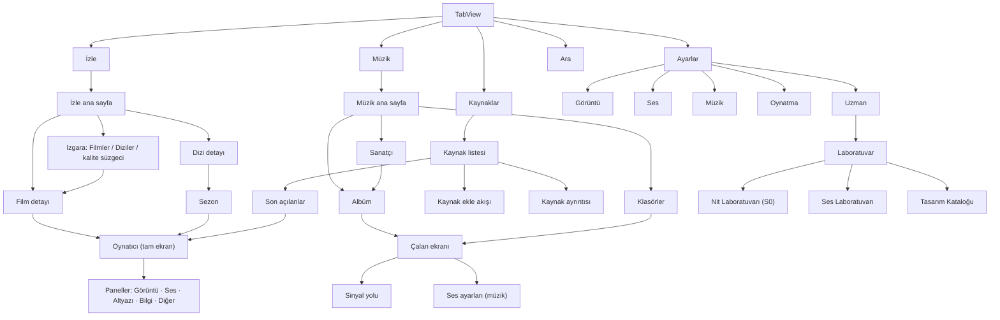
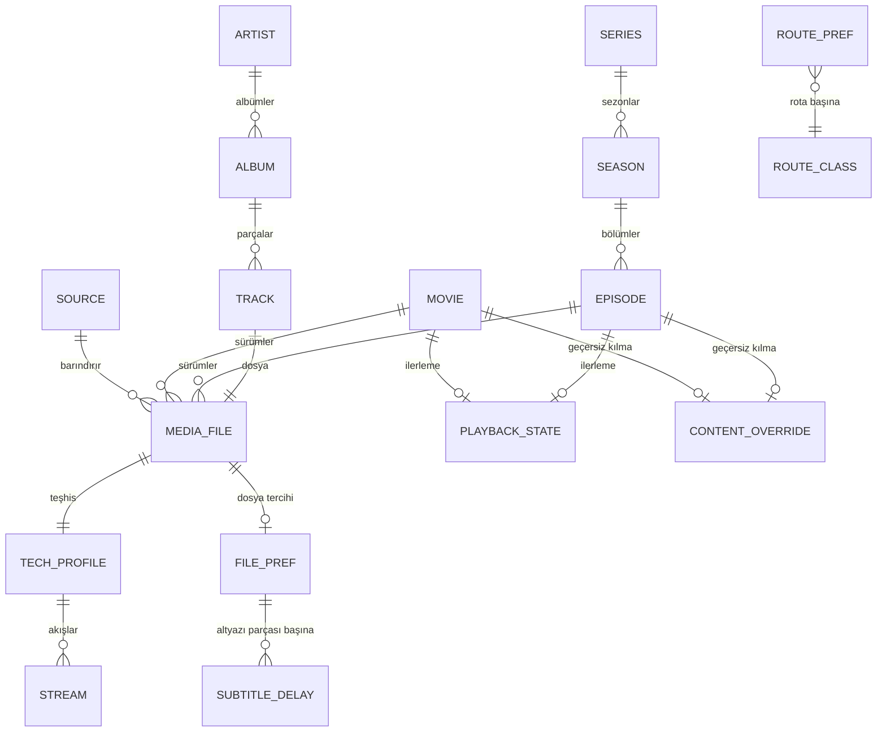
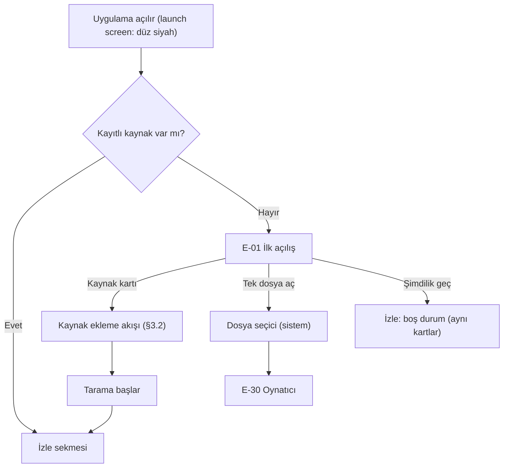
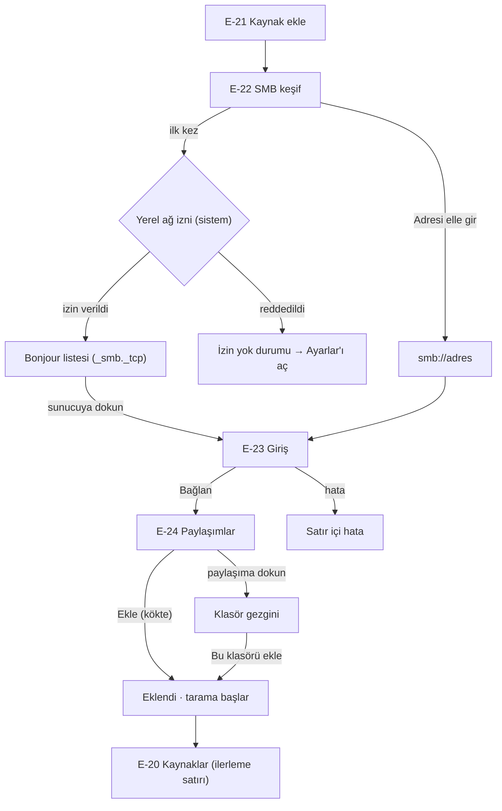
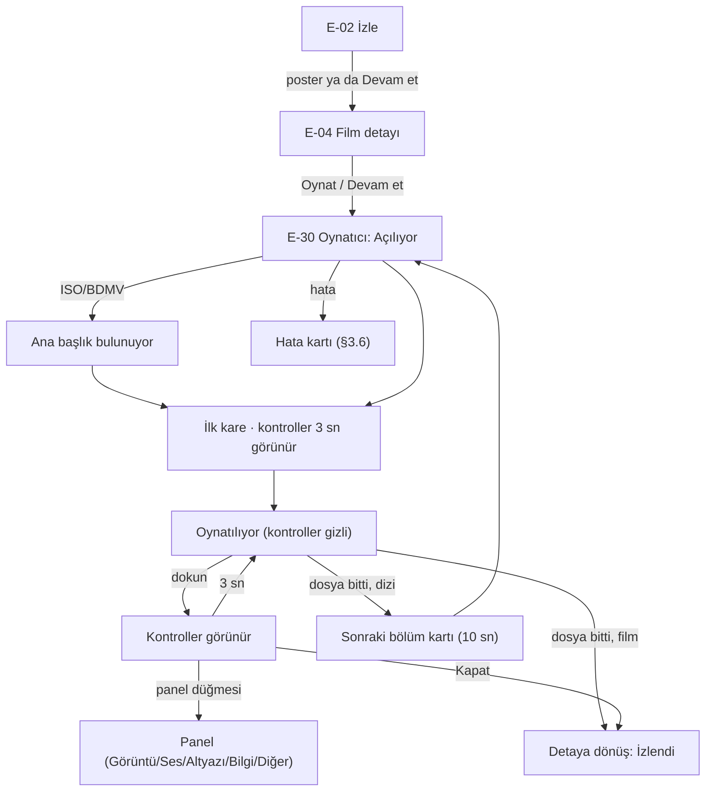
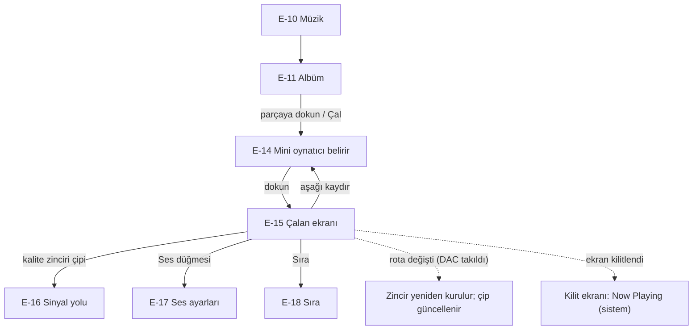
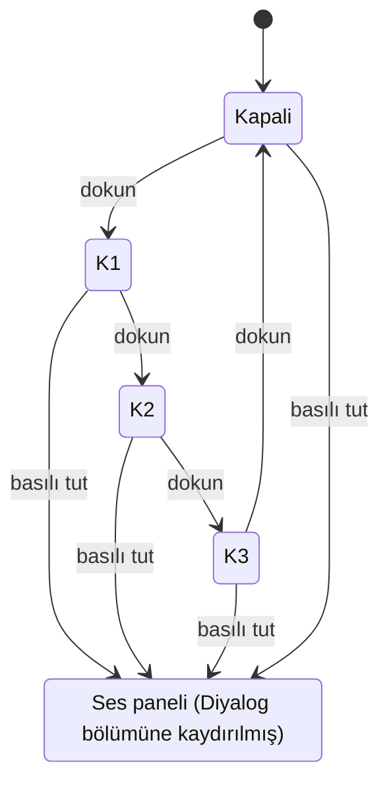

# 03 — Ürün ve Arayüz Tasarımı

> **Aşama:** 3 / 3 · **Ajan:** `tasarim-ajani` · **Tarih:** 25 Ekim 2026 · **Durum:** rev. 2 (uyum turu), kullanıcı onayı bekliyor
>
> **Girdiler (bağlayıcı):**
> - `docs/00-brief.md`
> - `docs/01-konsept.md` rev. 6 (MVP 10 özellik; sahne bazlı `L_ref` M2'nin içinde; M1'e oynatma hızı, M6'ya elle altyazı gecikmesi eklendi)
> - `docs/01b-ek-fikirler.md` (onaylı: N1 Temiz Nit MVP'de, N2 Ses Çekirdeği v1.1)
> - `docs/02-cozum.md` (teknik çözüm): özellikle §3.5.1 (sahne bazlı `L_ref`), §4.10 (oynatma hızı), §4.11 (elle altyazı gecikmesi), §10.1 (S0 ve "S0 v0.1 uygulama notu") ve §14 (G-01…G-20 yanıtları, `PlaybackEngine` olay sözleşmesi).
>
> **Rev. 2'de değişenler (uyum turu):**
> - §11 artık "çözüldü" tablosudur; her G maddesinin kararı ilgili tasarım bölümüne işlendi. Yeni açık noktalar §11.2'de (G-21…G-24).
> - Yeni MVP arayüzleri: **oynatma hızı** (§4.15) ve **elle altyazı gecikmesi** (§4.16).
> - Akışlar: Jellyfin Quick Connect (§3.2.2), Plex web + PIN ve kod yedeği (§3.2.3).
> - §9.5 durum modelleri §14'teki motor tipleriyle hizalandı. §9.1'e "v0.1'de uygulanan / v0.2'ye kalan" tablosu eklendi.
>
> **Bu belgede bağlayıcı olan kullanıcı kararları:**
> - **Nit Çekirdeği 1 numaralı özellik.** SDR ve HDR'da tipik beyaz yaklaşık 1200 nit. Modlar: **Nit** (varsayılan) ve **Referans**. HDR'da **Maksimum** (varsayılan) ya da **Dengeli** eğrisi. Ayrıca **Tepe Kilidi**, **Temiz Nit** (görünmez; uzman modunda A/B ve bant haritası) ve sahne bazlı `L_ref` (teşhis kartında "sahne beyazı X → Y nit").
> - Arayüz SDR'da kalır. Uygulama parlaklığı **asla kendiliğinden düşürmez.** OLED koruması yalnızca arayüz öğelerini gizler ya da kaydırır; video ve altyazı asla karartılmaz.
> - Headroom çöküşü ve Düşük Güç Modu kısa, bilgilendirici HUD mesajlarıyla bildirilir.
> - **Diyalog:** tek düğme, 3 kademe.
> - **Ses yükseltme (boost):** %100–%150 kaydırıcı, üst sınır kesin +6 dB, rota başına hatırlanır. **Limiter anahtarı** hem Ses panelinde hem Uzman katmanında, kolay erişilir. Limiter kapalıyken kırpma LED'i ve sayaç, açıkken anlık kazanç azaltma (dB) görünür. Atmos'ta boost "PCM'e çözüldü, nesneler kaybolur", DAC'ta "bit-perfect değil" göstergesi verir.
> - **Altyazılar gömülü gelir.** OCR, çeviri ve otomatik senkron yok. Altyazı parlaklığı videodan ayrı ayarlanır.
> - **Rev. 6 (kullanıcı onaylı):** Oynatma hızı 0,5×–2× (perde korunur) ve elle altyazı gecikmesi (±50 ms adım, ±10 s, dosya ve parça bazında hatırlanır) MVP'dedir.
> - Abartı ve süs yok. Basit varsayılan, gerektiğinde derin uzman kontrolü.
> - Platform kısıtları (02-cozum §0.4, §3.12, §14): PiP Referans yolunda çalışır (yazılım çözücülerde de), AirPlay video yok, Jellyfin adresi elle girilir (parola ya da Quick Connect), Plex hesapla (web + PIN), SMB Bonjour ile bulunur.
> - Cihaz: iPhone 11 Pro. 5,8", 60 Hz, çentikli, Dynamic Island yok, A13. Nit Çekirdeği ve Temiz Nit için 4,5 ms/kare GPU bütçesi ayrılmış durumda.
>
> **İşaretler:**
> - **[doğrulandı]**: Apple belgesi ya da WWDC oturumuyla teyit edildi.
> - **[doğrulanmalı]**: Çıkarım ya da ikincil kaynak. Uygulama aşamasında teyit edilecek.
> - **[ölçülmeli]**: Yalnızca cihazda ölçülerek bilinebilir.
> - **[ajan 2]**: Teknik tarafa açık geri bildirim (§11.2). Rev. 1'deki [ajan 2] işaretlerinin hepsi 02-cozum §14'te kapandı (§11.1).
>
> **Kapsam kuralı:** Teknik olarak çözülmemiş hiçbir şey MVP ekranına girmez. v1.1 ve sonrası özellikler yalnızca "yer ayrıldı" notuyla anılır; MVP arayüzünde devre dışı düğme olarak bile görünmez.

---

## 0. Yönetici özeti

- **Bilgi mimarisi:** Beş sekme: **İzle**, **Müzik**, **Kaynaklar**, **Ayarlar** ve **Ara**. Video oynatıcı tam ekran açılır. Müzik çalarken mini oynatıcı sekme çubuğunun üstünde durur. Uzman kontrolleri gizli değildir: her panelin dibinde katlanmış bir **Uzman** bölümü vardır. Ölçüm araçları Ayarlar > Uzman > **Laboratuvar**'dadır.
- **Oynatıcının ana fikri: "Görüntü kutsal, arayüz misafir."**
  - Video ve altyazı hiçbir zaman karartılmaz. Üstlerine perde (scrim), cam ya da bulanıklık inmez.
  - Kontroller ekran kenarlarında küçük, **opak siyah "OLED adacıkları"**dır. Biçim dili Liquid Glass'tan gelir (kapsül, eş merkezli köşeler), malzeme ise opak siyahtır.
  - Bunun iki gerekçesi var. (1) Nit modunda video SDR beyazının 8 katına kadar parlıyor; yarı saydam her zemin üstündeki SDR yazı okunmaz hale gelir (§6.2'deki hesap). (2) Canlı cam her video karesinde arka planı yeniden örnekler; A13'te bu, Nit Çekirdeği'nin bütçesinden çalar.
- **Tek dokunuş kuralı:**
  - **Nit | Referans** geçişi üst şeritte, tek dokunuş.
  - **Diyalog** alt şeritte, tek dokunuşla 3 kademe arasında döner.
  - **Limiter** anahtarı Ses panelinin ana düzeyinde durur, ölçer hemen yanındadır.
- **Dürüst zincir:** Format göstergeleri "kaynak → işlem → çıkış" dilbilgisiyle yazılır. Sadakatten her sapma amber renkte ve nedeniyle gösterilir.
- **Rev. 6 eklemeleri iki dokunuştadır:**
  - **Oynatma hızı:** Diğer (⋯) panelinin başında 7 kademe (0,5×–2×). Hız 1× değilken oynatma kümesinde bir hız rozeti görünür (§4.15).
  - **Altyazı gecikmesi:** Altyazı panelinde ±50 ms adımlı ayar. Altyazı düğmesine basılı tutunca doğrudan oraya gidilir (§4.16).
- **İlk kodlanacak ekran: S0 Nit Laboratuvarı** (§9.1). v0.1 kodda var; eşitlik ve tonalite testleri v0.2'de. Bu ekran sonradan Laboratuvar'da yaşamaya devam eder; bileşenleri (headroom göstergesi, mod anahtarı, HUD) oynatıcıya aynen taşınır.
- **İlk üç sprint:**
  1. Tasarım sistemi temeli, Nit Laboratuvarı, Ses Laboratuvarı ve Tasarım Kataloğu
  2. Oynatıcı v1, uygulama iskeleti ve Dosyalar kaynağı
  3. Ağ kaynakları, kütüphane ve sistem entegrasyonu (PiP, AirPlay, dış ekran)

  Müzik Sprint 4'e kalır.

---

## 1. Tasarım ilkeleri

Bu ilkeler genel UX ilkeleri değil; bu uygulamanın kararlarını ayırt etmek için yazıldı. Her birinin altında neyi **yasakladığı** ve neyi **gerektirdiği** yazılı. Bir tasarım tartışmasında hakem bunlardır.

### İ-1. Görüntü kutsaldır

Video ve altyazı, arayüzün hiçbir durumunda karartılmaz, bulanıklaştırılmaz ya da renklendirilmez.

- **Yasaklar:** Oynatıcıda yarı saydam perde (scrim), sistem sayfalarının (sheet) arka planı karartması, videonun üstünde cam ya da bulanıklık, "duraklatınca karart", OLED koruması adına video parlaklığına dokunmak.
- **Gerektirir:** Kontroller kenarlarda, küçük ve opak adacıklarda. Görüntünün merkezi boş kalır; yalnızca kısa süreli tampon göstergesi istisnadır. Paneller videoyu kapatır ama karartmaz.

### İ-2. Parlaklık tek yönlüdür

Uygulama ekran parlaklığını yalnızca yükseltir (Tepe Kilidi). Bir şey parlaklığı düşürüyorsa bu sistemdir ve kullanıcıya nedeni söylenir.

- **Yasaklar:** Kendiliğinden parlaklık azaltma; "pil tasarrufu için" ya da "göz konforu için" gibi varsayılanlar; sistemin aldığı headroom kaybını sessizce geçiştirmek.
- **Gerektirir:** Headroom'un her düşüşü HUD'da kısa bir cümleyle ve nedeniyle bildirilir (P-5). Oynatıcıdan çıkınca parlaklık kullanıcının giriş değerine döner, çünkü çıkış kullanıcının eylemidir (02-cozum §3.6).

### İ-3. Dürüst zincir

Ekranda ne oynuyorsa o yazılır: kaynak, yapılan her dönüşüm ve çıkış. Tahmini değerler "≈" ile yazılır.

- **Yasaklar:** "Dolby Vision" yazıp HDR10 oynatmak; Atmos nesneleri kaybolmuşken "Atmos" demek; pazarlama terimi ("Hi-Res", "Ultra") kullanmak.
- **Gerektirir:** Format göstergeleri §4.7'deki dilbilgisine uyar. Sadakatten sapma amber renkte ve nedeniyle gösterilir; sadakat korunuyorsa yeşil onay işareti konur.

### İ-4. Bir dokunuşta doğru, iki dokunuşta derin

Varsayılan her zaman doğrudur. Derinlik kat kat açılır ve hiçbir kat gizlenmez.

| Kat | İçerik | Nasıl açılır? |
|---|---|---|
| 0 · Varsayılan | Hiçbir ayar gerekmez. Parça seçimi, Nit, Temiz Nit ve rota profili otomatik. | — |
| 1 · Hızlı | Nit/Referans, Diyalog, oynat/sar | Oynatıcı şeridinde tek dokunuş |
| 2 · Panel | Eğri, Tepe Kilidi, parça, boost, limiter, altyazı parlaklığı, altyazı gecikmesi, oynatma hızı | Şeritteki panel düğmesi |
| 3 · Uzman | Temiz Nit kipi, A/B, bant haritası, `L_ref` ve sahne sapma sınırı, limiter kipi, Atmos'u koru, PGS boyutu, hızı hatırla… | Her panelin dibindeki **Uzman** bölümü (açık/kapalı hali hatırlanır) |
| 4 · Laboratuvar | Ölçüm desenleri, eşitlik testi, CSV, ham float kipi | Ayarlar > Uzman > Laboratuvar |

### İ-5. Arayüz misafirdir: SDR, opak, geçici

- Arayüz her zaman SDR beyazında (`1.0`) çizilir (P-4).
- Oynatıcı üstünde arayüz opak siyah zemin üzerindedir.
- Kontroller 3 saniye sonra gizlenir. Kalıcı olması gereken öğeler (sabitlenmiş istatistik, kayıt göstergesi) dakikada bir 1–2 piksel kaydırılır.

### İ-6. Kare bütçesi videonundur

Oynatma ekranında GPU'nun her milisaniyesi önce Nit Çekirdeği'ne aittir (≤ 4,5 ms/kaynak karesi).

- **Yasaklar:** Oynatıcıda canlı cam, bulanıklık, gölge, maske, karışım modu ve sürekli animasyon. Gizli kontrollerin "opaklığı 0" olarak katman ağacında kalması.
- **Gerektirir:** Gizlenen kontroller hiyerarşiden çıkarılır. Sayılar seyrek güncellenir: zaman 1 Hz'de, istatistikler 2 Hz'de, ölçer 30 Hz'de ve yalnızca görünürken.

### İ-7. Test edilebilir kontrol

Kullanıcının bizzat doğrulayacağı her özellik tek dokunuşla açılıp kapanabilir ve etkisinin ölçümü yanında görünür.

- **Örnekler:** Nit/Referans anahtarı ve yanında headroom; Limiter anahtarı ve yanında GR ya da kırpma sayacı; Temiz Nit A/B bölmesi ve bant haritası; Diyalog kademesi ve Bilgi'de kullanılan yöntem.

---

## 2. Bilgi mimarisi

### 2.1 Sekmeler

| Sekme | SF Symbol | İçerik | Neden ayrı sekme? |
|---|---|---|---|
| **İzle** | `film.stack` | Devam et, yeni eklenenler, filmler, diziler, kalite rafı | Ana kullanım; uygulama bu sekmeyle açılır |
| **Müzik** | `music.note` | Albümler, sanatçılar, parçalar, klasörler | Müzik dinleme kalıbı farklı: kuyruk ve mini oynatıcı |
| **Kaynaklar** | `externaldrive.connected.to.line.below` | Kaynak listesi, tarama durumu, kaynak ekleme, son açılan dosyalar | Ağ ve depolama sorunları tek yerde çözülür |
| **Ayarlar** | `gearshape` | Varsayılanlar, Uzman, Laboratuvar, lisanslar | — |
| **Ara** | `magnifyingglass` | Başlık, sanatçı, albüm; kalite süzgeçleri | iOS 26+ arama sekmesi rolü (`Tab(role: .search)`); sekme çubuğunda sağda ayrı durur |

SF Symbol adları SF Symbols 7 uygulamasında teyit edilmelidir **[doğrulanmalı]**.



### 2.2 Gezinme kuralları

- **Her sekmenin kendi `NavigationStack`'i vardır.** Sekme değişince yığın korunur.
- **Video oynatıcı** `fullScreenCover` ile açılır. Kapatınca çağrıldığı ekrana dönülür.
- **Müzik çalan ekranı** tam yükseklikte bir kapak olarak mini oynatıcıdan yukarı açılır; aşağı kaydırınca kapanır.
- **Oynatıcı içindeki paneller** sistem sayfası, menüsü ya da popover'ı değildir; uygulamanın kendi, arka planı karartmayan panelleridir (§4.3, §10).
- **Dışarıdan açma:** Dosyalar uygulamasından "Birlikte aç" ya da paylaşım ile gelen bir dosya doğrudan oynatıcıda açılır. Oynatıcı kapanınca Kaynaklar > Son açılanlar listesine eklenmiş olur.
- **Sekme çubuğu** aşağı kaydırınca küçülür (`tabBarMinimizeBehavior(.onScrollDown)`, iOS 26 **[doğrulandı: iOS 26 SDK]**). Mini oynatıcı `tabViewBottomAccessory` olarak sekme çubuğunun üstünde durur.
- **Durum geri yükleme:** Uygulama arka plandan dönünce son sekme ve yığın geri gelir. Oynatıcı açıksa oynatıcı geri gelir.

### 2.3 İçerik modeli



| Varlık | Önemli alanlar | Kaynağı (02-cozum modülü) |
|---|---|---|
| **Kaynak** | Tür (SMB / Jellyfin / Plex / Dosyalar / iPhone'umda), ad, adres, kimlik (Keychain referansı), kök klasörler ya da kütüphaneler, içerik türü (Otomatik / Video / Müzik), durum (çevrimiçi / çevrimdışı / taranıyor / hata), son tarama | `Sources` |
| **Dosya** | Kaynak, yol ya da URL, boyut, değişme tarihi, konteyner, süre, `TechProfile` | `MediaIO`, `Demux` |
| **TechProfile** | **Video:** codec, profil, çözünürlük, kare hızı, bit derinliği, renk (primaries / transfer / matris / aralık), HDR türü, MaxCLL/MaxFALL/MDL, DV (profil, BL uyumu, EL ve RPU varlığı). **Ses akışları:** codec, kanal, Atmos/JOC, dil, başlık, varsayılan, yorum, sesli betimleme. **Altyazı akışları:** format, dil, zorunlu (forced), SDH. **Bölümler.** ISO/BDMV için **başlıklar.** | `Demux` (tarama sırasında, yalnızca başlık okunur) |
| **Film** | Başlık, yıl, TMDB kimliği, poster, arka plan, özet, süre, sürümler (birden çok dosya) | `Library` + TMDB |
| **Dizi → Sezon → Bölüm** | Dizi meta verisi; bölüm no; sürümler | `Library` + TMDB |
| **Sanatçı → Albüm → Parça** | Etiketler (Vorbis comment / ID3 / MP4), disk no, ReplayGain, kapak | `Library` |
| **İzleme durumu** | Konum, tamamlandı mı, güncelleme zamanı. CloudKit ile senkronlanır. | M8 |
| **İçerik geçersiz kılma** | Seçilen ses ve altyazı parçası (kullanıcı değiştirdiyse), "bu film için" boost değeri | M10 (K-26), S1 |
| **Dosya tercihi** (rev. 6) | Anahtar: dosya kimliği (kaynak + yol + boyut + değişme zamanı; taşınan dosya için ilk ve son 1 MB'ın SHA-256 özeti). Alanlar: hatırlanan oynatma hızı (yalnızca "Bu dosyada hızı hatırla" açıksa), **altyazı parçası başına gecikme** (ms; 0 dışındaki her değer kendiliğinden saklanır) | 02-cozum §4.10, §4.11 (`Library`, SwiftData) |
| **Rota tercihi** | Rota sınıfı (hoparlör / kulaklık ve BT / AirPlay / USB DAC) başına boost yüzdesi | K-26 |

**Sürüm seçimi kuralı (sıfır ayar):** Bir filmin birden çok dosyası varsa varsayılan olarak bu cihazda oynayabilen en sadık sürüm seçilir: DV > HDR10 > HLG > SDR, aynı sınıfta yüksek çözünürlük ve kayıpsız ses önce. 4K AV1 gibi oynatılamayan sürümler elenir. Kullanıcı detay ekranında sürümü değiştirebilir; seçim içerik geçersiz kılması olarak saklanır.

### 2.4 Kalite rozetleri: iki ayrı gerçek

Rozetler iki farklı soruya cevap verir ve bu ikisi karıştırılmaz:

- **Kütüphanede (dosya gerçeği):** Dosyada ne var? Örneğin "TrueHD Atmos".
- **Oynatıcıda (oynatma gerçeği):** Şu an ne duyuyorsun ya da görüyorsun? Örneğin "TrueHD Atmos → 7.1 PCM (nesneler yok) → Uzamsal ses". Bkz. §4.7.

| Rozet | Koşul (dosya gerçeği) | Not |
|---|---|---|
| `4K` | Genişlik ≥ 3200 piksel | — |
| `Dolby Vision` | DV yapılandırması var (`dvcC`/`dvvC`, `BlockAdditionMapping`) | Detayda profil: "DV P7 FEL", "DV P8.1", "DV P5" |
| `HDR10` | PQ aktarımı var, DV yok | HDR10+ meta verisi varsa MVP'de yine `HDR10` yazılır; detayda "HDR10+ meta verisi (v1.1'de kullanılacak)" |
| `HLG` | HLG aktarımı | — |
| `Atmos` | E-AC-3 JOC ya da TrueHD Atmos parçası var | Detayda codec ile birlikte: "DD+ Atmos", "TrueHD Atmos" |
| `DTS:X`, `DTS-HD MA` | İlgili parça var | — |
| `Kayıpsız ses` | TrueHD, DTS-HD MA, LPCM ya da FLAC parçası var | — |
| `Remux` | Tahmin: dosya adında "remux" geçer ya da BD/UHD kaynaklı görünür ve kayıpsız ses içerir | Tahmin olduğu için yalnızca detayda, "≈ Remux" olarak gösterilir |
| Müzik: `24/96` gibi | Bit derinliği / örnekleme hızı sayıyla | "Hi-Res" yazılmaz (İ-3) |
| Müzik: `Kayıpsız` | FLAC, ALAC, WAV ya da AIFF | — |

**Görünüm kuralları:**
- Izgara posterinde **en fazla bir** video rozeti gösterilir. Öncelik: `Dolby Vision` > `HDR10`/`HLG` > `4K`. Diğerleri detay ekranındadır.
- Detayda rozetler çerçeveli kapsüllerdir (§6.10, C-17).

### 2.5 Ayarlar ağacı ve varsayılanlar

Kalın değerler varsayılandır. Ayarlar ekranı "varsayılan zaten doğru" ilkesine göre yazılır: her satırın altında bir cümleyle ne yaptığı söylenir.

```
Ayarlar
├─ Görüntü
│  ├─ Varsayılan mod ............ [Nit] · Referans
│  ├─ HDR eğrisi ................ [Maksimum] · Dengeli
│  ├─ Tepe Kilidi ............... [Açık]  "Gerekirse ekran parlaklığını yalnızca yükseltir; çıkınca geri döner."
│  ├─ Altyazı parlaklığı ........ [SDR beyazı] ─── Video beyazı
│  └─ Uzman ▸
│     ├─ Temiz Nit .............. [Otomatik] · Güçlü · Kapalı
│     ├─ Titreşim ............... Kapalı · [İnce] · Orta
│     ├─ Referans beyaz ......... [Sahne bazlı] · Sabit 203 nit · Elle (100–300 nit)
│     ├─ Sahne sapma sınırı ..... 0 ─[0,5]─ 1 stop   (yalnızca Sahne bazlı'da)
│     ├─ Beyaz hedefi (Maksimum)  0,90 ─[0,95]─ 0,98
│     ├─ SDR gama ............... [Otomatik] · 2,2 · 2,4     (Otomatik = S0 sonucu)
│     └─ Kesin kadans ........... [Kapalı]  "23,976 içerik %0,1 hızlı oynar; ses perdesi 1,7 sent kayar."
├─ Ses
│  ├─ Diyalog varsayılanı ....... [Kapalı] · 1 · 2 · 3
│  ├─ Gece modu varsayılanı ..... [Kapalı]
│  ├─ Ses yükseltme (rota başına)
│  │  ├─ Hoparlör ............... [%100]
│  │  ├─ Kulaklık ve Bluetooth .. [%100]
│  │  ├─ AirPlay ................ [%100]
│  │  ├─ USB DAC ................ [%100]
│  │  └─ İçeriğe özel değerleri sıfırla
│  ├─ Limiter ................... [Açık]
│  └─ Uzman ▸
│     ├─ Limiter kipi ........... [Akıllı] · Yalnızca limiter · Kapalı
│     ├─ Agresif yükseltme ...... [Kapalı]  (hedef −7 LUFS)
│     ├─ Atmos'u koru ........... [Kapalı]  "Açıkken Atmos içerikte boost %100'de kalır."
│     ├─ Stereoyu uzamsallaştır . [Kapalı]
│     ├─ LFE'yi stereoya kat .... [Kapalı]
│     └─ Bluetooth gecikmesi .... [Otomatik] · elle ±500 ms
├─ Müzik
│  ├─ Ses yüksekliği eşitleme ... [Otomatik]  "Albümde albüm kazancı, karışık listede parça kazancı. USB DAC'ta kapalı."
│  └─ Uzman ▸ Kazanç kaynağı .... [Etiket, yoksa ölçüm] · Yalnızca ölçüm
├─ Oynatma
│  ├─ Ses dili sırası ........... [Türkçe, Orijinal, İngilizce]  (sürükle-bırak)
│  ├─ Altyazı ................... [Otomatik: yalnızca zorunlu] · Her zaman · Kapalı
│  ├─ Altyazı dili sırası ....... [Türkçe, İngilizce]
│  ├─ Sarma aralığı ............. [10 sn] · 15 sn · 30 sn
│  ├─ Kontrolleri gizle ......... 2 sn · [3 sn] · 5 sn
│  ├─ Devam ederken geri sar .... [5 sn]
│  ├─ Sonraki bölümü oynat ...... [Açık]
│  ├─ Ana ekrana geçince PiP .... (varsayılanı AS-31 belirler; bkz. §4.11)
│  ├─ PGS ve VobSub boyutu ...... %80 ─[%100]─ %150   (bit eşlem altyazılar; §4.6)
│  └─ Dosyaya özel kayıtlar ▸ ... "Hatırlanan hızlar: 3 dosya · Altyazı gecikmeleri: 12 parça" [Hepsini sil]
├─ Senkron ...................... iCloud ile izleme ilerlemesi [Açık]
├─ Uzman
│  ├─ Uzman bölümlerini açık başlat [Kapalı]
│  ├─ Laboratuvar ▸ Nit Laboratuvarı · Ses Laboratuvarı · Tasarım Kataloğu
│  ├─ Telemetri kaydı (CSV) ..... [Kapalı]
│  └─ Günlükleri dışa aktar
└─ Hakkında
   ├─ Sürüm ve derleme
   ├─ Açık kaynak lisansları (FFmpeg LGPL notu ve kaynak bağlantısı dahil)
   └─ Gizlilik: "Hesap gerekmez. Ağa yalnızca kendi sunucuların ve TMDB'ye başlık sorgusu gider."
```

**Not:** Ayarlar'daki Görüntü ve Ses değerleri **varsayılanlardır.** Oynatıcı panelinde yapılan değişiklik yalnızca o oturum içindir. İstisnalar, teknik çözümde hatırlanması tanımlı olanlardır:
- boost (rota başına, K-26) ve "bu film için" boost,
- limiter durumu,
- Uzman bölümünün açık/kapalı hali,
- **altyazı gecikmesi** (dosya + parça bazında, kendiliğinden; 02-cozum §4.11),
- **oynatma hızı**, yalnızca o dosyada "Bu dosyada hızı hatırla" açıksa (02-cozum §4.10). Hız için genel bir varsayılan yoktur; her yeni dosya 1× ile başlar.

---

## 3. Ana akışlar

Her akış bir akış şeması ve adım tablosuyla verilir. Ekran kimlikleri (E-xx) §9.3'teki ekran listesine karşılık gelir. Hata ve boş durumların tamamı §3.6'dadır.

### 3.1 İlk açılış

**Hedef:** Hiçbir ayar sormadan, en fazla iki dokunuşla ilk kaynağı eklemeye ya da tek bir dosyayı oynatmaya ulaşmak. Karşılama turu, sayfa sayfa tanıtım ve izin yağmuru yok.



| Adım | Ekran | Durumlar | Kullanıcı eylemi | Sistem tepkisi |
|---|---|---|---|---|
| 1 | Launch screen | — | — | Düz siyah (OLED piksel kapalı). Logo yok; HIG'deki "ilk ekrana benzesin" kuralına uygun. |
| 2 | E-01 İlk açılış | Yalnızca kayıtlı kaynak yoksa ve ilk kez açılıyorsa | Kart seçer | İzin istenmez. Yerel ağ izni, SMB seçildiği anda (bağlam içinde) istenir. |
| 3a | Kaynak ekleme | §3.2 | — | Kaynak eklenince E-01 kapanır, İzle sekmesi açılır ve tarama ilerledikçe içerik belirir. |
| 3b | Dosya seçici | Sistem `fileImporter` | Bir video ya da ses dosyası seçer | Doğrudan oynatıcı açılır. Kapanınca dosya Kaynaklar > Son açılanlar'a eklenir. |
| 3c | İzle (boş) | Kaynak yok | "Şimdilik geç" | İzle sekmesi boş durumu aynı dört kartı gösterir. |
| 4 | İlk Nit oynatması | Uygulamanın ilk video oynatması | — | Tek seferlik HUD kartı (6 sn, modal değil): "Nit açık: beyaz, ekranın tepe parlaklığında. Gerekirse ekran parlaklığı yalnızca yükseltilir; çıkınca eski haline döner." Eylem: [Görüntü ayarları]. |

**E-01 İlk açılış (dikey, 375×812 pt):**

```
┌───────────────────────────────────────┐
│ 09:41                          (çentik)│  güvenli alan üst 44 pt
│                                        │
│  arifetanga                            │  largeTitle, bold
│  Diskindeki film ve müzik, bu ekranın  │  body, ikincil renk
│  verebileceği en iyi görüntü ve sesle. │
│                                        │
│                                        │
│                                        │
│  Kaynak ekle                           │  headline
│  ┌────────────────┐ ┌────────────────┐ │  kart 163×96 pt, köşe 12
│  │ [disk]         │ │ [sunucu]       │ │
│  │ Ağ paylaşımı   │ │ Jellyfin       │ │
│  │ SMB / NAS      │ │ adresle        │ │
│  └────────────────┘ └────────────────┘ │
│  ┌────────────────┐ ┌────────────────┐ │
│  │ [sunucu]       │ │ [klasör]       │ │
│  │ Plex           │ │ Dosyalar       │ │
│  │ hesapla        │ │ iPhone, iCloud │ │
│  └────────────────┘ └────────────────┘ │
│  ┌──────────────────────────────────┐  │
│  │        Tek dosya aç              │  │  ikincil düğme, 50 pt
│  └──────────────────────────────────┘  │
│            Şimdilik geç                │  metin düğmesi
│  Hesap gerekmez. Her şey cihazında.    │  footnote, üçüncül renk
│                                        │  güvenli alan alt 34 pt
└───────────────────────────────────────┘
```

- Kartlar ve düğmeler ekranın alt yarısındadır; tek elle başparmak bölgesinde kalır (§4.14).
- Kartlar SF Symbol + başlık + bir satır açıklama içerir; arka plan `bg.raised`. Liquid Glass kullanılmaz; bu bir içerik yüzeyi.

### 3.2 Kaynak ekleme

**Başarı ölçütü (M7):** Yeni bir NAS, kimlik bilgisi yazmak hariç **üç dokunuşta** kütüphaneye eklenir: sunucu → Bağlan → paylaşımın yanındaki Ekle.

E-21 "Kaynak ekle" sayfası dört satırdan oluşur: Ağ paylaşımı (SMB), Jellyfin, Plex, Dosyalar. Her satırın altında bir cümleyle nasıl bağlanıldığı yazar ("Aynı ağdaki sunucular kendiliğinden bulunur", "Sunucu adresini yazarak", "plex.tv hesabınla", "iPhone, iCloud Drive ya da harici disk").

#### 3.2.1 SMB / NAS



| Adım | Ekran | Durumlar | Metin / davranış |
|---|---|---|---|
| 1 | E-22 SMB keşif | **Aranıyor:** başlıkta küçük döner gösterge. **Bulundu:** liste (ad + IP + "SMB"). **Bulunamadı (10 sn):** "Aynı Wi-Fi ağında sunucu bulunamadı." + "Adresi elle gir". **İzin yok:** "Yerel ağ izni kapalı. Ayarlar > arifetanga > Yerel Ağ." + [Ayarlar'ı aç] | Liste canlı güncellenir; yeni sunucu belirince satır eklenir (Reduce Motion'da animasyonsuz). |
| 2 | E-23 Giriş | Segment: **Kayıtlı kullanıcı** / Misafir. Alanlar: Kullanıcı adı, Parola. Alt yapışkan düğme: [Bağlan]. **Bağlanıyor:** düğmede döner gösterge, alanlar kilitli. **Hata:** alanın altında kırmızı metin. | Parola Keychain'de saklanır (02-cozum §7.4); ayrı bir "sakla" anahtarı yok. Sunucu daha önce eklenmişse kimlik otomatik doldurulur ve bu adım atlanır. |
| 3 | E-24 Paylaşımlar | Paylaşım listesi; her satırda sağda [Ekle] ve ok işareti. Satıra dokunmak klasör gezginine iner; gezginin alt şeridinde [Bu klasörü ekle]. **Boş:** "Bu kullanıcının görebildiği paylaşım yok." | İçerik türü varsayılan olarak **Otomatik**tir (dosya türüne göre video ya da müzik). Sonradan kaynak ayrıntısında değiştirilebilir. Böylece ek soru sorulmaz. |
| 4 | E-20 Kaynaklar | Yeni satırda: "Taranıyor · 124 / 530 dosya" ve ince ilerleme çubuğu | Haptik: `.success`. Sayfa kapanır. İzle sekmesi tarama ilerledikçe dolar. |

**Hata metinleri (E-23):**
- "Kullanıcı adı ya da parola yanlış."
- "DiskStation'a ulaşılamıyor. Aynı Wi-Fi ağında mısın?" [Yeniden dene]
- "Bu sunucu yalnızca SMB1 kullanıyor. Sunucuda SMB2 ya da SMB3'ü aç." (libsmb2 SMB2/3 konuşur.)

#### 3.2.2 Jellyfin (adres elle girilir; parola ya da Quick Connect)

Kimlik doğrulama 02-cozum §14 G-15 ve K-35'e göredir: kullanıcı adı ve parola (`/Users/AuthenticateByName`) ya da **Quick Connect** (`/QuickConnect/Initiate` → başka cihazda onay → `/Users/AuthenticateWithQuickConnect`). Uç nokta adları **[doğrulanmalı]**.

| Adım | Ekran | Durumlar | Metin / davranış |
|---|---|---|---|
| 1 | E-25 Adres | Tek alan, yer tutucu `http://192.168.1.20:8096`. Klavye `.URL`. [Devam] | Keşif yok; nedeni alanın altında tek satırla yazar: "Jellyfin'in otomatik keşfi bu cihazda kullanılamıyor; adresi sunucunun panelinde bulabilirsin." |
| 2 | Doğrulama | **Denetleniyor** → **Bulundu:** "Ev · Jellyfin 10.x" ve yeşil onay. **Hata:** "Bu adreste Jellyfin bulunamadı." · "Uzak sunucular için HTTPS gerekir; yerel ağdaysan IP adresini kullan." | Yerel ağda HTTP'ye izin var (`NSAllowsLocalNetworking`). |
| 3 | E-26 Giriş | Üstte segment: **Parola** · Quick Connect. Varsayılan Parola. | Segment seçimi hatırlanmaz; her eklemede Parola ile başlar. |
| 3a | E-26 · Parola | Kullanıcı adı, parola → [Giriş yap] (alt yapışık). **Giriş yapılıyor:** düğmede döner gösterge. **Hata:** "Kullanıcı adı ya da parola yanlış." | Erişim belirteci Keychain'e yazılır. |
| 3b | E-26 · Quick Connect | **Kod isteniyor** → **Kod hazır:** kod büyük ve harf aralıklı yazılır (C-35) + talimat + "Onay bekleniyor…" ve küçük döner gösterge + [Kodu kopyala]. **Onaylandı:** yeşil onay, haptik `.success`, 0,5 sn sonra kendiliğinden adım 4. **Süresi doldu:** "Kodun süresi doldu." [Yeni kod]. **Sunucuda kapalı:** "Quick Connect bu sunucuda kapalı. Yönetici panelinden açılabilir ya da parolayla gir." [Parolayla gir] | Talimat: "Jellyfin'de oturumu açık bir cihazda Profil > Quick Connect'e gir ve bu kodu onayla." Yoklama sürerken ekran açık kalır; sayfa kapatılırsa yoklama durur. |
| 4 | E-26 Kütüphaneler | Kütüphane listesi; her satırda anahtar (Filmler ✓, Diziler ✓, Müzik ✓) → [Ekle] | Oynatma her zaman doğrudan oynatmadır (direct play); sunucuda kod dönüştürme yapılmaz. |

**E-26 · Quick Connect (dikey, sayfa yığını):**

```
┌───────────────────────────────────────┐
│ ‹ Geri          Jellyfin girişi        │
│ ┌──────────────────┬──────────────────┐│
│ │      Parola      │  Quick Connect   ││  C-04
│ └──────────────────┴──────────────────┘│
│                                        │
│              4 8 2 9 1 3               │  C-35: SF Mono, .largeTitle, harf aralığı 8 pt
│            [Kodu kopyala]              │  metin düğmesi
│                                        │
│  Jellyfin'de oturumu açık bir cihazda  │  body, ikincil
│  Profil > Quick Connect'e gir ve bu    │
│  kodu onayla.                          │
│                                        │
│  (◌) Onay bekleniyor…                  │  footnote, üçüncül
│                                        │
│            Parolayla gir               │  metin düğmesi
└───────────────────────────────────────┘
```

#### 3.2.3 Plex (hesapla: web + PIN, yedeği kod)

Kimlik doğrulama 02-cozum §14 G-15 ve K-35'e göredir: uygulama bir PIN oluşturur, plex.tv giriş sayfası sistem web oturumunda (`ASWebAuthenticationSession`) açılır, uygulama PIN'i yoklayarak belirteci alır. Yedek: 4 karakterlik kod ve plex.tv/link. Uç nokta adları **[doğrulanmalı]**.

| Adım | Ekran | Durumlar | Metin / davranış |
|---|---|---|---|
| 1 | E-27 Plex | [plex.tv ile oturum aç] (birincil, alt yapışık) · altında metin düğmesi "Tarayıcı olmadan: kodla bağlan" | Dokununca önce sistemin izin uyarısı gelir ("arifetanga, oturum açmak için plex.tv'yi kullanmak istiyor"), sonra plex.tv sayfası açılır. |
| 2 | Bekleme | Web sayfası kapanınca E-27'de "plex.tv onayı bekleniyor…" ve döner gösterge. **İptal:** "Oturum açma iptal edildi." [Yeniden dene]. **Zaman aşımı:** "plex.tv onayı gelmedi." [Yeniden dene] · [Kodla bağlan] | Belirteç Keychain'e yazılır. Haptik `.success`. |
| 2′ | E-27 · Kod (yedek) | 4 karakterlik kod (C-35) + "Başka bir cihazda plex.tv/link adresine git ve bu kodu gir." + "Onay bekleniyor…" + [Kodu kopyala]. **Süresi doldu:** [Yeni kod] | Tarayıcı açılmayan durumlar ve parola yöneticisi başka cihazda olanlar için. |
| 3 | Sunucular | Hesaptaki sunucular; her satırda rozet: "Yerel ağ" ya da "Uzak" | Uzak satırın altında: "Uzak bağlantı remux için yavaş olabilir." |
| 4 | Kütüphaneler | Anahtarlarla seçim → [Ekle] | Jellyfin ile aynı. |

Sistem web oturumu bir sistem sayfasıdır ve Liquid Glass kullanabilir. Bu kabul edilebilir: kütüphane bağlamındadır, arkasında video yoktur (§6.6).

#### 3.2.4 Dosyalar

| Adım | Ekran | Durumlar | Metin / davranış |
|---|---|---|---|
| 1 | Sistem klasör seçici | `fileImporter` (klasör) | Kalıcı yer imi (bookmark) saklanır. |
| 2 | Onay | Klasör adı ve konumu | Seçilen konum Dosyalar'ın kendi SMB bağlantısıysa ipucu: "Daha hızlı okuma için bu sunucuyu Ağ paylaşımı olarak ekle." (02-cozum: Files yolu yedektir.) |
| 3 | E-20 | Tarama başlar | — |

**iPhone'umda** klasörü (uygulamanın kendi Documents klasörü) her zaman kaynak listesinde, silinemez bir satır olarak durur. iTunes/Finder dosya paylaşımıyla ya da Dosyalar'dan kopyalanan içerik oraya düşer.

#### 3.2.5 Kaynak ayrıntısı ve tarama

**E-29 Kaynak ayrıntısı:** ad, tür, adres, durum, son tarama, içerik sayıları (film / dizi / albüm), içerik türü (Otomatik / Video / Müzik), [Şimdi tara], [Kimliği düzenle], [Kaynağı kaldır] (yıkıcı eylem, onay ister).

| Durum | Kaynaklar listesindeki satır | Ayrıntı ekranı |
|---|---|---|
| Çevrimiçi | Yeşil nokta + "Son tarama 2 sa önce" | — |
| Taranıyor | "Taranıyor · 124 / 530" + ilerleme çubuğu | Okunan dosya adı (footnote) |
| Çevrimdışı | Gri nokta + "Ulaşılamıyor" | [Yeniden dene] |
| Hata | Amber nokta + "12 dosya okunamadı" | Liste ve nedenler |

Tarama sırasında kütüphane kademeli dolar. İzle ekranının gezinme çubuğunda alt başlık olarak "Taranıyor…" yazar; tarama bitince kaybolur.

### 3.3 Film seçme ve oynatma



| Adım | Ekran | Durumlar | Davranış |
|---|---|---|---|
| 1 | E-04 Film detayı | Yükleniyor (poster yer tutucusu düz renk) · Hazır · Kaynak çevrimdışı (Oynat düğmesi devre dışı, "Kaynağa ulaşılamıyor" satırı) | Birincil düğme ekranın altına yapışıktır (`safeAreaInset(edge: .bottom)`): ilerleme varsa **"Devam et · 1:02:13"**, yoksa **"Oynat"**. Altında metin düğmesi: "Baştan başla". |
| 2 | Oynatıcı: Açılıyor | Siyah ekran, ortada döner gösterge, altında başlık (footnote). ISO/BDMV'de "Ana başlık bulunuyor…" | Gösterge yalnızca 300 ms'den uzun süren bekleyişte belirir. |
| 3 | İlk kare | Kontroller 3 sn görünür | Devam ediliyorsa üstte HUD çipi (5 sn): "Kaldığın yerden: 1:02:08 · [Baştan başla]". Geri sarma 5 sn (Ayarlar). Dosya için kayıtlı hız ya da altyazı gecikmesi varsa ardından HUD-19 gelir: "Bu dosya için kayıtlı: hız 1,5× · altyazı +250 ms" [Sıfırla] (§4.8). Hız, açılışta `open` komutunun hemen ardından `setRate` ile verilir; ilk kare zaten o hızdadır. |
| 4 | Oynatılıyor | §4.3'teki görünürlük kuralları | — |
| 5a | Bitti (dizi) | Sağ altta "Sonraki bölüm" kartı (§4.3) | 10 sn geri sayım; [Oynat] ve [İptal]. Ayarlardan kapatılabilir. |
| 5b | Bitti (film) | Oynatıcı kapanır | Detay ekranında "İzlendi" işareti; birincil düğme "Yeniden izle". |

**E-04 Film detayı (dikey):**

```
┌───────────────────────────────────────┐
│ [‹]                              [⋯]  │  gezinme düğmeleri (sistem Liquid Glass)
│ ┌───────────────────────────────────┐ │
│ │                                   │ │  arka plan görseli 375×211 (16:9), SDR
│ │                                   │ │
│ └───────────────────────────────────┘ │
│ Dune: Çöl Gezegeni Bölüm İki           │  title2, bold
│ 2024 · 2 sa 46 dk · Bilimkurgu         │  subheadline, ikincil
│ (4K) (Dolby Vision) (TrueHD Atmos)     │  rozetler (C-17), satır kaydırmalı
│ (Kayıpsız ses) (TR altyazı)            │
│                                        │
│ Özet metni, üç satır… devamı           │  body
│ ───────────────────────────────────── │
│ Sürüm      4K DV Remux · 61 GB      ›  │  yalnızca birden çok sürüm varsa
│ Ses        Türkçe · DD+ Atmos 5.1   ›  │  E-07 parça ön seçimi
│ Altyazı    Otomatik (zorunlu)       ›  │
│ Dosya bilgisi                       ›  │  E-06
│                                        │
│ ┌───────────────────────────────────┐ │
│ │      Devam et · 1:02:13           │ │  birincil, 50 pt, accent dolgu, siyah metin
│ └───────────────────────────────────┘ │
│            Baştan başla                │
│ [İzle] [Müzik] [Kaynaklar] [Ayarlar] (Ara) │  sekme çubuğu (sistem)
└───────────────────────────────────────┘
```

- **E-07 Parça ön seçimi** küçük bir sayfadır (medium detent): ses parçaları ve altyazı parçaları, otomatik seçilenin yanında "Otomatik" etiketi. Seçim içerik geçersiz kılması olarak saklanır.
- **E-06 Dosya bilgisi:** Bilgi panelinin (§4.9) statik kısmıdır: konteyner, video, ses ve altyazı akışları, bölümler, dosya yolu. Canlı değer içermez.

### 3.4 Müzik çalma



| Adım | Ekran | Durumlar | Davranış |
|---|---|---|---|
| 1 | E-11 Albüm | Kapak, başlık, sanatçı, yıl, format özeti ("FLAC · 24/96 · 10 parça · 52 dk"), disklere bölünmüş parça listesi | Parçaların formatı albümden farklıysa satırda küçük format etiketi. |
| 2 | E-14 Mini oynatıcı | Çalıyor / duraklatıldı / tamponlanıyor | Gapless: parça geçişinde mini oynatıcı titremez, yalnızca metin değişir. |
| 3 | E-15 Çalan ekranı | §5.2 | — |
| 4 | Rota değişimi | Örneğin USB DAC takıldı | Kalite zinciri çipi 300 ms'lik çapraz geçişle yeni zinciri gösterir. Örnekleme hızı değişirse çalma kısa süre durabilir (02-cozum §5.6); çipin altında 2 sn: "DAC 96 kHz'e geçiliyor…" |
| 5 | Kilit ekranı | Sistem Now Playing | §5.5 |

### 3.5 AI özelliği: Diyalog

MVP'de kullanıcının doğrudan kullandığı tek ML özelliği M9 Diyalog'dur (AUSoundIsolation ve Sound Analysis). Temiz Nit deterministiktir; AI değildir. İ-3 ve konseptteki "görünmez AI" ilkesi gereği:
- Arayüzde "AI" etiketi ya da parıltı simgesi kullanılmaz. Düğmenin adı yalnızca **Diyalog**'dur.
- Hangi yöntemin çalıştığı (AUSoundIsolation, F1 DSP, F2) yalnızca Bilgi panelinde yazar.



| Adım | Durum | Arayüz | Not |
|---|---|---|---|
| 1 | Kullanıcı alt şeritte **Diyalog**'a dokunur | Simge dolu hale gelir; altında 1 nokta yanar. Düğmenin üstünde 1,5 sn'lik küçük etiket: "Diyalog 1". Haptik: `.selection`. | Arayüz durumu anında değişir (iyimser güncelleme). Etki 100–300 ms içinde duyulur (02-cozum §5.4). |
| 2 | Tekrar dokunur | 2 nokta, "Diyalog 2"; sonra 3 nokta, "Diyalog 3"; sonra Kapalı. | Kademeler +3 / +6 / +9 dB'dir; bu sayılar yalnızca Bilgi'de yazar. |
| 3 | Kaynak native Atmos (E-AC-3 JOC) | İlk açılışta HUD (amber, 4 sn): "Atmos → 7.1 yatak (diyalog için)". Format çipinde amber nokta. | Diyalog kapanınca 2 sn sonra native Atmos'a dönülür; HUD: "Atmos'a dönüldü". |
| 4 | Müzikli sahne | Arayüzde değişiklik yok. | Gevşeme (r) Bilgi > Ses'te canlı görünür: "Müzik algılandı · diyalog gevşetildi (%80)". |
| 5 | Ekran kilitlendi ya da uygulama arka plana geçti | Arayüz yok. | Yöntem F1'e (DSP) geçer. Ön plana dönünce Bilgi'de "Arka planda DSP yöntemi kullanıldı" satırı görünür. |
| 6 | Isı `.serious` | Arayüz yok. | F1'e geçilir. Bilgi'de neden yazar. |
| 6b | Oynatma hızı 1× değil | Arayüz yok. | Gerçek zamandaki yük hızla çarpılır. 2×'te AUSoundIsolation bütçesi (≤ %40 P çekirdeği) aşılırsa 200 ms çapraz geçişle F1'e geçilir (02-cozum §4.10, `dialogEngineChanged`). Bilgi: "Diyalog 2 · DSP yöntemi (hız 2× nedeniyle)". Kademe ve düğme değişmez. |
| 7 | Basılı tutma | Ses paneli açılır, Diyalog bölümüne kaydırılmış olarak. | Paneldeki segment: Kapalı · 1 · 2 · 3. |

**Kalıcılık:** Her filmin başında Diyalog, Ayarlar > Ses > Diyalog varsayılanı değerinden başlar (varsayılanı **Kapalı**). Her filmde diyalog açmak isteyen kullanıcı bu varsayılanı değiştirir.

**Müzik çalarda Diyalog yoktur.** Bit-perfect yolunda M9 tanımlı değildir (02-cozum §5.4) ve müzikte anlamı yoktur.

### 3.6 Boş, hata ve uç durumlar kataloğu

Hata metni kuralları: Ne olduğunu söyle, nedenini söyle, yapılabilecek tek bir eylem öner. Ünlem işareti yok. "Bir hata oluştu" gibi genel cümle yok.

| # | Durum | Nerede | Metin | Eylem |
|---|---|---|---|---|
| H-01 | Kaynak yok | İzle, Müzik | "Henüz kaynak yok. Bir NAS, sunucu ya da klasör ekle." | Dört kaynak kartı |
| H-02 | Müzik yok, video var | Müzik | "Kaynaklarında müzik bulunamadı." | [Kaynak ekle] |
| H-03 | 4K AV1 | Oynatıcı açılışı (kart) | "Bu dosya bu cihazda oynatılamaz. AV1 4K için donanım çözücüsü yok ve yazılımla çözmek gerçek zamanlıya yetmiyor." | [Diğer sürümler] (varsa) · [Kapat] |
| H-04 | Codec ya da profil desteklenmiyor | Oynatıcı açılışı | "Bu video biçimi desteklenmiyor: {codec, profil}." | [Dosya bilgisi] · [Kapat] |
| H-05 | Dosya bulunamadı | Oynatıcı açılışı | "Dosya bulunamadı. Taşınmış ya da silinmiş olabilir." | [Kaynağı tara] |
| H-06 | Kaynağa ulaşılamıyor | Detay, oynatıcı | "{Sunucu}'ya ulaşılamıyor. Aynı ağda mısın?" | [Yeniden dene] |
| H-07 | Ağ yavaş (tampon > 5 sn) | Oynatıcı HUD | "Ağ yavaş · gereken 18 MB/sn, gelen 9 MB/sn." | — (tampon dolunca kendiliğinden sürer) |
| H-08 | DV P5 RPU hatası | Oynatıcı HUD | "Dolby Vision meta verisi okunamadı → Referans yoluna geçildi." | — |
| H-09 | BT.2020 CL ya da bilinmeyen renk sistemi | Oynatıcı HUD | "Renk sistemi Nit'te desteklenmiyor (BT.2020 CL) → Referans." | — |
| H-10 | Altyazı parçası desteklenmiyor (ör. DVB teletext). VobSub artık desteklenir (G-07, K-36). | Altyazı paneli, E-07 | Satır gri ve seçilemez: "{Dil} · {biçim} · desteklenmiyor", ör. "Deutsch · Teletext · desteklenmiyor" | — |
| H-11 | Yerel ağ izni yok | SMB keşif | "Yerel ağ izni kapalı." | [Ayarlar'ı aç] |
| H-12 | iCloud kapalı | Ayarlar > Senkron | "iCloud'a giriş yapılmamış; ilerleme yalnızca bu cihazda tutuluyor." | — |
| H-13 | Kimlik doğrulama süresi doldu (Plex/Jellyfin) | Kaynaklar satırı | "Oturumun süresi doldu." | [Yeniden giriş yap] |
| H-14 | Tarama hatası | Kaynak ayrıntısı | "12 dosya okunamadı." | [Listeyi göster] |
| H-15 | Arama sonuçsuz | Ara | "'{sorgu}' için sonuç yok." | — |

---

## 4. Oynatıcı arayüzü

### 4.1 Yerleşim ve güvenli alanlar

**Ölçüler (iPhone 11 Pro):**

| | Değer |
|---|---|
| Ekran | 375 × 812 pt (@3x: 1125 × 2436 px) |
| Güvenli alan, dikey | üst 44 pt (çentik ve durum çubuğu), alt 34 pt (ev göstergesi) |
| Güvenli alan, yatay | sol 44 pt, sağ 44 pt (çentik hangi taraftaysa), üst 0, alt 21 pt |
| Ekran köşe yarıçapı | ≈ 39 pt **[doğrulanmalı]** (eş merkezli köşe hesabının tabanı, §6.5) |
| Çentik (yatayda) | Yaklaşık 30 pt derinlik, ekran yüksekliğinin ortasında ≈ 209 pt boy **[doğrulanmalı]** |

**Video güvenli alanı yok sayar; kontroller uyar.**
- Video tam ekran çizilir. Varsayılan **Sığdır**'dır, kıstırma hareketiyle **Doldur**'a geçilir.
- Yatayda 16:9 video 666,7 × 375 pt olur; iki yanda 72,7 pt'lik siyah bant kalır. Görüntü çentiğe değmez.
- Yatayda 2,39:1 video 812 × 339,7 pt olur; üstte ve altta 17,6 pt'lik bant kalır. Görüntünün çentik tarafındaki kenarına çentik ≈ 30 pt girer; bu, sistemin kendi oynatıcısındaki davranışla aynıdır **[doğrulanmalı]**.
- Bantlar `(0,0,0,1)` ile temizlenir (02-cozum §3.9); OLED pikselleri kapalıdır.
- **Oynatıcıda Dynamic Island yoktur.** Durum çubuğu oynatıcıda gizlidir (`statusBarHidden`). Ev göstergesi kontroller gizliyken otomatik gizlenir (`persistentSystemOverlays(.hidden)`).

**Yatay yerleşim (kontroller görünür, 812 × 375 pt):**

```
x: 0  44                                                                    768 812
   ┌──┬──────────────────────────────────────────────────────────────────────┬──┐ y=0
   │  │╭─────────────────────────────╮       ╭────────────╮╭───────────╮╭───┬───┬────╮│  │ 8
   │  ││[Kapat] Dune: Bölüm İki      │       │ Nit │Ref.  ││ DV · Atmos││PiP│AP │Kilit││  │
   │ç ││        Bitiş 23:41          │       ╰────────────╯╰───────────╯╰───┴───┴────╯│  │ 48
   │e │╰─────────────────────────────╯                                               │  │
   │n │                                                                              │  │
   │t │                        (görüntü: merkez boş kalır)                            │  │
   │i │                                                                              │  │
   │k │                                                                              │  │
   │  │╭────────────────────────────────────────────────────────────────────────────╮│  │ 262
   │  ││ 1:02:13  ━━━━━━━━━━━━━━━━━━━━━━━━━●─────┊─────────────┊─────────  −1:12:40  ││  │
   │  │╰────────────────────────────────────────────────────────────────────────────╯│  │ 298
   │  │╭────────────────────╮               ╭────────────────────────────────────────╮│  │ 306
   │  ││ [−10] [Oynat] [+10]│               │ [Diyalog•••] [Ses] [Altyazı] [Görüntü] [⋯]││  │
   │  │╰────────────────────╯               ╰────────────────────────────────────────╯│  │ 350
   │  │                         ▁▁▁▁▁▁▁▁ ev göstergesi (alt 21 pt)                    │  │ 375
   └──┴──────────────────────────────────────────────────────────────────────┴──┘
```

| Öğe | Konum (pt) | Boyut | İçerik |
|---|---|---|---|
| Başlık adacığı | x 52, y 8 | yükseklik 40, genişlik içeriğe göre (≤ 320) | [Kapat] `xmark` + başlık (headline, tek satır, sonu kesilir) + alt satır (footnote, ikincil): "S1 · B2 · Bitiş 23:41". Bitiş saati gerçek zamandır: şimdi + kalan süre ÷ hız. |
| Mod anahtarı (C-05) | sağ küme, y 8 | 40 × 128 | **Nit \| Referans**, tek dokunuş |
| Format çipi (C-16) | mod anahtarının sağında | 40 × içerik | "DV · Atmos"; dokununca Bilgi paneli |
| Sistem düğmeleri | sağ uç, x ≤ 760 | 3 × 44 × 40 | PiP `pip.enter`, AirPlay `airplay.audio`, Kilit `lock.fill` |
| Zaman çizgisi adacığı (C-06) | x 52–760, y 262 | 36 pt | geçen süre, iz, bölüm işaretleri, kalan süre |
| Oynatma kümesi | x 52, y 306 | 44 × 156; hız 1× değilken 44 × 212 | [−10] `gobackward.10`, [Oynat/Duraklat], [+10] `goforward.10`; hız 1× değilken sağ uçta **hız rozeti** (C-33, 52 × 44, ör. "1,5×"; §4.15) |
| Panel düğmeleri | sağa yaslı, x ≤ 760, y 306 | 44 × (5 × 44 + 4 × 4) | Diyalog (kademe noktalı), Ses, Altyazı, Görüntü, Diğer (`ellipsis`) |

**Neden oynatma kümesi ortada değil? (HIG'den sapma, §10'da S-3):**
1. **Merkez boş kalır (İ-1).** Merkezde opak siyah daireler görüntünün ortasında "kara delik" etkisi yaratır. Nit modunda arkadaki görüntü 1200 nit olduğunda bu etki çok belirginleşir.
2. **Erişim:** Yatay iki elle tutuşta başparmaklar alt köşelere uzanır. Sol başparmak oynat ve sar düğmelerine, sağ başparmak panellere ulaşır. Merkez ise iki başparmaktan da ≈ 400 pt uzaktadır.
3. **Hareket eşdeğeri:** Sarma için iki yandaki çift dokunuş (§4.2) merkezi gereksiz kılar.

**Dikey yerleşim (kontroller görünür, 375 × 812 pt):**

```
┌───────────────────────────────────────┐ y=0
│ (durum çubuğu gizli, çentik)           │
│╭──────────────────────────╮╭──┬──┬───╮│ 52
││[Kapat] Dune: Bölüm İki   ││PiP│AP│Kil.││
││        Bitiş 23:41       │╰──┴──┴───╯│
│╰──────────────────────────╯           │ 92
│╭────────────╮╭────────────╮           │ 100
││ Nit │ Ref. ││ DV · Atmos │           │
│╰────────────╯╰────────────╯           │ 140
│                                        │
│ ┌────────────────────────────────────┐ │ ≈300
│ │                                    │ │
│ │       video 375 × 211 (16:9)       │ │
│ │                                    │ │
│ └────────────────────────────────────┘ │ ≈511
│                                        │
│╭──────────────────────────────────────╮│ 604
││1:02:13 ━━━━━━━━━━●──────┊──── −1:12:40││
│╰──────────────────────────────────────╯│ 640
│        ╭─────╮ ╭───────╮ ╭─────╮       │ 650
│        │ −10 │ │ Oynat │ │ +10 │       │  oynat 64 pt, sar 52 pt
│        ╰─────╯ ╰───────╯ ╰─────╯       │ 714
│╭──────────────────────────────────────╮│ 726
││[Diyalog][Ses][Altyazı][Görüntü][⋯]   ││  44 pt
│╰──────────────────────────────────────╯│ 770
│              ▁▁▁▁▁▁▁                   │ alt güvenli alan 34 pt
└───────────────────────────────────────┘ 812
```

- Dikeyde video dikey ortadadır. Bir panel açılınca video **üste kayar** (y = 52) ve panel aşağıdan gelir. Böylece panel görüntünün üstüne binmez (§4.3). Kayma yalnızca katman konum dönüşümüyle yapılır; drawable tam ekran olduğu için değişmez (G-18, K-33).
- Dikeyde oynatma kümesi alttadır ve ortalanmıştır; tek elle başparmak bölgesindedir (§4.14). Hız 1× değilken hız rozeti (C-33) aynı satırda sağda durur: x 307–359, y 660–704. Küme ortalı kalır; rozet kümeyi kaydırmaz.
- **Döndürme:** Yatay ↔ dikey geçişte eski içerik animasyon boyunca ölçeklenir. Yeni drawable son kare yeniden çizilerek aynı işlemde sunulur; siyah kare olmaz (G-18, 02-cozum §3.9).
- **Yönelim:** Oynatıcı ters dikey dışında tüm yönleri destekler ve cihazın o anki yönünde açılır. Dikey yön kilidi açıksa ve video yataysa, dikey yerleşimde üst şeritte bir [Yatay] düğmesi görünür; dokununca `requestGeometryUpdate` ile yataya geçilir.

### 4.2 Hareketler

| Hareket | Bölge | Eylem | Not |
|---|---|---|---|
| Tek dokunuş | Videonun herhangi bir yeri | Kontrolleri göster/gizle. Panel açıksa paneli kapat. | Orta üçte birde **anında** çalışır. Yan üçte birlerde çift dokunuş penceresi (250 ms) kadar gecikir. |
| Çift dokunuş | Sol üçte bir / sağ üçte bir | −10 sn / +10 sn | Art arda dokunuşlar birikir (+20, +30…). Geri bildirim adacığı (C-23) o tarafta görünür. Haptik `.selection`. Sarma aralığı Ayarlar'dan (10/15/30 sn). |
| Çift dokunuş | Orta üçte bir | Etkisiz | Bir hareket, bir anlam. Yakınlaştırma kıstırma ile yapılır (§10, S-6). |
| İki parmakla kıstırma | Video | Sığdır ↔ Doldur | Doldur, 19,5:9'a kırpar. Durum 1 sn'lik çiple gösterilir: "Doldur". |
| Dikey aşağı kaydırma (≥ 120 pt) | Video, kontroller görünürken | Oynatıcıyı kapat | Etkileşimli: video sürükledikçe %90'a küçülür. Bırakınca eşik altındaysa geri döner. Kontroller gizliyken etkin değildir; yanlışlıkla kapatmayı önler. |
| Yatay sürükleme | Zaman çizgisi adacığı | Sarma | §4.3, C-06 |
| Basılı tutma | Diyalog düğmesi | Ses panelini Diyalog bölümünde açar | — |
| Basılı tutma | Altyazı düğmesi | Altyazı panelini **Gecikme** bölümünde, odak kipinde açar (§4.16) | Altyazı gecikmesinin hızlı erişim yolu. Seçili altyazı yoksa paneli parça listesinde açar. |
| Dokunma | Hız rozeti (yalnızca hız 1× değilken) | Diğer panelini **Oynatma hızı** bölümünde açar (§4.15) | Rozete dokunmak hızı değiştirmez; kazara sıfırlama olmaz. |
| Basılı tutma | Mod anahtarı | Görüntü panelini açar | — |
| Basılı tutma | Boost kaydırıcısı | "Bu film için hatırla" satırını açar | — |
| İki parmakla çift dokunuş (VoiceOver Magic Tap) | — | Oynat/Duraklat | §7 |

**Bilinçli olarak eklenmeyen hareketler:**
- **Parlaklık için dikey kaydırma yok.** Parlaklığa yalnızca Tepe Kilidi dokunur (İ-2). İkinci bir parlaklık kontrolü kullanıcının kafasını karıştırır ve Tepe Kilidi mantığıyla çatışır.
- **Ses düzeyi için kaydırma yok.** Sistem ses düzeyini ayarlamanın public API'si yok. Donanım düğmeleri yeterli.
- **"Basılı tutunca 2×" yok.** Oynatma hızı rev. 6 ile MVP'de (§4.15), ama yalnızca panelden kalıcı bir seçim olarak. Gerekçeler:
  1. Native Atmos 1× dışında PCM'e çözülür ve 1×'e dönünce 2 sn sonra geri geçilir (02-cozum §4.10). Geçici bir hareket her basışta bu iki geçişi tetikler.
  2. 2×'te Diyalog yöntemi F1'e geçebilir (§3.5, adım 6b). Aynı geçiş zinciri her basışta yinelenir.
  3. Videoya basılı tutma yatakta ve cepte kazara olur. Kilit modu da bunu engellemek için var (§4.10).
- **Altyazı gecikmesi için video hareketi yok** (ör. iki parmakla yatay kaydırma). Kıstırma ve sarma hareketleriyle çakışır. Hızlı erişim, Altyazı düğmesine basılı tutmak ve donanım klavyesinde G/H tuşlarıdır (§4.16, §7.7).

Hareket tanıyıcılar UIKit'te kurulur (§9.6): tek ve çift dokunuş ayrımı `require(toFail:)` ile deterministik yapılır.

### 4.3 Kontroller, paneller ve görünürlük kuralları

**Görünürlük durum tablosu:**

| Oynatma durumu | Kontroller | Otomatik gizleme |
|---|---|---|
| İlk kare | Görünür | 3 sn |
| Oynatılıyor | Dokununca görünür | 3 sn (Ayarlar: 2 / 3 / 5 sn) |
| Duraklatıldı | Görünür | 30 sn; sonra tamamen gizlenir. Görüntü karartılmaz. |
| Sarılıyor | Görünür | Bırakınca 3 sn |
| Panel açık | Yalnızca panel görünür; üst ve alt şerit gizlenir | Panel kapanana kadar gizlenmez |
| Tamponlanıyor | Merkezde tampon göstergesi (C-25) | — |
| VoiceOver açık | Görünür | Gizlenmez |
| Kilit modu | Yalnızca kilit adacığı (dokununca 2 sn) | — |

- **Gizleme gerçek gizlemedir:** Kontroller görünüm hiyerarşisinden çıkarılır (`if isVisible { … }`). Opaklığı 0 olan katman bırakılmaz (İ-6).
- **Geçiş:** Görünme 200 ms, kaybolma 350 ms, yalnızca opaklık. Reduce Motion'da da aynıdır (zaten yalnızca opaklık).

**Panel sistemi (C-21 PanelHost).** Görüntü, Ses, Altyazı, Bilgi ve Diğer panelleri aynı kabı kullanır.

| | Yatay | Dikey |
|---|---|---|
| Yer | Sağda yüzen panel, güvenli alandan 8 pt içeride | Alttan gelen panel; video üste kayar |
| Boyut | Genişlik 340 pt (Bilgi: 400 pt), yükseklik 338 pt (y 8–346) | Genişlik 375 pt, yükseklik = 812 − (video alt kenarı + 8), en fazla 560 pt |
| Köşe | Eş merkezli, 31 pt (§6.5) | Üst köşeler 31 pt |
| Malzeme | Opak siyah adacık (`bg.base`) + 1 px çizgi | Aynı |
| Kapatma | [Kapat] düğmesi, videoya dokunmak ya da sağa kaydırma | [Kapat], videoya dokunmak ya da aşağı kaydırma |
| Arka plan | **Karartılmaz.** Video oynamaya devam eder. | Aynı |
| İçerik | Dikey kaydırılabilir liste; sıra: en sık kullanılan üstte, **Uzman** en altta | Aynı |

- **Sürükleme odağı:** Görüntüyü etkileyen bir kaydırıcı sürüklenirken (altyazı parlaklığı, beyaz hedefi) panelin diğer satırları 150 ms'de opaklığı 0'a iner ve yalnızca o satır kalır. Böylece kullanıcı etkiyi görüntünün daha geniş kısmında görür. Bırakınca satırlar geri gelir.
- **Odak kipi (yalnızca yatay, altyazı gecikmesi):** Sürükleme odağı, opak panel zemini yerinde kaldığı için altyazının sağ yarısını örter. Gecikme ayarında kullanıcının altyazıyı tam görmesi gerekir. Bu yüzden Gecikme bölümüne dokunulunca panel **küçülür:** yalnızca gecikme satırını içeren 340 × 112 pt'lik bir adacık olarak sağ üstte kalır (y 8–120). Alt yarı ve altyazı alanı boşalır. [Bitti] ya da 4 sn etkileşimsizlik paneli tam haline döndürür (`motion.standard`; Reduce Motion'da çapraz geçiş). Dikeyde gerekmez: video panelin üstündedir. Ayrıntı §4.16.
- **Neden sistem sayfası (sheet) ya da menü değil?** Sistem sayfaları arka planı karartır (İ-1). Ayrıca iOS 26+ sistem menüleri ve popover'lar Liquid Glass kullanır; bu, arkadaki EDR videoyu her karede yeniden örnekler (İ-6) ve camın içinde 8× parlaklığında görüntü parçaları belirebilir (P-4). Gerekçe §10, S-2 ve S-5'te.

**Zaman çizgisi (C-06):**
- **Adacık:** 36 pt yükseklik. Solda geçen süre, sağda kalan süre ("−1:12:40"). Kalan süreye dokunmak toplam süreyle değiştirir. Rakamlar `monospacedDigit`.
- **İz:** Boşta 4 pt, dokununca 8 pt. Oynatılan kısım beyaz (`text.primary`), tamponlanmış kısım %35 beyaz, kalan kısım %15 beyaz. Bölüm sınırları izde 2 pt'lik boşluk olarak görünür.
- **Sürükleme:** Göreli sürükleme yapılır; parmağın değdiği yere atlanmaz. Bu, kazara atlamayı önler.
- **İnce sarma:** Parmak izden yukarı uzaklaştıkça hız düşer: 0–40 pt'de 1×, 40–90 pt'de ½×, 90 pt'den sonra ¼×. Etiket: "Yarım hızda sarma", "Dörtte bir hızda sarma". iOS'un standart davranışıdır.
- **Balon:** Parmağın üstünde "1:02:13 · Bölüm 7: Arrakis". Bölüm sınırı geçilirken haptik `.selection`.
- **Saat hızı:** Sürükleme başlayınca arayüz `setClockRate(.scrubbing)` gönderir ve saat akışı 60 Hz'e çıkar. Bırakınca `.normal` (1 Hz) gönderilir (02-cozum §14 G-04).
- **Sarma bırakınca yapılır.** MVP'de sürükleme sırasında canlı kare önizlemesi yoktur; SMB'de sarma 1,5 sn'ye kadar sürebilir. **Önizleme görselleri v1.1'dedir** (G-11): Jellyfin 10.9+ trickplay karoları ve yerelde 10 sn aralıklı IDR karelerinden üretilen ≈ 240 px karolar. v1.1'de balonun üstüne 16:9 küçük resim girer; MVP yerleşimi bunun için yer bırakmaz, balon yalnızca yukarı büyür.
- **Zaman ve hız:** Geçen ve kalan süre medya zamanıdır; hız 1× değilken de öyle kalır. Gerçek zamanlı bitiş yalnızca başlık adacığındaki "Bitiş" saatindedir.

**Sonraki bölüm kartı (C-24):** Dizide dosya bitmeden 10 sn önce, ya da jenerik bölümü işaretliyse orada (bölüm bilgisi MKV'de varsa), sağ altta bir adacık belirir: "Sonraki · B3: Başlık" + [Oynat] (çevresinde 10 sn geri sayım halkası) + [İptal]. Kart gerçek videonun üstünde küçük kalır; görüntü küçültülmez.

**Tampon göstergesi (C-25):** Ortada 44 pt'lik opak daire ve içinde dönen gösterge. Yalnızca 300 ms'yi aşan beklemede belirir. Bekleme 5 sn'yi geçerse HUD-13 eklenir.

**Diğer paneli (⋯), E-35.** Sıra yukarıdan aşağıya:
- **Oynatma hızı:** 7 kademe, sıfırlama ve notlar. Ayrıntı ve tel kafes §4.15.
- **Bölümler:** Bölüm listesi (ad + zaman); dokununca o bölüme sarılır. Küçük resim yok (MVP).
- **Başlıklar:** Yalnızca ISO/BDMV'de. Süre ve playlist kimliğiyle; ana başlıkta "Ana başlık" etiketi.
- **Görüntü oranı:** Sığdır / Doldur.
- **Bilgi:** Bilgi panelini açar.
- **Teşhisi paylaş:** Bilgi metni ve son 10 dakikanın telemetrisi (CSV) paylaşım sayfasıyla gönderilir. Sistem paylaşım sayfası burada kabul edilebilir, çünkü kısa süreli bir eylemdir ve video duraklatılarak açılır.
- **Uzman:** "Bu dosyada hızı hatırla" (§4.15).

### 4.4 Görüntü: Nit | Referans, Görüntü paneli ve uzman araçları

**Mod anahtarı (C-05), üst şeritte.** İki segment: **Nit** ve **Referans**. Tek dokunuşla geçilir (P-3). Basılı tutunca Görüntü paneli açılır.
- Geçiş motorun işidir: ≤ 500 ms, siyah kare yok, ses kesilmez (02-cozum §3.11). Arayüz yalnızca segmenti hemen değiştirir. Geçiş sürerken segmentin altında 2 pt'lik ince bir ilerleme çizgisi akar.
- Nit'in kullanılamadığı durumlarda (PiP, dış ekran, DV P5 RPU hatası, BT.2020 CL) anahtar "Referans"ta görünür ve "Nit" segmenti devre dışıdır. Kaynak `DisplaySnapshot.nitUnavailableReason` (`AutoReferenceReason`: `.pictureInPicture`, `.externalDisplay`, `.dolbyVisionRPUError`, `.unsupportedColorSystem`). Nedeni, segmente basılı tutunca ya da Görüntü panelinde yazar.
- Geçiş çizgisi `displayModeTransition(.started)` ile başlar, `.finished` ile durur (02-cozum §14 G-04).

**E-31 Görüntü paneli (yatay, 340 pt):**

```
╭─ Görüntü ──────────────────────────────── [Kapat] ╮
│ ┌──────────────────────┬────────────────────────┐ │
│ │         Nit          │        Referans        │ │  C-04 segment, 36 pt
│ └──────────────────────┴────────────────────────┘ │
│ Beyaz ≈ tepe. Parlak vurgular beyaza yaklaşır.    │  footnote, moda göre değişir
│                                                    │
│ HDR eğrisi                                         │  yalnızca HDR / DV / HLG kaynakta
│ ┌──────────────────────┬────────────────────────┐ │
│ │       Maksimum       │        Dengeli         │ │
│ └──────────────────────┴────────────────────────┘ │
│                                                    │
│ Tepe Kilidi                               [ ●  ]  │  Toggle
│ Gerekirse ekran parlaklığını yalnızca yükseltir.   │
│ ── Şu an ───────────────────────────────────────── │
│ H  1×        2×         4×         8×              │  C-12 headroom göstergesi
│    ████████████████████████████████▌┆             │
│ ● Panel tepesinde · 7,8× / 8,0×                    │  durum satırı (renkli nokta + metin)
│ Sahne beyazı 140 nit → ≈ 1140 nit                  │  C-13, sahne değişince güncellenir
│ ── Uzman ▾ ─────────────────────────────────────── │  C-20
│ Temiz Nit        [Otomatik | Güçlü | Kapalı]       │
│ Etkin · 8-bit kaynak · ×11,8 yükseltme             │
│ A/B karşılaştır                        [Başlat]    │
│ Bant haritası                           [  ○ ]     │
│ Titreşim         [Kapalı | İnce | Orta]            │
│ Referans beyaz   [Sahne bazlı | 203 nit | Elle]    │
│ Sapma sınırı     0 ━━━━━●━━━━━ 1 stop     0,5      │  yalnızca Sahne bazlı
│ Elle beyaz       100 ━━━●━━━━━━━ 300 nit  150      │  yalnızca Elle
│ Beyaz hedefi     0,90 ━━━━━━━●━━━ 0,98     0,95    │  yalnızca Maksimum
│ SDR gama         [Otomatik | 2,2 | 2,4]            │  yalnızca SDR kaynakta
│ Kesin kadans                            [  ○ ]     │  yalnızca 23,976 içerikte
│ İçerik %0,1 hızlı oynar; ses perdesi 1,7 sent kayar│  1× dışında devre dışı (§4.15)
╰────────────────────────────────────────────────────╯
```

**Bağlama göre görünen satırlar (kademeli açılım):**

| Bağlam | Gizlenen | Gösterilen açıklama |
|---|---|---|
| Nit + SDR | HDR eğrisi, Referans beyaz, Beyaz hedefi | "SDR beyazı panelin tepesine çıkarıldı. Arayüz SDR'da kalır." |
| Nit + HDR Maksimum | SDR gama | "Beyaz ≈ tepe. Parlak vurgular beyaza yaklaşır." |
| Nit + HDR Dengeli | SDR gama, Beyaz hedefi | "Beyaz tepenin ≈ %75'inde. Vurgulara yer kalır." |
| Referans | HDR eğrisi, Tepe Kilidi, Şu an'daki sahne satırı, Uzman'daki Nit satırları | "Disk neyse o: sistemin HDR ve Dolby Vision işleyişi. Eğri ve Tepe Kilidi yalnızca Nit'te." |
| 10-bit kaynak, bant dedektörü tetiklenmedi (`cleanNitActive == false`) | A/B ve Bant haritası satırları | Temiz Nit satırında: "Bu kaynakta bant düzeltmesi gerekmiyor (10-bit)." Bit derinliği `TechProfile`'dan okunur. |
| Referans beyaz = Sabit 203 ya da Elle | Sapma sınırı | — |
| Hız 1× değil | Kesin kadans **devre dışı** (gizlenmez) | "Kesin kadans yalnızca 1×'te çalışır." (02-cozum §4.10) |
| Yanıp Sönen Işıkları Azalt açık ve Nit uyguluyor | — | Şu an bölümünde nötr satır: "Yanıp Sönen Işıkları Azalt uygulanıyor" (§7.6). Durumun motordan okunması **[G-23]**. |

**Headroom durum satırı (C-12'nin altı):**

| Durum (`HeadroomStatus`) | Nokta | Metin |
|---|---|---|
| `panelPeak` | yeşil | "Panel tepesinde · 7,8× / 8,0×" |
| `sliderLimited` | amber | "Ekran parlaklığı sınırlıyor" (Tepe Kilidi kapalıysa yanında [Tepe Kilidi'ni aç]) |
| `peakLockRaising` | nötr | "Tepe Kilidi parlaklığı yükseltiyor…" |
| `thermal` | amber | "Isı nedeniyle sistem kıstı" |
| `lowPower` | amber | "Düşük Güç Modu: HDR kapalı · beyaz SDR tepesinde" |
| `systemCollapsed` | amber | "Sistem HDR'yi kıstı · beyaz SDR tepesinde" |
| `reference` | nötr | "Referans: parlaklığı sistem belirler" |

Kırmızı bu satırda kullanılmaz. Kırmızı yalnızca hata ve kırpma için ayrılmıştır (§6.1).

**Sahne beyazı satırı (C-13), sahne bazlı `L_ref` (02-cozum §3.5.1, §14 G-01):**
- **Biçim:** "Sahne beyazı **X** nit → ≈ **Y** nit".
  - X = `SceneWhite.sourceNits`: sahnenin tespit edilen diffuse beyazı (DV'de L1, HDR10/HLG'de histogram P90; kaynak nit cinsinden).
  - Y = `SceneWhite.displayEstimateNits`: ekranda tahmin edilen beyaz. **Y'yi motor hesaplar; arayüz hesaplamaz.** 10 nite yuvarlanmış gelir.
- **Güncelleme:** Arayüz yalnızca `sceneWhiteChanged` olayıyla güncellenir; olay en fazla 1 Hz'dir (kesimden sonra değer oturunca, sahne içinde ≥ 0,1 stop değişince ya da headroom durumu değişince). Geçiş 300 ms çapraz geçiştir (`motion.crossfade`). Panel yeniden açılınca son değer `EngineState.display.sceneWhite`'tan gelir.
- **Gösterim kuralları.** Y yalnızca motor bir değer verdiyse yazılır; `nil` ise arayüz Y yerine aşağıdaki metni koyar:

  | `HeadroomStatus` / durum | Satır | Not |
  |---|---|---|
  | `panelPeak` | "Sahne beyazı 140 nit → ≈ 1140 nit" | Durum noktası yeşil |
  | `thermal` | "Sahne beyazı 140 nit → ≈ 900 nit" | Y düşer; durum satırı zaten amber |
  | `systemCollapsed`, `lowPower` | "Sahne beyazı 140 nit → ≈ 600 nit (SDR tepesi)" | "(SDR tepesi)" eki yalnızca parlaklık 1,0'dayken yazılır (Tepe Kilidi çöküşte parlaklığı 1,0'a çıkarır; `HeadroomSnapshot.brightness`). Değilse yalnızca "→ ≈ Y nit". |
  | `sliderLimited`, `peakLockRaising` | "Sahne beyazı 140 nit → tepeye ulaşmıyor" | **Y gösterilmez.** Kaydırıcı dirseğin altındayken ekran nit'i öğrenilemez. Metin nötr; nedeni üstteki durum satırındadır. |
  | `reference` | Satır gizli | Referans'ta parlaklığı sistem belirler |
  | Parlaklık tablosu `S(b)` bu parlaklık için henüz öğrenilmedi | "Sahne beyazı 140 nit" | Y'nin yeri boş kalır; tahmin yoksa yazılmaz (İ-3) |
  | SDR kaynak | "SDR beyazı → ≈ 1140 nit" | `sourceNits` SDR'da `nil`; yalnızca Y yazılır |
  | Sabit 203 | "Referans beyaz 203 nit (sabit) → ≈ 1140 nit" | Aynı Y kuralları |
  | Elle | "Referans beyaz 150 nit (elle) → ≈ 1140 nit" | Aynı Y kuralları |

- **"≈" zorunludur (İ-3).** Panelin gerçek nit değeri public API ile okunamaz. Satıra dokununca tek cümlelik açıklama açılır: "Tahmin: panel tepesi 1200 nit varsayılır; ekran parlaklığının etkisi bu cihazda ölçülerek öğrenilir." (`P_ref` 1200 nit, Laboratuvar'dan ayarlanabilir; 02-cozum §14 G-01.)
- **Bilgi panelinde uzun biçim** (02-cozum §3.5.1): "Sahne beyazı 128 nit → ≈ 1140 nit (0,95 H) · kaynak HDR10 histogram (P90) · çapa 135 nit". DV'de kaynak "DV L1 (trim düzeltmeli)".

**A/B karşılaştır (Temiz Nit, uzman).** [Başlat]'a basınca panel kapanır ve E-39 katmanı açılır:

```
┌───────────────────────────────────────┬───────────────────────────────────────┐
│ ╭──────────╮                          │                         ╭───────────╮ │
│ │ Ham Nit  │                          │                         │ Temiz Nit │ │  etiket adacıkları
│ ╰──────────╯                          │                         ╰───────────╯ │
│                                       ║                                       │
│                                      (=)  ← sürüklenebilir ayraç (28 pt tutamak)│
│                                       ║                                       │
│                         ╭──────────────────────────╮                          │
│                         │ [Bant haritası ○] [Bitir] │                         │
│                         ╰──────────────────────────╯                          │
└───────────────────────────────────────┴───────────────────────────────────────┘
```

- Sol yarı ham Nit, sağ yarı Temiz Nit (01b §2.5). Ayraç sürüklenebilir; konumu shader'a tek değer olarak gider: `setABSplit(0…1)`, kapatınca `setABSplit(nil)` (G-17). Ayraç çizgisini (1 pt beyaz, SDR) **arayüz katmanı** çizer; shader yalnızca bölmeyi uygular.
- Oynatma sürer. Tek dokunuş katmanı kapatmaz; yalnızca [Bitir] kapatır. Böylece kullanıcı ekrana dokunarak yanlışlıkla testten çıkmaz.

**Bant haritası.** Düzeltilen karolar videonun üstünde %40 karışımlı macenta ile boyanır: `bandMapAlpha = 0,4`, `bandMapColor` = doğrusal P3 `(1, 0, 1)` (G-17, 02-cozum §3.9). Bu boya shader'da ve SDR seviyesinde (`≤ 1.0`) yapılır; ayrı bir arayüz katmanı değildir. Etkinken format çipinin yanında "Bant haritası" çipi görünür ki kullanıcı açık bıraktığını unutmasın.

### 4.5 Ses paneli: parça, Diyalog, ses yükseltme, limiter

**Sıra gerekçesi:** En sık değişenler üstte. Parça seçimi çoğu zaman otomatik doğru gelir (S1), bu yüzden aşağıdadır. Limiter, kullanıcının test isteği gereği ana düzeydedir.

**E-32 Ses paneli, limiter açık (yatay, 340 pt):**

```
╭─ Ses ─────────────────────────────────── [Kapat] ╮
│ [AirPods Pro]  Uzamsal ses · 48 kHz               │  rota başlığı (C-18)
│ ── Diyalog ─────────────────────────────────────── │
│ ┌──────────┬──────┬──────┬──────┐                 │
│ │  Kapalı  │  1   │  2   │  3   │                 │  C-04
│ └──────────┴──────┴──────┴──────┘                 │
│ ── Ses yükseltme ───────────────────────────────── │
│ %100 ━━━━━━━━━━━━━●━━━━━━━━━ %150   %125 · +3,3 dB │  C-08
│ AirPods için hatırlanır                            │  footnote
│ Limiter                                 Açık [ ●] │  C-09
│ GR ▮▮▮▮▯▯▯▯▯▯▯▯▯▯▯▯▯▯▯▯▯▯▯▯   −1,8 dB  (tepe −3,1) │  C-10, 30 Hz
│ Etkin yükseltme +3,1 dB                            │
│ (!) Atmos → 7.1 PCM'e çözüldü (boost için).        │  amber not (yalnızca native Atmos'ta)
│   Nesneler kaybolur.  Atmos'u koru…                │
│ ── Gece modu ───────────────────────────────────── │
│ Gece modu                               [  ○ ]    │
│ Patlamaları kısar, diyaloğu korur.                 │
│ ── Ses parçası ─────────────────────────────────── │
│ ✓ Türkçe · DD+ Atmos 5.1                Otomatik   │  C-19
│   E-AC-3 JOC · 768 kbps                            │
│   English · TrueHD Atmos 7.1                       │
│   English · Yorum · AC-3 2.0                       │
│ ── Uzman ▾ ─────────────────────────────────────── │
│ Limiter kipi [Akıllı | Yalnızca limiter | Kapalı]  │
│ Agresif yükseltme (−7 LUFS)             [  ○ ]    │
│ Atmos'u koru                            [  ○ ]    │
│ Ölçeri sabitle                          [  ○ ]    │
│ Bluetooth gecikmesi  −500 ━━━●━━━ +500   −120 ms   │  yalnızca BT rotasında
│ Stereoyu uzamsallaştır                  [  ○ ]    │  yalnızca uzamsal rotada
│ LFE'yi stereoya kat                     [  ○ ]    │  yalnızca stereo rotada
╰────────────────────────────────────────────────────╯
```

**Limiter kapalı iken limiter bölümü:**

```
│ Limiter                               Kapalı [○ ] │
│ (●) Kırpma     Toplam 1.204 · son 1 sn 37          │  C-11: LED 10 pt, kırmızı, 500 ms tutulur
│ En büyük aşım +2,3 dBFS · TP aşımı 12  [Sıfırla]   │
│ Kapalıyken 0 dBFS'te sert kırpma yapılır.          │  footnote
```

**Limiter anahtarı ile Uzman'daki kip arasındaki ilişki:**
- Ana anahtar **Açık** ise son kullanılan açık kip geçerlidir: Akıllı (varsayılan) ya da Yalnızca limiter.
- Ana anahtar **Kapalı** ise kip "Kapalı"dır.
- Uzman'daki üç durumlu seçim aynı değeri gösterir ve değiştirir. Tek bir doğruluk kaynağı vardır (`LimiterMode`).
- Durum kalıcıdır; uygulama yeniden açılınca korunur. Kullanıcı testine uygun olarak sessizce sıfırlanmaz.
- Geçiş tıklamasızdır (02-cozum §5.5). Arayüz hemen değişir, etki ≤ 100 ms içinde duyulur.

**Boost kaydırıcısı (C-08) davranışı:**
- **Aralık:** %100–%150, sürekli. Değer etiketi yüzde ve dB'yi birlikte gösterir: "%125 · +3,3 dB". dB değeri `G(p) = 6 · log2(p/100) / log2(1,5)` ile hesaplanır (02-cozum §5.5).
- **Çentikler:** %125'te `.selection` haptiği. %150'de sert durak ve `.impact(flexibility: .rigid)`: üst sınırın kesin olduğu elde de hissedilir.
- **Sıfırlama:** Değer etiketine çift dokunmak %100'e döndürür.
- **Hatırlama:** Altındaki satır rota sınıfını söyler: "Hoparlör için hatırlanır", "AirPods için hatırlanır". Basılı tutunca satır içinde "Bu film için hatırla" anahtarı açılır (içerik geçersiz kılması, K-26). Etkinse satır "Bu film için hatırlanır" olur.
- **Etkin yükseltme:** Boost yöneticisi kazancı kısıyorsa ikinci satır dürüstçe yazar: "Etkin yükseltme +0,4 dB · içerik zaten tavanda" (02-cozum §5.5).

**Durum notları (satır içi, ilgili kontrolün altında):**

| # | Koşul | Renk | Metin |
|---|---|---|---|
| N-1 | Native Atmos + boost > %100 | amber | "Atmos → 7.1 PCM'e çözüldü (boost için). Nesneler kaybolur." + "Atmos'u koru…" bağlantısı (Uzman satırına kaydırır) |
| N-2 | "Atmos'u koru" açık ve kaynak Atmos | nötr | "Atmos korunuyor: boost %100'de kilitli." Kaydırıcı devre dışı. |
| N-3 | USB DAC + boost > %100 | amber | "Bit-perfect değil · Boost +3,3 dB. DAC'ın kendi ses düzeyi bit-perfect'i korur." |
| N-4 | Kulaklık rotası + boost > %100 | nötr | "iOS kulaklık güvenliği yüksek sesi sınırlayabilir." |
| N-5 | Hoparlör + boost > %100 | nötr | "Hoparlörde 150 Hz altı yükseltilmez (bozulmayı önler)." |
| N-6 | AirPlay rotası | nötr | "AirPlay'de değişiklikler birkaç saniye gecikmeli duyulur." |
| N-7 | Native Atmos + Diyalog açık | amber | "Atmos → 7.1 yatak (diyalog için)." |

**Kırpma LED'i panel dışında:** Limiter kapalıyken ve kontroller görünürken alt şeritteki **Ses** düğmesinin sağ üstünde 6 pt'lik kırmızı nokta, kırpma olduğunda 500 ms yanar. Kontroller gizliyken sürekli izlemek isteyen kullanıcı Uzman'da **Ölçeri sabitle**'yi açar: sağ üstte küçük bir ölçer adacığı (C-22b) kalır. Bu adacık mikro kaydırılır (§4.13).

**Parça satırı (C-19):**
- Birinci satır: dil ve varsa rol ("Yorum", "Sesli betimleme").
- İkinci satır (footnote): codec, kanal ve bit hızı.
- Otomatik seçilen parçada sağda "Otomatik" etiketi; seçili parçada onay işareti.
- Parça değişimi motor tarafında sarma gibi davranır; arayüz satırı hemen işaretler.

### 4.6 Altyazı paneli

**E-33 Altyazı paneli (yatay, 340 pt):**

```
╭─ Altyazı ─────────────────────────────── [Kapat] ╮
│ ✓ Kapalı                                           │
│   Türkçe · Zorunlu · PGS                Otomatik   │
│   Türkçe · PGS                                     │
│   English · SDH · SRT                              │
│   English · ASS                                    │
│   Français · VobSub                desteklenmiyor  │  gri, seçilemez (H-10)
│ ── Parlaklık ───────────────────────────────────── │
│ SDR beyazı ━━━●━━━━━━━━━━━━━━━━━ Video beyazı 1,4× │  C-14
│ Video şu an 7,8×. Altyazı ondan ayrı ayarlanır.    │
│ ── Görünüm ─────────────────────────────────────── │
│ Yazı tipi, boyut ve kenar: Ayarlar > Erişilebilirlik│  footnote (SRT ve ASS için)
│ > Altyazılar                                       │
│ ── Uzman ▾ ─────────────────────────────────────── │
│ Siyah banda taşı (geniş film)           [  ○ ]    │
╰────────────────────────────────────────────────────╯
```

- **Parlaklık kaydırıcısı (C-14):** Kaydırıcı logaritmiktir. `t ∈ [0, 1]` saklanır ve `s_sub = H_eff^t` uygulanır. Böylece:
  - `s_sub` her zaman `[1, H]` aralığında kalır (P-2, P-4).
  - Algıya göre eşit adımlar elde edilir.
  - Headroom değişince altyazı videoyla orantılı kalır.

  Varsayılan `t = 0`, yani SDR beyazı (P-4). Etiket o anki çarpanı gösterir: "1,4×". Formül önerisi **[ajan 2]**; 02-cozum yalnızca `s_sub ∈ [1, H]` aralığını tanımlıyor.
- **Referans modunda** kaydırıcı devre dışıdır ve şunu yazar: "Referans'ta altyazı SDR beyazında." Gerekçe: 02-cozum'a göre Referans'ta altyazı üstteki SDR katmanında çiziliyor **[ajan 2]**.
- **Metin stili** uygulama içinde değiştirilmez. SRT ve ASS, sistemin altyazı stil profilini (`MACaptionAppearance`) kullanır (02-cozum §4.7). PGS bir görüntüdür; sistem stili ona uygulanmaz.
- **Siyah banda taşı:** Yalnızca görüntüde bant varsa (≈ 2,39:1) etkindir; yoksa satır gizlenir. 02-cozum'da PGS için tanımlı; SRT ve ASS için **[ajan 2]**.
- **Kapsam dışı (kullanıcı kararı):** Altyazı gecikmesi ayarı, OCR, çeviri ve otomatik senkron bu panelde yoktur.

### 4.7 Format göstergeleri: çip ve zincir dilbilgisi

**İki biçim vardır:**
1. **Format çipi (C-16):** Üst şeritte, kısa. Biçim `{video kısa} · {ses kısa}`. Zincirde amber bir halka varsa çipin sağında 6 pt'lik amber nokta bulunur. Dokununca Bilgi paneli açılır.
2. **Zincir satırı (C-15):** Bilgi panelinin ve ilgili panellerin başında, tam biçim.

**Zincir dilbilgisi:**

```
<kaynak> [→ <dönüşüm>]* → <yol veya çıkış> [· <sonuç>]
```

- **Ok (→)** bir dönüşüm ya da aktarım demektir. Ok yoksa veri olduğu gibi gider.
- Her halka bir renk taşır:
  - **nötr:** sadık ya da beklenen işlem
  - **amber:** sadakatten sapma, nedeni parantez içinde
  - **yeşil onay:** doğrulanmış sadakat (bit-perfect, DV tetiklendi)
- Tahmini değerler "≈" ile yazılır. Bilinmeyen değer yazılmaz; "?" kullanılmaz.
- VoiceOver'da ok "sonra" olarak okunur (§7).

**Kısa adlar (çip):**

| Gerçek | Çipte |
|---|---|
| Dolby Vision (herhangi bir profil, Nit'te ya da Referans'ta tetiklenmiş) | `DV` |
| DV dosya, Referans'ta tetiklenmedi (HDR10 oynuyor) | `HDR10` + amber nokta |
| HDR10 / HLG / SDR | `HDR10` / `HLG` / `SDR` |
| Native Atmos (E-AC-3 JOC sıkıştırılmış) | `Atmos` |
| Atmos PCM'e çözülmüş (boost ya da diyalog için) | `7.1` (ya da `5.1`) + amber nokta |
| TrueHD Atmos / DTS:X → PCM yatak | `7.1` (nesneler çözülmüyor; çip "Atmos" demez) |
| Çok kanallı PCM, stereo | `7.1`, `5.1`, `2.0` |

**Örnekler:**

| # | Durum | Zincir satırı |
|---|---|---|
| 1 | UHD remux, Referans, DV tetiklendi | `Dolby Vision P8.1 → Referans (sistem DV) ✓` |
| 2 | P7 FEL, Nit | `Dolby Vision P7 FEL → P8.1 (EL katkısı yok) → Nit Maksimum · sahne beyazı 140 → ≈ 1140 nit` (P7→P8.1 halkası amber) |
| 3 | DV, Referans, tetiklenmedi | `Dolby Vision P8.1 → Referans → HDR10 (DV tetiklenmedi)` (son halka amber) |
| 4 | HDR10, Nit Dengeli | `HDR10 4K → Nit Dengeli · sahne beyazı 120 → ≈ 900 nit` |
| 5 | 1080p Blu-ray, Nit | `SDR 8-bit → Nit · Temiz Nit ×11,8 · beyaz ≈ 1200 nit` |
| 6 | AirPods, native Atmos | `DD+ Atmos 5.1 → native Atmos → Uzamsal ses · AirPods Pro` |
| 7 | Hoparlör, Atmos + boost | `DD+ Atmos 5.1 → 7.1 PCM (boost için, nesneler yok) → Boost +3,3 dB → Hoparlör` (ikinci halka amber) |
| 8 | AirPods, TrueHD Atmos | `TrueHD Atmos 7.1 → 7.1 PCM (nesneler yok) → Uzamsal ses · AirPods Pro` |
| 9 | Stereo film, BT kulaklık, diyalog | `AAC 2.0 → Diyalog 2 → Bluetooth AAC` |
| 10 | DAC, FLAC (müzik) | `FLAC 24/96 → USB DAC 96 kHz · Bit-perfect ✓` |
| 11 | DAC, FLAC + boost (müzik) | `FLAC 24/96 → Boost +3,3 dB → USB DAC 96 kHz · Bit-perfect değil` (son halka amber) |

**"Binaural" sözcüğü:** Arayüzde **Uzamsal ses** denir, çünkü binaural render'ı sistem yapar ve kullanıcı bunu Denetim Merkezi'nde bu adla görür. Bilgi panelinde ayrıntı: "Uzamsal ses (sistemin binaural render'ı; head tracking ayarı Denetim Merkezi'nde)". Head tracking'in açık olup olmadığı public API ile okunamıyorsa yazılmaz **[doğrulanmalı]**.

### 4.8 HUD mesajları

**Yer ve biçim (C-07 HUDToast):**
- Yatayda üst ortada, y = 8 pt; dikeyde y = 52 pt. Kontroller görünürken üst şeridin altına iner.
- Opak siyah kapsül (§6.6). İçinde renkli SF Symbol, bir ya da en fazla iki satır metin (subheadline semibold) ve isteğe bağlı tek bir eylem düğmesi. En fazla 420 pt genişlik.
- Video karartılmaz. Toast'ın arkası opak olduğu için 1200 nitlik görüntünün üstünde de okunur (§6.2).

**Kuyruk kuralları:**
- Aynı anda tek HUD görünür.
- **Öncelik:** amber > nötr > yeşil. Yeni gelen amber mesaj görünen nötr mesajı keser. Kesilen mesaj, süresi dolmadıysa sıraya döner.
- Aynı türden ikinci bir mesaj yenisini açmaz; görünen mesajın metni güncellenir.
- Her mesajın bir tekrar sınırı vardır (aşağıda). Amaç: bilgi vermek, rahatsız etmemek.
- **Kalıcı iz:** HUD kaybolduktan sonra durum sürüyorsa üç yerde izlenir: (1) kontroller görünürken **Görüntü** düğmesinde 6 pt amber nokta, (2) Görüntü panelinin durum satırı, (3) Bilgi paneli.

| # | Tetik (02-cozum) | Metin | Simge, renk | Süre | Eylem | Tekrar sınırı |
|---|---|---|---|---|---|---|
| HUD-01 | Headroom çöküşü: Nit'te `H_cur < 1,1` 5 sn'den uzun ve neden Düşük Güç Modu değil (§3.6) | "Sistem HDR'yi kıstı (uzun süreli HDR politikası). Beyaz SDR tepesinde." | `sun.min`, amber | 6 sn | — | Oturumda bir kez; HDR geri gelip yeniden çökerse tekrar |
| HUD-02 | HUD-01'den sonra HDR geri geldi | "HDR geri geldi. Beyaz panel tepesinde." | `sun.max.fill`, yeşil | 3 sn | — | HUD-01 başına bir |
| HUD-03 | Düşük Güç Modu açık (oynatma başında ya da sırasında) | "Düşük Güç Modu HDR'yi kapatıyor. Beyaz SDR tepesinde." | `battery.25percent`, amber | 6 sn | — | Mod her açıldığında bir kez |
| HUD-04 | Düşük Güç Modu kapandı | "Düşük Güç Modu kapandı. HDR geri geldi." | `sun.max.fill`, yeşil | 3 sn | — | — |
| HUD-05 | Isıl kısma (`thermalState ≥ .serious` ve `H` düştü) | "Cihaz ısındı; sistem tepe parlaklığını kıstı." | `thermometer.high`, amber | 5 sn | — | 10 dakikada bir |
| HUD-06 | Tepe Kilidi parlaklığı ilk kez yükseltti | "Tepe Kilidi ekran parlaklığını yükseltti. Çıkınca geri döner." | `sun.max.circle`, nötr | 4 sn | [Görüntü] | Oturumda bir kez |
| HUD-07 | Kaydırıcı sınırlı ve Tepe Kilidi kapalı | "Ekran parlaklığı düşük; beyaz tepeye ulaşamıyor." | `sun.min`, amber | 6 sn | [Tepe Kilidi'ni aç] | Oturumda bir kez |
| HUD-08 | Ekran kaydı ya da yansıtma başladı (`sceneCaptureState`) | "Ekran kaydediliyor: kayıtta parlak alanlar kırpılabilir." | `record.circle`, nötr | 6 sn | [Referans'a geç] | Kayıt başına bir kez |
| HUD-09 | Otomatik Referans'a geçiş (dış ekran, DV P5 RPU hatası, BT.2020 CL) | Nedenine göre, ör. H-08 ve H-09 | `exclamationmark.triangle.fill`, amber | 5 sn | — | Olay başına |
| HUD-10 | Atmos → PCM (boost), ilk kez | "Atmos → 7.1 PCM (boost için). Nesneler kaybolur." | `exclamationmark.triangle.fill`, amber | 5 sn | — | Oturumda bir kez; sonrası yalnızca çipteki nokta |
| HUD-11 | Atmos → PCM (diyalog) | "Atmos → 7.1 yatak (diyalog için)." | aynı, amber | 4 sn | — | Oturumda bir kez |
| HUD-12 | Native Atmos'a dönüş | "Atmos'a dönüldü." | `checkmark`, nötr | 2 sn | — | — |
| HUD-13 | Ağ yavaş (tampon > 5 sn) | "Ağ yavaş · gereken 18 MB/sn, gelen 9 MB/sn." | `wifi.exclamationmark`, nötr | Tampon sürdükçe | — | — |
| HUD-14 | Kaldığın yerden devam | "Kaldığın yerden: 1:02:08" | `clock.arrow.circlepath`, nötr | 5 sn | [Baştan başla] | Açılış başına |
| HUD-15 | Uygulamanın ilk Nit oynatması | §3.1 | `sun.max.fill`, nötr | 6 sn | [Görüntü ayarları] | Ömürde bir kez |
| HUD-16 | AirPlay ses rotası seçildi | "Ses AirPlay'de, görüntü bu ekranda. TV'de görüntü için Ekran Yansıtma'yı kullan." | `airplay.audio`, nötr | 6 sn | — | Oturumda bir kez |
| HUD-17 | PiP'ten dönüş | "PiP sırasında görüntü Referans yolundaydı (sistem kısıtı). Nit'e dönüldü." | `pip.exit`, nötr | 5 sn | — | Ömürde üç kez |

### 4.9 Bilgi katmanı (stats-for-nerds)

İki biçimi var:

**(a) E-34 Bilgi paneli:** Yatayda 400 pt genişliğinde panel. İçerik bölümlere ayrılır. Metin SF Mono (`caption`, monospaced) ile yazılır; sayılar 2 Hz'de güncellenir. Panelin altında iki eylem bulunur: [Kopyala] (metin) ve [Paylaş] (metin + son 10 dakikanın CSV'si).

```
╭─ Bilgi ─────────────────────────────────────────── [Kapat] ╮
│ Dolby Vision P7 FEL → P8.1 (EL katkısı yok) → Nit Maksimum │  C-15 zincir (video)
│ TrueHD Atmos 7.1 → 7.1 PCM (nesneler yok) → Uzamsal ses    │  C-15 zincir (ses)
│ ── Görüntü ──────────────────────────────────────────────  │
│ Mod        Nit · Maksimum (w 0,95)                          │
│ Sahne      beyazı 140 nit → ≈ 1140 nit · L_ref sahne bazlı  │
│ Headroom   H 7,84 · potansiyel 8,00 · etkin 7,84            │
│ Durum      panel tepesinde                                  │
│ Parlaklık  0,52 (girişte 0,46) · Tepe Kilidi açık           │
│ Temiz Nit  etkin değil (10-bit) · titreşim ince             │
│ GPU        p50 2,4 ms · p95 2,9 ms · bütçe 4,5 ms           │
│ Kareler    düşen 0 · kadans 3:2 · sapma 0,4 ms              │
│ ── Video ────────────────────────────────────────────────  │
│ HEVC Main10 L5.1 · 3840×2160 · 23,976 · 10-bit 4:2:0        │
│ BT.2020 · PQ · sınırlı aralık · MaxCLL 1000 · MaxFALL 400   │
│ DV P7 FEL · BL uyum 6 · RPU ✓ · EL atıldı                   │
│ Çözücü     VideoToolbox (donanım)                           │
│ ── Ses ──────────────────────────────────────────────────  │
│ TrueHD Atmos 7.1 · 24 bit 48 kHz · FFmpeg → PCM             │
│ Diyalog    2 · AUSoundIsolation · müzik gevşetmesi %20      │
│ Gece modu  kapalı                                           │
│ Yükseltme  %125 (+3,3 dB) · etkin +3,1 dB                   │
│ Limiter    Akıllı · GR −1,8 dB · TP tavanı −1,0 dBTP        │
│ Çıkış      AirPods Pro · 48 kHz · uzamsal ses               │
│ ── Altyazı ──────────────────────────────────────────────  │
│ Türkçe · PGS · 1920×1080 → ekran · parlaklık 1,4×           │
│ ── Dosya ve kaynak ─────────────────────────────────────── │
│ MKV · 61,2 GB · ort. 52 Mb/sn · anlık 74 Mb/sn              │
│ SMB · DiskStation/Filmler · tampon 48 MB (6,1 sn)           │
│ ── Sistem ───────────────────────────────────────────────  │
│ Isı nominal · Düşük Güç Modu kapalı · bellek 812 MB         │
│ Kayıt yok · pil %64                                         │
│ [Kopyala]                                       [Paylaş]   │
╰─────────────────────────────────────────────────────────────╯
```

**(b) Sabitlenmiş katman (C-22):** Bilgi panelinin en üstündeki "Oynatırken göster" anahtarıyla açılır. Sol üstte (yatayda x = 52, y = 8; kontroller görünürken üst şeridin altına iner), opak adacık içinde 6 satır gösterir:

```
Nit Maks · H 7,84/8,00 · panel tepesinde
Sahne beyazı 140 → ≈1140 nit
DV P7 FEL→8.1 · HEVC 10b 4K 23,976 · VT
GPU 2,4/2,9 ms · düşen 0 · 3:2 ±0,4 ms
TrueHD 7.1 → PCM → Uzamsal · D2 · +3,3 dB
Limiter GR −1,8 dB · kırpma 0
```

- Dokunmaya kapalıdır (`allowsHitTesting(false)`); altındaki video hareketlerini engellemez.
- 2 Hz'de güncellenir ve mikro kaydırılır (§4.13).
- Satırlar değeri değişmeyen alanlarda yeniden çizilmez.

### 4.10 Kilit modu

Amaç, yatakta ya da cepte yanlışlıkla dokunmayı engellemek. Ekran kilidiyle karıştırılmaz.

| Durum | Görünüm | Davranış |
|---|---|---|
| Kilitle | Üst şeritte [Kilit] `lock.fill` | Kontroller kaybolur. Haptik `.impact(weight: .medium)`. |
| Kilitliyken dokunuş | Alt ortada adacık (y ≈ 300 pt, yatayda): `lock.fill` + "Kilidi açmak için basılı tut" | 2 sn sonra kaybolur. Diğer tüm hareketler yok sayılır. |
| Kilidi açma | Simgenin çevresinde 1 sn'de dolan halka | Bırakılırsa halka geri sarılır. Dolunca kilit açılır, kontroller görünür, haptik `.success`. |
| Kilitliyken çalışmaya devam edenler | — | Donanım ses düğmeleri, kilit ekranı, Denetim Merkezi, kulaklık uzaktan kumandası |
| VoiceOver | Adacık tek öğe: "Kilitli" | Özel eylem: "Kilidi aç" |

### 4.11 Resim içinde resim (PiP)

**Platform gerçeği:** PiP yalnızca Referans yolunda çalışır, çünkü PiP `AVSampleBufferDisplayLayer` ister ve uygulama arka plandayken GPU kullanılamaz (02-cozum §0.4, §3.12). Bu bir sistem kısıtıdır, uygulamanın tercihi değil (İ-2); kullanıcıya açıkça söylenir.

| Adım | Arayüz | Not |
|---|---|---|
| 1 | Üst şeritte [PiP] `pip.enter` | Nit modunda motor PiP'ten önce 0,3 sn önden doldurma yapar (02-cozum §3.12). Arayüz bu sürede düğmede küçük bir döner gösterge gösterir. |
| 2 | PiP başlar | Oynatıcı ekranında E-38 yer tutucu: siyah zemin, ortada `pip` simgesi, "Resim içinde resim oynatılıyor" ve [Geri getir]. Yer tutucu statiktir ve mikro kaydırılır. |
| 3 | Kullanıcı geri döner | Nit'e otomatik dönülür. İlk üç seferde HUD-17 gösterilir. |
| Ana ekrana geçince PiP | Ayarlar > Oynatma | Varsayılan **AS-31**'e bağlı. Gölge besleme pahalı çıkarsa Nit modunda kapalı gelir; açıklama: "Nit modunda pil maliyeti nedeniyle kapalı. Elle PiP her zaman çalışır." |

Yazılımla çözülen codec'lerde (AV1, VC-1, MPEG-2) PiP sırasında çözücünün arka planda çalışıp çalışmayacağı **[ajan 2]**. Çalışmayacaksa bu içeriklerde PiP düğmesi devre dışı olur ve basılı tutunca nedeni yazar.

### 4.12 AirPlay, dış ekran ve ekran kaydı

**AirPlay düğmesi** üst şeritte `AVRoutePickerView` olarak bulunur, simgesi `airplay.audio`, video cihazları önceliklendirilmez.
- **Özel hatta AirPlay video yok** (02-cozum §0.4). Bu yüzden düğme bir **ses rotası** seçicisidir ve simgesi de bunu söyler.
- Kullanıcı bir AirPlay hoparlörü ya da TV seçerse ses oraya gider, görüntü iPhone'da kalır ve HUD-16 gösterilir.
- AirPlay 2 tamponlu çalar; ses ayarı değişiklikleri gecikmeli duyulur (N-6).

**Dış ekran (Ekran Yansıtma ya da Lightning Digital AV).** Video dış ekranda **Referans** katmanıyla gösterilir (`UISceneAccessory`, iOS 27). Nit panele özgüdür; dış ekranın kendi HDR'si vardır. iPhone'da E-37 kontrol ekranı açılır:

```
┌──────────────────────────────────────────────────────────────────────────┐
│                                                                          │
│                    [tv]  TV'de oynatılıyor                                │
│                    Referans · TV'nin kendi HDR işleyişi                   │
│                                                                          │
│  ╭────────────────────────────────────────────────────────────────────╮  │
│  │ 1:02:13  ━━━━━━━━━━━━━━━━━━●──────────────────────────  −1:12:40   │  │
│  ╰────────────────────────────────────────────────────────────────────╯  │
│  ╭──────────────────╮                    ╭─────────────────────────────╮ │
│  │ [−10] [Oynat] [+10]│                  │ [Diyalog] [Ses] [Altyazı] [⋯]│ │
│  ╰──────────────────╯                    ╰─────────────────────────────╯ │
└──────────────────────────────────────────────────────────────────────────┘
```

- Zemin gerçek siyahtır. **Görüntü** düğmesi ve mod anahtarı bu ekranda yoktur.
- Kontroller 10 sn sonra gizlenir. Geriye yalnızca "TV'de oynatılıyor" yazısı kalır ve mikro kaydırılır. Dokununca kontroller geri gelir.
- Dış ekran ayrılınca iPhone'da oynatma Nit'te sürer. Kullanıcı Referans'ı seçmemişse HUD gösterilmez.

**Ekran kaydı ve yansıtma algılama (`sceneCaptureState`).**
- Nit değiştirilmez (02-cozum §3.12); parlaklık kendiliğinden düşürülmez.
- HUD-08 bilgi verir ve tek dokunuşla Referans'a geçmeyi önerir. Karar kullanıcınındır.

### 4.13 OLED koruması

Kural tek cümle: **OLED koruması yalnızca arayüze dokunur; videoya ve altyazıya asla.**

| Önlem | Uygulama |
|---|---|
| Siyah bantlar | Bantlar `(0,0,0,1)`, pikseller kapalı (motor) |
| Otomatik gizleme | Kontroller 3 sn (oynarken), 30 sn (duraklatılmışken) |
| Ev göstergesi ve durum çubuğu | Kontroller gizliyken ev göstergesi gizli; durum çubuğu oynatıcıda hep gizli |
| Mikro kaydırma | Kalıcı öğeler (sabitlenmiş istatistik, sabit ölçer, Laboratuvar'ın KAYIT göstergesi, PiP yer tutucusu, dış ekran yazısı) her 60 sn'de 3×3'lük bir ızgarada bir sonraki konuma geçer. Adım 2 px (0,67 pt), genlik en fazla ±2 px. Geçiş animasyonsuzdur. |
| Logo, filigran | Yok |
| Duraklatınca karartma | **Yok** (konsept rev. 2) |
| Arayüz parlaklığı | Arayüz `1.0` SDR beyazında kalır. Daha parlak arayüz yok. |

### 4.14 Tek elle kullanım

**Başparmak bölgeleri (dikey, sağ el, 5,8"):**

```
┌─────────────────────┐
│  ZOR   ZOR    ZOR    │  y 0–270   : gezinme çubuğu, nadir eylemler
│  UZANMA     UZANMA   │  y 270–480 : içerik
│  KOLAY  KOLAY  KOLAY │  y 480–812 : birincil eylemler, sekme çubuğu, mini oynatıcı
└─────────────────────┘
```

| Yer | Tek el için kural |
|---|---|
| Kütüphane | Birincil eylem (Oynat / Devam et) ekranın altına yapışık. Sekme çubuğu ve arama sekmesi altta. Gezinme çubuğundaki düğmeler yalnızca nadir eylemler için (paylaş, düzenle). |
| Kaynak ekleme | [Bağlan] ve [Ekle] alt yapışık düğmeler. Listeler aşağıdan dolar. |
| Oynatıcı, dikey | Oynatma kümesi ve panel düğmeleri altta (y 650–770). Paneller alttan açılır; video üste kayar. Kapatmak için aşağı kaydırma, başparmağın doğal hareketidir. |
| Oynatıcı, yatay, iki el | Sol başparmak: oynatma kümesi. Sağ başparmak: paneller. Üst şerit (mod, PiP, kilit) işaret parmağıyla ya da tutuşu kaydırarak. |
| Oynatıcı, yatay, tek el | İki yanda çift dokunuşla sarma. Ortada tek dokunuş. Ses için donanım düğmeleri. Kilit modu. |
| Erişilebilirlik | Sistem "Erişim Kolaylığı" (Reachability) kütüphane ekranlarında çalışır. Oynatıcıda tam ekran olduğu için anlamsızdır. |

**Güvenli alan özeti:** Dokunulabilir hiçbir öğe çentik bölgesine ve ev göstergesi bölgesine girmez. Yatayda alt şeridin alt kenarı y = 350 pt'dedir; ev göstergesinin 21 pt'lik bölgesinin 4 pt üstünde. Böylece sarma sırasında ev hareketi tetiklenmez. Sistem hareketleri ertelenmez (`preferredScreenEdgesDeferringSystemGestures` kullanılmaz); bu, HIG'e uygundur.

---

## 5. Müzik çalar arayüzü

Müzik tarafının sözü: **"Ne çaldığını ve nasıl çaldığını her an bil."** Görsel süs yok; kalite zinciri ön planda.

### 5.1 Mini oynatıcı (E-14)

Sekme çubuğunun üstünde, sistem `tabViewBottomAccessory` olarak durur ve Liquid Glass'ı sistem çizer.

```
╭──────────────────────────────────────────────╮
│ [kapak]  Parça adı                [Oynat] [Sonraki] │  44 pt dokunma hedefleri
│  32 pt   Sanatçı · 24/96                      │  footnote ikincil
╰──────────────────────────────────────────────╯
```

- Sekme çubuğu küçülünce (satır içi yerleşim) yalnızca parça adı ve [Oynat] kalır.
- Dokununca E-15 çalan ekranı açılır; yukarı kaydırma da aynı işi yapar.
- Format etiketi sayıyla yazılır ("24/96", "16/44,1"). Kayıplı kaynakta codec yazılır ("AAC 256").

### 5.2 Çalan ekranı (E-15, dikey)

```
┌───────────────────────────────────────┐
│               ───                      │  tutamak
│ [Küçült]                         [⋯]  │
│  ┌─────────────────────────────────┐  │
│  │                                 │  │
│  │                                 │  │
│  │        albüm kapağı 327×327     │  │  köşe 12 pt, gölge yok
│  │                                 │  │
│  │                                 │  │
│  └─────────────────────────────────┘  │
│  Parça adı                             │  title3 semibold
│  Sanatçı — Albüm                       │  body ikincil
│  ╭───────────────────────────────────╮ │
│  │ FLAC 24/96 → USB DAC 96 kHz · Bit-perfect ✓ │  C-15 kalite zinciri çipi (dokununca E-16)
│  ╰───────────────────────────────────╯ │
│  ━━━━━━━━━━●━━━━━━━━━━━━━━━━━━━━━━━━  │  zaman çizgisi
│  1:23                          −3:33   │
│                                        │
│      [Önceki]     [ Oynat ]    [Sonraki] │  oynat 72 pt, diğerleri 56 pt
│                                        │
│  [ses-]  ━━━━━━━━━━━●━━━━━━━  [ses+]   │  sistem ses düzeyi (C-27)
│                                        │
│  [Sıra]          [Rota]          [Ses] │  44 pt; Ses = E-17
└───────────────────────────────────────┘
```

- **Zemin gerçek siyah.** Kapaktan türetilmiş bulanık arka plan yok (İ-5; OLED). Kapak tek renk alanıdır.
- **Düğmeler zeminsizdir** (SF Symbol, beyaz). Siyah zemin üstünde cam, gri leke gibi görünür ve bir şey katmaz.
- **Sistem ses düzeyi kaydırıcısı** `MPVolumeView` ile yapılır. Now Playing framework'üyle birlikte kullanımı **[doğrulanmalı]**; sorun çıkarsa kaydırıcı kaldırılır (donanım düğmeleri yeter).
- **Rota düğmesi** `AVRoutePickerView` ile. Etiketi o anki rotadır ("AirPods Pro", "D10s").
- **Yön:** Çalan ekranı yalnızca dikey çalışır. Müzik için yatay yerleşim değer katmaz.
- **Gapless:** Parça geçişinde kapak ve metin 200 ms çapraz geçişle değişir. Ses kesintisizdir; arayüz de kesinti hissi vermez.

### 5.3 Kalite zinciri göstergesi

**Çip (C-15, kısa zincir):** Çalan ekranında başlığın altında durur. Dilbilgisi §4.7'dekiyle aynıdır.

**E-16 Sinyal yolu (ayrıntı, sistem sayfası, orta ve büyük yükseklik):**

```
╭─ Sinyal yolu ──────────────────────────────────╮
│ (●) Kaynak                                       │
│  │  FLAC · 24 bit · 96 kHz · 2 kanal             │
│  │  3.412 kb/sn · DiskStation/Müzik/…            │
│ (●) Çözücü                                       │
│  │  FFmpeg FLAC → tamsayı PCM (kayıpsız)          │
│ (●) İşlem                                        │
│  │  Yok · DSP devre dışı                          │
│ (●) iOS mikseri                                  │
│  │  96 kHz (istenen 96 kHz)                  ✓   │
│ (●) Çıkış                                        │
│  │  USB DAC "D10s" · 96 kHz                       │
│ ════════════════════════════════════════════════ │
│ Bit-perfect ✓                                    │
│ Ses düzeyi %100'deyken ya da DAC'ın kendi        │
│ ses düzeyiyle bit-perfect kalır.                 │
╰──────────────────────────────────────────────────╯
```

| Aşama | Gösterilen | Renk kuralı |
|---|---|---|
| Kaynak | Codec, bit derinliği, örnekleme hızı, kanal, bit hızı, konum | Nötr |
| Çözücü | Hangi çözücü ve çıktısı (tamsayı PCM ya da float) | Kayıplı kaynakta "kayıplı kaynak" etiketi, nötr |
| İşlem | "Yok" ya da sırayla: ses yüksekliği eşitleme (−4,2 dB, albüm), yükseltme (+3,3 dB), limiter | DAC rotasında herhangi bir işlem varsa amber |
| iOS mikseri | Gerçek oturum örnekleme hızı ve istenen hız | Uyuşmazlıkta amber (DAC'ta) ya da nötr (diğer rotalarda) |
| Çıkış | Rota adı ve hız; BT için "Bluetooth AAC'ye yeniden kodlanır (≈ 256 kb/sn)"; AirPlay için "AirPlay 2" | Nötr |
| Sonuç | "Bit-perfect ✓" (yeşil) · "Bit-perfect değil: {nedenler}" (amber) · "Bu rotada bit-perfect mümkün değil" (nötr) | Amber yalnızca rota bit-perfect'i destekliyorsa (USB DAC) ve bozulduysa |

**Bit-perfect değil nedenleri (02-cozum §5.6):** "Yükseltme +3,3 dB" · "Ses yüksekliği eşitleme" · "Hız uyuşmazlığı: 48 kHz (istenen 96 kHz)" · "Dijital ses düzeyi %100'ün altında". Her nedenin yanında onu kaldıran eylem bulunur: [Yükseltmeyi %100 yap], [Eşitlemeyi kapat].

**Rota örnekleri:**

| Rota | Zincir çipi |
|---|---|
| USB DAC | `FLAC 24/96 → USB DAC 96 kHz · Bit-perfect ✓` |
| AirPods | `ALAC 16/44,1 → Bluetooth AAC` |
| AirPods, çok kanallı FLAC | `FLAC 5.1 24/48 → Uzamsal ses · AirPods Pro` |
| Dahili hoparlör | `FLAC 24/96 → iOS 48 kHz → Hoparlör` (nötr; hoparlörde bit-perfect beklenmez) |
| AirPlay | `FLAC 24/96 → AirPlay 2` (AirPlay 2'nin aktarım biçimi **[doğrulanmalı]**; bilinmeyen ayrıntı yazılmaz) |

### 5.4 Ses ayarları (müzik, E-17): yükseltme, limiter, uzamsal ses, EQ'nun yeri

Sistem sayfası, orta yükseklik:

```
╭─ Ses ──────────────────────────────────────────╮
│ [AirPods Pro] · 48 kHz                           │
│ ── Ses yüksekliği eşitleme ──────────────────── │
│ [ Kapalı | Otomatik ]                            │
│ Albümde albüm kazancı, karışık listede parça     │
│ kazancı · bu parça −4,2 dB                       │
│ ── Ses yükseltme ────────────────────────────── │
│ %100 ━━━━━━━━●━━━━━━━━━━━━ %150   %100 · 0 dB    │  C-08 (video ile aynı bileşen)
│ Limiter                                Açık [●] │  C-09
│ GR ▯▯▯▯▯▯▯▯▯▯▯▯▯▯▯▯▯▯▯▯   0,0 dB                 │  C-10
│ ── Uzamsal ses ─────────────────────────────── │
│ Stereoyu uzamsallaştır                  [ ○]   │  yalnızca uzamsal destekli rotada
│ Head tracking: Denetim Merkezi'nde ses düzeyine │
│ basılı tut.                                     │
│ ── Uzman ▾ ──────────────────────────────────── │
│ Limiter kipi [Akıllı | Yalnızca limiter | Kapalı]│
│ Agresif yükseltme                       [ ○]   │
│ Kazanç kaynağı [Etiket, yoksa ölçüm | Ölçüm]     │
╰─────────────────────────────────────────────────╯
```

- **Video ile aynı bileşenler:** Boost, limiter ve ölçer video Ses paneliyle aynı bileşenlerdir. Değer de aynıdır, çünkü rota başına hatırlanır (K-26).
- **USB DAC rotasında** sayfanın başında yeşil bir satır görünür: "Bit-perfect öncelikli: işlem kapalı." Eşitleme varsayılan olarak Kapalı, boost %100'dür. Kullanıcı birini açarsa amber not çıkar (N-3) ve zincir güncellenir. Bu varsayılan, 02-cozum §5.2'deki "bit-perfect yolu: DSP yok" kuralından çıkarıldı **[ajan 2: teyit]**.
- **Uzamsal ses:**
  - Çok kanallı içerik sistem uzamsallaştırmasına kendiliğinden gider. Stereo varsayılan olarak stereo kalır (`.multichannel`, 02-cozum §5.3).
  - "Stereoyu uzamsallaştır" anahtarı `.monoStereoAndMultichannel` demektir.
  - Head tracking ayarı sistemdedir; uygulama yalnızca nerede olduğunu söyler.
- **EQ:** MVP'de yok. Kulaklık EQ'su ve crossfeed (A6) ile Ses Çekirdeği (N2) v1.1'dedir; teknik çözümde MVP için tanımlı değiller. Arayüzde devre dışı yer tutucu bile gösterilmez. **v1.1 için ayrılan yer:** "Ses yüksekliği eşitleme" ile "Ses yükseltme" arasına bir **Ton** bölümü girer.
  - **Ses Çekirdeği (N2, 01b §3.5):** Basit kipte görünmez; yalnızca tek bir bilgi satırı: "Ses Çekirdeği: ≈ 62 phon → referans 83 · +7 dB @ 50 Hz". Uzman satırları: referans seviyesi, yoğunluk, kalibrasyon, kişisel katman ve "Basılı tutarak karşılaştır" düğmesi.
  - **Kulaklık EQ'su (A6):** Kulaklık modeli seçimi ve crossfeed anahtarı.

  Böylece MVP yerleşimi v1.1'de değişmez, yalnızca araya bir bölüm eklenir.

### 5.5 Kilit ekranı, Now Playing ve Live Activity (Dynamic Island olmayan cihaz)

**Now Playing.** Medya kontrolleri iOS 27'nin Now Playing framework'üyle (`MediaSession`, `MediaSessionRepresentable`) kurulur. `MPNowPlayingInfoCenter` ve `MPRemoteCommandCenter` kullanılmaz (02-cozum §7.3) **[doğrulandı: WWDC26 oturum 312]**.

| Yüzey | Müzik | Film (arka planda ses) |
|---|---|---|
| Kilit ekranı | Kapak, parça, sanatçı — albüm, zaman çizgisi, önceki / oynat / sonraki | Poster, film adı (dizide "Dizi · S1B2"), zaman çizgisi, −10 / oynat / +10 (sarma aralığı komutu **[doğrulanmalı: framework'te karşılığı]**) |
| Denetim Merkezi | Aynı | Aynı |
| Bekleme (StandBy) | Sistem Now Playing | Aynı |

**Kurallar:**
- Kapak en az 600×600 px verilir. Film posteri 2:3'tür; sistemin kırpma davranışı **[doğrulanmalı]**.
- **Meta verisi kirletilmez (İ-3).** Başlık ya da albüm alanına "24/96" gibi kalite bilgisi eklenmez; bu alanlar CarPlay ve Watch'ta da görünür. Kalite bilgisi uygulamanın içindedir.
- iOS 27'de kullanıcı Now Playing kartını kilit ekranından kaydırarak kaldırabiliyor (9to5Mac, beta 1). Uygulama buna karşı bir şey yapmaz.

**Live Activity: MVP'de yok.** Gerekçeler:
1. **Kopya olur.** Kilit ekranındaki Now Playing kartı aynı işi zaten yapıyor.
2. **Bu cihazda yüzeyi zayıf.** Dynamic Island olmayan iPhone'da Live Activity yalnızca kilit ekranında ve uyarı içeren güncellemelerde ekran üstünde banner olarak görünür **[doğrulandı: ActivityKit belgesi]**. Çalma sırasında banner rahatsız eder.
3. **Uzantı gerektirir.** Live Activity bir widget uzantısı ister; MVP'de uzantı yok (02-cozum §7.1).

**v1.2 adayı:** L5 akıllı önbellek ve indirme için kilit ekranında bir Live Activity ("3 bölüm indiriliyor · %40"). Uyarılı güncelleme, yani banner, yalnızca indirme bitince ya da hata olunca gönderilir.

**Kilit ekranında film sesi:** Ekran kilitlenince görüntü yolu durur, ses sürer (02-cozum §7.3). Diyalog F1 yöntemine geçer (§3.5). Kilit açılıp oynatıcıya dönülünce son IDR'den yeniden çözülür. 300 ms'yi aşarsa tampon göstergesi görünür.

### 5.6 Sıra (E-18)

- Liste: "Şimdi çalıyor", "Sıradaki" (sürükle-bırak ile sıralama, sola kaydırarak kaldırma), "Albümden sonra".
- Gapless çalan ardışık parçalar arasında ince bir bağ çizgisi bulunur. Örnekleme hızı değişen parçalar arasında küçük bir not çıkar: "Hız değişiyor: kısa boşluk" (02-cozum §5.6; dürüst zincir).
- Karıştırma ve tekrar düğmeleri listenin üstündedir.

---

## 6. Tasarım sistemi

### 6.1 Renk token'ları

**Görünüm yalnızca koyudur** (HIG'den sapma S-4, §10). Bütün değerler Display P3 olarak tanımlanır. iPhone 11 Pro P3 panellidir; sRGB karşılıkları yalnızca belgede yaklaşık değer olarak verilmiştir. Kontrast değerleri saf siyah zemine göredir ve WCAG göreli parlaklık formülüyle yaklaşık hesaplanmıştır.

| Token | Display P3 (r, g, b, α) | ≈ sRGB | Kullanım | Siyah üstünde kontrast |
|---|---|---|---|---|
| `bg.base` | 0, 0, 0, 1 | #000000 | Bütün ekran zeminleri, oynatıcı adacıkları | — |
| `bg.raised` | 0,043, 0,043, 0,051, 1 | #0B0B0D | Kütüphane kartları, liste hücreleri | — |
| `bg.elevated` | 0,086, 0,086, 0,098, 1 | #161619 | Basılı ve seçili satır, giriş alanı | — |
| `bg.control` | 0,137, 0,137, 0,153, 1 | #232327 | Seçili olmayan segment zemini, kaydırıcı izinin boş kısmı, LED'in sönük hali | — |
| `line.hairline` | 1, 1, 1, 0,14 | — | Adacık kenarı (1 px), ayraçlar | — |
| `text.primary` | 1, 1, 1, 1 | #FFFFFF | Birincil metin ve simge | 21:1 |
| `text.secondary` | 0,631, 0,631, 0,659, 1 | #A1A1A8 | İkincil metin | ≈ 8,1:1 |
| `text.tertiary` | 0,486, 0,486, 0,518, 1 | #7C7C84 | Açıklama satırları | ≈ 5,0:1 |
| `text.disabled` | 0,345, 0,345, 0,365, 1 | #58585D | Devre dışı öğe (WCAG'de muaf) | ≈ 2,9:1 |
| `text.onFill` | 0, 0, 0, 1 | #000000 | Beyaz ya da accent dolgulu öğe üstünde | — |
| `accent` | 0,16, 0,66, 1,00, 1 | ≈ #00ABFF | Seçili durum, anahtar izi, kaydırıcı dolgusu, birincil düğme, GR ölçeri | ≈ 8,1:1 |
| `status.ok` | 0,25, 0,85, 0,45, 1 | ≈ #00DC66 | "Bit-perfect ✓", "panel tepesinde", "DV tetiklendi" | ≈ 11:1 |
| `status.warn` | 1,00, 0,72, 0,15, 1 | ≈ #FFB400 | Sadakatten sapma, headroom kısıtı | ≈ 12:1 |
| `status.error` | 1,00, 0,27, 0,23, 1 | ≈ #FF272A | Kırpma LED'i, hata, Laboratuvar'da P-2 ihlali | ≈ 6,5:1 |
| `segment.selected` | 1, 1, 1, 1 | #FFFFFF | Seçili segment zemini (metni `text.onFill`) | — |
| `diag.bandMap` | 1, 0, 1, 0,40 | — | Bant haritası (shader içinde) | — |

**Renk kuralları:**
- **Kırmızı** yalnızca kırpma ve hata içindir. Headroom kısıtları ne kadar önemli olursa olsun amberdir; çünkü hata değil, sistemin kararıdır.
- **Yeşil** yalnızca doğrulanmış sadakat içindir. "Açık" demek için yeşil kullanılmaz; açık durum `accent`'tir.
- **Accent dolgu üstünde metin siyahtır** (`text.onFill`). Beyaz metin accent üstünde ≈ 2,6:1 verir ve yetmez.
- **Seçili segment beyaz dolgu + siyah metindir.** Gün ışığında ve 1200 nitlik video yanında en net ayrım budur.
- **Increase Contrast açıkken:** `text.secondary` → #C7C7CC, `text.tertiary` → #A1A1A8, `line.hairline` → %32 beyaz, adacık kenarı 1 px → 2 px, `accent` → P3 (0,35, 0,75, 1,00).

### 6.2 HDR içerik üstünde okunabilirlik: neden opak?

**Sorun.** Arayüz SDR beyazında (`1.0`) kalır (P-4). Nit modunda arkadaki video `H` kadar parlaktır; `H` 8'e kadar çıkar. Yarı saydam bir zemin, arkasındaki parlaklığın bir kısmını geçirir ve bu kısım arayüzün beyazından parlak olabilir.

**Hesap.** Metin parlaklığı 1,0, video parlaklığı V (SDR beyazının katı), zemin opaklığı α olsun. Kompozitörün doğrusal ışıkta karıştırdığı varsayılır **[doğrulanmalı, S0'da]**. Zemin parlaklığı `(1 − α) · V` olur. WCAG kontrast formülü HDR için tasarlanmadı; burada temkinli bir yaklaşım olarak kullanılıyor:

```
C = (1 + 0,05) / ((1 − α) · V + 0,05)
C ≥ 4,5  ⇔  (1 − α) · V ≤ 0,183
C ≥ 7    ⇔  (1 − α) · V ≤ 0,100
```

| V (arkadaki video) | Örnek | Gereken α (4,5:1) | Gereken α (7:1) |
|---|---|---|---|
| 1 | Referans, SDR beyazı | ≥ 0,82 | ≥ 0,90 |
| 4 | Nit, orta parlaklıkta beyaz | ≥ 0,955 | ≥ 0,975 |
| 8 | Nit, tepe | ≥ 0,977 | ≥ 0,988 |

**Sonuç:** Tipik yarı saydam malzemeler (α ≈ 0,6–0,8) V ≥ 2'de okunmaz hale gelir. Bu yüzden oynatıcıdaki her arayüz zemini **opaktır (α = 1,0).**

**Kurallar:**
- **R-1:** Video üstündeki bütün arayüz zeminleri opak siyahtır (OLED adacığı, §6.6).
- **R-2:** Video üstüne doğrudan metin yazılmaz. Tek istisna altyazıdır; altyazı videonun bir parçasıdır.
- **R-3:** Adacıkların 1 px'lik `line.hairline` kenarı vardır. Siyah bant ya da karanlık sahne üstünde adacığın sınırını belli eder.
- **R-4:** Oynatıcıda metin en az 13 pt'dir; birincil öğeler semibold.
- **R-5:** Kütüphanedeki posterler ve arka planlar SDR görsellerdir. Arayüzde EDR görsel kullanılmaz (P-4 bütün uygulamada geçerli).
- **Doğrulama:** S0'da "okunabilirlik deseni" (§9.1, K-T1). PQ 10000 nitlik beyaz pencere üstünde HUD, şerit ve çipler okunabilir olmalı.

### 6.3 Tipografi

SF Pro (sistem yazı tipi), bütün metinler Dynamic Type stilleriyle. Teknik veriler için SF Mono. Varsayılan boyut "Large" iken punto değerleri:

| Rol | Stil | Punto (Large) | Ağırlık | Not |
|---|---|---|---|---|
| Sekme kök başlığı | `.largeTitle` | 34 | bold | Gezinme çubuğu büyük başlığı |
| Ekran başlığı (detay) | `.title2` | 22 | bold | — |
| Çalan ekranı parça adı | `.title3` | 20 | semibold | — |
| Bölüm başlığı | `.headline` | 17 | semibold | — |
| Gövde, liste satırı | `.body` | 17 | regular | — |
| Oynatıcı başlığı | `.headline` | 17 | semibold | Tek satır, sonu kesilir |
| Oynatıcı alt satırı | `.footnote` | 13 | regular | — |
| Zaman ve sayaçlar | `.footnote` + `monospacedDigit()` | 13 | medium | Rakamlar sabit genişlikte; titreşmez |
| Çip ve segment metni | `.footnote` | 13 | semibold | — |
| HUD metni | `.subheadline` | 15 | semibold | En fazla 2 satır |
| Açıklama satırı | `.footnote` | 13 | regular | `text.tertiary` |
| Rozet | `.caption2` | 11 | semibold | Büyük harf dönüşümü yok (§6.11) |
| Bilgi paneli, istatistik | `.caption` + `monospaced()` (SF Mono) | 12 | regular | — |

**Dynamic Type sınırları:**

| Yüzey | Desteklenen aralık | Sınırın ötesinde |
|---|---|---|
| Kütüphane, kaynaklar, ayarlar, müzik | Tamamı (xSmall – AX5) | Izgara sütunları azalır: 3 → 2 → liste. Satırlar çok satıra kayar. |
| Oynatıcı şeritleri | xSmall – AX3 (`dynamicTypeSize(...accessibility3)`) | Simge düğmelerinde Büyük İçerik Görüntüleyici (`accessibilityShowsLargeContentViewer`). Başlık tek satırda kalır. |
| Oynatıcı panelleri | Tamamı | Panel kaydırılır; satırlar çok satıra kayar. |
| Sabitlenmiş istatistik katmanı | xSmall – xxxLarge | Daha büyük boyutta katman yerine Bilgi paneli önerilir. |

### 6.4 Boşluk ölçeği

4 pt tabanlı:

| Token | Değer | Tipik kullanım |
|---|---|---|
| `space.1` | 2 pt | Rozet içi |
| `space.2` | 4 pt | Simge ile metin arası, segmentler arası |
| `space.3` | 8 pt | Adacık ile güvenli alan arası, adacıklar arası |
| `space.4` | 12 pt | Adacık iç dolgusu (yatay), satır içi boşluk |
| `space.5` | 16 pt | Ekran kenar boşluğu (dikey yerleşim), panel iç dolgusu |
| `space.6` | 20 pt | Bölümler arası |
| `space.7` | 24 pt | Kart ızgara aralığı |
| `space.8` | 32 pt | Büyük bölüm ayrımı |
| `target.min` | 44 pt | En küçük dokunma hedefi (HIG) |
| `target.primary` | 64 pt | Oynatıcı dikey oynat düğmesi |

### 6.5 Köşe yarıçapları

Liquid Glass'ın eş merkezli geometrisi korunur: iç içe şekillerde iç yarıçap = dış yarıçap − aradaki boşluk. Taban, ekranın köşe yarıçapıdır (≈ 39 pt **[doğrulanmalı]**).

| Token | Değer | Kullanım |
|---|---|---|
| `radius.xs` | 4 pt | Rozet |
| `radius.s` | 8 pt | Poster, küçük kapak, ölçer çubuğu |
| `radius.m` | 12 pt | Kart, büyük kapak |
| `radius.panel` | 31 pt (= 39 − 8) | Oynatıcı paneli (ekran kenarından 8 pt içeride) |
| `radius.panelInner` | 19 pt (= 31 − 12) | Panel içindeki gruplu bölümler |
| `radius.capsule` | yükseklik / 2 | ≤ 44 pt yüksekliğindeki bütün adacıklar, çipler, segmentler, düğmeler |

SwiftUI'da iOS 26'nın `ConcentricRectangle` / `containerShape` araçları kullanılabilir **[doğrulanmalı: iOS 27 SDK'daki adları]**; yoksa değerler sabit olarak verilir.

### 6.6 Materyaller ve Liquid Glass bütçesi

**İki malzeme var:**

| Malzeme | Tanım | Nerede? |
|---|---|---|
| **OLED adacığı** | Dolgu `bg.base` α = 1,0. Kenar 1 px `line.hairline`. Köşe: kapsül ya da eş merkezli. Gölge, bulanıklık, canlılık (vibrancy) yok. | Oynatıcıdaki her şey, Laboratuvar, HUD |
| **Liquid Glass (sistem)** | iOS 26+ sistem bileşenlerinin malzemesi. iOS 27 SDK'sıyla derlenen uygulamalarda ertelenemeyebilir **[doğrulanmalı: ikincil kaynak]**. | Sekme çubuğu, gezinme çubuğu, araç çubuğu, mini oynatıcı, kütüphane ve ayarlardaki sistem sayfaları |

**Yüzeylere göre malzeme:**

| Yüzey | Malzeme | Gerekçe |
|---|---|---|
| Sekme, gezinme ve araç çubukları | Sistem Liquid Glass | HIG; cam kontrol katmanı içindir |
| Mini oynatıcı | Sistem Liquid Glass | Sistem bileşeni |
| Kütüphane ve ayarlardaki sistem sayfaları | Sistem | Arkada video yok |
| Kütüphane içeriği (poster, kart, liste) | Opak `bg.raised`, cam yok | İçerik katmanı; cam içerik katmanına konmaz |
| Çalan ekranı (müzik) düğmeleri | Zeminsiz simge | Siyah zeminde cam katkısız ve maliyetli |
| **Video oynatıcı** | **OLED adacığı; cam yasak** | §6.2 ve İ-6 |
| Laboratuvar | OLED adacığı | Oynatıcıyla aynı koşul |

**A13 bütçesi (kütüphane ekranları, 60 Hz):**
- Ekranda aynı anda en fazla ≈ 6–8 cam öğe; sistem çubukları dahil **[ölçülmeli]**.
- Kaydırılan içerikte (hücrelerde) cam yoktur.
- `Glass.clear` kullanılmaz; okunabilirlik için arkasına karartma katmanı ister.
- Uygulamanın kendi `glassEffect` kullanımı gerekirse tek bir `GlassEffectContainer` içinde toplanır.
- Reduce Transparency ve iOS 26.1'deki sistem Liquid Glass görünüm tercihi sistem bileşenlerince kendiliğinden uygulanır **[doğrulanmalı]**. Uygulamanın kendi yüzeyleri zaten opaktır.

İkincil kaynaklara göre iOS 26 eski A serisi cihazlarda Liquid Glass animasyonlarıyla yavaşlama ve pil tüketimi gösterdi. iPhone 11 bu bağlamda anılan modeller arasında. Bu bütçe o yüzden temkinli tutuldu.

### 6.7 SF Symbols

Oynatıcıda yalnızca **monokrom** (beyaz) işleme kullanılır. Kütüphanede hiyerarşik işleme serbesttir. Çok renkli işleme kullanılmaz. Adlar SF Symbols 7'de teyit edilmeli **[doğrulanmalı]**; bulunamayan sembolün yerine en yakın sistem sembolü seçilir, özel simge çizilmez.

| Rol | Sembol | Rol | Sembol |
|---|---|---|---|
| Kapat | `xmark` | Oynat / Duraklat | `play.fill` / `pause.fill` |
| 10 sn geri / ileri | `gobackward.10` / `goforward.10` | Önceki / Sonraki (müzik) | `backward.fill` / `forward.fill` |
| PiP | `pip.enter` / `pip.exit` | AirPlay (ses) | `airplay.audio` |
| Kilit | `lock.fill` / `lock.open.fill` | Diyalog | `person.wave.2.fill` |
| Ses paneli | `speaker.wave.2.fill` | Altyazı | `captions.bubble` / `.fill` |
| Görüntü paneli | `sun.max.fill` | Diğer | `ellipsis` |
| Bilgi | `info.circle` | Uyarı | `exclamationmark.triangle.fill` |
| Bit-perfect | `checkmark.seal.fill` | Isı | `thermometer.high` |
| Düşük Güç Modu | `battery.25percent` | Headroom kısıldı | `sun.min` |
| Kayıt | `record.circle` | Dış ekran | `tv` |
| Gece modu | `moon.fill` | Ses yükseltme | `speaker.plus.fill` |
| Sığdır / Doldur | `arrow.down.right.and.arrow.up.left` / `arrow.up.left.and.arrow.down.right` | Bölümler | `list.bullet` |
| SMB kaynağı | `externaldrive.connected.to.line.below` | Jellyfin / Plex | `server.rack` |
| Dosyalar | `folder` | Hoparlör / AirPods / DAC | `speaker.wave.2` / `airpods.pro` / `cable.connector` |

### 6.8 Hareket ve animasyon

| Token | Değer | Kullanım |
|---|---|---|
| `motion.fast` | 150 ms, `easeOut` | Segment ve anahtar değişimi, sürükleme odağı |
| `motion.standard` | `.smooth(duration: 0.25)`, sekme yok | Panel açma ve kapama, video üste kayma (dikey) |
| `motion.chromeIn` | 200 ms, `easeOut`, yalnızca opaklık | Kontrollerin görünmesi |
| `motion.chromeOut` | 350 ms, `easeIn`, yalnızca opaklık | Kontrollerin gizlenmesi |
| `motion.hud` | Giriş 200 ms, çıkış 300 ms, opaklık + 8 pt kayma | HUD |
| `motion.crossfade` | 300 ms | Zincir çipinin güncellenmesi, sahne beyazı satırı, kapak değişimi |
| `motion.seekBubble` | 600 ms toplam | Çift dokunuş sarma geri bildirimi |

**Kurallar:**
- **Oynatıcıda sekmeli (bounce) yay yoktur.** Hareket sakin ve kısadır.
- **Video katmanının opaklığı ve dönüşümü arayüz tarafından canlandırılmaz.** Tek istisna, motorun yönettiği mod geçişidir (150 ms opaklık, 02-cozum §3.11) ve dikeyde videonun üste kayması (`motion.standard`, yalnızca konum).
- **Sürekli animasyon yok:** dönen gösterge yalnızca beklemede, ölçer yalnızca görünürken.
- **Kütüphanede:** Posterden detaya yakınlaştırma geçişi (`navigationTransition(.zoom)`) kullanılabilir. Liquid Glass biçim değişimlerini sistem yapar.
- **Reduce Motion açıkken:** yakınlaştırma geçişi yerine çapraz geçiş; panel kayması yerine çapraz geçiş; HUD'da kayma yok, yalnızca opaklık; sarma balonu sabit.

### 6.9 Dokunsal geri bildirim

| Olay | Haptik |
|---|---|
| Segment değişimi (Nit/Referans, eğri, Diyalog kademesi) | `.selection` |
| Boost %125 çentiği | `.selection` |
| Boost %150 üst sınırı | `.impact(flexibility: .rigid)` |
| Çift dokunuş sarma | `.selection` |
| Zaman çizgisinde bölüm sınırı | `.selection` |
| Kilitleme | `.impact(weight: .medium)` |
| Kilit açma tamamlandı / kaynak eklendi | `.success` |
| Hata kartı | `.error` |
| Ölçer, kırpma LED'i, HUD | Haptik **yok** (sürekli ya da sistem kaynaklı olaylar titreşim yağmuruna dönüşür) |

### 6.10 Bileşenler

Bileşenlerin tam listesi, durumları ve hangi ekranda kullanıldıkları §9.4'tedir. Tasarım sisteminin çekirdek bileşenleri: OLED adacığı (C-01), simge düğmesi (C-02), segment (C-04), mod anahtarı (C-05), zaman çizgisi (C-06), HUD (C-07), boost kaydırıcısı (C-08), limiter anahtarı (C-09), GR ölçeri (C-10), kırpma LED'i ve sayacı (C-11), headroom göstergesi (C-12), zincir satırı (C-15), format çipi (C-16), kalite rozeti (C-17), Uzman bölümü (C-20).

### 6.11 Mikro metin ve terimler

**Dil kuralları:**
- **Hitap "sen"dir** (konseptteki gibi). Kısa ve teknik ama sade cümleler. Ünlem yok.
- **Sayı biçimi Türkçe yerel ayardadır:** ondalık virgül (1,4 ms, +3,3 dB), binlik nokta (1.204). Biçimlendirme `FormatStyle` ile yapılır; elle yazılmaz.
- **Birimler:** nit, dB, dBFS, dBTP, LUFS, kHz, ms, sn, dk, sa, Mb/sn, MB/sn. Değer ile birim arasında boşluk bırakılır.
- **Programatik büyük harf dönüşümü yasaktır** (`textCase(.uppercase)` ve `uppercased()`). Türkçede i/İ ve ı/I dönüşümü yerel ayara bağlıdır ve yanlış sonuç verebilir. Gerekirse metin zaten büyük harfle yazılır. Bölüm başlıkları cümle düzenindedir.
- **"≈"** yalnızca tahmini değerlerde kullanılır. Ölçülen değerde kullanılmaz.

**Terimler:**

| Kullan | Kullanma | Not |
|---|---|---|
| Nit | Parlak mod, HDR+ | Mod adı |
| Referans | Orijinal, Native | Mod adı |
| Maksimum / Dengeli | — | HDR eğrisi |
| Tepe Kilidi | Otomatik parlaklık | Sistem ayarıyla karışmasın |
| Temiz Nit | Debanding | Teşhis satırında: "Bit derinliği genişletme" |
| Diyalog | Yapay zekâ sesi, konuşma güçlendirici | — |
| Ses yükseltme | Boost (arayüzde) | Bilgi panelinde kısa biçim "Yükseltme" |
| Limiter | Sınırlayıcı | Kullanıcının kendi terimi; teknik terim olarak korunur |
| Kırpma | Clipping | — |
| Bit-perfect | Kayıpsız çıkış | Terim korunur |
| Uzamsal ses | Binaural, 3D ses | Apple'ın Türkçe terimi. "Binaural" yalnızca Bilgi ayrıntısında geçer. |
| Uzman | Gelişmiş | Katman adı |
| Laboratuvar | Debug, Geliştirici | — |
| Kaynak | Sunucu (genel anlamda) | SMB, Jellyfin, Plex ve Dosyalar'ın ortak adı |

---

## 7. Erişilebilirlik

### 7.1 VoiceOver

**Oynatıcı:**
- VoiceOver açıkken kontroller **otomatik gizlenmez.**
- **Odak sırası:** Kapat → Başlık → Mod anahtarı → Format çipi → PiP → AirPlay → Kilit → Zaman çizgisi → 10 sn geri → Oynat/Duraklat → 10 sn ileri → Diyalog → Ses → Altyazı → Görüntü → Diğer.
- **Video yüzeyi** tek bir öğedir: etiket "Video". Özel eylemleri: Oynat/Duraklat, 10 saniye geri, 10 saniye ileri, Kontrolleri göster.
- **Magic Tap** (iki parmakla çift dokunuş) oynatır ya da duraklatır (`accessibilityAction(.magicTap)`).
- **Kaçış hareketi** (iki parmakla Z) önce açık paneli, sonra oynatıcıyı kapatır.
- **Bölümler rotoru:** Zaman çizgisinde "Bölümler" adlı özel rotor bulunur; bölümler arasında gezinir.

| Öğe | Etiket | Değer | İpucu / eylem |
|---|---|---|---|
| Zaman çizgisi | "Konum" | "1 saat 2 dakika 13 saniye, toplam 2 saat 46 dakika" | Ayarlanabilir: her adım sarma aralığı kadar |
| Mod anahtarı | "Görüntü modu" | "Nit, seçili" | "Referans'a geçmek için iki kez dokun. Görüntü paneli için basılı tut." |
| Format çipi | Tam zincir; oklar "sonra" diye okunur | — | "Bilgi panelini açar" |
| Diyalog | "Diyalog" | "Kademe 2 / 3" ya da "Kapalı" | "Kademeyi değiştirmek için iki kez dokun." Özel eylem: "Ses panelini aç" |
| Boost kaydırıcısı | "Ses yükseltme" | "Yüzde 125, artı 3,3 desibel, AirPods için hatırlanır" | Ayarlanabilir: %5 adım |
| Limiter | "Limiter" | "Açık" ya da "Kapalı, kırpma 1.204 örnek" | — |
| GR ölçeri | "Kazanç azaltma" | "Eksi 1,8 desibel" | `updatesFrequently`; değer yalnızca odaklanınca okunur |
| Kırpma LED'i | "Kırpma göstergesi" | "Son 1 saniyede 37 örnek" | — |
| Headroom göstergesi | "Headroom" | "7,8 kat; potansiyel 8 kat; panel tepesinde" | — |
| Sahne beyazı | "Sahne beyazı" | "140 nit, ekranda yaklaşık 1140 nit, tahmin" | — |
| Sabitlenmiş istatistik | Gizli (`accessibilityHidden`) | — | Aynı bilgi Bilgi panelinde okunur |

**Duyurular:**
- **HUD:** Amber mesajlar yüksek öncelikli, diğerleri varsayılan öncelikli duyurulur.
- **Kırpma:** Yalnızca Ses paneli açıkken ve limiter kapalıyken duyurulur: "Kırpma". En fazla 5 sn'de bir.
- **Ölçer ve headroom değerleri** sürekli duyurulmaz.

**Kütüphane:**
- **Poster** tek öğedir: "Dune: Çöl Gezegeni Bölüm İki, 2024, Dolby Vision, 4K, yüzde 40 izlendi".
- **Rozet satırı** tek öğe olarak okunur.
- **Arka plan görselleri** dekoratiftir ve gizlenir.

### 7.2 Dynamic Type

Sınırlar §6.3'te. Ek kurallar:
- Sabit yükseklikli satır yoktur; en küçük yükseklik 44 pt'dir, içerik büyüdükçe satır uzar.
- Yan yana iki öğe (etiket + değer) AX1 ve üstünde alt alta dizilir (`ViewThatFits`).
- Oynatıcı şeritleri AX3'te sınırlanır, çünkü yatayda 375 pt yükseklik büyüyen şeritleri taşıyamaz. Bunun yerine Büyük İçerik Görüntüleyici kullanılır (HIG'in çubuklar için önerdiği yol).
- Tasarım Kataloğu'nda (E-63) her bileşen xSmall, Large, AX1 ve AX5'te yan yana görülebilir.

### 7.3 Reduce Motion

- Yakınlaştırma geçişleri yerine çapraz geçiş.
- Paneller kaymaz, çapraz geçişle belirir.
- HUD'da kayma yok, yalnızca opaklık.
- Sarma balonu yerinde belirir.
- Liste eklemelerinde animasyon yok.
- Liquid Glass biçim değişimlerini sistem kendisi sadeleştirir.

### 7.4 Kontrast, renge bağlı olmama ve şeffaflık

- **Increase Contrast** değerleri §6.1'de.
- **Renk tek başına anlam taşımaz (Differentiate Without Color):**
  - Amber durumda hep bir simge (`exclamationmark.triangle.fill`) ve metin bulunur.
  - Kırpma LED'inin yanında "Kırpma" yazar.
  - Diyalog kademesi noktaların yanında VoiceOver'da sayıyla okunur.
  - Bit-perfect durumunda onay işareti ve metin birlikte bulunur.
  - Format çipindeki amber nokta açıkken çipin VoiceOver etiketi "uyarı var" ile başlar.
- **Reduce Transparency:** Sistem cam bileşenlerini kendisi opaklaştırır. Uygulamanın kendi yüzeyleri zaten opaktır.
- **Akıllı Ters Çevirme (Smart Invert):** Video yüzeyi, kapaklar ve posterler `accessibilityIgnoresInvertColors(true)` ile korunur.

### 7.5 Altyazı ve işitme

- **Metin altyazıları** (SRT, ASS) sistemin altyazı stil profilini kullanır (`MACaptionAppearance`): boyut, renk, kenar ve arka plan. Altyazı panelinde stilin nerede değiştirileceği yazılıdır (§4.6).
- **PGS** bir görüntüdür; sistem stili ona uygulanamaz. Boyut ölçeği uzman seçeneği olarak **[ajan 2]**.
- **SDH ve sesli betimleme tercihleri:** Kullanıcı sistemde "Altyazılar + SDH" ya da "Sesli Betimleme"yi tercih ettiyse otomatik parça seçimi (S1) SDH altyazıyı ya da sesli betimleme parçasını öne almalı **[ajan 2: S1 kuralına eklenmeli]**.
- **Diyalog (M9)** işitme güçlüğü olan kullanıcı için birincil araçtır; bu yüzden alt şeritte tek dokunuştadır. Ayarlar'da varsayılan kademe seçilebilir.
- **Mono ses ve denge** sistem tarafından, bizim çıkışımızdan sonra uygulanır. Arayüzde ek bir şey gerekmez.
- **Altyazı parlaklığı** varsayılan olarak SDR beyazındadır. Göz almaz; gerekirse artırılır.

### 7.6 Işığa duyarlılık: "Yanıp Sönen Işıkları Azalt"

**Çatışma:**
- Sistemin "Yanıp Sönen Işıkları Azalt" ayarı, video uygulamalarından ani parlak flaşları yumuşatmalarını bekler.
- Nit yolu ise beyazı tepeye taşıyor ve bu ayarı uygulamıyor.
- Uygulama parlaklığı kendiliğinden düşüremez (İ-2).

**Tasarım:**
- Ayar açıksa (`MADimFlashingLightsEnabled()`), uygulamanın ilk video oynatmasında tek seferlik bir kart gösterilir: "Yanıp Sönen Işıkları Azalt açık. Nit modu bu ayarı uygulayamaz. Varsayılan modu Referans yapmak ister misin?" Eylemler: [Referans yap] [Nit'te kal].
- Kart, ilk oynatmanın açılış ekranında, video başlamadan önce gösterilir ve yanıt verilince oynatma başlar. HUD-15 bu karttan sonra gelir; ikisi aynı anda görünmez.
- Kararı kullanıcı verir; uygulama kendiliğinden mod değiştirmez.
- Sistemin bu ayarı `AVSampleBufferDisplayLayer` yolunda uygulayıp uygulamadığı **[doğrulanmalı, ajan 2]**. Uygulamıyorsa kart metni şöyle olur: "Bu ayar bu uygulamada uygulanamıyor."

### 7.7 Klavye, Switch Control ve dokunma hedefleri

- **Dokunma hedefleri:** Bütün denetimler en az 44 × 44 pt. Oynatıcıda hedefler arası en az 4 pt.
- **Switch Control ve Tam Klavye Erişimi:** Bütün denetimler odaklanabilir. Odak sırası VoiceOver sırasıyla aynıdır.
- **Donanım klavyesi kısayolları:**

  | Tuş | Eylem |
  |---|---|
  | Boşluk | Oynat/Duraklat |
  | ← / → | Sar |
  | Esc | Paneli, sonra oynatıcıyı kapat |
  | N | Nit/Referans |
  | D | Diyalog kademesi |

---

## 8. Performans bilinci

### 8.1 Bütçe çerçevesi

| Kalem | Değer |
|---|---|
| Ekran | 60 Hz, vsync aralığı 16,67 ms |
| Nit Çekirdeği + Temiz Nit | ≤ 4,5 ms GPU / kaynak karesi (24p'de GPU'nun ≈ %11'i, 60p'de ≈ %27'si; 02-cozum §3.10) |
| Çekirdeğin çalışma temposu | Kaynak kare hızı (24p'de saniyede 24 çizim). Değişiklik yoksa çizim yok (K-07). |
| Arayüz hedefi | Kontroller görünürken de **0 düşen kare** ve kadans sapmasında **değişim yok**. Arayüz yalnızca bir şey değiştiğinde yeniden çizilir. |

**Arayüzün maliyeti nerede?** SwiftUI ve UIKit katmanları video katmanının üstünde sistem kompozitöründe birleştirilir. Bu maliyet bizim Metal ölçümümüzde (`gpuStartTime`/`gpuEndTime`) görünmez. Bu yüzden dolaylı ölçülür: düşen kare, `presentedTime` sapması ve pil (§8.6).

**Ek güç gerekçesi:** Üstünde arayüz katmanı olmayan tam ekran bir video katmanını sistem daha ucuz bir yoldan (doğrudan ekrana) gösterebilir; arayüz katmanı varken tam kompozisyon gerekir **[doğrulanmalı]**. Bu, kontrollerin gerçekten hiyerarşiden çıkarılmasının bir nedeni daha.

### 8.2 Oynatma ekranındaki katmanlar

| Katman | Ne zaman var? | Güncelleme | Maliyet | Kural |
|---|---|---|---|---|
| Video (CAMetalLayer, Nit) | Her zaman | Kaynak kare hızı | ≤ 4,5 ms GPU | Motorun; arayüz dokunmaz |
| Referans katmanı (AVSampleBufferDisplayLayer) | Referans modunda; Nit'te yalnızca gölge besleme açıksa | Sistem | Sistem | AS-31 |
| Üst ve alt şerit adacıkları | Kontroller görünürken (≤ 3 sn) | Zaman 1 Hz; başka değişiklik olaya bağlı | Düşük: opak düz şekil + metin | Gizliyken hiyerarşiden çıkar |
| Panel | Açıkken | Olaya bağlı | Düşük–orta (liste) | Açılıp kapanırken video yüzeyinin boyutu değişmez (drawable yeniden ayrılmaz) |
| Ölçer (GR, LED) | Ses paneli açıkken ya da sabitlenmişken | 30 Hz | Orta (CPU metin düzeni) | `Canvas` ile çizilir; sayı metni değişmedikçe yeniden yazılmaz |
| Headroom göstergesi | Görüntü paneli açıkken | 10 Hz | Düşük | — |
| HUD | Olay sonrası 2–6 sn | Olay | Düşük | — |
| Sabitlenmiş istatistik | İsteğe bağlı | 2 Hz | Düşük | Mikro kaydırma 60 sn'de bir |
| Tampon göstergesi | Bekleme > 300 ms | Animasyon | Düşük | Yalnızca beklemede |

### 8.3 Oynatıcıda kapatılan efektler

| Efekt | Durum | Neden |
|---|---|---|
| Liquid Glass (`glassEffect`, sistem cam bileşenleri) | **Yasak** | Arka plan örneklemesi video her değiştiğinde (24–60 Hz) yeniden yapılır. EDR içerik camın içinde arayüzden parlak görünür (P-4). |
| Bulanıklık, `Material`, `UIVisualEffectView`, canlılık | **Yasak** | Aynı neden; ayrıca okunabilirlik kuralı (§6.2) opaklık istiyor |
| Gölge | **Yasak** | Ekran dışı (offscreen) render geçişi. Ayrım için 1 px kenar yeterli. |
| Yarı saydam perde (scrim) ve degrade | **Yasak** | İ-1: video karartılmaz. Ayrıca tam ekran karışım maliyeti. |
| Maske, `blendMode`, `drawingGroup` | **Yasak** (video üstünde) | Ek render geçişi |
| Sürekli animasyon (`TimelineView(.animation)`) | Yalnızca ölçer ve tampon göstergesi görünürken | — |
| Sistem menüsü, popover, sayfa | Oynatıcıda yasak (Diğer > Teşhisi paylaş hariç; video duraklatılır) | Cam ve karartma |
| Video yüzeyinin canlandırılması | Yasak (motorun mod geçişi ve dikeyde kayma hariç) | Drawable yeniden ayırma (≈ 66 MB) riski |

### 8.4 Güncelleme hızları ve SwiftUI gözlem yalıtımı

- **Zaman ve zaman çizgisi: 1 Hz.** 2 saatlik bir filmde iz saniyede ≈ 0,1 pt ilerler; 1 Hz yeterli. Sarma sırasında, kullanıcı etkileşimi sürdükçe 60 Hz.
- **Yüksek frekanslı veriler ayrı gözlemlenebilir modellerdedir.** `MeterModel` (30 Hz), `HeadroomModel` (10 Hz) ve `ClockModel` (1 Hz) ayrı `@Observable` sınıflardır. Böylece yalnızca onları okuyan küçük yaprak görünümler yeniden hesaplanır; `PlayerViewModel`'in geri kalanı etkilenmez.
- **Motordan arayüze köprü:** `PlaybackEngine` actor'ü anlık görüntüleri (snapshot) `AsyncStream` ile yayımlar. `@MainActor` tarafındaki tüketici bunları hedef hıza indirger (coalescing). Render thread'inden ana thread'e kare başına geçiş yapılmaz.
- **Ölçer verisi** 02-cozum §5.5'teki kilitsiz halkadan 30 Hz'de okunur ve yalnızca görünürken abone olunur.

### 8.5 Kütüphane ekranları

- **Posterler:** Görüntüleme boyutunda küçük resme ana thread dışında çözülür (ImageIO `CGImageSourceCreateThumbnailAtIndex`). Bellek ve disk önbelleği kullanılır.
- **Izgara:** `LazyVGrid`, önden yükleme; poster yer tutucusu düz renktir (`bg.raised`).
- **Hücrelerde** gölge, cam ve bulanıklık yok.
- **Kaydırma hedefi:** 60 Hz'de takılmasız. Takılma oranı MetricKit'in kaydırma takılma metriğiyle izlenir **[doğrulanmalı: metrik adı]**.

### 8.6 Ölçüm

S0 telemetrisine (02-cozum §3.14) arayüz için iki alan eklenir:
- `chromeVisible`: kontroller görünür mü (0/1)
- `panel`: açık panel (yok / görüntü / ses / altyazı / bilgi)

**Kabul ölçütü:** Kontroller görünürken, gizliyken ve panel açıkken düşen kare sayısı ile `presentedTime` sapma dağılımı arasında anlamlı fark olmamalı (10 dk'lık kayıtlarda düşen kare 0, sapma p95 farkı < 0,2 ms) **[ölçülmeli]**.

Fark çıkarsa uygulanacak sıra:
1. Şeritlerin metin güncellemeleri azaltılır.
2. Ölçer 15 Hz'e indirilir.
3. Panel listeleri sabit yükseklikli hücrelere geçirilir.

---

## 9. Uygulamaya hazır spesifikasyon

### 9.1 S0 Nit Laboratuvarı: ilk kodlanacak ekran (E-61)

**Amaç (02-cozum §10.1):** Nit Çekirdeği'nin vaadini ilk haftada cihazda kanıtlamak ya da çürütmek. Tasarımın ek amacı, oynatıcıya taşınacak bileşenleri (headroom göstergesi, mod anahtarı, HUD, OLED adacığı) gerçek EDR içerik üstünde ilk günden sınamak.

**Kapsam:**
- Tek ekran, yalnızca yatay. Beş kip: Oynatma, Dosya paneli, Eşitlik testi, Tonalite testi, Parametreler paneli.
- Sprint 1'de uygulama doğrudan **Laboratuvar kökü (E-60)** ile açılır. E-60 üç satırdan oluşur: Nit Laboratuvarı, Ses Laboratuvarı, Tasarım Kataloğu. Sprint 2'de Laboratuvar, Ayarlar > Uzman altına taşınır.
- **Kapsam dışı (02-cozum):** MKV/FFmpeg, DV, altyazı, PiP, SMB, M9 ve M10. Ses Laboratuvarı ayrı ekrandır (E-62).

#### S0-A · İlk açılış: dosya seçimi

```
┌────────────────────────────────────────────────────────────────────────────────┐
│╭─ Dosya ─────────────────────────────────╮                                     │
││ Gömülü örnekler                          │                                     │
││ (●) SDR · 1080p H.264 8-bit · 709 · 10 dk│          (video alanı: siyah)       │
││ ( ) HDR10 · 4K HEVC 10-bit · PQ 2020     │                                     │
││     MDL 1000 · MaxCLL 1000 · 10 dk       │                                     │
││ ── Desenler ──────────────────────────── │                                     │
││ Beyaz pencereler · SDR               ›   │   ╭───────────────────────────╮     │
││ Beyaz pencereler · PQ 1000/4000/10000 ›  │   │ Dosya seç: soldaki listeden│     │
││ Rampalar · ince ve karanlık (AS-33)  ›   │   │ ya da Dosyalar'dan aç.     │     │
││ Kadans · 23,976 kare sayaçlı         ›   │   ╰───────────────────────────╯     │
││ SDR gri rampa (gama)                 ›   │                                     │
││ Okunabilirlik deseni (K-T1)          ›   │                                     │
││ ── Diğer ─────────────────────────────── │                                     │
││ Dosyalar'dan aç…                     ›   │                                     │
││ Son açılanlar: ornek_sdr.mp4             │                                     │
│╰──────────────────────────────────────────╯                                     │
└────────────────────────────────────────────────────────────────────────────────┘
```

- Sol panel, 340 pt, OLED adacığı. Satıra dokununca dosya yüklenir ve panel kapanır.
- "Desenler" satırları alt listeye iner: pencere boyutu (%1 / 10 / 25 / 50 / 100) ve seviye.
- **"Okunabilirlik deseni"** tasarım için eklendi. %100 PQ 10000 nit beyaz alanın üstünde, ortada bir HUD toast'ı ve tam bir şerit gösterir (K-T1).

#### S0-B · Oynatma: HUD ve şerit

```
x: 0  44                                                                          768 812
┌──┬──────────────────────────────────────────────────────────────────────────────┬──┐
│  │╭─ HUD ─────────────────────────────────────────────╮       ╭───────────────╮│  │ 8
│  ││ Nit · HDR10 4K HEVC 10-bit PQ 2020 · Maksimum      │       │ (●) Kayıt 12:31 ││  │
│  ││ H  1×          2×           4×           8×        │       ╰───────────────╯│  │
│  ││    ├───────────┼────────────┼────────────┤         │                        │  │
│  ││    ██████████████████████████████████▌ ┆           │                        │  │
│  ││                                      ▲ çıkış maks.  │                        │  │
│  ││ (●) Panel tepesinde                  P-1 ✓  P-2 ✓  │                        │  │
│  ││ H_cur 7,84  H_pot 8,00  H_s 7,84  H_eff 7,84       │                        │  │
│  ││ parlaklık 0,46 → 0,52 ↑ Tepe Kilidi · b_k 0,52     │                        │  │
│  ││ ısı nominal · DGM kapalı · ekran kaydı yok         │                        │  │
│  ││ GPU p50 1,1 · p95 1,4 ms (hedef ≤ 3,0)             │                        │  │
│  ││ kare: düşen 0 · kadans 3:2 · sapma 0,3 ms          │                        │  │
│  │╰────────────────────────────────────────────────────╯                        │  │ ≈200
│  │╭──────────────────────────────────────────────────────────────────────────╮│  │ 214
│  ││ [Oynat] 0:04:12 ━━━━━━━━━━●━━━━━━━━━━━━━━━━━━━━━━━━━━ 0:10:00  [Döngü ○] ││  │
│  ││ [Dosya] [ Nit | Referans ] [ Maksimum | Dengeli ] [Tepe Kilidi ●] [Titreşim ●]││  │
│  ││ [Eşitlik testi] [Tonalite testi] [Parametreler] [CSV paylaş] [HUD küçült] ││  │
│  │╰──────────────────────────────────────────────────────────────────────────╯│  │ 350
└──┴──────────────────────────────────────────────────────────────────────────────┴──┘
```

**HUD (C-22'nin Laboratuvar biçimi):**
- SF Mono 12 pt, opak adacık, 360 pt genişlik. 2 Hz'de güncellenir; headroom göstergesi 10 Hz'de.
- **Headroom göstergesi (C-12):**
  - Yatay eksen log2 ölçeklidir: 1×, 2×, 4×, 8× (`H_pot > 8` olursa ölçek 16×'e uzar).
  - Dolgu `H_eff` değeridir. Kesikli işaret `H_pot`'tur. Üçgen `çıkış maksimumu`dur.
  - Çıkış maksimumu `H_cur`'u aşarsa üçgen ve "P-2" kırmızı olur.
- **Durum satırı:** §4.4'teki `HeadroomStatus` tablosu ve renkleri kullanılır.
- **P-1 ✓:** Kayıt boyunca parlaklığın hiç azalmadığının otomatik denetimi (K9). İhlalde kırmızı "P-1 ✗" ve zaman damgası gösterilir.
- **"HUD küçült"** HUD'u tek satıra indirir: `H 7,84/8,00 · panel tepesinde · GPU 1,4 ms · düşen 0`.
- HUD mikro kaydırılır (§4.13).

**Şerit:**
- Üç satırlı opak adacık: 36 + 44 + 44 pt.
- **Satır 1:** Oynat/Duraklat, zaman çizgisi ve [Döngü]. Döngü, AS-28'in 2 saatlik testi için dosyayı sürekli tekrarlar.
- **Satır 2 (ana kontroller):** Dosya paneli, **Nit | Referans** (C-05, tek dokunuş), **Maksimum | Dengeli** (C-04), **Tepe Kilidi** ve **Titreşim** (C-03).
- **Satır 3 (araçlar):** Eşitlik testi, Tonalite testi, Parametreler, CSV paylaş, HUD küçült.
- SDR dosyada "Maksimum | Dengeli" gizlenir ve yerinde etiket görünür: "SDR: beyaz = H".
- Referans modunda "Maksimum | Dengeli" ve "Tepe Kilidi" devre dışıdır; altlarında "yalnızca Nit" yazar.
- Videoya tek dokunuş şeridi gizler ya da gösterir. HUD ve Kayıt göstergesi sabittir; ayrı düğmeyle küçülür.
- **Kayıt göstergesi:** Laboratuvar açıkken telemetri sürekli kaydedilir (son 3 saat, döngüsel). Gösterge sağ üstte "(●) Kayıt 12:31" olarak durur ve mikro kaydırılır.

#### S0-C · Eşitlik testi (AS-26, K2)

```
┌───────────────────────────────────────┬───────────────────────────────────────┐
│                                       │                                       │
│              ┌───────┐                │               ┌───────┐               │
│              │   A   │                │               │   B   │               │  %10 pencere
│              └───────┘                │               └───────┘               │
│                                       │                                       │
│ ╭────────────────────────────────────────────────────────────────────────────╮│
│ │ Deneme 2 / 5 · %10 pencere · PQ 1000                                        ││
│ │ [ A daha parlak ]      [ Aynı ]      [ B daha parlak ]           [ Bitir ]  ││
│ ╰────────────────────────────────────────────────────────────────────────────╯│
└───────────────────────────────────────┴───────────────────────────────────────┘
```

- **Başlangıç ayarı:** [Eşitlik testi]'ne basınca küçük bir panelde pencere boyutu (%10 / %25) ve PQ seviyesi (1000 / 4000 / 10000) seçilir, ardından [Başlat].
- **Yanların atanması:** Bir yarı Referans katmanında PQ beyaz yamadır, diğeri Nit katmanında SDR × H. Hangi yarının hangisi olduğu her denemede rastgele atanır ve gösterilmez. Etiketler yalnızca "A" ve "B"dir.
- **Denemeler arası:** Her yanıttan sonra 500 ms siyah ekran gelir (göz uyumu), sonra yeni atama.
- **Sonuç kartı:** "5 denemenin 4'ünde 'Aynı' → K2 eşitlik ölçütü geçti". Altında deneme tablosu (A/B gerçek atamaları ve yanıtlar). Sonuç CSV'ye olay satırı olarak yazılır.
- Test sırasında HUD küçük kalır ve yanıt şeridi opaktır; ikisi de ABL'yi etkilemeyecek kadar küçük siyah alanlardır.

#### S0-D · Tonalite testi (K11, SDR gama)

- **Yerleşim:** Ekran ikiye bölünür. Solda Referans yolunda SDR gri rampa, sağda Nit yolunda `H = 1`'e zorlanmış aynı rampa.
- **Alt şerit:** [ 2,2 | 2,4 | 1,96 ] segmenti, "Hangisi soldakine en yakın?" sorusu ve [Bu eşleşiyor] düğmesi.
- **Sonuç:** Seçilen gama, varsayılan SDR gaması olarak kaydedilir ve CSV'ye yazılır.

#### S0-E · Parametreler paneli

Sağda 340 pt'lik panel. Her değişiklik CSV'ye olay satırı olarak yazılır ve dosyanın başına o anki parametre kümesi eklenir.

| Grup | Parametre | Aralık | Varsayılan (02-cozum) |
|---|---|---|---|
| Eğri | Maksimum `w`, `κ` | 0,90–0,98 · 0,70–0,90 | 0,95 · 0,80 |
| Eğri | Dengeli `w`, `κ` | 0,70–0,80 · 0,40–0,60 | 0,75 · 0,50 |
| Headroom | `τ_up` (log kaydırıcı) | 50–1000 ms | 150 ms |
| Headroom | Ölü bant · histerezis | %0,5–3 · %0–5 | %1 · %0 |
| Tepe Kilidi | Adım · aralık · eşik | 0,01–0,05 · 100–1000 ms · 0,95–0,99 × `H_pot` | 0,03 · 300 ms · 0,97 |
| Tepe Kilidi | [b_k'yi sıfırla] | — | — |
| Titreşim | `b` | 8 · 10 | 10 |
| SDR | Gama | 2,2 · 2,4 · 1,96 | 2,4 |
| Ölçekleyici | — | bicubic · bilineer | bicubic |
| Katman | `contentsHeadroom` | 0 · `H_pot` | 0 |
| — | [Hepsini varsayılana döndür] | — | — |

#### S0 durumları

| Durum | Görünüm |
|---|---|
| Dosya yok | S0-A; HUD "Dosya yok" |
| Yükleniyor | Video alanı siyah, ortada tampon göstergesi |
| Nit · SDR | HUD ilk satırı "Nit · SDR …"; eğri segmenti gizli |
| Nit · HDR10 | Eğri segmenti görünür |
| Referans | Segment "Referans"; eğri ve Tepe Kilidi devre dışı; HUD'da `H_eff` yerine "sistem" yazar |
| Geçiş (≤ 500 ms) | Mod segmentinin altında akan ince çizgi; HUD'da "geçiş 312 ms" (geçiş süresi ölçülür, K6) |
| Düşük Güç Modu | HUD-03; durum amber; dolgu 1×'te |
| Headroom çöküşü | HUD-01; durum amber; parlaklık satırında "↑ 1,00 (SDR tepesi)" |
| Kaydırıcı sınırlı | Durum amber; Tepe Kilidi açıksa "peakLockRaising" ve parlaklık oku |
| Isı | HUD-05; HUD satırında ısı durumu amber |
| Ekran kaydı | HUD-08; HUD satırında "ekran kaydı var" |
| P-2 ihlali | Üçgen ve "P-2 ✗" kırmızı; CSV'ye olay |
| Hata | Ortada hata kartı: "VideoToolbox bu dosyayı açamadı: {kod}". Eylemler: [Dosya] [CSV paylaş] |

#### S0'ın tasarım kabul ölçütleri

Bunlar 02-cozum §10.1'deki K1–K11'e eklenir.

| # | Ölçüt | Eşik |
|---|---|---|
| K-T1 | **Okunabilirlik:** "Okunabilirlik deseni"nde (%100 PQ 10000 nit) HUD, şerit ve toast metinleri okunur. | Kör değerlendirmede 3/3 okunur. Ekran fotoğrafı rapora eklenir. Kompozitör karışımı varsayımı (§6.2) teyit ya da çürütülür. |
| K-T2 | **Arayüz maliyeti:** Şerit görünür, gizli ve Parametreler paneli açıkken 10'ar dk kayıt | Üç durumda da düşen kare 0. `presentedTime` sapmasının p95 farkı < 0,2 ms. |
| K-T3 | **Tek dokunuş:** Nit ↔ Referans şeritten tek dokunuşla geçer | Geçiş sırasında arayüz donmaz (ana thread'de > 50 ms engel yok) |
| K-T4 | **HUD:** Düşük Güç Modu açılıp kapanınca ve headroom çöküşü oluşursa | HUD-01, 03 ve 04 doğru metinle, tekrar sınırlarına uyarak çıkar |

#### S0'dan son ürüne taşınanlar

| S0 öğesi | Son üründeki bileşen | Son üründeki yer |
|---|---|---|
| Headroom göstergesi | C-12 (kompakt biçim) | Görüntü paneli > Şu an; Bilgi > Görüntü |
| Nit \| Referans | C-05 | Oynatıcı üst şeridi |
| Maksimum \| Dengeli | C-04 | Görüntü paneli |
| Tepe Kilidi | Toggle satırı | Görüntü paneli |
| Titreşim | C-04 | Görüntü > Uzman |
| HUD (uzun) | C-22 ve Bilgi bölümü | Sabitlenmiş istatistik; Bilgi > Görüntü |
| HUD toast | C-07 | Oynatıcı HUD'u |
| Okunabilirlik deseni | — | Tasarım Kataloğu |
| Eşitlik ve Tonalite testi, Parametreler, CSV, Dosya paneli | — | Laboratuvar'da kalır |

### 9.2 SwiftUI görünüm hiyerarşisi

```
ArifetangaApp (App)
└─ WindowGroup
   └─ RootView                                  .preferredColorScheme(.dark)
      ├─ TabView(selection: $router.tab)
      │  ├─ Tab("İzle", systemImage: "film.stack")
      │  │  └─ NavigationStack(path: $router.watchPath)
      │  │     └─ WatchHomeView                 E-02
      │  │        ├─ ContinueRow · RecentRow · QualityShelf · SectionLinks
      │  │        └─ → LibraryGridView (E-03) · MovieDetailView (E-04)
      │  │             · SeriesDetailView / SeasonView (E-05) · FileInfoView (E-06)
      │  ├─ Tab("Müzik", systemImage: "music.note")
      │  │  └─ NavigationStack → MusicHomeView (E-10) → AlbumDetailView (E-11)
      │  │                       · ArtistView (E-12) · MusicFolderView (E-13)
      │  ├─ Tab("Kaynaklar", systemImage: "externaldrive.connected.to.line.below")
      │  │  └─ NavigationStack → SourcesView (E-20) → SourceDetailView (E-29)
      │  │                       .sheet → AddSourceFlow (E-21…E-27)
      │  ├─ Tab("Ayarlar", systemImage: "gearshape")
      │  │  └─ NavigationStack → SettingsView (E-50) → E-51…E-56 → LabHomeView (E-60)
      │  │                       → NitLabScreen (E-61) · AudioLabScreen (E-62)
      │  │                       · DesignCatalogView (E-63)
      │  └─ Tab(role: .search) → NavigationStack → SearchView (E-40)
      │  .tabViewBottomAccessory { MiniPlayerView (E-14) }   // yalnızca müzik çalarken
      │  .tabBarMinimizeBehavior(.onScrollDown)
      ├─ .fullScreenCover(item: $router.videoSession) { PlayerScreen (E-30) }
      ├─ .fullScreenCover(isPresented: $router.nowPlaying) { NowPlayingView (E-15) }
      └─ .fullScreenCover(isPresented: $router.firstRun) { FirstRunView (E-01) }

PlayerScreen (E-30)                             .statusBarHidden()
└─ ZStack                                       .persistentSystemOverlays(chrome.isVisible ? .automatic : .hidden)
   ├─ VideoSurface                              UIViewRepresentable → VideoSurfaceView (UIKit)
   │     katmanlar: AVSampleBufferDisplayLayer (Referans, altta) + CAMetalLayer (Nit, üstte)
   │     + PlayerGestureController (UITapGestureRecognizer ×3, UIPinch, UIPan)
   │     .ignoresSafeArea() · .accessibilityIgnoresInvertColors(true)
   ├─ if chrome.isVisible && !lock.isLocked
   │  └─ PlayerChrome
   │     ├─ TopBar: TitleIsland · ModeToggle (C-05) · FormatChip (C-16)
   │     │          · PiPButton · RoutePickerButton (C-28) · LockButton
   │     └─ BottomBar: Scrubber (C-06) · TransportCluster · PanelButtons
   ├─ SeekFeedback (C-23) · BufferIndicator (C-25) · NextEpisodeCard (C-24)
   ├─ PinnedStatsOverlay (C-22) · PinnedMeter (C-22b)     // isteğe bağlı, mikro kaydırmalı
   ├─ HUDHost (C-07)
   ├─ if let panel = chrome.activePanel
   │  └─ PanelHost (C-21)
   │     └─ DisplayPanel (E-31) | AudioPanel (E-32) | SubtitlePanel (E-33)
   │        | InfoPanel (E-34) | MorePanel (E-35)
   ├─ if display.abSplit != nil { ABSplitOverlay (E-39) }
   ├─ if lock.isLocked { LockOverlay (E-36) }
   └─ if system.pipActive { PiPPlaceholder (E-38) }
      if system.externalDisplay { ExternalDisplayScreen (E-37) }
```

**Kısa iskelet (yalnızca yapı, uygulama kodu değil):**

```swift
struct PlayerScreen: View {
    @State var model: PlayerViewModel

    var body: some View {
        ZStack {
            VideoSurface(output: model.videoOutput)        // UIKit + Metal; arayüz katmanına dokunmaz
                .ignoresSafeArea()
            if model.chrome.isVisible && !model.lock.isLocked {
                PlayerChrome(model: model)
                    .transition(.opacity)                   // yalnızca opaklık (İ-6)
            }
            HUDHost(queue: model.hud)
            if let panel = model.chrome.activePanel {
                PanelHost(panel: panel, model: model)       // karartma yok (İ-1)
            }
            if model.lock.isLocked { LockOverlay(lock: model.lock) }
        }
        .background(.black)
        .statusBarHidden()
        .persistentSystemOverlays(model.chrome.isVisible ? .automatic : .hidden)
        .dynamicTypeSize(...DynamicTypeSize.accessibility3)
    }
}

extension View {
    /// OLED adacığı: opak siyah, 1 px kenar, gölge ve bulanıklık yok (§6.6).
    func oledIsland<S: InsettableShape>(_ shape: S) -> some View {
        background(DS.Color.base, in: shape)
            .overlay(shape.strokeBorder(DS.Color.hairline, lineWidth: DS.hairline))
    }
}
```

### 9.3 Ekran listesi

| ID | Ekran | Yer | Teknoloji | Sprint |
|---|---|---|---|---|
| E-01 | İlk açılış | Kök kapak | SwiftUI | 2 |
| E-02 | İzle ana sayfa | İzle | SwiftUI | 3 |
| E-03 | Kütüphane ızgarası (Filmler, Diziler, kalite süzgeci) | İzle | SwiftUI | 3 |
| E-04 | Film detayı | İzle | SwiftUI | 3 |
| E-05 | Dizi detayı ve sezon | İzle | SwiftUI | 3 |
| E-06 | Dosya bilgisi | İzle | SwiftUI | 3 |
| E-07 | Parça ön seçimi | Sayfa | SwiftUI | 3 |
| E-10 | Müzik ana sayfa | Müzik | SwiftUI | 4 |
| E-11 | Albüm | Müzik | SwiftUI | 4 |
| E-12 | Sanatçı | Müzik | SwiftUI | 4 |
| E-13 | Klasörler | Müzik | SwiftUI | 4 |
| E-14 | Mini oynatıcı | Sekme aksesuarı | SwiftUI | 4 |
| E-15 | Çalan ekranı | Kapak | SwiftUI + UIKit (`MPVolumeView`, `AVRoutePickerView`) | 4 |
| E-16 | Sinyal yolu | Sayfa | SwiftUI | 4 |
| E-17 | Ses ayarları (müzik) | Sayfa | SwiftUI | 4 |
| E-18 | Sıra | Sayfa | SwiftUI | 4 |
| E-20 | Kaynaklar | Kaynaklar | SwiftUI | 2 (Dosyalar ve iPhone'umda), 3 (tamamı) |
| E-21 | Kaynak ekle | Sayfa | SwiftUI | 3 |
| E-22 | SMB keşif | Sayfa yığını | SwiftUI | 3 |
| E-23 | SMB giriş | Sayfa yığını | SwiftUI | 3 |
| E-24 | Paylaşım ve klasör seçici | Sayfa yığını | SwiftUI | 3 |
| E-25 | Jellyfin adresi | Sayfa yığını | SwiftUI | 3 |
| E-26 | Jellyfin giriş ve kütüphaneler | Sayfa yığını | SwiftUI | 3 |
| E-27 | Plex oturumu, sunucu ve kütüphaneler | Sayfa yığını | SwiftUI + AuthenticationServices | 3 |
| E-28 | Dosyalar klasör seçimi | Sistem | `fileImporter` | 2 |
| E-29 | Kaynak ayrıntısı | Kaynaklar | SwiftUI | 3 |
| E-30 | Oynatıcı (yatay ve dikey) | Tam ekran kapak | SwiftUI + UIKit/Metal yüzey | 2 |
| E-31 | Görüntü paneli | Oynatıcı | SwiftUI | 2 |
| E-32 | Ses paneli | Oynatıcı | SwiftUI (+ `Canvas` ölçer) | 2 |
| E-33 | Altyazı paneli | Oynatıcı | SwiftUI | 2 |
| E-34 | Bilgi paneli ve sabitlenmiş katman | Oynatıcı | SwiftUI | 2 |
| E-35 | Diğer paneli | Oynatıcı | SwiftUI | 2 |
| E-36 | Kilit katmanı | Oynatıcı | SwiftUI | 2 |
| E-37 | Dış ekran kontrol ekranı | Oynatıcı | SwiftUI + `UISceneAccessory` | 3 |
| E-38 | PiP yer tutucusu | Oynatıcı | SwiftUI + AVKit | 3 |
| E-39 | A/B bölme katmanı | Oynatıcı | SwiftUI + Metal (shader parametresi) | 2 |
| E-40 | Ara | Ara | SwiftUI | 3 |
| E-50 | Ayarlar kökü | Ayarlar | SwiftUI | 2 |
| E-51…E-56 | Görüntü, Ses, Müzik, Oynatma, Uzman, Hakkında ve Lisanslar | Ayarlar | SwiftUI | 2 (Müzik ayarları 4) |
| E-60 | Laboratuvar kökü | Sprint 1'de uygulamanın kökü, sonra Ayarlar > Uzman | SwiftUI | 1 |
| E-61 | Nit Laboratuvarı (S0) | Laboratuvar | SwiftUI + UIKit/Metal | 1 |
| E-62 | Ses Laboratuvarı | Laboratuvar | SwiftUI | 1 |
| E-63 | Tasarım Kataloğu | Laboratuvar | SwiftUI | 1 |

**E-62 Ses Laboratuvarı (AS-37 ve kullanıcının limiter testi için):**

```
┌───────────────────────────────────────┐
│ ‹ Laboratuvar       Ses Laboratuvarı   │
│ Dosya  [Yüksek kayıtlı müzik −7 LUFS ▾]│  gömülü test dosyaları + Dosyalar'dan aç
│ [Oynat]  0:42 ━━━━━●━━━━━━━━━  4:10    │
│ Çıkış  AirPods Pro · 48 kHz · uzamsal  │  C-18
│ ── Ses yükseltme ───────────────────── │
│ %100 ━━━━━━━━━━━━━━━━━━━● %150         │  C-08
│ %150 · +6,0 dB                         │
│ ── Limiter ─────────────────────────── │
│ [ Akıllı | Yalnızca limiter | Kapalı ] │  C-04 (üç durum doğrudan)
│ GR ▮▮▮▮▮▯▯▯▯▯▯▯▯▯▯▯▯  −2,4 dB (−3,1)   │  C-10
│ Etkin yükseltme +0,4 dB · içerik       │
│ zaten tavanda                          │
│ (●) Kırpma   L 1.204 · R 1.198         │  C-11 (kapalıyken; kanal başına)
│ Son 1 sn 37 · en büyük +2,3 dBFS       │
│ TP aşımı 12                 [Sıfırla]  │
│ Kanal tepesi  L −0,2 · R +0,4 dBFS     │
│ ── AS-37 ───────────────────────────── │
│ Ham float geçir (yalnızca test) [  ○ ] │  02-cozum §5.5, gizli kip
│ [CSV paylaş]                           │
└───────────────────────────────────────┘
```

Bu ekranın kontrolleri oynatıcıdaki Ses paneliyle aynı bileşenlerdir. Kullanıcı limiter'ı Sprint 1'in sonunda burada test edebilir; Sprint 2'de aynı bileşenler oynatıcıya girer.

### 9.4 Bileşen listesi

Bileşenler `DesignSystem` paketindedir (§9.7). Her biri Tasarım Kataloğu'nda (E-63) bütün durumlarıyla ve xSmall, Large, AX1, AX5 boyutlarında görünür. Mac olmadığı için Xcode önizlemesi yok; katalog bu boşluğu cihaz üzerinde doldurur.

| ID | Bileşen | Durumlar | Kullanıldığı ekranlar |
|---|---|---|---|
| C-01 | `oledIsland` değiştiricisi | normal · Increase Contrast (2 px kenar) | Oynatıcı, Laboratuvar, HUD |
| C-02 | `IconButton` (44 pt) | normal · basılı · devre dışı · rozetli (amber ya da kırmızı nokta) · Büyük İçerik Görüntüleyici | Oynatıcı şeritleri |
| C-03 | `ToggleChip` | açık · kapalı · devre dışı | Laboratuvar şeridi |
| C-04 | `SegmentedPill` | seçili · seçili değil · devre dışı segment · geçişte (alt çizgi akar) | Paneller, Laboratuvar |
| C-05 | `ModeToggle` (Nit \| Referans) | nit · referans · geçişte · Nit kullanılamaz (neden) | Üst şerit, S0 |
| C-06 | `Scrubber` | boşta · sürükleniyor (hız 1 / ½ / ¼) · tamponlu aralık · bölüm işaretleri · balon | Oynatıcı, S0 |
| C-07 | `HUDToast` ve `HUDHost` | ok · nötr · amber · hata · eylemli · sırada | Oynatıcı, S0 |
| C-08 | `BoostSlider` | değer · çentikler · Atmos'u koru kilidi · içerik için hatırla · etkin kazanç satırı | Ses paneli, müzik ses ayarları, Ses Laboratuvarı |
| C-09 | `LimiterSwitch` | açık (Akıllı ya da Yalnızca limiter) · kapalı | Aynı |
| C-10 | `GRMeter` | değer · 1 sn tepe tutma | Aynı |
| C-11 | `ClipLED` ve `ClipCounter` | sönük · yanık (500 ms) · sayaçlar · sıfırla | Aynı |
| C-12 | `HeadroomGauge` | kompakt · genişletilmiş · P-2 ihlali | Görüntü paneli, Bilgi, S0 |
| C-13 | `SceneWhiteLine` | sahne bazlı · sabit 203 · SDR · kısıtlı | Görüntü paneli, Bilgi |
| C-14 | `SubtitleBrightnessSlider` | t değeri · çarpan etiketi · devre dışı (Referans) | Altyazı paneli |
| C-15 | `ChainLine` | halkalar ve durumları (nötr / amber / onaylı) · kısa ve uzun biçim | Bilgi, Ses paneli başlığı, çalan ekranı, sinyal yolu |
| C-16 | `FormatChip` | kısa metin · amber nokta | Üst şerit |
| C-17 | `QualityBadge` | çerçeveli · tahmini ("≈ Remux") | Detay, ızgara posteri |
| C-18 | `RouteHeader` | rota simgesi, adı, hızı, uzamsal | Ses paneli, müzik ses ayarları, Ses Laboratuvarı |
| C-19 | `TrackRow` | seçili · otomatik · desteklenmiyor · rol etiketleri | Ses ve Altyazı panelleri, E-07 |
| C-20 | `ExpertSection` | kapalı · açık (panel başına hatırlanır) | Bütün paneller, Ayarlar |
| C-21 | `PanelHost` | yatay yan panel · dikey alt panel · sürükleme odağı | Oynatıcı |
| C-22 | `PinnedStatsOverlay` · C-22b `PinnedMeter` | açık · kapalı · mikro kaydırma | Oynatıcı |
| C-23 | `SeekFeedback` | sol · sağ · birikmiş değer | Oynatıcı |
| C-24 | `NextEpisodeCard` | geri sayım · iptal | Oynatıcı |
| C-25 | `BufferIndicator` | gizli (< 300 ms) · görünür | Oynatıcı, S0 |
| C-26 | `PosterCard` | yer tutucu · yüklendi · ilerleme çubuğu · rozet | E-02, E-03 |
| C-27 | `SystemVolumeSlider` (`MPVolumeView` sarmalayıcısı) | — | E-15 |
| C-28 | `RoutePickerButton` (`AVRoutePickerView` sarmalayıcısı) | — | Oynatıcı, E-15 |
| C-29 | `SourceTile` ve `SourceRow` | çevrimiçi · taranıyor · çevrimdışı · hata | E-01, E-20 |
| C-30 | `microShift` değiştiricisi | 3×3 ızgara, 60 sn | Kalıcı öğeler |
| C-31 | `LockOverlay` | kilitli · basılı tutuluyor (halka) · açıldı | Oynatıcı |
| C-32 | `SignalPathStage` | nötr · amber · onaylı | E-16 |

### 9.5 Durum modelleri

**İlke:** Arayüz motoru doğrudan yönetmez. Kullanıcı eylemleri `PlayerIntent` olarak motora gider. Durum motordan anlık görüntüler halinde gelir ve `@MainActor` modelde tutulur. Yüksek frekanslı veriler ayrı modellerdedir (§8.4).

```swift
// Oynatıcı (iskelet)
@MainActor @Observable
final class PlayerViewModel {
    var phase: PlaybackPhase = .opening(.reading)
    var item: PlayingItem?
    var chrome = ChromeState()
    var lock = LockState()
    var display = DisplayState()
    var audio = AudioState()
    var subtitles = SubtitleState()
    var format = FormatChain.empty           // video ve ses zincirleri (§4.7)
    var hud = HUDQueue()
    var system = SystemContext()             // PiP, dış ekran, ekran kaydı, rota

    let clock: ClockModel                    // 1 Hz; sararken 60 Hz
    let headroom: HeadroomModel              // 10 Hz; yalnızca görünürken
    let meters: MeterModel                   // 30 Hz; yalnızca görünürken

    func send(_ intent: PlayerIntent) { /* PlaybackEngine'e iletir */ }
}

enum PlaybackPhase: Equatable {
    case opening(OpeningStep)                // .reading, .findingMainTitle
    case playing, paused
    case buffering(BufferInfo?)              // gereken ve gelen hız (HUD-13)
    case seeking(to: Duration)
    case ended(next: EpisodeRef?)
    case failed(PlaybackFailure)             // H-03…H-06
}

struct ChromeState {
    var visibility: ChromeVisibility = .visible(until: .now + .seconds(3))  // .hidden, .visible(until:), .pinned
    var activePanel: PlayerPanel?            // .display, .audio, .subtitle, .info, .more
    var expertExpanded: Set<PlayerPanel> = []
}

struct DisplayState {
    var mode: DisplayMode = .nit             // .nit, .reference
    var nitAvailability: NitAvailability = .available
                                             // .unavailable(.pip / .externalDisplay / .dvRPUError / .unsupportedColor)
    var hdrCurve: HDRCurve = .maximum        // .maximum, .balanced (yalnızca HDR kaynakta)
    var peakLock = true
    var status: HeadroomStatus = .panelPeak
    var sceneWhite: SceneWhite?              // kaynak nit → ≈ ekran nit, kip
    var cleanNit: CleanNitState              // .inactive(reason), .active(mode, gain)
    var expert: DisplayExpert                // w, γ, L_ref kipi, titreşim, kesin kadans
    var abSplit: Double?                     // nil = kapalı; 0…1 ayraç konumu
    var bandMap = false
}

enum HeadroomStatus { case panelPeak, sliderLimited, peakLockRaising, thermal, lowPower, systemCollapsed, reference }

struct AudioState {
    var route: RouteInfo                     // sınıf, ad, hız, uzamsal mı
    var tracks: [AudioTrack] = []
    var selectedTrack: AudioTrack.ID?
    var dialog: DialogLevel = .off           // .off, .one, .two, .three
    var nightMode = false
    var boost: BoostState
    var limiter: LimiterMode = .smart        // .smart, .limiterOnly, .off (tek doğruluk kaynağı)
    var notices: [AudioNotice] = []          // N-1…N-7
}

struct BoostState {
    var percent: Double = 100                // 100…150; motor da kodda sınırlar (K-14)
    var gainDB: Double { 6 * log2(percent / 100) / log2(1.5) }
    var routeClass: RouteClass               // .speaker, .headphonesBT, .airPlay, .usbDAC
    var rememberForContent = false
    var lockedByAtmosPreserve = false
}

struct SubtitleState {
    var tracks: [SubtitleTrack] = []
    var selected: SubtitleTrack.ID?          // nil = kapalı
    var brightnessT: Double = 0              // s_sub = H_eff^t (§4.6)
    var moveToBand = false
}

struct HUDMessage: Identifiable, Equatable {
    let id: HUDKind                          // HUD-01…HUD-17; aynı türde birleşme kimliği
    var text: LocalizedStringResource
    var symbol: String
    var severity: Severity                   // .ok, .neutral, .warn, .error
    var ttl: Duration
    var action: HUDAction?
}

enum PlayerIntent {
    case togglePlay, seek(by: Duration), seek(to: Duration)
    case setMode(DisplayMode), setCurve(HDRCurve), setPeakLock(Bool)
    case cycleDialog, setDialog(DialogLevel), setNightMode(Bool)
    case setBoost(percent: Double), setRememberBoostForContent(Bool), setLimiter(LimiterMode)
    case selectAudio(AudioTrack.ID), selectSubtitle(SubtitleTrack.ID?)
    case setSubtitleBrightness(t: Double), setMoveToBand(Bool)
    case setDisplayExpert(DisplayExpert), startAB, setABSplit(Double), endAB, setBandMap(Bool)
    case resetClipCounters, startPiP, lock, unlock, close
}

// Yüksek frekanslı modeller
@MainActor @Observable final class MeterModel {
    var gainReductionDB = 0.0, grPeakHoldDB = 0.0, effectiveBoostDB = 0.0
    var clipLit = false, clipTotal: UInt64 = 0, clipLastSecond = 0
    var maxOvershootDBFS: Double?, truePeakOvers: UInt64 = 0
}
@MainActor @Observable final class HeadroomModel {
    var current = 1.0, potential = 1.0, smoothed = 1.0, effective = 1.0
    var outputMax = 0.0, brightness = 0.0, brightnessAtEntry = 0.0
}
```

```swift
// Müzik (iskelet)
@MainActor @Observable
final class MusicPlayerModel {
    var queue = PlayQueue()
    var current: TrackRef?
    var phase: MusicPhase = .idle            // .idle, .playing, .paused, .buffering, .switchingRate(to:)
    var signalPath = SignalPath.empty
    var loudness: LoudnessMode = .auto       // .off, .auto (USB DAC'ta varsayılan .off)
    var boost: BoostState
    var limiter: LimiterMode = .smart
    var spatializeStereo = false
}

struct SignalPath {
    var stages: [SignalStage]                // kaynak, çözücü, işlem, iOS mikseri, çıkış
    var verdict: Verdict                     // .bitPerfect, .notBitPerfect([Reason]), .notApplicable(RouteClass)
}
```

```swift
// Kaynak ekleme (SMB örneği)
enum SMBAddFlow {
    case discovering(found: [SMBServer], permission: LocalNetworkPermission)
    case manualAddress(String, error: AddressError?)
    case login(SMBServer, error: SMBLoginError?)    // .badCredentials, .unreachable, .smb1Only
    case connecting(SMBServer)
    case shares(SMBServer, [SMBShare])
    case browsing(SMBServer, path: [String])
    case added(SourceID)
}

// Uygulama yönlendirmesi
@MainActor @Observable
final class AppRouter {
    var tab: AppTab = .watch
    var watchPath = NavigationPath(), musicPath = NavigationPath()
    var sourcesPath = NavigationPath(), settingsPath = NavigationPath()
    var videoSession: VideoSessionRequest?   // fullScreenCover(item:)
    var nowPlaying = false
    var firstRun: Bool
}
```

Kütüphane listeleri `Library` modülünün SwiftData modellerinden `@Query` ile okunur (02-cozum §9.1).

### 9.6 UIKit ve Metal katmanı gerektirenler

| Ekran / bileşen | Katman | Neden |
|---|---|---|
| `VideoSurfaceView` (E-30, E-61) | UIKit `UIView`; alt katman `AVSampleBufferDisplayLayer` (Referans), üst katman `CAMetalLayer` (Nit, EDR) | EDR ve Nit Çekirdeği; SwiftUI'da doğrudan karşılığı yok. Katmanları motor üretir (`PlaybackEngine` → `VideoOutput`); görünüm yalnızca barındırır. |
| Oynatıcı hareketleri | UIKit hareket tanıyıcıları (tek, çift ve kıstırma; `require(toFail:)`) | Tek ve çift dokunuş ayrımı ile üçte bir bölgelerinin deterministik olması |
| Dikeyde videonun üste kayması | `CALayer` konum dönüşümü | Drawable yeniden ayrılmaz (§8.3) **[ajan 2]** |
| A/B bölme ve bant haritası (E-39) | Metal (NitCore shader parametreleri) | Görüntünün kendisinde çizilir |
| Eşitlik ve Tonalite testleri, desenler (E-61) | Metal + Referans katmanı | Yan yana iki yol |
| PiP (E-38) | AVKit `AVPictureInPictureController` (sample buffer içerik kaynağı) | — |
| AirPlay rota düğmesi (C-28) | AVKit `AVRoutePickerView` | — |
| Dış ekran (E-37) | UIKit `UISceneAccessory` + ayrı Referans katmanı | iOS 27 (02-cozum §3.12) |
| Headroom okuma | UIKit `CADisplayLink` (motor, 30 Hz) | — |
| Sistem ses düzeyi kaydırıcısı (C-27) | MediaPlayer `MPVolumeView` | **[doğrulanmalı]** |
| Plex oturumu (E-27) | AuthenticationServices (SwiftUI `webAuthenticationSession`) | — |
| Dosya seçimi (E-28) | SwiftUI `fileImporter` | Yer imi kalıcılığı `Sources` modülünde |
| Paylaşım (CSV, teşhis) | SwiftUI `ShareLink` | — |
| Ölçer (C-10, C-11) | SwiftUI `Canvas` | 30 Hz, küçük alan |

Bunların dışındaki bütün ekranlar saf SwiftUI'dır.

### 9.7 Proje klasör yapısı

02-cozum §8.1 ve §9.1'deki modül sınırları korunur. Tasarım iki ek getirir: **`DesignSystem` paketi** ve **App içindeki özellik klasörleri.**

```
project.yml                              XcodeGen (DesignSystem paketi eklenir)
App/
  ArifetangaApp.swift
  Root/          RootView · AppRouter · AppTab · FirstRunView (E-01)
  Features/
    Watch/       WatchHomeView · LibraryGridView · MovieDetailView · SeriesDetailView
                 · SeasonView · FileInfoView · TrackPreselectSheet
    Music/       MusicHomeView · AlbumDetailView · ArtistView · MusicFolderView
                 · MiniPlayerView · NowPlayingView · SignalPathView · MusicAudioSheet · QueueView
    Sources/     SourcesView · SourceDetailView
                 AddSource/  AddSourceSheet · SMBDiscoveryView · SMBLoginView · SharePickerView
                             · FolderPickerView · JellyfinAddressView · JellyfinLoginView
                             · PlexSignInView · LibraryPickerView
    Player/      PlayerScreen · PlayerViewModel · PlayerIntent
                 Surface/   VideoSurface (UIViewRepresentable) · VideoSurfaceView (UIKit)
                            · PlayerGestureController · PiPCoordinator · ExternalDisplayAccessory
                 Chrome/    TopBar · BottomBar · TransportCluster · PanelButtons · TitleIsland
                 Panels/    PanelHost · DisplayPanel · AudioPanel · SubtitlePanel · InfoPanel · MorePanel
                 Overlays/  HUDHost · SeekFeedback · LockOverlay · PinnedStatsOverlay · PinnedMeter
                            · ABSplitOverlay · NextEpisodeCard · PiPPlaceholder · ExternalDisplayScreen
    Search/      SearchView
    Settings/    SettingsView · DisplaySettings · AudioSettings · MusicSettings
                 · PlaybackSettings · ExpertSettings · AboutView · LicensesView
    Lab/         LabHomeView · NitLabScreen · NitLabHUD · NitLabStrip · FilePanel
                 · EqualityTestView · ToneTestView · ParameterPanel · AudioLabScreen · DesignCatalogView
  Resources/     Assets.xcassets (P3 renkler + Increase Contrast varyantları)
                 · Localizable.xcstrings (tr) · LaunchScreen
Packages/
  DesignSystem/                          ← yeni
    Sources/DSCore/                      saf Swift, Linux'ta test edilir
      Tokens (renk, boşluk, yarıçap ve hareket değerleri veri olarak)
      ChainFormatter (§4.7 dilbilgisi) · NumberFormats (tr) · HUDCatalog (HUD-01…17 metinleri)
    Sources/DesignSystem/                SwiftUI
      Tokens/      Color · Typography · Spacing · Radius · Motion · Haptics
      Materials/   OLEDIsland · MicroShift
      Components/  C-02…C-32 (§9.4)
    Tests/DSCoreTests/                   zincir dilbilgisi, sayı biçimleri, HUD tekrar sınırları
  NitMath · DSPKit · DoviKit · MediaIO · Demux · VideoDecode · NitCore · ReferencePath
  · AudioCore · DialogKit · SubtitleKit · PlaybackEngine · Sources · Library · Diagnostics
                                         (02-cozum §9.1; değişmedi)
```

**Sınır kuralları:**
- `App/Features` yalnızca `PlaybackEngine`'in kamuya açık yüzünü (`PlayerIntent`, anlık görüntü akışları, `VideoOutput`), `Library`, `Sources` ve `DesignSystem`'i içe aktarır. `NitCore`, `AudioCore` ve `DSPKit` arayüzden doğrudan çağrılmaz.
- `DesignSystem` hiçbir motor modülüne bağlı değildir. Bu sayede Tasarım Kataloğu motor olmadan çalışır.
- **`Diagnostics`** 02-cozum'da "HUD, Laboratuvar, CSV" olarak tanımlı. Öneri: `Diagnostics` telemetri, CSV, `OSLogStore` ve MetricKit'i (arayüzsüz) tutar. Laboratuvar ekranları `App/Features/Lab`'a, HUD bileşenleri `DesignSystem`'e gider. Böylece `Diagnostics` arayüze bağımlı olmaz **[ajan 2]**.
- Modül sayısı 15 + 1 = 16; XcodeGen'in yeniden değerlendirme eşiği olan 25'in altında (K-19).

### 9.8 İlk üç sprint: ekran bazlı kapsam

Sprint süresi 2 haftadır. Sprintler 02-cozum §10.2'deki spike sırasına hizalıdır. Her sprintin sonunda Tasarım Kataloğu güncellenir ve kullanıcıya cihazda gösterilir.

#### Sprint 1 (Hafta 1–2): Nit Laboratuvarı ve tasarım temeli

| Ekran | Kapsam | Bağlı spike |
|---|---|---|
| E-60 Laboratuvar kökü | Uygulamanın geçici ana ekranı; üç satır | — |
| **E-61 Nit Laboratuvarı** | §9.1'in tamamı: S0-A…S0-E, HUD, CSV. **Hafta 2:** Temiz Nit kip seçimi (Otomatik / Güçlü / Kapalı), A/B bölmesi ve bant haritası (AS-32). | S0 (hafta 1), S1 (hafta 2) |
| **E-62 Ses Laboratuvarı** | Boost, üç durumlu limiter, GR ölçeri, kırpma LED'i ve sayaçları, ham float kipi, CSV | S5 / AS-37 (hafta 2) |
| E-63 Tasarım Kataloğu | Sprint 1 bileşenleri, Dynamic Type yan yana görünümü, okunabilirlik deseni | — |

- **Tasarım sistemi:** §6'nın tamamı (token'lar, OLED adacığı, mikro kaydırma, haptikler) ve C-01…C-12, C-25, C-30.
- **Tasarım kabulü:**
  - K-T1…K-T4 geçer.
  - Ses Laboratuvarı'nda limiter geçişi tıklamasızdır, kırpma LED'i ve sayaçlar duyulan sesle ±20 ms hizalıdır (AS-37 c, d).
  - Bütün metinler Türkçe ve yerel sayı biçimindedir.

#### Sprint 2 (Hafta 3–4): Oynatıcı v1 ve uygulama iskeleti

| Ekran | Kapsam | Bağlı spike |
|---|---|---|
| Kök | `TabView` (İzle, Müzik, Kaynaklar, Ayarlar, Ara); İzle'nin boş durumu; Müzik ve Ara yer tutucusu; yalnızca koyu görünüm | — |
| E-01 İlk açılış | Dört kaynak kartı; Sprint 2'de yalnızca Dosyalar ve "Tek dosya aç" çalışır, diğerleri Sprint 3'te bağlanır | — |
| E-20 Kaynaklar (kısmi) + E-28 | Dosyalar, iPhone'umda, Son açılanlar | — |
| **E-30 Oynatıcı** | Yatay ve dikey yerleşim, bütün hareketler, üst ve alt şerit, bölüm işaretli zaman çizgisi, mod anahtarı, format çipi, görünürlük kuralları, kilit (E-36) | S2 (MKV, DV) |
| **E-31 Görüntü paneli** | Tamamı, Uzman ve A/B (E-39) dahil; sahne beyazı satırı (`L_ref` MVP bölümüne bağlı) | S0, S1, S2 |
| **E-32 Ses paneli** | Tamamı: Diyalog, boost, limiter ve ölçer, notlar N-1…N-7, gece modu, parçalar, Uzman | S3, S4, S5 |
| E-33 Altyazı paneli | Parçalar, parlaklık, siyah banda taşıma | — |
| E-34 Bilgi paneli + sabitlenmiş katman, E-35 Diğer | Tamamı | — |
| HUD sistemi | HUD-01…HUD-15; kuyruk ve tekrar sınırları | — |
| E-50, E-51, E-52, E-54, E-55, E-56 | Ayarlar: Görüntü, Ses, Oynatma, Uzman (Laboratuvar buraya taşınır), Hakkında ve Lisanslar | — |

- **Bileşenler:** C-13…C-24, C-31.
- **Tasarım kabulü:**
  - §8.6 ölçütü geçer (kontroller ve paneller açıkken 0 düşen kare).
  - VoiceOver odak sırası ve özel eylemler çalışır.
  - Dynamic Type AX3'te oynatıcı şeritleri taşmaz.
  - Bütün HUD metinleri §4.8'deki gibidir.

#### Sprint 3 (Hafta 5–6): Kaynaklar, kütüphane ve sistem entegrasyonu

| Ekran | Kapsam | Bağlı spike |
|---|---|---|
| E-21…E-27, E-29 | SMB (keşif, giriş, paylaşım, klasör), Jellyfin (elle adres), Plex (hesap), kaynak ayrıntısı ve tarama durumu | S7 (SMB) |
| E-02, E-03 | İzle ana sayfa (Devam et, Yeni eklenenler, kalite rafı), ızgara ve kalite süzgeci | — |
| E-04, E-05, E-06, E-07 | Film detayı, dizi ve sezon, dosya bilgisi, parça ön seçimi | S9 (ISO/BDMV başlıkları) |
| E-40 Ara | Başlık araması ve kalite süzgeçleri | — |
| Oynatıcı sistem entegrasyonu | PiP (E-38, HUD-17), AirPlay ses rotası (HUD-16), dış ekran (E-37), ekran kaydı (HUD-08), sonraki bölüm kartı (C-24), devam çipi (HUD-14), kilit ekranında film (Now Playing) | S8 (platform) |

- **Bileşenler:** C-26, C-28, C-29.
- **Tasarım kabulü:**
  - Yeni bir NAS üç dokunuşta eklenir (M7).
  - H-01…H-15 boş ve hata durumlarının hepsi cihazda tetiklenip görülür.
  - Kütüphane ızgarası 60 Hz'de takılmasız kayar (§8.5).

**Sprint 4 (kapsam dışı, bilgi için):** Müzik sekmesi ve çalan ekranı (E-10…E-18), müzik için Now Playing, sinyal yolu ve `MPVolumeView` doğrulaması (S6 bit-perfect sonucuna bağlı).

---

## 10. HIG'den sapmalar ve gerekçeleri

| # | Sapma | HIG'in varsayılanı | Gerekçe |
|---|---|---|---|
| S-1 | Oynatıcıda Liquid Glass ve bulanıklık yok; kontroller opak siyah adacıklarda | Kontrol katmanı Liquid Glass ya da materyal kullanır | (1) Arayüz SDR'da kalmalı (P-4); camın içinde 8× parlaklıkta EDR görüntü parçası belirebilir. (2) Okunabilirlik hesabı (§6.2): video tepedeyken α ≥ 0,977 gerekir. (3) A13'te cam her video karesinde yeniden örnekleme ister (İ-6). Biçim dili (kapsül, eş merkezli köşe) korunur, yalnızca malzeme değişir. |
| S-2 | Oynatıcıda arka planı karartmayan özel paneller | Sistem sayfaları ve modal görünümler arka planı karartır | Kullanıcı kuralı: video asla karartılmaz (İ-1). Ayrıca sistem sayfaları cam kullanır (S-1). |
| S-3 | Yatayda oynatma kümesi altta solda; ortada değil | Sistem oynatıcısında oynatma düğmeleri ortadadır | Görüntünün merkezi boş kalır; başparmak erişimi; 1200 nitlik görüntünün ortasındaki opak daireler "kara delik" etkisi yaratır. Dikeyde küme yine alt ortadadır. |
| S-4 | Yalnızca koyu görünüm | Uygulamalar açık ve koyu görünümü desteklemeli | OLED'de gerçek siyah; video bağlamı; siyah bantlarla tutarlılık; parlak arayüzün HDR içerikle yarışmaması. Medya uygulamalarında yaygın bir tercih. |
| S-5 | Oynatıcıda sistem menüsü, popover ve sayfa yok (Teşhisi paylaş hariç) | Seçimler için `Menu` önerilir | S-1 ve S-2 ile aynı neden. Paneller aynı işi görür ve VoiceOver'da sistem kalıplarıyla aynı davranır. |
| S-6 | Ortada çift dokunuş yakınlaştırmaz; yakınlaştırma kıstırmayla yapılır | Sistem oynatıcısında çift dokunuş Sığdır/Doldur yapar | Yan bölgelerde çift dokunuş sarma demek. Ortada da farklı bir anlam yüklemek kafa karıştırır: bir hareket, bir anlam. |
| S-7 | Uygulama sistem parlaklığını değiştirir (Tepe Kilidi) | Uygulamalar sistem ayarlarına dokunmamalı; parlaklık kullanıcınındır | Kullanıcının 1 numaralı isteği; kaydırıcıya bağlı 8× sınırı olmadan 1200 nit düşük kaydırıcıda imkânsız (02-cozum K-06). Önlemler: yalnızca yükseltir; oynatıcıdan çıkınca giriş değerine döner; ilk seferde HUD ile söylenir (HUD-06); tek dokunuşla kapatılır. |
| S-8 | Teknik terimler: Limiter, Bit-perfect, headroom, dBTP | Sade dil | Hedef kullanıcı uzman ve bu terimleri kendisi kullanıyor. Teknik terimler yalnızca 2. ve sonraki katlarda geçer; varsayılan katta (HUD, ilk açılış) sade cümle kullanılır. |

Sapma olmayan ama vurgulanması gereken uyumlar:
- Sistem hareketleri ertelenmez.
- Dokunma hedefleri ≥ 44 pt.
- Dynamic Type sınırında Büyük İçerik Görüntüleyici kullanılır.
- Kütüphanede sistem gezinme kalıpları (sekme, yığın, arama sekmesi, mini oynatıcı aksesuarı) aynen kullanılır.
- İzinler yalnızca bağlam içinde istenir.

---

## 11. Ajan 2'ye geri bildirim

Bunlar tasarımın dayandığı ama 02-cozum'da henüz tanımlı olmayan ya da netleşmesi gereken noktalardır. Hiçbiri yeni özellik değildir; MVP arayüzü bunlar netleşmeden ilgili satırı göstermez ya da devre dışı bırakır.

| # | Konu | İstek | Tasarımda bağlı yer |
|---|---|---|---|
| G-01 | **Sahne bazlı `L_ref` (MVP)** | 02-cozum'a eklenecek bölümde şunlar tanımlansın: kaynak (DV L1 / HDR10 histogramı); sahne kesimi tespiti; güncelleme sıklığı; "→ ≈ Y nit" tahmin formülü (1200 nit tepe varsayımı ve headroom durumuyla); uzman kipleri (Sahne bazlı / Sabit 203 / Elle 100–300); Bilgi için olay akışı. | §4.4 C-13, Bilgi, Ayarlar |
| G-02 | **Okunabilirlik varsayımı** | Kompozitör SDR arayüzü EDR katmanının üstünde doğrusal ışıkta mı karıştırıyor? S0'da K-T1 ile ölçülsün. | §6.2 |
| G-03 | **Arayüz katmanlarının maliyeti** | Kontroller açıkken ve kapalıyken düşen kare ve sapma farkı; arayüz katmanı yokken tam ekran videonun daha ucuz bir yoldan gösterilip gösterilmediği. S0'da K-T2. | §8.1, §8.6 |
| G-04 | **Motor → arayüz olay sözleşmesi** | `PlaybackEngine` şu olayları türlü (enum) olarak yayımlasın: headroom çöktü / geri geldi, Düşük Güç Modu açıldı / kapandı, ısıl kısma, Tepe Kilidi ilk yükseltme, kaydırıcı sınırlı, ekran kaydı başladı, otomatik Referans (neden), Atmos PCM'e çözüldü (neden) / geri döndü, ağ yavaş (gereken, gelen), devam konumu, PiP'ten dönüş. Anlık görüntü hızları: headroom 10 Hz, ölçer 30 Hz, saat 1 Hz. | §4.8, §8.4 |
| G-05 | **Altyazı parlaklığı** | `s_sub = H_eff^t` (t ∈ [0, 1]) önerisi. Referans modunda altyazının çizildiği katmanın EDR olup olamayacağı. | §4.6 C-14 |
| G-06 | **Siyah banda taşıma** | 02-cozum PGS için tanımlıyor; SRT ve ASS için de (libass kenar boşluğuyla) mümkün mü? | §4.6 |
| G-07 | **VobSub (DVD bit eşlem altyazı)** | FFmpeg `dvdsub` PGS gibi bit eşlem üretiyor; M6 listesine eklenebilir mi? Eklenmezse arayüz "desteklenmiyor" der (H-10). | §4.6, H-10 |
| G-08 | **PGS boyut ölçeği** | Erişilebilirlik için uzman seçeneği olarak PGS'e ölçek çarpanı (ör. %80–150). | §7.5 |
| G-09 | **S1 parça seçimi** | Sistemin SDH altyazı ve sesli betimleme tercihleri (MediaAccessibility) kurala eklensin. | §7.5 |
| G-10 | **Yanıp Sönen Işıkları Azalt** | Sistem bu ayarı `AVSampleBufferDisplayLayer` yolunda uyguluyor mu? Nit'te uygulanamayacağı varsayıldı. | §7.6 |
| G-11 | **Zaman çizgisi önizleme görselleri** | MVP'de yok; v1.1 için Jellyfin trickplay görselleri ve yerelde anahtar kare çıkarma değerlendirilsin. | §4.3 |
| G-12 | **USB DAC'ta ses yüksekliği eşitleme** | Bit-perfect önceliği nedeniyle DAC rotasında varsayılanın "kapalı" olması teyit edilsin. | §5.4 |
| G-13 | **`MPVolumeView`** | Now Playing framework'üyle birlikte kullanımı sorunsuz mu? | §5.2 C-27 |
| G-14 | **Now Playing: film** | Sarma aralığı komutlarının framework'teki karşılığı; poster en-boy oranının kilit ekranındaki davranışı. | §5.5 |
| G-15 | **Kimlik doğrulama** | Plex: PIN akışı mı, web oturumu mu? Jellyfin: kullanıcı/parola dışında Quick Connect desteklenecek mi? | §3.2.2, §3.2.3 |
| G-16 | **PiP'te yazılım çözücüler** | AV1, VC-1 ve MPEG-2 içerikte PiP sırasında yazılım çözücü arka planda çalışacak mı? Çalışmayacaksa PiP düğmesi bu içerikte devre dışı olur. | §4.11 |
| G-17 | **A/B ve bant haritası parametreleri** | Ayraç konumu (0–1) shader'a tek değer olarak; bant haritası rengi P3 macenta %40, SDR seviyesinde. | §4.4 |
| G-18 | **Dikeyde videonun üste kayması** | Yalnızca katman konum dönüşümüyle yapılsın; drawable değişmesin. Döndürmede (yatay ↔ dikey) drawable yeniden ayrılırken siyah kare olmasın. | §4.1, §9.6 |
| G-19 | **`Diagnostics` modül sınırı** | Arayüzsüz telemetri modülü; Laboratuvar arayüzü `App/Features/Lab`'da, HUD bileşenleri `DesignSystem`'de. | §9.7 |
| G-20 | **Laboratuvar telemetrisine iki alan** | `chromeVisible` ve `panel` alanları CSV'ye eklensin. | §8.6 |

**Bilinçli olarak tasarlanmayanlar** (teknik çözümde yok ya da kullanıcı kapsam dışı bıraktı):
- Oynatma hızı (0,5–2×)
- Altyazı gecikmesinin elle ayarı (otomatik senkron kullanıcı kararıyla kapsam dışı; elle ayar da MVP'de tanımlı değil)
- Altyazı OCR'ı ve çevirisi
- EQ ve Ses Çekirdeği (v1.1; yeri ayrıldı, §5.4)
- Live Activity (§5.5)
- Nit-PiP (v1.1 deneyi)

---

## 12. Kaynaklar

**Girdi belgeleri**
- `docs/00-brief.md`, `docs/01-konsept.md` (rev. 5), `docs/01b-ek-fikirler.md`, `docs/02-cozum.md`

**Apple**
- [Human Interface Guidelines: Playing video](https://developer.apple.com/design/human-interface-guidelines/playing-video) · [Materials](https://developer.apple.com/design/human-interface-guidelines/materials) · [Accessibility](https://developer.apple.com/design/human-interface-guidelines/accessibility) · [Layout](https://developer.apple.com/design/human-interface-guidelines/layout). Not: Sayfalar bu ortamda içerikleriyle okunamadı; HIG'e yapılan atıflar genel ilkelere dayanır.
- [WWDC26 312: Now Playing framework](https://developer.apple.com/videos/play/wwdc2026/312/) · [Publishing media sessions](https://developer.apple.com/documentation/nowplaying/publishing-media-sessions)
- [ActivityKit: Displaying live data with Live Activities](https://developer.apple.com/documentation/activitykit/displaying-live-data-with-live-activities) (Dynamic Island olmayan cihazda banner davranışı)
- [Geliştirici forumu: Live Activity without Dynamic Island](https://developer.apple.com/forums/thread/835192) · [iOS 27 simülatöründe Now Playing sorunu](https://developer.apple.com/forums/thread/848425)
- EDR, Metal ve AVFoundation kaynakları için 02-cozum §13.

**İkincil (doğrulanmalı)**
- [noqta.tn: Liquid Glass iOS 27 benimseme rehberi](https://noqta.tn/en/blog/apple-liquid-glass-ios-27-developer-adoption-guide-2026) (iOS 27 SDK'da ertelemenin kalktığı iddiası)
- [9to5Mac: iOS 27'de Now Playing kartının kaydırılarak kaldırılması](https://9to5mac.com/?p=1055697)
- [MacObserver: iOS 26 Liquid Glass eski iPhone'da](https://macobserver.com/tips/round-ups/i-tested-ios-26-on-iphone-se-with-liquid-glass-and-it-feels-laggy) · [BGR: iOS 26 eski iPhone'larda yavaşlama](https://bgr.com/2047698/how-to-fix-ios-26-slowing-down-iphone-guide/) · [SlashGear: iOS 26 pil tüketimi](https://www.slashgear.com/1982231/why-ios-26-is-draining-your-iphones-battery)

